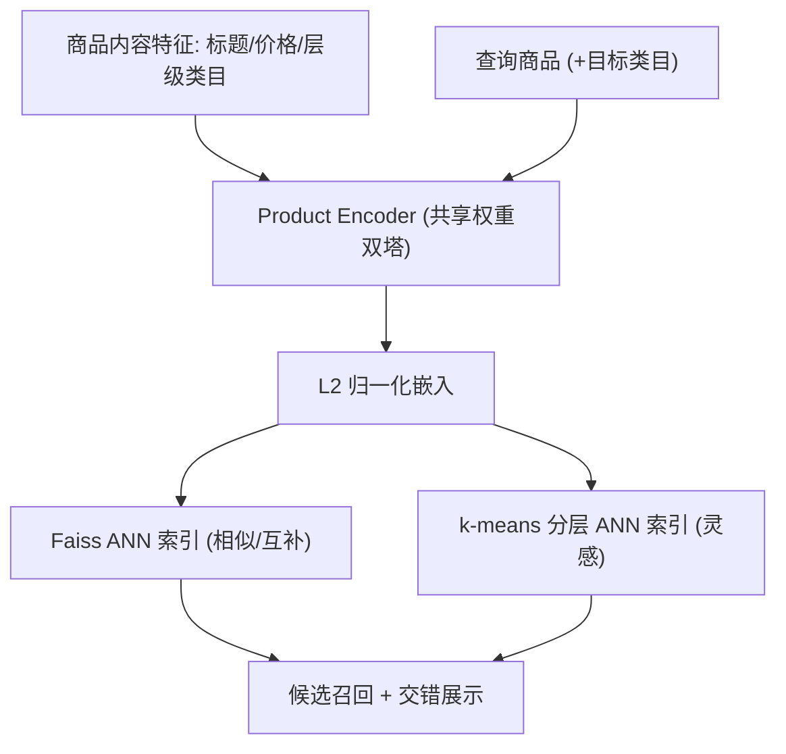
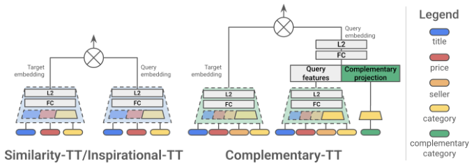

# Suggest, Complement, Inspire: Story of Two Tower Recommendations at Allegro.com (建议、互补、灵感：Allegro.com 双塔推荐的故事)

- **会议/期刊**: RecSys 2025 (Industrial Track)
- **作者与机构**: Aleksandra Osowska-Kurczab, Klaudia Nazarko, Mateusz Marzec, Lidia Wojciechowska, Eliška Kremeňová（Allegro.com）
- **推荐链路定位**: 召回（候选生成）
- **研究方向**: 协同过滤与双塔召回 / 冷启动与长尾推荐
- **论文原文**: [https://arxiv.org/abs/2508.03702v1](https://arxiv.org/abs/2508.03702v1)
- **开源代码**: 暂未开源

## TL;DR (1分钟核心速览)

面向欧洲最大电商 Allegro 的数十个推荐位，本文提出一套**纯内容特征的双塔召回底座**：商品仅用标题、价格、层级类目等结构化/文本属性编码，查询塔与目标塔权重共享（Product Encoder），配合 sampled softmax 与混合负采样训练、Faiss ANN 在线检索。作者把"相似、互补、灵感"三类看似不同的任务统一重定义为相似检索的变体——互补任务只在查询塔拼接目标类目嵌入并加类目重构损失，灵感任务则完全不动模型、只改分层 ANN 索引与用户近期浏览聚合。两年线上 A/B 显示 CTR 提升 1.06%–2.37%、灵感位 CTA 提升 3.12%–4.15%、跳出率下降 4.09%–5.74%，且单卡 T4 即可训练、p99 延迟 40ms。

## Background & Motivation (背景与核心矛盾)

- **主流范式**: 工业界候选生成以双塔（TT）+ ANN 为主流，用户/物品经 DLRM 编码后内积检索；Allegro 已有协同过滤（共视/共购）模型作为主力召回。
- **前人局限**: 其一，数十个推荐位若各建专用模型，维护成本与复杂度爆炸；其二，若改用大基础模型，则需重型推理基础设施，中小团队难以承受。同时平台商品目录高度动态（亿级 SKU、海量冷启新品），为每个商品 ID 学独立嵌入极易过拟合且无法覆盖新品。
- **核心洞察 (Key Insight)**: 商品的内容属性（标题、价格、类目）本身已足以刻画"相似性"，而"互补"与"灵感"在检索层面并非新任务——前者是"带目标类目条件的相似检索"，后者是"带多样性约束的相似检索"。
- **本文切入点**: 用一套共享 Product Encoder 的内容双塔作为统一底座，通过**最小化改动**（改查询塔输入 / 改索引结构）覆盖三类意图，把架构复用率推到极致。

## Method (核心方法设计)

### 1. 整体框架 (Overall Architecture)

离线侧：以共视/共购商品对为训练样本（设最小共现阈值过滤），商品各特征经独立嵌入表映射后拼接、过 MLP、L2 归一化，查询塔与目标塔**权重绑定**构成 Product Encoder；用 sampled softmax + 混合负采样训练，单张 NVIDIA T4 16GB 即可完成。随后用 Faiss 建 ANN 索引并每日刷新。在线侧：请求商品经 Product Encoder 编码，从索引中毫秒级取回候选。三类任务共享该闭环，差异仅在查询塔输入（互补任务追加目标类目嵌入）与索引组织方式（灵感任务用 k-means 分层索引）。

<figure class="paper-figure" markdown="span">
  <figcaption>图2：两种提出的 TT 架构对比。</figcaption>
</figure>

### 2. 关键设计拆解 (Key Designs)

1. **内容化共享双塔 (Product Encoder)**：痛点是为亿级动态 SKU 学 ID 嵌入既过拟合又无法冷启 $\to$改为纯内容特征编码并对查询/目标塔做 weight tying，等价于强制两侧共享同一映射$f(\cdot)$，使相似度退化为$\langle f(q), f(t)\rangle$的自洽度量$\to$ 直觉上既消除 ID 表开销、又让新品凭属性直接获得表征，天然缓解冷启动。

2. **互补任务：查询塔条件化 + 类目重构损失**：痛点是共购对里混杂"同类替代"与"互补搭配" $\to$从共购统计、外部标注与领域知识构建一对多互补类目映射，查询塔输入变为$[\boldsymbol{e}_q \,\|\, \boldsymbol{e}_{c_t}]$（$c_t$ 为目标类目），并在损失中加入目标类目重构项：
$$\mathcal{L}=\mathcal{L}_{\text{softmax}}+\lambda\,\big\|\hat{\boldsymbol{e}}_{c_t}-\boldsymbol{e}_{c_t}\big\|_2^2$$
$\to$ 直觉上重构项迫使查询表征真正"携带"目标类目语义，避免模型退化为普通相似检索；同时引入 seller 特征捕捉"同店凑单"行为。线上对多目标类目分组召回后交错排列。

3. **灵感任务：分层 ANN 索引实现可控多样化**：痛点是纯相似检索结果同质化、缺乏探索性 $\to$对全库嵌入做 k-means 得$k$个簇，簇心入顶层索引、簇内商品入二级索引；用户以近 7 天最近 100 次浏览按类目聚合、每类取最近一件作代表查询，先取每类最近的$n$个簇（$n$越大越多样），可跳过最近$l$个簇以避免与查询过近，再从二级索引取相似商品并交错$\to$ 直觉上"簇级采样"把多样性变成可调旋钮，且**模型零改动**，仅服务逻辑调整。

**训练目标、负采样与推理效率**：总损失为 sampled softmax（大规模分类形式）加上述重构项；负采样采用混合策略（in-batch 与难负例结合）。在线吞吐 20k QPS、p99 CPU 延迟 40ms，索引日更、模型定期重训。

## Experimental Setup & Evaluation Protocol (实验设置与评估协议)

- **数据集与预处理**: 本文为工业系统论文，未公开离线数据集统计；训练样本为共视/共购商品对，按最小共现阈值过滤；互补任务进一步用互补关系启发式筛除"同类替代"对。

| 场景 | 样本构造 | 过滤方式 | 特征/场景说明 |
| :--- | :--- | :--- | :--- |
| Similarity-TT | 共视商品对 | 最小共现阈值 | 标题/价格/层级类目 |
| Complementary-TT | 共购商品对 | 互补关系启发式 | 追加 seller 特征与目标类目 |
| Inspirational-TT | 复用 Similarity-TT 编码器 | 无需重训 | 分层 ANN + 用户近期浏览 |

- **数据划分与防穿越 (Splitting Strategy)**: 论文未披露离线划分细节，评估以**两年连续线上 A/B 测试**为主，按 desktop 与 mobile app 分流，统计显著性水平 $0.01$。
- **排名评测协议 (Ranking Protocol)**: 不采用离线 Full-Ranking / Sampled Ranking 指标，而以线上业务指标为准：CTR、GMV per visit、CTA、CVR、bounce rate、exit rate。
- **对比基线与超参设置**: 基线为平台现有协同过滤召回（相似位对应共视 CF、互补位对应共购 CF）；嵌入维度、MLP 层数等超参未在正文给出；显著性以 $p<0.01$ 标注。

## Key Experimental Results (实验关键数据)

### 1. 主实验对比 (Main Results)

商品详情页（相对 CF 基线的变化率，∗ 表示 $p<0.01$ 显著）：

| 模型 / 位置 | 渠道 | CTR ↑ | GMV/visit ↑ |
| :--- | :--- | :---: | :---: |
| Similarity-TT（"Others also viewed"） | mobile app | **+2.11%**∗ | +0.13% |
| Similarity-TT（"Others also viewed"） | desktop | **+2.37%**∗ | **+0.29%** |
| Complementary-TT（"Order in one parcel"） | mobile app | +1.62%∗ | +0.09% |
| Complementary-TT（"Order in one parcel"） | desktop | +1.06%∗ | +0.31% |

灵感推荐位（desktop，"How about..."，相对基线变化率）：

| 展示形态 | CTA ↑ | CVR ↑ | bounce rate ↓ | exit rate ↓ |
| :--- | :---: | :---: | :---: | :---: |
| carousel | +3.12%∗ | +1.38%∗ | -4.09%∗ | -1.82%∗ |
| infinite feed | **+4.15%**∗ | **+2.22%**∗ | **-5.74%**∗ | **-1.66%**∗ |

### 2. 消融实验 (Ablation Study)

本文为工业部署论文，未提供传统离线消融表；其"消融"以**任务级架构复用**的形式呈现——同一 Product Encoder 在三任务上的改动幅度对比：

| 配置 | 模型改动 | 服务改动 | 是否重训 | 线上效果 |
| :--- | :--- | :--- | :---: | :--- |
| Similarity-TT | 底座 | 标准 ANN | 是 | CTR +2.11%~+2.37% |
| Complementary-TT | 查询塔 + 类目重构损失 | 多类目交错 | 是 | CTR +1.06%~+1.62% |
| Inspirational-TT | 无 | 分层 ANN + 浏览聚合 | 否 | CTA +3.12%~+4.15% |

### 3. 关键实验发现 (Key Findings)

1. **内容双塔可超越协同过滤基线**：Similarity-TT 在 desktop 上 CTR +2.37%、mobile +2.11% 且均显著，说明纯内容表征已能捕捉 CF 难以覆盖的隐式商品关联，同时天然覆盖冷启新品。
2. **互补任务的收益来自"条件化"而非更强编码器**：仅改查询塔输入并加类目重构项，即在 desktop 取得 GMV +0.31%（高于相似任务的 +0.29%），表明类目条件显著提升了"凑单"场景的成交转化，而 CTR 增幅（+1.06%）低于相似任务，反映互补意图本身点击率天花板较低。
3. **零模型改动的索引侧多样化性价比最高**：Inspirational-TT 完全不重训模型，仅靠分层 ANN 与跳过最近簇，即把 CTA 提升至 +4.15%、跳出率压低 5.74%，且 infinite feed 全面优于 carousel，说明"展示形态 + 索引多样性"是低成本高回报的杠杆。

## Highlights & Limitations (亮点、对比与审稿批判)

- **与代表作对比 (vs. Prior Work)**: 相较 Covington et al. 的 YouTube 双塔（依赖用户 ID/行为序列、面向个性化排序），本文彻底放弃 ID 嵌入、走纯内容路线，因而在冷启与维护成本上占优；相较 TIGER 等生成式语义 ID 召回，本文不引入 RQ-VAE 码本与自回归解码，工程复杂度低一个量级；相较各推荐位独立建模的常规工业实践，本文以"改查询塔 / 改索引"两类最小改动实现三任务复用，维护开销显著下降。
- **可迁移亮点**: ① 用"目标类目条件化 + 类目重构辅助损失"把搭配推荐转成条件检索，可直接迁移至跨类目捆绑销售、内容-商品联动；② 用 k-means 簇心做顶层索引、以"取前 $n$簇、跳过前$l$ 簇"作为多样性旋钮，是无需重训即可调控探索度的通用技巧。
- **审稿级局限批判**: ① 全文缺乏离线定量评估与消融，A/B 仅给相对变化率、未披露流量规模与置信区间，且互补任务仅在 Sports/Travel/Fashion 三个类目测试，外推性存疑；② 系统强依赖内容特征质量与编码器-索引一致性，作者亦承认未来需引入用户上下文，当前灵感任务实际只用单件查询商品（未用 100 次浏览上下文），个性化程度有限。

## Rating (四维评分)

- **方法创新性 (Novelty)**: ⭐⭐⭐ （单点算子创新有限，但"三任务统一为相似检索变体"的问题重定义颇具工程洞察力）
- **评估协议与实验扎实度 (Protocol & Experiments)**: ⭐⭐⭐ （两年线上 A/B 与 $p<0.01$ 显著性可信，但缺离线基准、消融与数据集统计）
- **写作与数学规范度 (Clarity & Rigor)**: ⭐⭐⭐⭐ （四页短文结构清晰、公式精简，唯超参与损失细节披露不足）
- **工业落地与复现价值 (Industrial & Practical Value)**: ⭐⭐⭐⭐⭐ （单卡 T4 可训、20k QPS/40ms p99、索引日更，落地价值极高，惜未开源）

