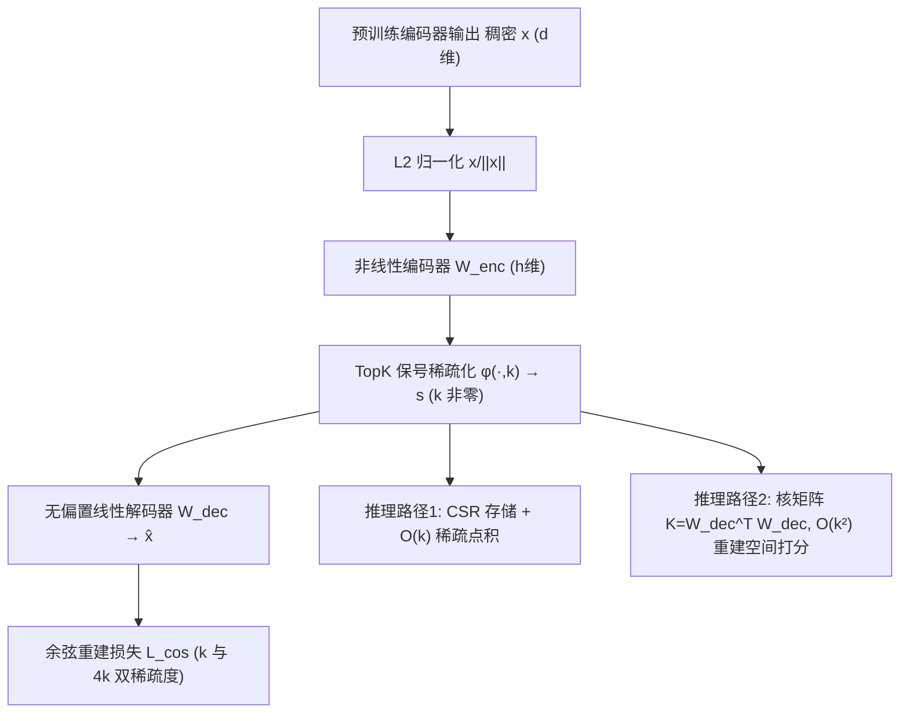

# The Future is Sparse: Embedding Compression for Scalable Retrieval in Recommender Systems (未来属于稀疏：面向可扩展召回的嵌入压缩)

- **会议/期刊**: RecSys 2025 (Under Review 版, arXiv v1)
- **作者与机构**: Petr Kasalický, Martin Spišák, Vojtěch Vančura, Daniel Bohuněk, Rodrigo Alves, Pavel Kordík（Recombee / 布拉格捷克技术大学 / 查理大学）
- **推荐链路定位**: 召回（候选检索阶段的嵌入存储与相似度计算）
- **研究方向**: 协同过滤与双塔召回 / 生成式与离散语义 ID（向量量化压缩侧）
- **论文原文**: [https://arxiv.org/abs/2505.11388v1](https://arxiv.org/abs/2505.11388v1)
- **开源代码**: [https://github.com/recombee/CompresSAE](https://github.com/recombee/CompresSAE)

## TL;DR (1分钟核心速览)

工业级推荐系统用稠密内容嵌入解决冷启动与长尾，但 $10^8$量级目录的嵌入表动辄数百 GB，存储、缓存与检索延迟全面吃紧。本文提出 CompresSAE：在**预训练编码器输出上**训练一个稀疏自编码器，把$d$维稠密向量投影为$h$维、仅$k$个非零项的稀疏向量，并以**余弦距离**（而非$\ell_2$）为重建目标以保住检索方向信息。骨干模型无需重训，768 维压成 4096 维$k{=}32$ 稀疏向量即得 12× 压缩；线上 A/B（约 850 万用户/组）中相对未压缩 Nomic 仅损失 1.35% CTR，却比同尺寸 Matryoshka 显著提升 +1.52%。

## Background & Motivation (背景与核心矛盾)

- **主流范式**: 工业召回普遍采用多阶段架构，候选召回依赖预训练内容编码器（SBERT、Nomic 等）产出的稠密向量，配合向量库（pgvector/HNSW）做余弦近邻检索；压缩侧主流是 Matryoshka 渐进截断、int4 量化、SVD/PCA 降维与多级内存卸载。
- **前人局限**: ① Matryoshka 必须**重训骨干编码器**才能获得嵌套可截断表征，且截断到 64 维时方向信息损失明显；② 量化依赖硬件特定支持与量化感知重训，SVD/PCA 则有稳定精度损失；③ 卸载/缓存方案需复杂平台工程，难以跨系统迁移。
- **核心洞察 (Key Insight)**: 检索只关心**方向（余弦相似度）**而非绝对幅值。若把向量投到"高维但稀疏激活"的空间，则表达能力由维度 $h$保证、存储与点积开销由非零数$k$ 决定，二者可解耦——这是稠密低维截断做不到的。
- **本文切入点**: 把稀疏自编码器（SAE）从"可解释性工具"改造为"检索专用压缩器"：输入归一化 + TopK 保号激活 + 无偏置线性解码器 + 余弦重建损失，得到一个即插即用的后处理模块。

## Method (核心方法设计)

### 1. 整体框架 (Overall Architecture)

CompresSAE 完全离线作用于**预计算好的嵌入批次** $\mathbf{E}\in\mathbb{R}^{N\times d}$，不接触原始模态数据、不回传梯度到编码器。训练时：稠密向量先做$\ell_2$归一化，经非线性编码器得到$h$维激活，再由$\phi(\cdot,k)$保留绝对值最大的$k$项（其余置零）形成稀疏码$\mathbf{s}$，最后经**无偏置、行归一化**的线性解码器重建$\hat{\mathbf{x}}$，以余弦损失（对$k$与$4k$两个稀疏度同时监督）优化。推理时有两条路径：直接把$\mathbf{s}$以 CSR 格式入库做$O(k)$稀疏点积；或用核技巧在重建空间做$O(k^2)$ 的高保真打分。

### 2. 关键设计拆解 (Key Designs)

1. **保号 TopK 稀疏激活 $\phi(\cdot,k)$替代 ReLU+TopK**：ReLU 会丢弃全部负值，使稀疏码只能表达"正方向锥"内的信息，容量被浪费。本文直接用$\mathbf{s}=\phi(\mathbf{W}_{enc}\mathbf{x}+\mathbf{b}_{enc},k)$，仅按**绝对值**取前$k$并保留符号，同时充当非线性激活与稀疏化算子。直觉上，余弦相似度对符号敏感（相反方向应判为不相似），保号使有限容量$k$ 能编码更完整的角度信息，也缓解了 dead neuron 问题。

2. **余弦重建目标替代 $\ell_2$重建**：传统 SAE 最小化$\|\mathbf{x}-\hat{\mathbf{x}}\|^2$，会把容量浪费在拟合幅值上，而检索只用方向。本文改为
$$\mathcal{L}_{cosine}(\mathbf{x},\hat{\mathbf{x}})=1-\frac{\mathbf{x}^\top\hat{\mathbf{x}}}{\|\mathbf{x}\|_2\|\hat{\mathbf{x}}\|_2}$$
并配合输入归一化（不再做标准化/反标准化），使稀疏空间与原始嵌入空间在**角度**上对齐——这正是后文核技巧成立的前提。

3. **线性解码器解锁的"核技巧"检索**：因 $f_{dec}$无偏置且线性，$\hat{\mathbf{x}}=\mathbf{W}_{dec}\mathbf{s}$，于是
$$\frac{\mathbf{x}^\top\mathbf{y}}{\|\mathbf{x}\|\|\mathbf{y}\|}\approx\frac{\mathbf{s}_x^\top\mathbf{K}\mathbf{s}_y}{\sqrt{\mathbf{s}_x^\top\mathbf{K}\mathbf{s}_x}\sqrt{\mathbf{s}_y^\top\mathbf{K}\mathbf{s}_y}},\quad \mathbf{K}=\mathbf{W}_{dec}^\top\mathbf{W}_{dec}\in\mathbb{R}^{h\times h}$$
只需两个 $k$-稀疏向量与预计算核矩阵即可高精度估相似度，复杂度$O(k^2)$，在$k$较小时仍远低于稠密$O(d)$ 的常数开销。

4. **训练目标、负采样与推理效率**：总损失为两个稀疏度下余弦损失之和 $\mathcal{L}=\mathcal{L}_{cosine}(\mathbf{x},f(\mathbf{x};\theta,k))+\mathcal{L}_{cosine}(\mathbf{x},f(\mathbf{x};\theta,4k))$，多稀疏度联合监督用于防止死神经元。**无负采样**（纯重建式自监督）。训练极轻：Adam、batch size 100,000，单张 H100 上约 500 步 / ~100 秒收敛。存储上，$k$非零的 float32 稀疏向量占$2\cdot k\cdot 4$字节（值+索引），768→4096($k{=}32$) 即 12× 压缩。

## Experimental Setup & Evaluation Protocol (实验设置与评估协议)

- **数据集**: 某全球媒体领域客户的**私有生产数据集**，目录规模 $O(10^8)$ 物品，长尾显著（大量物品零交互），故必须依赖内容嵌入做目录探索。论文未公开用户/交互统计量，这是复现性的主要缺口。

| 数据集 | #Users | #Items | #Interactions | 稀疏度/密度 | 特征/场景说明 |
| :--- | :---: | :---: | :---: | :---: | :--- |
| 工业私有（媒体域） | 未披露（A/B 每组 ~8.5M） | $O(10^8)$ | 未披露 | 极稀疏（长尾为主） | 多模态内容嵌入（文本/图/视频/商品/音乐） |

- **数据划分与防穿越**: 离线部分以验证集余弦/Recall@100 监控收敛；线上采用**随机分流 A/B 测试**（每组约 850 万用户），以真实曝光-点击日志评估，天然无穿越问题。
- **排名评测协议**: 离线为 **Recall@100**（在压缩/重建空间内做近邻检索）；线上为**下游 CTR**，报告相对 SBERT 基线的提升及 **anytime-valid 99% 置信区间**（允许持续监控而不膨胀第一类错误）。
- **对比基线与超参**: SBERT 512 维（生产基线）、Nomic 768 维（未压缩上界）、Nomic+Matryoshka 64 维、CompresSAE（Nomic 的 4096 维 $k{=}32$稀疏压缩）。离线另扫$k\in\{8,16,32,64,128,256\}$与$d\in\{64,128,256,512\}$ 的压缩-精度曲线。

## Key Experimental Results (实验关键数据)

### 1. 主实验对比 (Main Results)

线上 A/B（基线 = 512 维 SBERT，指标 = 下游 CTR 相对提升，99% anytime-valid CI）：

| 嵌入方案 | 维度 (压缩) | 每亿物品存储 | CTR Lift |
| :--- | :---: | :---: | :---: |
| SBERT | 512 (baseline) | 204.8 GB | — |
| Nomic（未压缩上界） | 768 | 307.2 GB | **+4.86%** |
| Nomic + Matryoshka | 64 | 25.6 GB | +1.89% |
| **CompresSAE (Ours)** | 4096* ($k{=}32$) | 25.6 GB | **+3.44%** |

\* 稀疏向量，仅 32 个非零项。相对未压缩 Nomic 仅损失 1.35% CTR；相对同存储预算的 Matryoshka **+1.52%**（统计显著）。

离线压缩-精度（Recall@100，图 3 中）：CompresSAE 可匹配**至多 4 倍大**的 Matryoshka 模型；在 15 秒训练后即超过同尺寸 Matryoshka 的检索精度；重建空间检索给出整体最优的精度-压缩折衷。

### 2. 消融实验 (Ablation Study)

原文未提供标准组件消融表，以下依据正文与图 3 归纳关键设计的作用方向：

| 配置 | 关键变化 | 效果（定性/定量） |
| :--- | :--- | :--- |
| 稀疏空间直接检索（$O(k)$） | 仅用$\mathbf{s}$ 做点积 | 最快，线上 +3.44% CTR |
| 重建空间核技巧检索（$O(k^2)$） | 引入$\mathbf{K}=\mathbf{W}_{dec}^\top\mathbf{W}_{dec}$ | 离线精度最优，成本略增 |
| Matryoshka 同尺寸 (64) | 稠密截断 | +1.89%，显著低于本文 |
| 余弦损失 vs. $\ell_2$ 重建 | 方向对齐 | 核技巧成立的必要条件（作者论证） |
| 保号 TopK vs. ReLU+TopK | 保留负值 | 提升有限容量下的方向保真度 |

### 3. 关键实验发现 (Key Findings)

1. **压缩比越高，稀疏方案优势越大**：在 12× 压缩下 CompresSAE 仍保留未压缩 Nomic 的绝大部分收益（+3.44% vs +4.86%），而同预算 Matryoshka 仅 +1.89%，说明"高维稀疏"比"低维稠密"在极端压缩区间更具容量效率。
2. **免重训骨干是工程上的决定性优势**：整个 SAE 在单卡 H100 上约 100 秒收敛，可对已上线的任意编码器做后处理升级；Matryoshka 路线则需重训骨干，迭代成本高一个数量级。
3. **两条推理路径可按场景切换**：稀疏空间检索以 $O(k)$复杂度支撑高吞吐召回，重建空间核技巧以$O(k^2)$ 换取更高保真度，为延迟-精度权衡提供了显式旋钮，且二者共享同一份 CSR 存储。

## Highlights & Limitations (亮点、对比与审稿批判)

- **与代表作对比 (vs. Prior Work)**: 与 Matryoshka 的本质区别是**压缩维度方向相反**——Matryoshka 降维保稠密、需重训骨干；本文升维但稀疏化、纯后处理。与量化/SVD 相比，本文不依赖硬件特定 kernel，也不做线性子空间硬截断，而是学习一个保方向的非线性稀疏字典。与既有 SAE（Anthropic 式可解释性 SAE、带对比损失的 [21]）相比，本文去掉标准化/反标准化、改用余弦损失与保号 TopK，专门服务检索。
- **可迁移亮点**: ① "余弦重建 + 线性无偏置解码器 ⇒ 核技巧打分"这一组合可直接移植到任何以余弦为度量的双塔召回/向量库；② 多稀疏度联合监督（$k$与$4k$）抑制死神经元的做法，可迁移到其他 TopK 稀疏结构（如稀疏 MoE、稀疏特征哈希）。
- **审稿级局限批判**: ① **评估仅基于单一私有工业数据集与单一客户场景**，缺少公开基准（如 Amazon/ML-1M 内容嵌入）与多域复现，泛化性证据薄弱；② 存储分析只计 float32 值与索引，未与 int4 量化等强基线做**同字节预算**的端到端对比，也未报告 $O(k^2)$ 核技巧路径在高并发下的实际 P99 延迟与向量库（HNSW 对稀疏向量的支持度）适配成本。

## Rating (四维评分)

- **方法创新性 (Novelty)**: ⭐⭐⭐⭐ （把 SAE 从可解释性工具重构为检索压缩器，"高维稀疏 + 余弦重建 + 核技巧"组合简洁且有清晰几何直觉，但单点技术多为已有组件的巧妙重组）
- **评估协议与实验扎实度 (Protocol & Experiments)**: ⭐⭐⭐ （线上 850 万用户/组的 A/B 与 anytime-valid CI 很有说服力，但仅一个私有数据集、无公开基准、无标准消融表，复现与外部效度受限）
- **写作与数学规范度 (Clarity & Rigor)**: ⭐⭐⭐⭐ （公式精简、核技巧推导干净、训练/推理两模式图示清晰；但数据集统计与超参细节披露不足）
- **工业落地与复现价值 (Industrial & Practical Value)**: ⭐⭐⭐⭐⭐ （免重训骨干、100 秒训练、CSR 兼容 pgvector/SciPy/PyTorch、代码已开源，是可直接插入现有召回链路的低成本升级方案）

