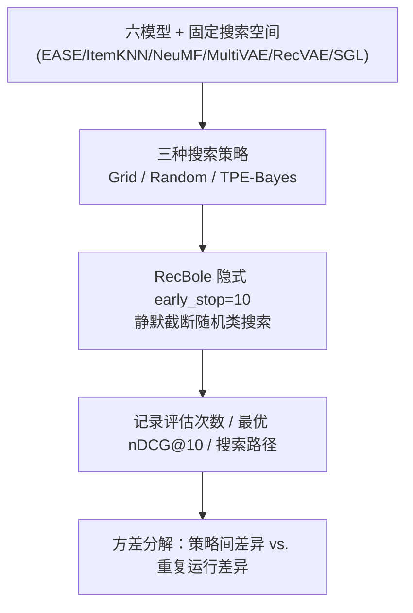

# The Hidden Cost of Defaults in Recommender System Evaluation (推荐系统评测中默认值的隐性代价)

- **会议/期刊**: RecSys 2025 (Prague, Czech Republic)
- **作者与机构**: Hannah Berling, Robin Svahn, Alan Said（University of Gothenburg）
- **推荐链路定位**: 离线评测与超参数调优流程（贯穿召回/精排模型的实验方法论层）
- **研究方向**: 协同过滤与双塔召回 / 去偏公平、可信隐私与工业架构
- **论文原文**: [https://arxiv.org/abs/2508.21180v2](https://arxiv.org/abs/2508.21180v2)
- **开源代码**: [https://github.com/alansaid/recsysdefaults](https://github.com/alansaid/recsysdefaults)

## TL;DR (1分钟核心速览)

本文不做模型创新，而是把 RecBole 框架本身当作审计对象：其内部未文档化的 `early_stop = 10` 策略会在随机搜索与 TPE 贝叶斯优化中静默截断搜索，使 NeuMF（60 组）、RecVAE（45 组）、SGL（100 组）等大搜索空间模型在 10–12 次迭代后即终止，大量候选配置从未被评估。在 MovieLens-1M 上，六模型调优后 nDCG@10 相对默认配置提升约 1.5%–21%，但同一策略两次重复运行的差异（如 NeuMF 贝叶斯两次相差 0.0067）已可与策略间差异相当，说明"框架默认值"是实验设计中不可忽视的活跃变量。

## Background & Motivation (背景与核心矛盾)

- **主流范式**: RecSys 社区普遍依赖 RecBole、Elliot、RecPack 等统一框架完成模型实现、数据管线与指标计算，以提升可复现性；超参数调优则常直接调用框架内置的 Grid / Random / TPE 搜索。
- **前人局限**: 其一，已有可复现性研究（如 Shehzad & Jannach）指出多数论文不完整报告调优策略与搜索空间，导致"调得好的基线"难以复现；其二，框架在内部覆写第三方库（HyperOpt）的默认行为，却不在 YAML 配置或日志中暴露，忠实复跑公开代码仍可能得到不同结果。
- **核心洞察 (Key Insight)**: 作者发现 RecBole 对随机搜索与贝叶斯优化统一施加了"连续 10 次验证指标无提升即停止"的隐式早停，该阈值既不可见于配置文件也不见于主文档；对搜索空间大于 10 的模型，这意味着搜索预算被静默截断，用户却误以为已穷尽搜索。
- **本文切入点**: 将"框架"提升为一等研究对象，用受控实验量化默认值对搜索覆盖度、性能方差与搜索路径稳定性的影响，而非比较哪种搜索策略更优。

## Method (核心方法设计)

### 1. 整体框架 (Overall Architecture)

本文是一篇方法论审计论文，其"方法"即受控实验设计：固定 RecBole 1.2.0 版本与同一套搜索空间，对六个模型分别施加 Grid Search（穷举）、Random Search 与 TPE 贝叶斯优化（后两者继承 `early_stop = 10` 默认），记录每次运行的评估次数、验证集最优 nDCG@10 及对应配置；随机类策略每模型重复两次以度量方差，并绘制搜索路径散点图观察探索行为。核心对照是"默认配置 vs. 调优配置"与"策略间差异 vs. 同策略重复运行差异"两组比较。

### 2. 关键设计拆解 (Key Designs)

1. **隐式早停的暴露与量化**：痛点在于早停逻辑藏在源码而非配置层，用户无法感知搜索被截断。作者以"实际评估次数"为观测量，定义截断判据为搜索在未覆盖全部组合前终止，即 $N_{\text{eval}} < |\mathcal{S}|$且终止原因为连续 10 次无提升。物理直觉是：当$|\mathcal{S}| \gg 10$ 时，早停等价于把搜索预算压缩到常数级，搜索策略的算法差异被框架行为淹没。
2. **搜索路径不稳定性度量**：不只比较最终分数，而是比较同一策略两次独立运行的路径与最优解差异，用 $\Delta_{\text{rep}} = |\text{nDCG}^{(1)}_{\text{best}} - \text{nDCG}^{(2)}_{\text{best}}|$与策略间差异$\Delta_{\text{strat}}$对照。若$\Delta_{\text{rep}} \approx \Delta_{\text{strat}}$，则"某策略更好"的结论缺乏统计基础。
3. **训练目标、负采样与推理效率**：本文不涉及新损失函数；所有模型沿用 RecBole 默认训练目标（如 BPR/交叉熵）与默认负采样，评测指标统一为验证集 nDCG@10。计算开销方面，Grid Search 全量耗时随复杂度急剧上升：EASE 1 分钟、ItemKNN 12 分钟、MultiVAE 19 分钟、NeuMF 199 分钟、RecVAE 260 分钟、SGL 985 分钟——这正是随机类策略被早停"加速"的动机，也是其风险来源。

## Experimental Setup & Evaluation Protocol (实验设置与评估协议)

- **数据集与预处理**: 采用 MovieLens-1M 与 BeerAdvocate；过滤规则为评分低于 3 剔除、交互数少于 10 的用户/物品剔除（即 10-core 式过滤），BeerAdvocate 使用 overall 列作为评分。

| 数据集 | #Users | #Items | #Interactions | 稀疏度/密度 | 特征/场景说明 |
| :--- | :---: | :---: | :---: | :---: | :--- |
| MovieLens-1M | 约 6.0k（10-core 后） | 约 3.5k（10-core 后） | 约 57.5 万（评分≥3） | 密度约 2.7% | 电影评分，主报告数据集 |
| BeerAdvocate | 原文未单列 | 原文未单列 | 原文未单列 | — | 啤酒评论文本评分，结论与 ML-1M 一致 |

- **数据划分与防穿越 (Splitting Strategy)**: 沿用 RecBole 默认划分（按用户留一/比例切分，验证集用于早停与选优），论文未自定义划分，属框架默认协议。
- **排名评测协议 (Ranking Protocol)**: 以验证集 nDCG@10 为唯一选优与报告指标；未采用全库 Full-Ranking 的显式声明，属框架默认的采样式评测流程，这也是本文未展开的协议细节之一。
- **对比基线与超参设置**: 基线为 RecBole 各模型默认配置；搜索空间取自文档默认范围（EASE 6 组、ItemKNN 24 组、NeuMF 60 组、MultiVAE 5 组、RecVAE 45 组、SGL 100 组）。因每策略仅两次重复，未做正式显著性检验，作者明确承认此局限。

## Key Experimental Results (实验关键数据)

### 1. 主实验对比 (Main Results)

MovieLens-1M 上各策略最优 nDCG@10（随机/贝叶斯各两次独立运行）：

| 模型 | Default | Grid | Rand-1 | Rand-2 | Bayes-1 | Bayes-2 | 相对默认提升 |
| :--- | :---: | :---: | :---: | :---: | :---: | :---: | :---: |
| EASE | 0.2789 | **0.2865** | **0.2865** | **0.2865** | **0.2865** | **0.2865** | +2.7% |
| ItemKNN | 0.2345 | **0.2391** | 0.2390 | 0.2382 | **0.2391** | **0.2391** | +2.0% |
| NeuMF | 0.1870 | **0.2266** | 0.2236 | 0.2229 | **0.2266** | 0.2199 | +21.2% |
| MultiVAE | 0.2404 | **0.2520** | **0.2520** | **0.2520** | **0.2520** | **0.2520** | +4.8% |
| RecVAE | 0.2625 | **0.2633** | 0.2625 | 0.2614 | 0.2614 | 0.2598 | +0.3% |
| SGL | 0.2489 | **0.2555** | **0.2555** | **0.2555** | **0.2555** | 0.2554 | +2.7% |

### 2. 消融实验 (Ablation Study)

本文无传统模块消融，其"消融"等价于对框架默认行为的干预对照：

| 配置变体 | 搜索覆盖度 | 观测结果 |
| :--- | :---: | :--- |
| Grid（无早停，穷举） | 100% | 多数模型取得最优，但 SGL 耗时 985 分钟 |
| Random + `early_stop=10` | 10–12 次即止 | 小空间模型（EASE/MultiVAE）等效穷举，大空间模型严重欠探索 |
| Bayes + `early_stop=10` | 10–12 次即止 | 采样集中于高分区，但同样被截断 |
| 同策略重复两次 | 路径不同 | NeuMF 贝叶斯两次差 0.0067，与贝叶斯 vs. Grid 差异同量级 |

### 3. 关键实验发现 (Key Findings)

1. **早停截断是主导变量而非策略本身**：NeuMF（60 组）、RecVAE（45 组）、SGL（100 组）的随机类搜索均在 10–12 次迭代终止，搜索空间覆盖率不足 20%，而 EASE（6 组）与 MultiVAE（5 组）因空间小于阈值而"意外地"等效穷举——策略优劣的结论完全被搜索空间大小与默认阈值共同决定。
2. **重复运行方差可与策略间差异比肩**：NeuMF 两次贝叶斯运行最优 nDCG@10 相差 0.0067，恰等于贝叶斯与 Grid 之间的差距；RecVAE 上贝叶斯两次分别为 0.2614 与 0.2598，甚至低于默认配置 0.2625，说明单次运行的"策略排名"不可信。
3. **调优收益真实存在但被高估或误读**：所有策略均优于默认配置（NeuMF 提升达 21.2%，RecVAE 仅 0.3%），但 Grid 的"最优"往往只是多探索了几组配置的结果，而非算法优势；作者据此呼吁报告搜索预算、早停规则与框架版本。

## Highlights & Limitations (亮点、对比与审稿批判)

- **与代表作对比 (vs. Prior Work)**: 相较 Shehzad & Jannach 聚焦"论文是否报告调优细节"，本文进一步下沉到"框架源码是否静默改写调优行为"；相较 RecBole 原论文强调标准化管线带来的可复现性，本文给出反例证据；相较通用 HPO 文献（Random vs. TPE 的理论比较），本文指出这些比较在第三方框架默认值下可能失效。
- **可迁移亮点**: ① 任何使用 RecBole/HyperOpt 的实验都应显式设置 `early_stop=None` 或提高阈值，并记录实际评估次数；② 将"同策略多次重复的方差"作为基线噪声，用于判断模型间差异是否显著，这一做法可直接迁移到召回/精排的离线对比中。
- **审稿级局限批判**: ① 每策略仅两次重复、仅两个数据集、未做显著性检验，统计效力不足，结论应视为指示性而非定论；② 仅审计 RecBole 1.2.0，未验证 Elliot/RecPack 是否存在同类隐式默认，也未评估自定义搜索空间与混合策略；③ 评测协议细节（划分方式、是否全库排序）未充分披露，削弱了跨论文可比性。

## Rating (四维评分)

- **方法创新性 (Novelty)**: ⭐⭐⭐ （不以模型创新为目标，"框架即实验变量"的审计视角有价值，但方法本身是受控对照实验，理论深度有限）
- **评估协议与实验扎实度 (Protocol & Experiments)**: ⭐⭐⭐ （六模型两数据集覆盖合理，但仅两次重复、无显著性检验、协议细节披露不足）
- **写作与数学规范度 (Clarity & Rigor)**: ⭐⭐⭐⭐ （问题陈述清晰、图表直观、建议可操作，公式极少但表述准确）
- **工业落地与复现价值 (Industrial & Practical Value)**: ⭐⭐⭐⭐⭐ （开源代码完整，结论直接改变调优工作流，对工业界离线实验平台与学术界复现均有即时价值）

