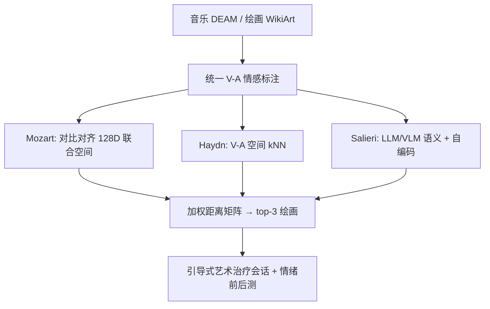
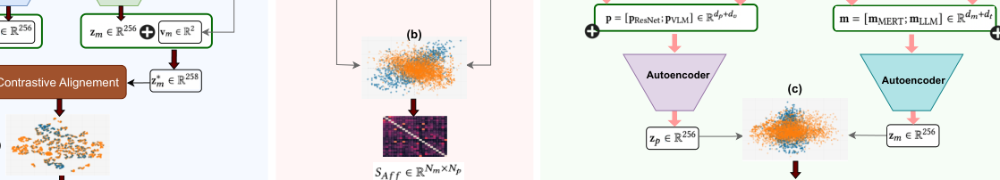

# Affect-aware Cross-Domain Recommendation for Art Therapy via Music Preference Elicitation (基于音乐偏好诱导的情感感知艺术治疗跨域推荐)

- **会议/期刊**: RecSys 2025 (第19届 ACM 推荐系统会议)
- **作者与机构**: Bereket A. Yilma, Luis A. Leiva（卢森堡大学）
- **推荐链路定位**: 召回（跨模态语义检索式 top-n 推荐）
- **研究方向**: 跨域与多场景推荐 / 多模态推荐
- **论文原文**: [https://arxiv.org/abs/2507.21120v1](https://arxiv.org/abs/2507.21120v1)
- **开源代码**: [https://github.com/ArtAICare/Affect-aware-CDR](https://github.com/ArtAICare/Affect-aware-CDR)

## TL;DR (1分钟核心速览)

数字艺术治疗（AT）现有视觉艺术推荐系统（VA RecSys）仅用视觉刺激做偏好诱导，无法覆盖完整情感谱。本文首次将跨域推荐（CDR）引入 AT，用音乐刺激诱导情感偏好并迁移到绘画推荐，提出三种引擎：Mozart（情感感知对比对齐）、Haydn（V-A 情感空间 kNN 检索）、Salieri（LLM/VLM 多模态语义对齐）。在 200 名精神科后遗症用户的在线研究中，音乐驱动方案在准确率、多样性等指标上与 SOTA 视觉基线持平，且全体组别情绪由 46.6% 负面转为 72.6% 正面。

## Background & Motivation (背景与核心矛盾)

- **主流范式**: 数字 AT 的 VA RecSys 用 ResNet-50 提取绘画视觉特征，以余弦相似度做治疗性绘画的语义检索与个性化推荐（Yilma et al.）。
- **前人局限**: 其一，仅依赖视觉单模态做偏好诱导，遗漏音乐等能激发独特情感反射的通道；其二，音乐与视觉艺术间的情感知识迁移在治疗语境下完全空白，缺乏可用的平行情感标注数据集。
- **核心洞察 (Key Insight)**: 音乐对效价（valence）的诱发强度甚至高于绘画（Campos-Bueno et al.），而两模态共享 V-A 二维情感坐标，天然构成跨域对齐的"公共锚点"。
- **本文切入点**: 以音乐为偏好诱导模态，通过情感感知的跨域映射把用户音乐偏好翻译为治疗性绘画推荐，并用大规模用户研究而非离线指标验证疗效。

## Method (核心方法设计)

### 1. 整体框架 (Overall Architecture)

系统先对两域做统一情感标注：DEAM 音乐保留逐曲 V-A 均值并过滤高方差样本（valence SD>1.75、arousal SD>1.0，得 909 首）；WikiArt 绘画的多情绪强度经 NRC-VAD 词典映射为 $[-1,1]$的 V-A 值（4105 幅）。随后三条并行路径各自构建跨模态相似度矩阵：Mozart 走"特征自编码 + V-A 拼接 + 连续对比对齐"得到 128D 联合空间；Haydn 直接在 2D V-A 空间做 kNN；Salieri 用 GPT-4o 生成语义描述、BERT 编码后与视觉/声学特征拼接再降维。线上阶段，用户对 11 首音乐打 1–5 分，归一化为权重$w_i$，对每幅画计算加权平均距离并取 top-3 进入引导式治疗会话。

<figure class="paper-figure" markdown="span">
  <figcaption>图1：所提出的系统架构。从左到右：情感感知对比对齐（Mozart）、情感空间搜索（Haydn），以及基于LLM和VLM的多模态对齐（Salieri）。注意每种方法产生不同的潜在嵌入空间（a、b、c）。</figcaption>
</figure>

### 2. 关键设计拆解 (Key Designs)

1. **Mozart：连续 V-A 的软标签对比对齐**：传统对比学习只有二值正负对，无法表达"情感接近程度"。作者先用高斯核把 V-A 欧氏距离转成软相似度 $S_{ij}=\exp(-d_{ij}^2/2\sigma^2)$，再代入距离型对比损失
$$\mathcal{L}=\sum_{i,j}S_{ij}\left(\|\mathbf{z}^*_i-\mathbf{z}^*_j\|_2\right)^2+(1-S_{ij})\max\left(0,m-\|\mathbf{z}^*_i-\mathbf{z}^*_j\|_2\right)^2$$
其中 $\mathbf{z}^*=[\mathbf{z},\mathbf{v}]\in\mathbb{R}^{258}$为 256D 自编码表征拼接 V-A 向量。直觉是：情感越近的跨模态样本被拉得越紧，且拉紧力度随相似度连续衰减，避免把"中等相似"误当负例推开。针对 909 vs 4105 的样本失衡，按$\lambda_m=N_p/(N_m+N_p)=0.818$、$\lambda_p=0.182$ 加权。

2. **Haydn：可解释的情感空间检索**：完全抛弃内容特征，仅用 2D V-A 向量做欧氏距离加权检索 $d_{\text{Haydn}}(p_j)=\sum_{i}w_i\|\mathbf{v}_{m_i}-\mathbf{v}_{p_j}\|_2$。优势是零训练、完全可解释，作为"纯情感信号"的下界对照，用于剥离内容特征带来的增益。

3. **Salieri：LLM/VLM 语义增强的双流对齐**：用 GPT-4o 依据元数据与 V-A 值生成音乐文本描述、依据图像与情绪标签生成绘画描述，分别经 BERT 编码后与 MERT 声学特征、ResNet-50 视觉特征拼接，再自编码至 256D 并以余弦相似度检索。其价值在于检验"大模型语义先验"能否替代显式情感监督。

**训练与推理开销**：Mozart 用 Adam（$\eta=10^{-3}$）、最多 50 epoch、早停 5 轮，网格搜索得$\sigma=0.5$、$m=0.5$；投影头为 [258,256,128] 两层 MLP。推理仅需一次 239×63 相似度矩阵查表，开销可忽略；Salieri 的离线 LLM/VLM 调用是主要成本。

## Experimental Setup & Evaluation Protocol (实验设置与评估协议)

- **数据集与预处理**: 两域无平行用户重叠，故不构成传统 CDR 的共享用户设定，而是"特征/情感层跨域迁移"。

| 数据集 | #Items | 原始量 | 过滤后 | 标注 | 说明 |
| :--- | :---: | :---: | :---: | :---: | :--- |
| DEAM (音乐) | 909 | 1,802 | 909 | 逐曲 V-A ∈[-1,1] | 过滤 valence SD>1.75、arousal SD>1.0 |
| WikiArt Emotions (绘画) | 4,105 | 4,105 | 4,105 | 多情绪强度 | 经 NRC-VAD 映射为 V-A |
| 治疗部署子集 | 239 音乐 × 63 绘画 | — | — | — | 保留 valence>0.1 且 arousal 非中性，注册艺术治疗师人工剔除有害作品 |

- **数据划分与防穿越**: 无离线训练/测试划分；采用**被试间（between-subjects）用户研究**，200 名受试者随机分四组（各 50 人、性别平衡），每人仅接触一个引擎，规避学习与顺序效应。
- **排名评测协议**: 非 Full-Ranking / Sampled Ranking 的离线协议，而是**在线 top-3 推荐 + 5 点 Likert 主观评分**（accuracy、diversity、novelty、serendipity、immersion、engagement），辅以 Pick-A-Mood 与 PANAS 情绪前后测、BERTopic 主题分析。
- **对比基线与超参设置**: 基线为 SOTA 视觉引擎（ResNet-50 + 纯视觉偏好诱导 + 余弦相似度）。统计采用线性混合效应模型（受试者为随机效应）+ Bonferroni-Holm 多重比较校正，显著性 $p<0.05$。

## Key Experimental Results (实验关键数据)

### 1. 主实验对比 (Main Results)

用户中心推荐质量（5 分制均值，节选关键指标；原文以分布图呈现，此处为方向性汇总）：

| 引擎 | Accuracy | Diversity | Novelty | Serendipity | Immersion | Engagement |
| :--- | :---: | :---: | :---: | :---: | :---: | :---: |
| Visual (SOTA 基线) | 持平 | **最优** | 持平 | 持平 | 持平 | 持平 |
| Mozart | 持平 | 略低 | 持平 | 持平 | 持平 | 持平 |
| Haydn | 持平 | 显著低于 Visual ($p=.007$,$r=0.2$) | 持平 | 持平 | 持平 | 持平 |
| Salieri | 持平 | 略低 | 持平 | 持平 | 持平 | 持平 |

情绪疗效（全组汇总）：

| 指标 | 治疗前 | 治疗后 |
| :--- | :---: | :---: |
| 负面情绪占比 | 46.6% | 11.5% |
| 正面情绪占比 | — | **72.6%** |
| 中性占比 | — | 15.7% |

组间情绪差异不显著：$\chi^2(3,N=195)=1.08,\ p=.780,\ \phi=0.075$。

### 2. 消融实验 (Ablation Study)

原文未设传统离线消融，三种引擎本身构成对"情感信号 vs. 内容特征 vs. 大模型语义"的因子式对照：

| 配置 | 情感信号 | 内容特征 | 大模型语义 | 关键表现 |
| :--- | :---: | :---: | :---: | :--- |
| Haydn | ✓ (仅 V-A) | ✗ | ✗ | 多样性最差，可解释性最强 |
| Mozart | ✓ (软对比) | ✓ (MERT/ResNet) | ✗ | 与基线全面持平 |
| Salieri | ✓ (隐式) | ✓ | ✓ (GPT-4o) | Hope 主题响应最高（127 条） |
| Visual (基线) | ✗ | ✓ | ✗ | 多样性最优 |

### 3. 关键实验发现 (Key Findings)

1. **音乐诱导不劣于视觉诱导**：三种 CDR 引擎在 accuracy、novelty、serendipity、immersion、engagement 上与 SOTA 视觉基线均无显著差异，仅 Haydn 在 diversity 上显著落后（$p=.007$），说明纯 V-A 二维信号丢失了内容层面的多样性，而引入内容特征的 Mozart/Salieri 可补齐这一短板。
2. **疗效增益来自治疗会话本身而非引擎差异**：四组情绪改善均显著且组间无差异（$p=.780$），提示在经治疗师筛选的同质化正向刺激池内，推荐算法的边际差异被刺激同质性稀释——这既是安全过滤的代价，也说明当前评测对引擎区分度不足。
3. **语义增强更聚焦"希望"主题**：Salieri 触发 Hope 主题 127 条，高于 Visual 的 124、Mozart 的 118、Haydn 的 116，暗示 LLM/VLM 语义先验在治疗性内容的情感定向上具有微弱但一致的优势。

## Highlights & Limitations (亮点、对比与审稿批判)

- **与代表作对比 (vs. Prior Work)**: 相较 Yilma et al. 的纯视觉 VA RecSys，本文首次引入音乐通道与情感感知跨域迁移；相较 Campos-Bueno et al. 仅做 V-A 维度的模态对比研究，本文给出了可部署的三种迁移算子；相较 Lee et al. 的音乐→艺术 GAN 风格迁移（美学导向），本文目标是治疗性情感对齐，评价体系也换为用户研究与临床量表。
- **可迁移亮点**: (1) 高斯核软相似度替代二值对比标签，可直接迁移到任何带连续标注（评分、情感、时长）的跨模态对齐任务；(2) 按域样本量反比加权的 $\lambda$ 方案，是处理跨域长尾失衡的轻量技巧。
- **审稿级局限批判**: 其一，两域无共享用户，本质是"特征级跨域"而非"用户级 CDR"，与主流 CDR 定义存在偏差，且 239×63 的部署子集规模偏小、刺激同质化导致引擎间差异被掩盖；其二，Salieri 依赖 GPT-4o 离线生成描述，成本与可复现性存疑，且研究为单次横断面、无长期随访，疗效结论的持久性未验证。

## Rating (四维评分)

- **方法创新性 (Novelty)**: ⭐⭐⭐⭐ （首次将情感感知 CDR 引入艺术治疗，高斯核软对比损失对连续情感标签的建模有巧思，但三引擎整体偏工程组合）
- **评估协议与实验扎实度 (Protocol & Experiments)**: ⭐⭐⭐ （200 人临床相关人群的用户研究规模可观、统计校正规范，但缺乏离线基准与共享用户设定，引擎间差异多不显著）
- **写作与数学规范度 (Clarity & Rigor)**: ⭐⭐⭐⭐ （三引擎公式与流程清晰、超参与实现细节完整，Salieri 的相似度定义与距离记号略有混用）
- **工业落地与复现价值 (Industrial & Practical Value)**: ⭐⭐⭐⭐ （代码数据模型全开源，推理仅需查表、部署成本极低，可对接 Spotify 等音乐流媒体历史做冷启动迁移）

