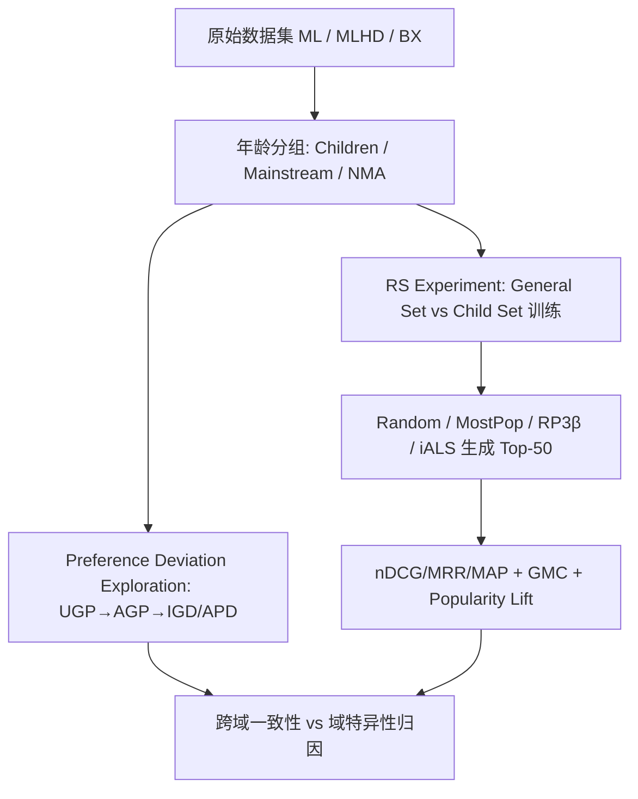

# Impacts of Mainstream-Driven Algorithms on Recommendations for Children Across Domains: A Reproducibility Study (主流驱动算法对跨域儿童推荐的影响：一项可复现性研究)

- **会议/期刊**: RecSys 2025 (Proceedings of the 19th ACM Conference on Recommender Systems, pp. 783-791)
- **作者与机构**: Robin Ungruh, Maria Soledad Pera (Delft University of Technology); Alejandro Bellogín (Universidad Autónoma de Madrid); Dominik Kowald (Know Center GmbH & TU Graz)
- **推荐链路定位**: 召回（Top-50 推荐生成与排序评估）
- **研究方向**: 跨域与多场景推荐 / 去偏公平与可信推荐
- **论文原文**: [论文原文链接](https://arxiv.org/abs/2507.06596v1)
- **开源代码**: [开源代码仓库链接](https://github.com/rUngruh/2025_RecSys_Reproducibility)

## TL;DR (1分钟核心速览)

本文针对"儿童作为非主流用户群体在推荐系统中被系统性忽视"这一痛点，对 Ungruh et al. 的参考框架进行**复现（reproduction）+ 复刻（replication）+ 扩展（extension）**：在电影（ML）、音乐（MLHD）、图书（BX）三个域上重跑偏好偏差探索与推荐实验，并新增流行度偏差指标。核心发现是：儿童与主流用户的体裁偏好差异在三个域中**一致存在**，但推荐算法对儿童的"友好程度"呈现**强烈的域依赖性**——音乐域中儿童偏好热门曲目因而被主流驱动算法"意外照顾"，而电影/图书域中儿童偏好冷门物品，主流数据训练的算法对其显著失效（如 ML 上 MostPop 对儿童 nDCG 仅 0.129 vs 主流 0.174）。

## Background & Motivation (背景与核心矛盾)

- **主流范式**: 推荐系统研究几乎全部基于主流用户（年轻成年人）主导的数据集进行设计与评估，儿童在数据中仅占 2.83%–8.21% 的交互，属于典型的长尾/非主流群体。
- **前人局限**: 参考工作 Ungruh et al. 仅在 ML 与 LFM-2b 两个数据集上发现儿童偏好偏差与算法行为不一致，但 (1) LFM-2b 已不可获取，直接复现不可能；(2) 结论局限于音乐/电影两域，且音乐消费具有独特特性（重复收听），无法判断偏差是数据集特有还是跨域普遍现象。
- **核心洞察 (Key Insight)**: 作者观察到儿童偏好偏差的"方向"与"幅度"在不同域中截然不同——音乐域儿童偏好**热门**曲目，电影/图书域儿童偏好**冷门**物品，这意味着主流驱动算法的流行度偏置对儿童的影响是**域符号相反**的。
- **本文切入点**: 用统一的参考框架跨三域复刻实验，并引入 Profile Popularity / Profile Age-Popularity / Popularity Lift 三个流行度指标，将"偏好偏差"与"算法流行度放大"解耦分析。

## Method (核心方法设计)

### 1. 整体框架 (Overall Architecture)

本文并非提出新模型，而是构建一个**可跨域迁移的审计框架**，包含两个实验：(1) **Preference Deviation Exploration**——用 User Genre Profiles (UGP) 与 Age Genre Profiles (AGP) 量化各年龄组的体裁消费分布，以 Jensen-Shannon Divergence 度量组内偏差 IGD 与组间偏差 APD；(2) **RS Experiment**——在 General Set（含全年龄交互，主流主导）与 Child Set（仅儿童交互）上分别训练推荐算法，对比 Top-50 推荐在 nDCG/MRR/MAP、Genre Miscalibration (GMC) 与 Popularity Lift (PL) 上的表现。扩展部分新增流行度画像指标，用于解释算法行为差异的成因。

### 2. 关键设计拆解 (Key Designs)

1. **体裁画像与偏差度量（UGP/AGP + JSD）**：痛点在于不同年龄组交互量差异巨大，直接比较原始频次会被主流用户淹没。作者将每个用户的交互聚合为体裁频率向量 $UGP_u$（体裁等权归一化），年龄组画像取均值$AGP_{age}=\frac{1}{|\mathcal{U}_{age}|}\sum_{u\in\mathcal{U}_{age}}UGP_u$，组间偏差定义为$APD_{age_1,age_2}=JSD(AGP_{age_1}\|AGP_{age_2})$，组内偏差$IGD_{age}$为组内各$UGP_u$到$AGP_{age}$的平均 JSD。JSD 的有界性与对称性使其天然适配"分布距离"语义，且$IGD$可充当"用户难度"代理——$IGD$ 越高说明组内偏好越分散，越难被单一画像刻画。

2. **General Set vs Child Set 的双训练对照（主流支配效应的因果探针）**：痛点在于无法直接观测"主流数据的存在"对儿童推荐的影响。作者设计同一算法在两种训练集上训练：General Set 保留全年龄交互（主流占 77%–82%），Child Set 仅保留儿童交互。若 Child Set 上儿童指标**下降**，说明算法实际依赖主流数据来"借力"推断儿童偏好（儿童是"困难用户"）；若**上升**，说明主流数据构成噪声干扰。该设计将"数据组成"作为唯一干预变量，是本文最具方法论价值的审计工具。

3. **流行度扩展指标与训练/评估协议**：新增 Profile Popularity（用户画像中物品的全局归一化流行度均值）与 Profile Age-Popularity（同龄组内归一化流行度均值），以及 $PL=\frac{\overline{pop}(Rec_u)-\overline{pop}(Profile_u)}{\overline{pop}(Profile_u)}$度量算法相对用户画像的流行度放大。统计检验上，作者弃用参考工作的 MANOVA（多元正态/方差齐性假设在归一化体裁比例上不成立），改用 **Kruskal–Wallis + 成对 Mann–Whitney U（$p<0.01$ 多重校正）**，这是对原方法的重要方法学修正。

## Experimental Setup & Evaluation Protocol (实验设置与评估协议)

- **数据集与预处理**（仅保留 12–65 岁用户，剔除无体裁标注物品）：

| 数据集 | #Users | #Items | #Interactions | 儿童交互占比 | 主流交互占比 | 域说明 |
| :--- | :---: | :---: | :---: | :---: | :---: | :--- |
| ML (MovieLens-1M) | 6,040 | 3,706 | 1,000,209 | 2.83% | 84.60% | 电影，18 体裁 |
| MLHD (Last.fm) | 44,349 | 1,918,414 | 1,055,574,094 | 10.80% | 78.89% | 音乐，20 体裁（MusicBrainz 映射） |
| BX (Book Crossing) | 35,029 | 80,785 | 396,460 | 2.88% | 81.29% | 图书，8 体裁（Goodreads 合并） |

- **数据划分与防穿越 (Splitting Strategy)**: MLHD 采用**全局时间戳切分**（6–8 月训练 / 9 月验证 / 10 月测试，2009 年）；ML 与 BX 因时间跨度不足或无时间戳，改用 **60/20/20 比例划分**。ML 二值化为 rating>3，MLHD 要求至少收听 2 次并仅保留首次事件，BX 全部交互视为正样本。ML 用 $k=10$、BX 用$k=5$的迭代$k$-core 过滤。
- **排名评测协议 (Ranking Protocol)**: 生成 **Top-50** 推荐列表，指标为 nDCG/MRR/MAP 与 GMC（UGP 与 RGP 的 JSD），属于**全量候选排序**（非采样负例），但未报告统计显著性以外的置信区间。
- **对比基线与超参设置**: 2 个非个性化基线（Random、MostPop）+ 2 个个性化算法（RP3$\beta$、iALS），基于 Elliot 框架实现，超参沿用原研究与既有实践调优；显著性阈值$p<0.01$。

## Key Experimental Results (实验关键数据)

### 1. 主实验对比 (Main Results)

下表摘取 General Set 训练下各年龄组的核心指标（ML 与 BX 为电影/图书域代表，MLHD 为音乐域代表；加粗为组内最优）：

| 数据集 | 算法 | 组别 | nDCG↑ | MAP↑ | GMC↓ | PL→0 |
| :--- | :--- | :--- | :---: | :---: | :---: | :---: |
| ML | MostPop | Children | 0.129 | 0.146 | 0.151 | 1.768 |
| ML | MostPop | Mainstream | **0.174** | **0.196** | **0.120** | **1.263** |
| ML | iALS | Children | 0.292 | 0.246 | 0.054 | 0.377 |
| ML | iALS | Mainstream | **0.322** | **0.295** | **0.047** | **0.311** |
| BX | iALS | Children | 0.106 | 0.105 | 0.160 | 1.242 |
| BX | iALS | Mainstream | 0.080 | 0.092 | **0.115** | **0.926** |
| MLHD | MostPop | Children | **0.011** | **0.024** | 0.139 | 6.429 |
| MLHD | MostPop | Mainstream | 0.008 | 0.018 | **0.135** | 7.751 |
| MLHD | iALS | Children | **0.038** | **0.065** | **0.042** | **0.826** |
| MLHD | iALS | Mainstream | 0.030 | 0.050 | 0.050 | 1.083 |

### 2. 消融实验 (Ablation Study)

本文无传统模块消融，其"消融"等价物为 **General Set → Child Set 的训练集切换**（移除主流数据），下表为儿童指标变化（∗ 表示 $p<0.01$ 显著）：

| 数据集 | 算法 | ΔnDCG | ΔGMC | ΔPL | 方向解读 |
| :--- | :--- | :---: | :---: | :---: | :--- |
| ML | RP3$\beta$ | −0.065∗ | +0.022∗ | +0.226∗ | 移除主流数据后显著变差 |
| ML | iALS | −0.095∗ | +0.019∗ | −0.163∗ | 显著变差，主流数据有"借力"价值 |
| ML | MostPop | +0.023∗ | −0.011∗ | −0.358∗ | 儿童专属热门反而更准 |
| BX | iALS | −0.072∗ | +0.050∗ | −0.734∗ | 显著变差 |
| MLHD | iALS | −0.005∗ | +0.018∗ | +0.985∗ | nDCG 微降但 GMC 恶化 |
| MLHD | MostPop | +0.002∗ | −0.003∗ | −0.739∗ | 儿童热门推荐更对齐 |

### 3. 关键实验发现 (Key Findings)

1. **偏好偏差跨域一致，但算法友好度域特异**：三域中儿童与主流的 APD 均显著（ML 0.013、MLHD 0.0062、BX 0.071，除个别体裁外全部体裁 $p<0.01$），但 ML/BX 上主流用户几乎在所有指标上最优（如 ML 上 iALS 主流 nDCG 0.322 vs 儿童 0.292），而 MLHD 上儿童反而更优（iALS 儿童 nDCG 0.038 vs 主流 0.030）——根源是音乐域儿童偏好热门曲目（Profile Popularity 0.079 高于主流的 0.064），流行度偏置"歪打正着"。
2. **儿童是"困难用户"，主流数据对其有正向外溢**：ML 与 BX 上个性化算法在 Child Set 训练时对儿童显著变差（ML 上 iALS nDCG 下降 0.095），说明算法实际借助主流交互来补偿儿童稀疏信号；这与 ML/BX 上儿童更高的 IGD（组内偏好更分散）相互印证。
3. **流行度放大方向与域强相关**：ML/BX 上儿童获得的 Popularity Lift 不低于甚至高于主流（ML MostPop 儿童 1.768 vs 主流 1.263），而 MLHD 上儿童 PL 更低（6.429 vs 7.751），证明"主流驱动算法伤害儿童"并非普适结论，必须结合域的流行度消费结构判断。

## Highlights & Limitations (亮点、对比与审稿批判)

- **与代表作对比 (vs. Prior Work)**: 相比 Ungruh et al. 原研究（仅 ML + 已失效的 LFM-2b，MANOVA 检验），本文 (1) 用 MLHD 替代 LFM-2b 并新增 BX 图书域，首次给出跨三域证据；(2) 用非参数检验修正了原方法的分布假设缺陷；(3) 新增流行度指标，将"体裁对齐"与"流行度放大"两条解释路径分离，解释了原研究无法解释的"为何某些 RA 对儿童更好"。
- **可迁移亮点**: ① General Set / Child Set 双训练对照是审计任意"少数群体 vs 多数群体"推荐公平性的低成本因果探针，可直接迁移到老年用户、小众兴趣社区；② IGD 作为"用户难度"代理指标，可用于预判哪些用户群体需要额外侧信息。
- **审稿级局限批判**: ① 仅 4 个算法（2 个非个性化 + 2 个个性化），未覆盖图神经/序列/生成式等现代架构，"主流驱动"结论的算法覆盖面有限；② 体裁标注依赖外部 API 映射（MusicBrainz→Allmusic、Goodreads→BX ISBN 合并），大量无可靠体裁的物品被剔除，可能系统性丢失儿童偏好的小众体裁；③ 儿童被简化为同质群体，未做年龄段细分（BX 上 12 岁与 16 岁已显现分化），且年龄信息为数据采集时快照，存在时间漂移误差。

## Rating (四维评分)

- **方法创新性 (Novelty)**: ⭐⭐⭐ （非新模型论文，但双训练集对照 + 流行度扩展 + 非参数检验修正构成扎实的审计方法学增量）
- **评估协议与实验扎实度 (Protocol & Experiments)**: ⭐⭐⭐⭐ （三域三数据集、$p<0.01$ 多重校正、General/Child 双设置完整，唯算法覆盖面偏窄）
- **写作与数学规范度 (Clarity & Rigor)**: ⭐⭐⭐⭐ （UGP/AGP/IGD/APD/PL 定义清晰、统计检验选择有据，但部分表格符号密集、可读性略受影响）
- **工业落地与复现价值 (Industrial & Practical Value)**: ⭐⭐⭐⭐ （代码与 MLHD 采样子集均开源，审计框架可直接用于平台侧少数群体公平性体检，但结论依赖人口统计学元数据，工业数据常缺失）

