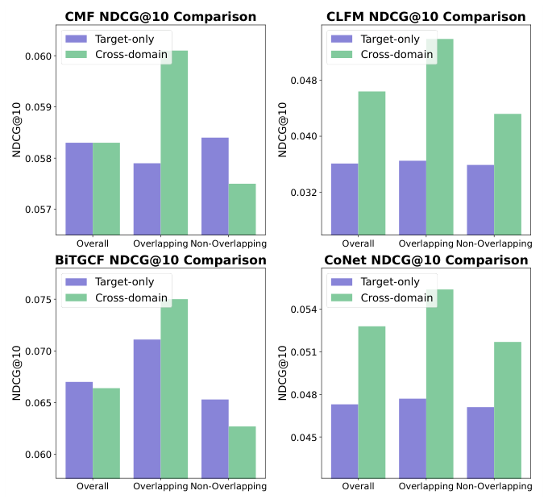
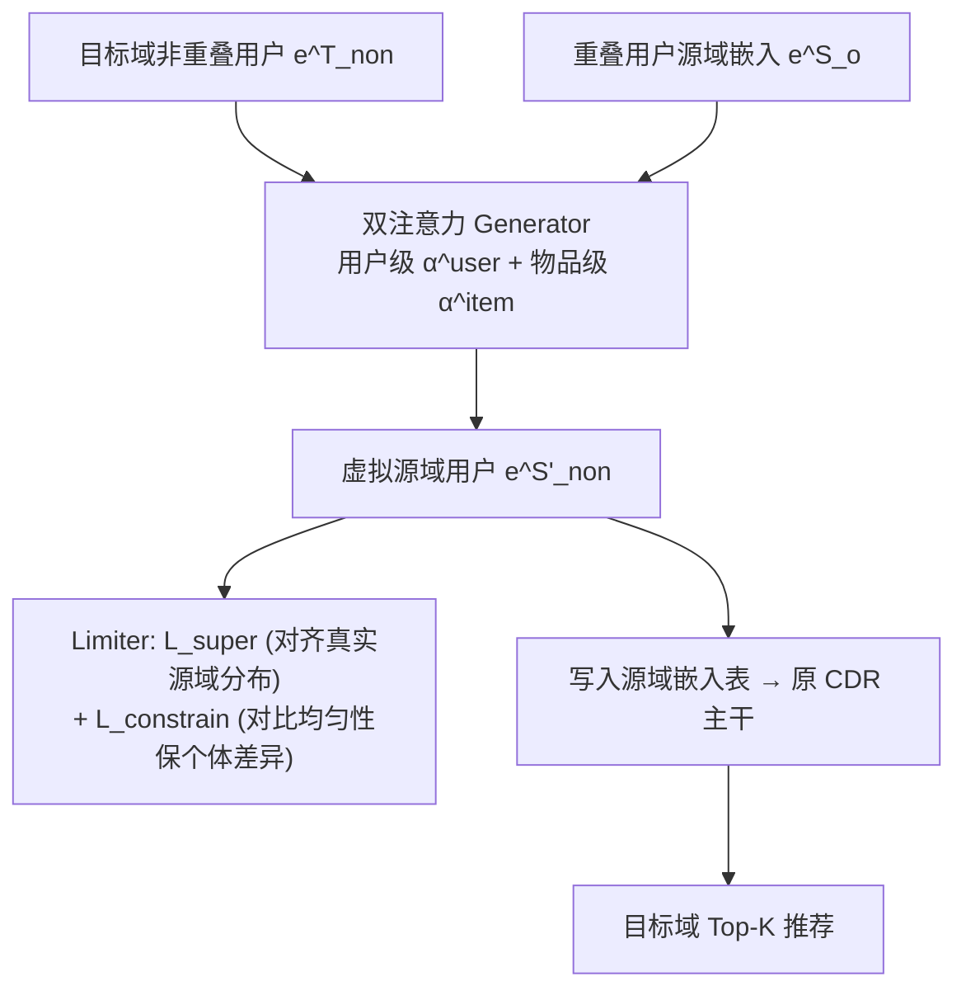

# Leave No One Behind: Fairness-Aware Cross-Domain Recommender Systems for Non-Overlapping Users (一个都不能少：面向非重叠用户的公平跨域推荐)

- **会议/期刊**: RecSys 2025
- **作者与机构**: Weixin Chen, Yuhan Zhao, Li Chen (香港浸会大学), Weike Pan (深圳大学)
- **推荐链路定位**: 召回（跨域表征生成，可插入任意 CDR 主干）
- **研究方向**: 跨域与多场景推荐 / 去偏公平与可信推荐
- **论文原文**: [https://arxiv.org/abs/2507.17749v1](https://arxiv.org/abs/2507.17749v1)
- **开源代码**: [https://github.com/WeixinChen98/VUG](https://github.com/WeixinChen98/VUG)

## TL;DR (1分钟核心速览)

现有 CDR 方法以重叠用户为知识迁移桥梁，导致非重叠用户几乎无收益甚至性能倒退（CDR Overlapping Bias）。本文提出 VUG：用双注意力（用户级+物品级）在源域为非重叠用户合成"虚拟用户"嵌入，再用重叠用户作监督信号 + 对比均匀性约束的 limiter 保证其符合源域分布且保留个体差异。方法模型无关，可即插即用于任意 CDR 主干。在 Amazon/Douban/Epinions 三数据集、五个 CDR 基线上，UGF 公平性指标最高改善 94.13%，同时整体精度普遍提升（如 CLFM 在 Douban +17.82%）。

## Background & Motivation (背景与核心矛盾)

- **主流范式**: CDR 通过重叠用户 $\mathcal{U}_o$作为桥梁，将源域$\mathcal{D}_S$的高阶协同信号迁移至稀疏目标域$\mathcal{D}_T$（CMF 共享隐因子、BiTGCF 图高阶连通、CoNet 跨连接单元、MFGSLAE 因子选择）。
- **前人局限**: ① 迁移通道只为重叠用户而建，非重叠用户 $\mathcal{U}_T\setminus\mathcal{U}_o$ 既无源域表征也无监督信号，收益被系统性边缘化；② 实验显示部分 SOTA（如 MFGSLAE）在 Epinions 上的组间偏差甚至比经典 CMF 更严重——单纯优化精度并不自动带来公平。
- **核心洞察 (Key Insight)**: 作者用信息论给出解释：重叠用户因共享隐变量 $z_u$使$I(R^S;R^T)>0$，条件熵$H(R^T|R^S)<H(R^T)$，由 Fano 不等式其预测误差下界严格更低；非重叠用户$I(R^S;R^T)=0$，误差下界无法被跨域信息压低。**偏差是结构性的，而非调参问题**。
- **本文切入点**: 既然差距源于"源域无表征"，那就**造一个**——为非重叠用户在源域生成虚拟画像，把"非重叠"转化为"虚拟重叠"，使其进入同一迁移通道。

<figure class="paper-figure" markdown="span">
  <figcaption>图 1：Epinions 数据集中重叠用户与非重叠用户的性能比较。Target-only 模式表示相同方法但禁用跨域信息流动。</figcaption>
</figure>

## Method (核心方法设计)

### 1. 整体框架 (Overall Architecture)

VUG 作为外挂模块嵌入 CDR 主干：对每个目标域非重叠用户 $u_{\text{non}}$，Generator 以目标域嵌入$e^T_{\text{non}}$为 query，对全部重叠用户在源域的嵌入做双注意力加权聚合，得到虚拟源域嵌入$e^{S\prime}_{\text{non}}$；该嵌入直接写入源域用户嵌入表，参与主干原有的跨域图传播/因子共享。训练采用**交替优化**：主干参数按原 CDR 损失$\mathcal{L}_{CDR}$更新（冻结 generator），generator 单独由$\gamma_2\mathcal{L}_{super}+(1-\gamma_2)\mathcal{L}_{constrain}$ 更新（冻结其余）。推理时虚拟用户已固化，无额外在线开销。

### 2. 关键设计拆解 (Key Designs)

1. **双注意力虚拟用户生成器（Dual Attention Generator）**：痛点是最相似的 top-$N$ 重叠用户筛选不可微、且单一用户相似度不足以刻画协同信号。作者改为对**全体**重叠用户做 soft 聚合，权重由用户级与物品级两路注意力线性融合：
$$\alpha_u=\gamma_1\alpha^{\text{user}}_u+(1-\gamma_1)\alpha^{\text{item}}_u,\quad e^{S\prime}_{\text{non}}=\sum_{u\in\mathcal{U}_o}\alpha_u\left(\mathbf{W}_v e^S_u+\mathbf{b}_v\right)$$
其中 $\alpha^{\text{user}}_u$以$e^T_{\text{non}}$为 query、$e^T_u$为 key 做缩放点积；$\alpha^{\text{item}}_u$则先把用户交互物品嵌入均值池化为$g^T_u=\frac{1}{|\mathcal{I}^T_u|}\sum_{i\in\mathcal{I}^T_u}e_i$ 再作 query/key。直觉：用户级捕捉"人像人"，物品级捕捉"口味像口味"，二者互补且全程可微。

2. **Limiter：监督对齐 + 对比均匀性**：生成器若无约束会退化为噪声或简单复制。① **分布对齐**：把重叠用户的目标域嵌入喂入 generator，要求输出逼近其真实源域嵌入，$\mathcal{L}_{super}=\frac{1}{|\mathcal{U}_o|}\sum_{o}\|e^{S\prime}_o-e^S_o\|^2$，以真实用户作"锚"把虚拟用户拉回源域流形；② **个体差异保持**：借用对比学习中的 uniformity 项，$\mathcal{L}_{constrain}=\log\mathbb{E}\left[e^{-2\|e^{S\prime}_u-e^{S\prime}_{u'}\|^2}\right]$，把虚拟用户彼此推开，防止同质坍缩。二者构成"学别人 vs 做自己"的张力平衡。

3. **训练目标与开销**：$\min_{\Theta\setminus\Theta_{gen}}\mathcal{L}_{CDR}$，$\min_{\Theta_{gen}}\gamma_2\mathcal{L}_{super}+(1-\gamma_2)\mathcal{L}_{constrain}$。无负采样设计（沿用主干原有 BPR/回归损失）；生成仅需一次$|\mathcal{U}_o|\times d$ 的注意力矩阵乘法，Epinions 上五个主干的训练时间增幅均在 1–10 秒量级（如 BiTGCF 64.4s→74.7s）。

## Experimental Setup & Evaluation Protocol (实验设置与评估协议)

- **数据集与预处理**（Douban/Amazon 采用 `5-core` 过滤）：

| 数据集 | 源域→目标域 | #Users (S/T) | #Items (S/T) | #Interactions (S/T) | 重叠率 |
| :--- | :---: | :---: | :---: | :---: | :---: |
| Amazon | Book→Movie | 65,725 / 8,663 | 70,071 / 7,790 | 2,021,443 / 229,257 | 19.32% |
| Douban | Book→Movie | 18,086 / 3,372 | 33,067 / 9,342 | 809,248 / 311,797 | 31.88% |
| Epinions | Elec→Game | 10,124 / 4,247 | 13,018 / 4,094 | 34,859 / 16,471 | 29.83% |

- **数据划分与防穿越**: 源域 `8:2` 训练/验证；目标域 `8:1:1` 训练/验证/测试，**按用户独立划分**；另设**全局时间戳切分**（Temporal split）作为鲁棒性验证（图 3）。
- **排名评测协议**: 评分 ≥3 视为正反馈，**Full-Ranking 全库排序**（evaluated across all items），指标 HR@10/20、NDCG@10/20；公平性用 UGF $=\left|\frac{1}{|\mathcal{U}_o|}\sum_{o}M(L_o)-\frac{1}{|\mathcal{U}_T\setminus\mathcal{U}_o|}\sum_{non}M(L_{non})\right|$，越小越公平。
- **对比基线与超参**: 5 个 CDR 主干（CMF / CLFM / BiTGCF / CoNet / MFGSLAE），嵌入维度 $d=64$，Adam lr=0.001，batch=2048，$L_2=10^{-4}$；$\gamma_1,\gamma_2$在$[0,1]$步长 0.1 网格搜索；双侧 t-test，$p<0.05$。

## Key Experimental Results (实验关键数据)

### 1. 主实验对比 (Main Results)

各主干"w/o → w/" VUG 的精度与公平性（UGF 取四指标平均改善）：

| 数据集 | 指标 | CMF | CLFM | BiTGCF | CoNet | MFGSLAE |
| :--- | :--- | :---: | :---: | :---: | :---: | :---: |
| Amazon | NDCG@10 | 0.0356→0.0359 | 0.0177→**0.0191** | 0.0354→0.0360 | 0.0150→0.0154 | 0.0373→**0.0393** |
| | 精度提升 | +0.50% | **+7.06%** | +2.03% | +2.06% | +3.57% |
| | 公平性提升 | +16.15% | **+57.17%** | +35.41% | +57.34% | +37.60% |
| Douban | NDCG@10 | 0.0822→0.0905 | 0.0633→**0.0765** | 0.0656→0.0674 | 0.0767→0.0804 | 0.1061→0.1059 |
| | 精度提升 | +10.61% | **+17.82%** | +1.37% | +2.45% | +0.71% |
| | 公平性提升 | +13.52% | +9.96% | +2.60% | +3.33% | +0.91% |
| Epinions | NDCG@10 | 0.0583→0.0589 | 0.0464→0.0546 | 0.0664→0.0689 | 0.0528→0.0514 | 0.0575→**0.0710** |
| | 精度提升 | +2.50% | +13.22% | +6.75% | +1.73% | **+19.47%** |
| | 公平性提升 | +58.68% | +86.18% | +70.16% | +12.84% | **+94.13%** |

### 2. 消融实验 (Ablation Study)

MFGSLAE + Epinions 上的组件移除（精度越大越好 / UGF 越小越好）：

| 变体 | HR@10 | NDCG@10 | UGF(HR@10) | UGF(NDCG@10) |
| :--- | :---: | :---: | :---: | :---: |
| w/o $\mathcal{L}_{constrain}$ | 0.1302 | 0.0655 | 0.0010 | 0.0005 |
| w/o $\mathcal{L}_{super}$ | 0.1355 | 0.0707 | **0.0281** | **0.0129** |
| w/o $\alpha^{\text{user}}_u$ | 0.1298 | 0.0662 | 0.0020 | 0.0015 |
| w/o $\alpha^{\text{item}}_u$ | 0.1287 | 0.0658 | 0.0041 | 0.0005 |
| **VUG (full)** | **0.1363** | **0.0710** | **0.0003** | **0.0005** |

### 3. 关键实验发现 (Key Findings)

1. **公平性与精度并非零和**：所有五个主干在绝大多数设置下 UGF 与 NDCG 同时改善，说明偏差纠偏释放的是被浪费的非重叠用户信号，而非以精度换公平。Epinions 上 MFGSLAE 的 UGF(HR@10) 从 0.0230 压到 0.0003（-94.13%），同时 NDCG@10 反升 19.47%。
2. **$\mathcal{L}_{super}$ 是公平性的命门**：移除后 UGF(HR@10) 从 0.0003 暴涨至 0.0281（近 90 倍），远超移除任一注意力分支的影响，证明"以重叠用户为锚对齐源域分布"是防止虚拟用户退化为噪声的关键；而两路注意力各自移除均带来 0.5–1.5% 的精度损失，验证用户级与物品级信号的互补性。
3. **低重叠率场景收益最大**：Epinions 重叠率从 100% 降至 25% 时，NDCG@10 增益由 0.0583→0.0700 变为 0.0527→0.0592，UGF@10 从 0.0062 降至 0.0037——恰是传统 CDR 最吃亏的稀疏重叠区间，VUG 的边际价值最高，具备明确的工业投放优先级。

## Highlights & Limitations (亮点、对比与审稿批判)

- **与代表作对比 (vs. Prior Work)**: 与 CMF/CoNet 等"共享参数/跨连接"的隐式迁移不同，VUG 不改主干结构而是**补数据**；与 MACDR 无监督利用非重叠用户相比，VUG 显式构造源域表征并给出信息论下界解释；与 CDR 公平性工作 [32]（敏感属性重加权）关注的是另一维度偏差，二者正交可叠加。
- **可迁移亮点**: ① "用重叠用户作监督锚 + uniformity 约束"的生成器训练范式，可直接迁移到冷启动用户画像合成、跨场景新客表征补全；② 交替冻结优化使外挂模块不干扰主干收敛，工程上易于灰度上线。
- **审稿级局限批判**: ① 虚拟用户完全由注意力聚合重叠用户得到，本质是凸组合+线性变换，表达上界受限于重叠用户张成的子空间，对兴趣高度异质的非重叠用户可能欠拟合；② 公平性仅在"重叠 vs 非重叠"二分群体上度量，未讨论虚拟用户引入后对源域原有用户排序的扰动（负迁移风险），且实验均为公开离线数据集，缺少线上 A/B 与用户感知公平性的验证。

## Rating (四维评分)

- **方法创新性 (Novelty)**: ⭐⭐⭐⭐ （"虚拟重叠用户"视角新颖，配 Fano 不等式的信息论归因给足了理论动机，但生成器本身是标准注意力聚合，算子层面增量有限）
- **评估协议与实验扎实度 (Protocol & Experiments)**: ⭐⭐⭐⭐ （三数据集×五主干×四指标+时间切分+重叠率扫描+效率分析齐全，Full-Ranking 与 t-test 规范；扣分在于缺少线上验证与负迁移分析）
- **写作与数学规范度 (Clarity & Rigor)**: ⭐⭐⭐⭐ （偏差分析—方法—实验逻辑闭环清晰，公式与符号定义完整；$\mathcal{L}_{constrain}$ 的推导与超参敏感性讨论略简）
- **工业落地与复现价值 (Industrial & Practical Value)**: ⭐⭐⭐⭐⭐ （模型无关即插即用、训练开销仅秒级增量、代码开源，是少数能低成本接入现有 CDR 管线的公平性补丁）

