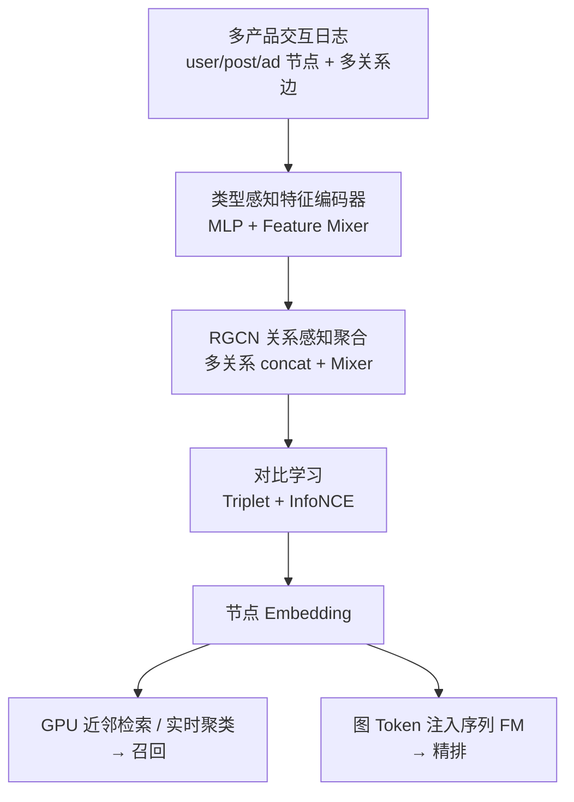
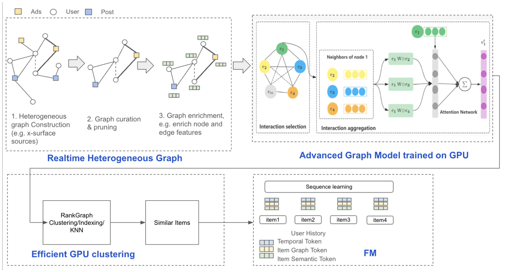

# RankGraph: Unified Heterogeneous Graph Learning for Cross-Domain Recommendation (统一异构图表征学习的跨域推荐)

- **会议/期刊**: RecSys 2025 (Industry Track, 4 页短文)
- **作者与机构**: Renzhi Wu, Junjie Yang, Li Chen, Hong Li, Li Yu, Hong Yan (Meta MRS / Facebook Monetization)
- **推荐链路定位**: 召回（retrieval generator）+ 为精排 FM 提供图上下文 token
- **研究方向**: 跨域与多场景推荐 / 图神经网络与知识图谱推荐
- **论文原文**: [https://arxiv.org/abs/2509.02942v1](https://arxiv.org/abs/2509.02942v1)
- **开源代码**: 暂未开源

## TL;DR (1分钟核心速览)

跨域推荐基础模型（FM）难以刻画跨产品、细粒度的用户-物品关系。RankGraph 把 Meta 多产品（帖子、广告、用户等）的交互建成一张异构异质图，用 GPU 加速的 RGCN 做关系感知消息传递，并以 triplet + InfoNCE 混合对比损失训练节点表征；训练后既可实时产出 embedding 做相似召回与聚类，也可作为图 token 注入序列 FM。离线 next-day 边召回 Recall@100 从 0.379 提升到 0.614，线上 A/B 点击 +0.92%、转化 +2.82%。

## Background & Motivation (背景与核心矛盾)

- **主流范式**: 推荐基础模型以序列/ID 特征为骨干，图学习则多以单产品同构图（user-item 二部图）建模协同信号，二者长期割裂。
- **前人局限**: 其一，同构图无法表达 user-post-ad 等多类型节点与 click/like/share/co-engagement 等多关系，跨 surface 的语义被压平；其二，离线图召回指标（拟合图边）与线上真实参与度存在系统性偏差，导致离线涨点无法兑现为线上收益。
- **核心洞察 (Key Insight)**: 跨域增益的本质不是"共享用户 ID"，而是共享**关系结构**——把多产品交互统一进一张异质图后，高阶多跳邻居（semantic edges）能补足直接交互的稀疏性。
- **本文切入点**: 用一张统一异质图 + 类型感知编码 + 关系感知聚合 + 混合对比学习，把图结构知识同时输送给召回与 FM 精排两条链路。

## Method (核心方法设计)

### 1. 整体框架 (Overall Architecture)

输入是多产品交互日志，先按节点类型（user / post / ad 等）与边类型（click、like、share 的加权组合，以及多跳语义边）构图；随后类型感知特征编码器把各类型异构特征投影到统一空间，RGCN 式关系聚合逐层传播，对比学习拉近有边节点、推远负样本；产出 embedding 一路进 GPU 聚类/近邻检索做召回，一路作为图 token 与时间戳 token 等拼接送入序列 FM 做排序。训练与推理全 GPU 化，支持按需抽取 item-item、user-user 子图。

<figure class="paper-figure" markdown="span">
  <figcaption>图1：Rankgraph系统架构。</figcaption>
</figure>

### 2. 关键设计拆解 (Key Designs)

1. **类型感知特征编码器（异构特征对齐）**：不同节点类型的特征空间互不相容，直接拼接会让 ID 类稠密特征淹没语义 embedding。本文对每个节点类型 $t$的$n_t$类特征分别过 MLP 后再拼接，并用 Feature Mixer$M_t$ 显式建模特征两两交叉：
$h_t = M_t\big(\text{concat}_{j=1}^{n_t} f_{t,j}(x_{t,j})\big)$
直觉上这是把 CTR 领域的特征交叉思想搬到图节点初始化，避免异构特征在首层就被平均掉。

2. **RGCN 式关系感知聚合（保留关系语义）**：同构图 GCN 把所有边一视同仁，会抹掉"点击"与"共同参与"的强度差异。本文对每种关系 $r$单独设权重$W_r$与归一化因子$c_{i,r}$，聚合后按关系 concat 再用 Mixer 融合，并保留自环：
$h_i^{l+1} = M_t\Big(\text{concat}_r\big(f_r(c_{i,r}\textstyle\sum_{j\in\mathcal{N}_i^r} W_r h_j^l)\big)\Big)$
关键在于"先分关系聚合、再跨关系融合"，使跨域迁移时不同产品的交互语义不会被混为一谈。

3. **混合对比损失与负采样策略**：单一 InfoNCE 只做全局簇级区分，单一 triplet 只做局部对级区分。本文把二者相加，局部拉开正负对、全局对齐簇结构。负采样三路并行：in-batch（同批不同边）、out-of-batch（GPU 上按节点类型维护候选池并增量更新，逼近全局分布）、semantic negative（多头结构下用不同 head 的 embedding 互为负例）。总损失为 $\mathcal{L}=\mathcal{L}_{\text{triplet}}+\lambda\mathcal{L}_{\text{InfoNCE}}$，无需额外 hard-negative 挖掘即可稳定训练。

## Experimental Setup & Evaluation Protocol (实验设置与评估协议)

- **数据集与预处理**: 论文未给出公开数据集统计表，实验在 Meta 生产环境的多产品图上进行（含十亿级用户 surface），基线为 Meta 内部图学习系统 Filament2。

| 数据集 | #Users | #Items | #Interactions | 稀疏度/密度 | 特征/场景说明 |
| :--- | :---: | :---: | :---: | :---: | :--- |
| Meta 生产异质图 | 十亿级 | 未披露 | 未披露 | 未披露 | user/post/ad 多类型节点，跨 surface |
| 离线采样边集 $E_s$ | — | — | 1,000 条边 | — | 随机采样用于 next-day 召回评测 |

- **数据划分与防穿越 (Splitting Strategy)**: 采用**时间切分**——用前一日生成的 embedding 评测次日新增图边；engagement recall 用过去一周交互作 trigger，预测 $t+1$至$t+4$ 小时的交互，严格避免未来信息泄漏。
- **排名评测协议 (Ranking Protocol)**: 近似 `Full-Ranking` 的近邻全排序——对每个节点在全体候选节点中按 embedding 距离取 top-$k$ 邻居，命中真实边即算召回；engagement recall 则对每个物品取 top-20 近邻扩展为预测集后排序。
- **对比基线与超参设置**: 仅对比 Filament2 一个工业基线；embedding 维度、层数、$\lambda$ 等超参未在短文中披露，亦未报告显著性检验。

## Key Experimental Results (实验关键数据)

### 1. 主实验对比 (Main Results)

**表 1：次日图边召回（1000 条采样边，近邻全排序）**

| Method | Recall@5 | Recall@10 | Recall@50 | Recall@100 |
| :--- | :---: | :---: | :---: | :---: |
| Filament2 | 0.051 | 0.079 | 0.268 | 0.379 |
| **RankGraph** | **0.143** | **0.239** | **0.485** | **0.614** |
| Improv. | +180.4% | +202.5% | +81.0% | +62.0% |

**表 2：参与度召回（十亿级用户 surface，按天平均）**

| Method | Recall@100 | Recall@200 | Recall@500 |
| :--- | :---: | :---: | :---: |
| Filament2 | 0.071 | 0.125 | 0.221 |
| **RankGraph** | **0.106** | **0.157** | **0.234** |
| Improv. | +49.3% | +25.6% | +5.9% |

**线上 A/B**：点击率 +0.92%，转化率 +2.82%。

### 2. 消融实验 (Ablation Study)

原文为 4 页工业短文，**未提供组件级消融表**（无 w/o semantic edges、w/o triplet、w/o out-of-batch sampling 的对照）。可确认的对照仅为：图边召回 vs. 参与度召回两种离线协议，以及离线指标与线上 A/B 的一致性讨论。

### 3. 关键实验发现 (Key Findings)

1. **短列表收益远大于长列表**：表 1 中 Recall@5 相对提升 +180%、Recall@100 仅 +62%，说明异质图带来的增益集中在"头部近邻精度"，这对召回通道只取 top-几十的工业场景恰好是最有价值的区间。
2. **离线图边召回会高估线上收益**：表 1 的巨大涨幅（+62%~+202%）在表 2 的参与度召回上收缩到 +5.9%~+49.3%，作者明确指出二者存在 discrepancy，因此专门设计了 engagement recall 作为更贴近线上的代理指标——这是本文方法论上最值得借鉴的一点。
3. **长尾位置收益衰减**：参与度召回 Recall@500 仅 +5.9%，说明图 embedding 对"广撒网式"长尾扩展帮助有限，增益主要来自中短列表的精准命中，也解释了线上 CTR 提升（+0.92%）温和而 CVR 提升（+2.82%）更显著的现象——转化更依赖高精度近邻。

## Highlights & Limitations (亮点、对比与审稿批判)

- **与代表作对比 (vs. Prior Work)**: 相比 Filament2 这类单产品同构图系统，RankGraph 的核心差异是**异质 + 多关系 + 跨产品统一建模**；相比 SGL/SimGCL 等对比学习推荐工作，本文把 triplet（局部）与 InfoNCE（全局）显式组合，并引入 out-of-batch 候选池逼近全局负样本分布；相比 TIGER 等生成式语义 ID 路线，本文不走量化码本，而是把图 embedding 直接作为 token 注入 FM，工程路径更轻。
- **可迁移亮点**: (1) "图边召回 + 参与度召回"双离线协议，可直接用于任何图召回系统的离线评估校准；(2) 多头结构互为正负例的 semantic negative sampling，零额外采样开销即可增强鲁棒性。
- **审稿级局限批判**: 其一，实验仅对比单一内部基线 Filament2，缺少 LightGCN、SGL、HGNN 等公开基线，且无消融、无超参敏感性分析，4 页短文难以支撑各模块的独立贡献；其二，全 GPU 图训练与候选池增量更新的显存/延迟开销未量化，十亿级图上的实时 embedding 刷新频率与线上 serving 成本均未披露，复现与迁移门槛高。

## Rating (四维评分)

- **方法创新性 (Novelty)**: ⭐⭐⭐ （异质图 + 混合对比损失的组合在工业界属稳健工程创新，但各组件均有前人原型，缺少理论或谱分析支撑）
- **评估协议与实验扎实度 (Protocol & Experiments)**: ⭐⭐⭐ （提出 engagement recall 校准离线-线上偏差是亮点，但仅一个基线、无消融、无显著性检验，扎实度受限）
- **写作与数学规范度 (Clarity & Rigor)**: ⭐⭐⭐ （公式简洁、符号基本自洽，但超参、图规模、复杂度分析全部缺失，4 页篇幅牺牲了可复现细节）
- **工业落地与复现价值 (Industrial & Practical Value)**: ⭐⭐⭐⭐ （已在十亿级 surface 上线并有 A/B 正收益，召回 + FM token 双通道落地路径清晰，但未开源、依赖内部图基础设施）

