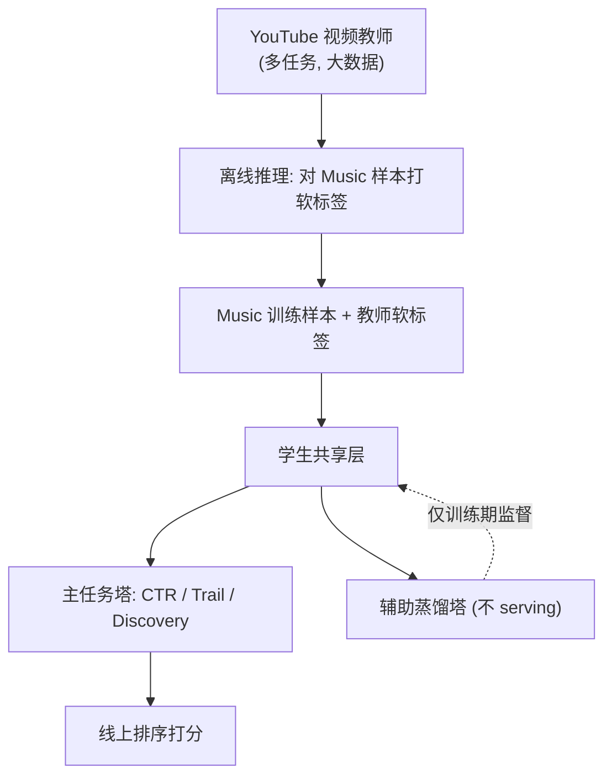
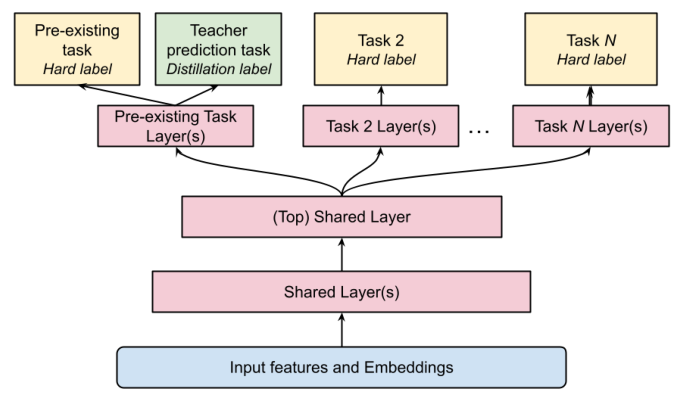

# Zero-shot Cross-domain Knowledge Distillation: A Case study on YouTube Music (零样本跨域知识蒸馏：YouTube Music 案例研究)

- **会议/期刊**: RecSys 2025 (Industry Track, 4 页短文)
- **作者与机构**: Srivaths Ranganathan, Chieh Lo, Bernardo Cunha 等，Google / YouTube LLC
- **推荐链路定位**: 精排（多任务排序模型）
- **研究方向**: 跨域与多场景推荐 / 知识蒸馏（KD）
- **论文原文**: [https://arxiv.org/abs/2603.28994v1](https://arxiv.org/abs/2603.28994v1)
- **开源代码**: 暂未开源（工业案例研究，无公开代码）

## TL;DR (1分钟核心速览)

低流量推荐场景（YouTube Music）数据量仅为 YouTube 视频域的 1/100，自建大教师不划算。本文提出**零样本跨域知识蒸馏（CDKD）**：直接复用已训练好的 YouTube 视频多任务教师，离线对 Music 数据打软标签，学生模型仅增加**辅助蒸馏 logits 头**即可在纯 Music 数据上训练。离线 AUC 仅 +0.21（79.34→79.55），但线上两周 A/B 中 Homepage 新发内容互动 **+11.39%**、Discovery **+1.12%**，Radio Discovery **+2.13%**（$p<0.05$），证明跨域 KD 的价值主要体现在泛化与新内容响应而非离线 AUC。

## Background & Motivation (背景与核心矛盾)

- **主流范式**: 工业推荐普遍用 KD 把大教师压到低延迟学生；但教师本身需在**同域**大数据上训练。
- **前人局限**: ① 低流量域数据不足，撑不起大教师，易过拟合且 GPU 成本不划算；② 已有"采样源域数据混训"方案引入训练不稳定与跨域数据依赖，且历史上去依赖尝试均失败。
- **核心洞察 (Key Insight)**: 源域（YouTube 视频）与目标域（Music）存在三重鸿沟——**40% 教师输入特征在 Music 侧缺失**（回退默认值）、**任务与标签分布偏移**（Homepage 货架式展示 vs. 视频 feed，CTR 差约 2%）、**用户行为差异**（音乐重复收听高、探索低、会话长）。但共享层表征仍可迁移。
- **本文切入点**: 不追求教师在同域更强，而是把教师当"特权信息源"，用**辅助蒸馏头**把跨域软标签注入共享层，从而摆脱对源域原始样本的依赖。

## Method (核心方法设计)

### 1. 整体框架 (Overall Architecture)

教师为 YouTube 大规模多任务排序模型（多 surface 特征拼接 → 共享层 → 各 surface 任务塔）。离线流水线让教师在 Music 数据上推理产出软标签，写入训练样本；学生（Homepage / Radio 两个多任务排序器，分别比教师小 150×/300×）在**纯 Music 数据**上训练，除原有任务塔外新增辅助蒸馏塔拟合教师软标签，辅助损失与主损失等权。推理时辅助塔不参与 serving，零额外延迟。

<figure class="paper-figure" markdown="span">
  <figcaption>图1：YouTube Music 主页与电台学生模型的蒸馏</figcaption>
</figure>

### 2. 关键设计拆解 (Key Designs)

1. **辅助蒸馏头（Auxiliary Distillation Head）**：痛点是教师任务与 Music 任务不完全对齐、直接共享 logits 会引入标签偏置。做法是为学生每个被蒸馏任务**另开一组 logits** 专门拟合教师软标签，主任务 logits 保持纯净。总损失为
$\mathcal{L}=\sum_{t\in\mathcal{T}_{\text{main}}}\mathcal{L}_{t}^{\text{main}}+\lambda\sum_{k\in\mathcal{T}_{\text{aux}}}\mathcal{L}_{k}^{\text{KD}}\!\left(\hat{y}_{k}^{\text{stu}},\,y_{k}^{\text{tea}}\right),\ \lambda=1$
直觉：辅助头相当于给共享层加了一个"跨域正则项"，把视频域学到的泛化表征注入而不污染目标任务校准。

2. **跨任务蒸馏（Cross-task Distillation）**：Radio 模型与教师**无任何共同任务**，于是新增一个"非 serving"任务头，拟合教师的 *Continue Watching* 软标签（当前视频是否引发后续观看）。该头只在训练期存在，却通过共享层反哺主互动任务——这是 Radio 线上收益的**唯一**来源机制。

3. **训练目标、负采样与推理效率**：沿用原有多任务损失（CTR 用交叉熵、Trail 用回归），辅助项等权叠加；训练数据完全来自 Music 域，**不再混入源域采样样本**，消除跨域依赖与训练不稳定。推理零开销（辅助塔裁剪），工程维护成本仅为一次离线打标流水线。

## Experimental Setup & Evaluation Protocol (实验设置与评估协议)

- **数据集与预处理**: 工业内部数据，未公开统计量；Music 训练样本量比 YouTube 视频域少 **100×**。教师输入特征中约 **40%** 在 Music 侧缺失并以默认值回退。

| 数据集 | 规模关系 | 学生/教师参数量 | 场景说明 |
| :--- | :---: | :---: | :--- |
| YouTube 视频（源域） | 100× Music | 教师（大） | 多 surface 统一排序 |
| YouTube Music Homepage | 1× | 小 150× | 货架式展示，任务：CTR / Trail / Discovery |
| YouTube Music Radio | 1× | 小 300× | 音乐连播排序，任务：互动 |

- **数据划分与防穿越 (Splitting Strategy)**: 工业在线训练流水线，未披露具体切分；对照模型与学生模型**同期、同训练步数**训练以控制数据新鲜度。
- **排名评测协议 (Ranking Protocol)**: 离线用 **AUC**（CTR/Discovery/Engagement）与 **R²**（Trail Engagement 回归）；线上为两周 A/B，报告 $p<0.05$ 的显著指标变化。
- **对比基线与超参设置**: 基线为**同架构、同参数量但无辅助 KD 头**的 Control 模型；另单列 Teacher 在目标域的直接表现作为参照。辅助损失权重与主损失相同（$\lambda=1$）。

## Key Experimental Results (实验关键数据)

### 1. 主实验对比 (Main Results)

| 模型 / 任务 | CTR (AUC) | Trail Engagement (R²) |
| :--- | :---: | :---: |
| Teacher（视频域教师，直接用于 Music） | 75.40 | 0.267 |
| Control（无 KD 学生） | 79.34 | 0.312 |
| **Cross-Domain Student** | **79.55** | **0.320** |
| Improv. vs. Control | +0.21 | +0.008 |

线上 A/B（两周，$p<0.05$）：

| Surface | Engagement | Discovery | 新发内容 Engagement |
| :--- | :---: | :---: | :---: |
| Homepage | +0.58% | +1.12% | **+11.39%** |
| Radio | +0.70% | **+2.13%** | +0.96% |

### 2. 消融实验 (Ablation Study)

原文未做组件级消融，仅提供"非蒸馏任务"的间接验证（等价于跨任务迁移消融）：

| 设置 | 任务 | Control AUC | CDKD Student AUC |
| :--- | :--- | :---: | :---: |
| Homepage（未蒸馏任务） | Discovery | 76.06 | **76.22** |
| Radio（无共同任务，仅辅助头） | Engagement | 90.30 | **91.38** |

### 3. 关键实验发现 (Key Findings)

1. **教师更差也能蒸馏出更好的学生**：教师在 Music 上 CTR AUC 仅 75.40（远低于 Control 79.34），但学生仍提升至 79.55——说明蒸馏传递的是**表征泛化性**而非标签精度，软标签的"特权信息"价值独立于教师同域准确率。
2. **跨任务迁移真实存在**：Homepage 未蒸馏的 Discovery 任务 +0.16 AUC；Radio 在**零共同任务**下靠一个非 serving 辅助头把主互动任务从 90.30 拉到 91.38（+1.08），证明收益来自共享层表征而非任务对齐。
3. **离线 AUC 严重低估线上价值**：离线仅 +0.21 AUC，线上新发内容互动却 +11.39%。作者归因于 YouTube 教师见过远更多新内容，蒸馏把"新内容响应能力"迁移过来，而 AUC 无法刻画这种分布漂移下的泛化收益。

## Highlights & Limitations (亮点、对比与审稿批判)

- **与代表作对比 (vs. Prior Work)**: 传统 KD（Hinton 等）要求同域同任务教师；跨域推荐（CDR）多依赖重叠用户/物品对齐或源域样本混训。本文的差异在于**零样本、无重叠对齐、无源域样本**，仅靠离线软标签 + 辅助头完成迁移，工程成本极低。
- **可迁移亮点**: ① "辅助蒸馏头 + 等权损失"是低成本注入外部知识的通用模板，可直接套用到任何多任务精排；② 用**非 serving 任务头**做跨域桥接，适合任务体系完全不重叠的两个业务。
- **审稿级局限批判**: ① 仅 4 页案例研究，无数据集统计、无超参敏感性、无 $\lambda$ 与辅助任务选择的消融，随机噪声对照（作者自述未来工作）缺失，因果归因偏弱；② 结论强依赖 Google 内部生态（同公司、同用户体系、教师可离线打标），跨公司或特征体系差异更大时 40% 缺失特征可能直接击穿效果，外部有效性存疑。

## Rating (四维评分)

- **方法创新性 (Novelty)**: ⭐⭐⭐ （辅助蒸馏头与非 serving 跨任务桥接思路实用，但本质是 KD 工程组合，理论新意有限）
- **评估协议与实验扎实度 (Protocol & Experiments)**: ⭐⭐⭐ （有真实线上两周 A/B 与显著性检验是加分项，但缺消融、缺数据统计、缺噪声对照）
- **写作与数学规范度 (Clarity & Rigor)**: ⭐⭐⭐ （工业叙事清晰、发现总结到位，但全文几乎无公式与复杂度分析，仅 4 页）
- **工业落地与复现价值 (Industrial & Practical Value)**: ⭐⭐⭐⭐ （推理零开销、免源域数据依赖、GPU 成本大降，对低流量场景落地价值高；但无开源代码，复现受限于内部生态）

