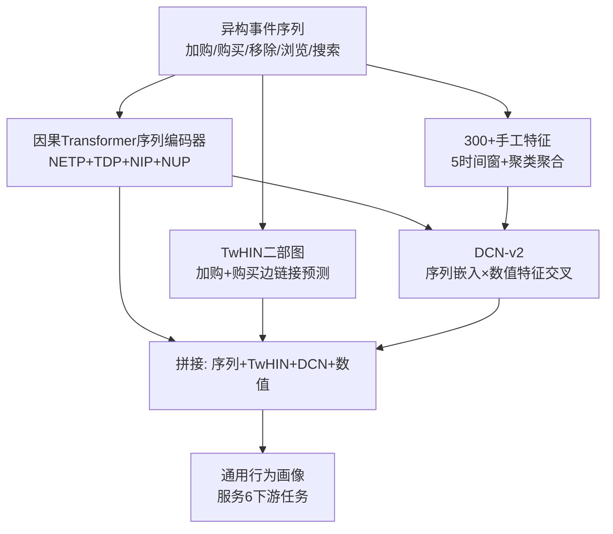

# Blending Sequential Embeddings, Graphs, and Engineered Features: 4th Place Solution in RecSys Challenge 2025 (融合序列嵌入、图与手工特征的通用行为画像：RecSys 2025 挑战赛第 4 名方案)

- **会议/期刊**: RecSys Challenge 2025 (Prague)
- **作者与机构**: Sergei Makeev, Alexandr Andreev, Vladimir Baikalov, Vladislav Tytskiy, Aleksei Krasilnikov, Kirill Khrylchenko（均属 Yandex）
- **推荐链路定位**: 召回（用户表征生成，供下游六任务服务端训练）
- **研究方向**: CTR/CVR 预估与特征交叉 / 序列与会话推荐
- **论文原文**: [https://arxiv.org/abs/2508.06970v1](https://arxiv.org/abs/2508.06970v1)
- **开源代码**: [https://github.com/Synerise/recsys2025](https://github.com/Synerise/recsys2025)

## TL;DR (1分钟核心速览)

本文针对 RecSys Challenge 2025「通用行为画像」任务——用一份用户嵌入同时服务流失预测、品类预测、SKU 预测及 3 个隐藏任务。方案将**异构因果 Transformer 序列编码器**（多任务：NETP/TDP/NIP/NUP）、**TwHIN 二部图 GNN**、**300+ 手工特征**与 **DCN-v2 高阶交叉网络**四路表征拼接为最终画像。在 100 万用户服务端评测中，流失 AUC 达 0.7389、品类 0.8151、SKU 0.8041，总榜第 4；消融显示 NIP 目标与序列编码器贡献最大。

## Background & Motivation (背景与核心矛盾)

- **主流范式**: 电商推荐通常为单一任务（CTR/流失/购买倾向）单独建模，用户表征与任务强绑定，难以复用。
- **前人局限**: ① 纯序列模型只捕捉时序兴趣演化，对稀疏用户与冷门物品泛化差；② 纯 GNN 依赖协同信号，对时序动态与内容语义不敏感；③ 手工特征虽强但无法自动挖掘高阶交叉。
- **核心洞察 (Key Insight)**: 六任务共享同一批用户行为日志，异构事件（加购/购买/移除/浏览/搜索）的**时间差与事件类型本身**就是强监督信号，可作为自监督目标增强表征通用性。
- **本文切入点**: 不做端到端多任务联合训练，而是**分模块独立训练、表征拼接**，用 DCN-v2 显式融合手工特征与序列嵌入，兼顾通用性与任务适配。

## Method (核心方法设计)

### 1. 整体框架 (Overall Architecture)

输入为五类异构事件合并成的单一时间序（训练切 256 长 chunk，推理取最近 256 事件）。序列编码器输出用户向量；TwHIN 在「加购+购买」二部图上做链接预测得到图嵌入；300+ 手工特征经分段线性编码后与序列嵌入拼接送入 DCN-v2 得交叉嵌入；四路（序列/TwHIN/DCN/标准化数值特征）拼接即最终 Universal Behavioral Profile。

### 2. 关键设计拆解 (Key Designs)

1. **异构因果 Transformer 多任务序列编码器**：痛点在于单一 NIP 目标浪费了事件类型与时间间隔信息。本文对每个位置同时预测下一事件类型（5 类交叉熵）、时间差（MSE on $\log(1+\text{hours})$）、下一 URL（8192 in-batch 负采样 softmax）与下一物品。NIP 采用带 logQ 校正的 sampled softmax 并乘不确定性权重$w_{up}=\mathrm{sg}(1-P(p|u))$，负样本为 8192 in-batch + 8192 均匀混合。直觉：事件类型与时间差是「免费标签」，迫使编码器理解行为节奏而非仅记忆物品共现。

2. **TwHIN 图 + 预训练物品编码器初始化**：痛点在于纯 ID 图嵌入对长尾物品无泛化。本文在加购/购买两类边的二部图上做 BCE 链接预测，物品侧**复用序列编码器权重初始化**，用户侧为 256 维可训练嵌入（升至 512 无增益），训练前对两侧嵌入施加 0.3 dropout 再归一化。直觉：物品语义由序列模型提供、协同结构由图提供，二者互补。

3. **DCN-v2 融合与对比学习正则**：痛点在于手工特征与序列嵌入量纲/语义异构。数值特征经 63 分位切 64 区间、再细分 32 子区间的分段线性编码得 2 维嵌入，与投影至 64 维的序列嵌入拼接后过 3 层 cross layer $x_{l+1}=x_0\odot(U_l(V_l^\top x_l)+b_l)+x_l$，各层$V_l^\top x_l$拼接后过 4 层 DenseNet。额外对序列做 30% 事件随机 mask 两次增广，经 DCN 后做 8192 in-batch 负采样对比损失$\mathcal{L}_{CL}$。总损失为各模块损失加权和，训练全程无显式难负采样挖掘。

## Experimental Setup & Evaluation Protocol (实验设置与评估协议)

- **数据集与预处理**: 官方电商行为日志，评测集 100 万「相关用户」；TwHIN 训练集含评测用户 + 其余池中最活跃用户共 150 万。事件含加购、购买、移除、浏览、搜索五类；价格量化为 100 桶，文本用 16 维 LLM 嵌入（每维 256 桶）经 embedding bag 平均。

| 数据集 | #Users | #Items | #Interactions | 稀疏度/密度 | 特征/场景说明 |
| :--- | :---: | :---: | :---: | :---: | :--- |
| 官方评测集 | 1.0M | 高基数 SKU/品类/URL | 未公开 | 未公开 | 六任务服务端评测 |
| TwHIN 训练集 | 1.5M | 同左 | 加购+购买边 | — | 二部图链接预测 |

- **数据划分与防穿越 (Splitting Strategy)**: 消融实验采用**时间戳切分**，保留最近 4 周日志用于下游模型训练与评测；流失/SKU/品类标签取自训练期最后两周，序列编码器与手工特征仅用更早数据，严格防标签泄漏。
- **排名评测协议 (Ranking Protocol)**: 非传统 Top-N 排序，而是下游任务指标——流失用 AUC-ROC；品类与 SKU 用官方加权组合（AUC-ROC + 新颖性/多样性度量）；结果 5 次运行平均。
- **对比基线与超参设置**: 以官方 leaderboard 前三名（rec2、ai_lab_recsys、SenseLab）为对照；序列编码器 $N=256$、hidden_dim=1024、20 层、8 头、embedding_dim=256、有效 batch 8192、约 5 epoch；DCN-v2 训练 25000 步约 30 epoch、batch 16384，分组学习率 2e-4/5e-4/1e-3。

## Key Experimental Results (实验关键数据)

### 1. 主实验对比 (Main Results)

| 队伍 | Churn | Category | SKU | hid.1 | hid.2 | hid.3 |
| :--- | :---: | :---: | :---: | :---: | :---: | :---: |
| rec2 (1st) | 0.7375 | **0.8179** | **0.8224** | **0.7717** | **0.8293** | **0.8161** |
| ai_lab_recsys (2nd) | 0.7376 | 0.8180 | 0.8130 | 0.7649 | 0.8052 | 0.8117 |
| SenseLab (3rd) | 0.7374 | 0.8180 | 0.8081 | 0.7637 | 0.8081 | 0.8116 |
| **ambitious (本文, 4th)** | **0.7389** | 0.8151 | 0.8041 | 0.7699 | 0.7948 | 0.8147 |

本文在 Churn 上取得全场最优（0.7389），hid.1/hid.3 亦具竞争力；Category/SKU 落后冠军约 0.3%/2.2%，主要差距在未见商品泛化。

### 2. 消融实验 (Ablation Study)

| 配置 | Churn | Category | SKU |
| :--- | :---: | :---: | :---: |
| 序列编码器全目标 | **0.7404** | **0.8048** | 0.7735 |
| w/o NETP | 0.7379 | 0.8017 | 0.7738 |
| w/o TDP | 0.7369 | 0.8016 | **0.7768** |
| w/o NUP | 0.7391 | 0.8008 | 0.7727 |
| w/o NIP | 0.7374 | 0.7974 | 0.7695 |
| 图: 仅购买边 | 0.6083 | 0.6719 | 0.6321 |
| 图: 购买+加购 | 0.6625 | 0.7048 | 0.6719 |
| 图: 购买+加购+预训练编码器 | 0.6401 | **0.7094** | **0.6815** |
| DCN 全目标 | **0.7509** | **0.8115** | **0.7952** |
| DCN w/o CL | 0.7496 | 0.7972 | 0.7862 |
| 画像全组件 | **0.7531** | **0.8147** | 0.7899 |
| w/o 序列编码器 | 0.7502 | 0.8027 | 0.7883 |
| w/o TwHIN | 0.7530 | 0.8146 | 0.7901 |
| w/o DCN | 0.7515 | 0.8111 | 0.7849 |
| w/o 数值特征 | 0.7523 | 0.8154 | 0.7889 |

### 3. 关键实验发现 (Key Findings)

1. **NIP 是序列编码器最关键的监督信号**：移除后 Category 掉 0.74%、SKU 掉 0.40%，远超移除 NETP/TDP/NUP 的影响；而 TDP 移除反而使 SKU 微升 0.33%，说明时间差目标对物品预测存在轻微负迁移。
2. **图结构收益远大于编码器初始化**：仅购买边时 SKU 仅 0.6321，加入加购边跃升至 0.6719（+6.3%），而预训练物品编码器进一步带来 Category +0.46%、SKU +0.96%，但 Churn 反降 2.2%，提示图嵌入与序列嵌入在流失任务上信号重叠。
3. **对比学习与序列编码器是画像主力，TwHIN 边际贡献最小**：DCN 加 CL 使 Category +1.43%、SKU +0.90%；画像移除序列编码器 Category 掉 1.20%，而移除 TwHIN 仅掉 0.01%，印证作者所述「协同信号与序列嵌入高度重叠」。

## Highlights & Limitations (亮点、对比与审稿批判)

- **与代表作对比 (vs. Prior Work)**: 相比单一任务序列推荐（如 SASRec 类）与纯 GNN 方案（如 LightGCN 类），本文不追求单一 SOTA，而是以「表征可复用性」为目标做模块化拼接；相比 DCN-v2 原论文的纯 CTR 场景，本文将其用于跨任务画像融合并叠加对比学习正则。
- **可迁移亮点**: ① 用「事件类型 + 时间差」作为免费自监督目标，几乎零成本增强序列编码器；② 物品侧 GNN 嵌入用序列模型权重初始化，缓解长尾冷启；③ 数值特征分段线性编码（63 分位 × 32 子区间）可直接用于任何 DCN/DeepFM 类模型。
- **审稿级局限批判**: ① 四模块独立训练、无联合微调，模块间信号重叠（TwHIN 几乎无增益）未被消解，存在冗余计算；② 隐藏任务 hid.2（未见商品）明显过拟合（0.7948 vs 冠军 0.8293），泛化机制缺失；③ 20 层 252M 参数编码器推理开销大，论文未报告线上延迟。

## Rating (四维评分)

- **方法创新性 (Novelty)**: ⭐⭐⭐ （模块均为已有技术，创新在于异构事件多目标组合与工程化拼接，理论新颖度有限）
- **评估协议与实验扎实度 (Protocol & Experiments)**: ⭐⭐⭐⭐ （官方 100 万用户评测 + 5 次平均 + 四组消融完整，但缺显著性检验与延迟分析）
- **写作与数学规范度 (Clarity & Rigor)**: ⭐⭐⭐⭐ （公式与损失定义清晰、超参详尽，但整体架构图置于附录 B，正文可读性略打折）
- **工业落地与复现价值 (Industrial & Practical Value)**: ⭐⭐⭐⭐⭐ （代码开源、超参与训练细节完整，手工特征与分段编码技巧可直接迁移至工业画像系统）

