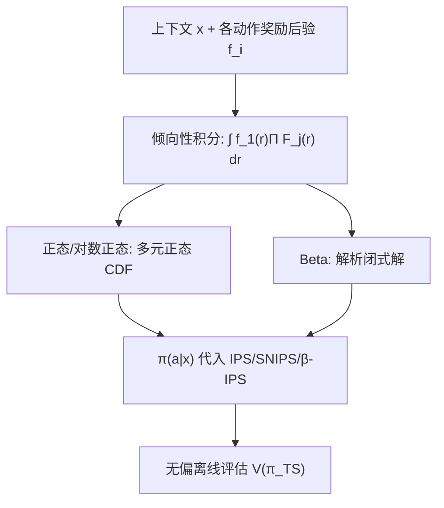

# Counterfactual Inference under Thompson Sampling (Thompson 采样下的反事实推断)

- **会议/期刊**: RecSys 2025
- **作者与机构**: Olivier Jeunen (aampe, Antwerp, Belgium)，单作者论文
- **推荐链路定位**: 召回（动作选择/探索策略）与离线评估
- **研究方向**: CTR/CVR 预估与特征交叉 / 强化学习与动态探索推荐
- **论文原文**: [https://arxiv.org/abs/2504.08773v2](https://arxiv.org/abs/2504.08773v2)
- **开源代码**: [https://github.com/olivierjeunen/ope-ts-recsys-2025](https://github.com/olivierjeunen/ope-ts-recsys-2025)

## TL;DR (1分钟核心速览)

Thompson Sampling (TS) 通过采样模型参数/奖励后验来选动作，其随机性来自"信念不确定性"而非显式动作分布，因此 IPS 类反事实估计器所需的动作倾向性 $\pi(a|x)$无法直接获得，业界只能退回低效的 Replay 方法（要求均匀随机日志策略）。本文推导出 TS 下倾向性的精确表达式：连续奖励归约为多元正态 CDF，二值奖励给出基于 Beta 函数的解析闭式解，从而让 IPS/SNIPS/$\beta$-IPS 在 TS 场景下可用。在 Open Bandit Pipeline 仿真中，估计器随样本量$N$增大无偏收敛至真实$V(\pi_{\text{TS}})$。

## Background & Motivation (背景与核心矛盾)

- **主流范式**: 反事实/离线策略评估几乎全部建立在逆倾向性加权 (IPS) 之上，核心量是日志策略的动作概率 $\pi_0(a|x)$与目标策略概率$\pi_t(a|x)$ 之比。
- **前人局限**: TS 的动作随机性源自对奖励模型后验的采样，而非对动作的显式概率建模，倾向性没有现成解析式；Amat et al. 明确指出这是 TS 的主要缺陷，实践中被迫使用 Replay 方法，要求日志策略均匀随机，样本效率远低于 IPS 系方法。
- **核心洞察 (Key Insight)**: 若把不确定性放在奖励输出而非参数上（Zhang et al. 的 reward-posterior TS），则"动作 $a_i$ 被选中"等价于"其奖励采样值在全部动作中最大"，倾向性可写成对奖励分布 PDF/CDF 的多重积分；而在末层线性假设下，参数正态后验可直接诱导出奖励的正态分布。
- **本文切入点**: 针对正态（含对数正态）与 Beta 两类最常用奖励分布，把该多重积分分别化为可高效计算的多元正态 CDF 与解析闭式解，一举打通 TS 场景下的 IPS 评估链路。

## Method (核心方法设计)

### 1. 整体框架 (Overall Architecture)

模型从"奖励后验采样"出发：对每个候选动作 $a_i$维护奖励分布$f_i$（正态或 Beta），TS 采样后取最大者作为动作。本文不改变决策流程，而是**在决策流程之外补上一个倾向性计算模块**：将"$a_1$被选中"的概率写成$\pi_\theta(a_1|x)=\int f_1(r_1)\prod_{j\neq 1}F_j(r_1)\,\mathrm{d}r_1$，再按分布族分别求闭式/半闭式解，输出$\pi(a|x)$ 供 IPS 系估计器使用，最终得到对目标 TS 策略期望奖励的无偏估计。

### 2. 关键设计拆解 (Key Designs)

1. **连续奖励的多元正态归约**：痛点是对 $n$个动作的$n$重积分无解析解。作者固定$x$、记各动作奖励为$\mathcal{N}(\mu_i,\sigma_i^2)$，证明该积分恰等于一个$(n-1)$ 维多元正态 CDF：
$$\pi_\theta(a_1|x)=F(\boldsymbol{\mu}\,|\,\boldsymbol{m},\boldsymbol{V}),\quad \boldsymbol{m}=[\mu_2,\dots,\mu_n]^\top,\ \boldsymbol{V}_{ij}=\sigma_i^2\delta_{ij}+\sigma_1^2$$
直觉是"$r_1$大于所有其他采样"可等价转化为一组相关正态变量的联合上界事件，协方差中的$\sigma_1^2$正是与$r_1$共享的随机性。该 CDF 虽无解析式但有成熟高效数值实现。对数正态因指数变换单调，可直接在$\log R$ 上复用该结论。

2. **二值奖励的 Beta 解析闭式解**：这是本文最硬的技术增量。作者先复现 Miller 的两动作解 $P(p_i>p_j)=\sum_{m=0}^{\alpha_i-1}\frac{B(\alpha_j+m,\beta_i+\beta_j)}{(\beta_i+m)B(1+m,\beta_i)B(\alpha_j,\beta_j)}$，再用**容斥原理**把$n$动作的"$a_1$最大"拆成两两比较的合取，并识别出 Miller 遗留的余项恰是"$a_1$最小"的概率$P_{\min}$；最后借 Beta 分布的对称性$P(p_i>p_j)=P(\bar p_i<\bar p_j)$（$\bar p\sim\text{Beta}(\beta,\alpha)$）直接翻转参数，得到无需迭代的闭式：
$$\pi_\theta(a_1|x)=\sum_{j_2=0}^{\beta_2-1}\cdots\sum_{j_n=0}^{\beta_n-1}\frac{B\!\left(\beta_1+\sum_{a\ge2}j_a,\ \sum_{a}\alpha_a\right)}{B(\beta_1,\alpha_1)\prod_{a\ge2}(\alpha_a+j_a)B(1+j_a,\alpha_a)}$$
复杂度为 $O(\prod_{a\ge2}\beta_a)$；当动作成功率低（$\alpha<\beta$）时，用容斥式$O(\prod\alpha_a)$更省，实现时可按$\alpha,\beta$ 大小择一，并用对数域计算规避 Beta 函数的阶乘数值溢出。

3. **训练目标、负采样与推理效率**：本文无训练损失，产出的是估计器组件。倾向性代入标准 IPS 目标 $\hat R_{\text{IPS}}=\frac{1}{|\mathcal{D}|}\sum_{(x,a,r)}r\frac{\pi_t(a|x)}{\pi_0(a|x)}$，并兼容 SNIPS 与$\beta$-IPS 做方差缩减。相比蒙特卡洛采样估计倾向性（每样本需上万次采样），闭式解把单次倾向性计算降到一次 CDF 求值或有限重求和，是让 IPS 在 TS 场景"从不可行到可行"的关键。

## Experimental Setup & Evaluation Protocol (实验设置与评估协议)

- **数据集与预处理**: 采用 Open Bandit Pipeline (OBP) 的标准合成数据生成器，非真实日志数据集，故无 5-core 等过滤；上下文嵌入维度 10，动作空间大小 10。

| 数据集 | #Users | #Items | #Interactions | 稀疏度/密度 | 特征/场景说明 |
| :--- | :---: | :---: | :---: | :---: | :--- |
| OBP-Synthetic | 合成上下文 | 10 动作 | $\|\mathcal{D}\|\in[10^2,10^6]$| 按$N$ 扫描 | 贝叶斯逻辑回归 + TS 策略仿真 |

- **数据划分与防穿越 (Splitting Strategy)**: 无传统训练/测试划分；日志策略 $\pi_0$为温度$\beta=-1.5$的 softmax，用其采样的 211 条样本训练贝叶斯逻辑回归（先验$\mathcal{N}(0,10^3)$），再在$\pi_0$采集的评估集$\mathcal{D}$上做 off-policy 估计，样本量$|\mathcal{D}|$从$10^2$扫到$10^6$。
- **排名评测协议 (Ranking Protocol)**: 非 ranking 评测，而是**全动作空间的策略价值估计**：真值 $V(\pi_{\text{TS}})$由$10^6$个上下文 ×$10^4$次蒙特卡洛采样求得，报告 99% 置信区间下 IPS/SNIPS/$\beta$-IPS 的收敛曲线。
- **对比基线与超参设置**: 对比三类 IPS 系估计器（传统 IPS、自归一化 SNIPS、$\beta$-IPS）与真值、日志策略值$V(\pi_0)$；核心验证点是"随$N$ 增大估计器是否收敛到真值"。

## Key Experimental Results (实验关键数据)

### 1. 主实验对比 (Main Results)

原文为理论型短文，主实验以图 1 的收敛曲线呈现，未给数值表格。核心结论以定性方式复述如下（数值为图示趋势）：

| 估计器 | $N=10^3$|$N=10^4$|$N=10^5$|$N=10^6$ | 收敛性 |
| :--- | :---: | :---: | :---: | :---: | :---: |
| $\hat V_{\text{IPS}}$ | 高方差偏离 | 靠近真值 | 贴近真值 | **收敛** | 无偏、方差大 |
| $\hat V_{\text{SNIPS}}$ | 偏差略大 | 靠近真值 | 贴近真值 | **收敛** | 有偏但方差小 |
| $\hat V_{\beta\text{-IPS}}$ | 较稳 | 靠近真值 | 贴近真值 | **收敛** | 偏差-方差折中 |
| $V(\pi_{\text{TS}})$ (真值) | — | — | — | 基准线 | — |
| $V(\pi_0)$ (日志策略) | — | — | — | 参照线 | — |

### 2. 消融实验 (Ablation Study)

本文无模块消融，其"消融"体现为分布族与估计器的组合覆盖：

| 配置 | 倾向性来源 | 是否可行 | 说明 |
| :--- | :--- | :---: | :--- |
| TS + Replay（前人） | 需均匀日志策略 | 受限 | 样本效率低，本文动机基线 |
| TS + 蒙特卡洛倾向性 | 万次采样近似 | 理论可行 | 计算开销不可接受 |
| TS + 本文正态闭式 | 多元正态 CDF | **可行** | 连续奖励主路径 |
| TS + 本文 Beta 闭式 | 容斥+对称性求和 | **可行** | 二值奖励主路径 |

### 3. 关键实验发现 (Key Findings)

1. **无偏性得到实证确认**：三类 IPS 估计器在 $N$从$10^2$增至$10^6$时全部收敛至$V(\pi_{\text{TS}})$，且置信区间随$N$ 收缩，直接验证了倾向性推导的正确性——这是此前 TS 场景下无法完成的评估。
2. **方差-偏差权衡在 TS 下依旧成立**：IPS 方差最大但无偏，SNIPS 方差最小但引入有限样本偏差，$\beta$-IPS 居中；说明本文贡献是"打开可用性"，而非消除 IPS 固有方差问题，后续仍需控制变量类方法配合。
3. **闭式解是可行性的分水岭**：若无本文表达式，唯一替代是蒙特卡洛采样倾向性，其开销在 $10^6$ 量级样本上不可接受；闭式解把单次倾向性计算压到一次 CDF 求值或有限重求和，使大规模离线评估在工程上成立。

## Highlights & Limitations (亮点、对比与审稿批判)

- **与代表作对比 (vs. Prior Work)**: 相比 Amat et al. 只能退回 Replay（要求均匀日志策略），本文让 IPS 系估计器在任意 TS 日志策略下可用；相比 Miller 仅手工推导 2–4 动作的 Beta 比较概率，本文用容斥+对称性给出任意 $n$ 动作的通用闭式并去掉迭代；相比 Zhang et al. 的 reward-posterior TS（只解决决策），本文补齐了其反事实评估缺口。
- **可迁移亮点**: ①"把策略随机性归约为奖励分布比较积分"的建模视角，可迁移到任何隐式随机策略（如 Gumbel-Softmax 采样、Plackett-Luce 采样）的倾向性推导；②Beta 情形下按 $\alpha$与$\beta$ 大小在两种等价求和式间切换、并在对数域计算 Beta 函数的工程技巧，可直接复用到贝叶斯 A/B 测试与 Thompson 采样的线上实现。
- **审稿级局限批判**: ①实验仅为 OBP 合成数据的概念验证，缺少真实推荐日志上的评估，且未报告倾向性计算相对推理延迟的实测开销，$n$较大时 Beta 求和复杂度$\prod\beta_a$可能爆炸；②正态情形依赖末层线性 + 参数正态后验假设，深度非线性模型下该归约不成立，且多元正态 CDF 在高维（大动作空间）下数值精度与速度均会退化，论文未讨论$n$ 的适用上界。

## Rating (四维评分)

- **方法创新性 (Novelty)**: ⭐⭐⭐⭐ （首次给出 TS 下倾向性的通用精确闭式解，Beta 情形的容斥+对称性推导干净且具一般性）
- **评估协议与实验扎实度 (Protocol & Experiments)**: ⭐⭐⭐ （仅合成数据概念验证，无真实日志与数值表格，收敛性验证充分但覆盖面窄）
- **写作与数学规范度 (Clarity & Rigor)**: ⭐⭐⭐⭐ （推导链条完整、附录补齐 Miller 引理，复杂度与数值稳定性讨论到位）
- **工业落地与复现价值 (Industrial & Practical Value)**: ⭐⭐⭐⭐ （代码开源、直接嵌入 OBP 生态，为 TS 线上系统的离线评估提供了即插即用的倾向性计算组件）

