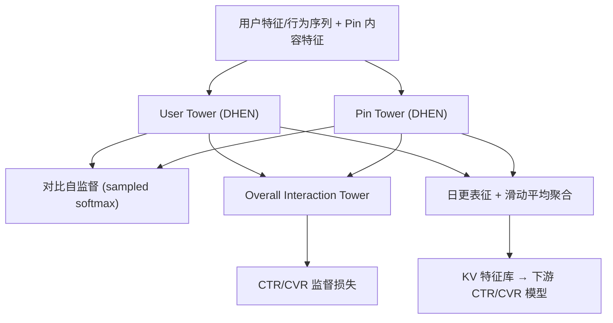
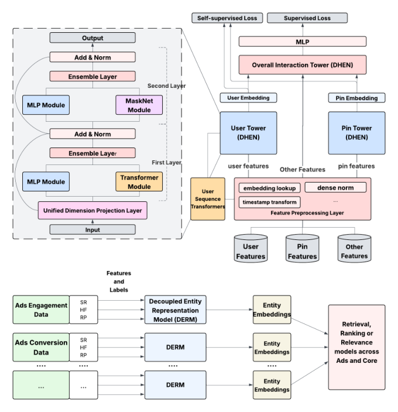

# Decoupled Entity Representation Learning for Pinterest Ads Ranking (Pinterest 广告排序的解耦实体表征学习)

- **会议/期刊**: RecSys 2025
- **作者与机构**: Jie Liu, Yinrui Li, Jiankai Sun 等（Pinterest, Inc.）
- **推荐链路定位**: 召回（ANN 检索）+ 精排（CTR/CVR 预估）
- **研究方向**: CTR/CVR 预估与特征交叉 / 自监督对比学习
- **论文原文**: [https://arxiv.org/abs/2509.04337v1](https://arxiv.org/abs/2509.04337v1)
- **开源代码**: 暂未开源

## TL;DR (1分钟核心速览)

Pinterest 广告系统面临多场景（Home Feed / Related Pins / Search）与多优化目标（CTR / CVR）导致实体表征碎片化、跨域知识难以共享的痛点。本文提出解耦式上游-下游框架 DERM：上游用三塔（User / Pin / Overall Interaction）多任务架构离线产出用户与 Pin 表征，塔间加 sampled-softmax 对比自监督任务，并用 $w=0.8$ 的滑动平均聚合日更表征以稳定分布；下游将表征作为特征注入 CTR/CVR 模型。离线 CTR 任务 ROC-AUC 提升 0.19%、PR-AUC 提升 0.46%，线上 Related Pins 场景 CTR +1.38%、gCTR +1.96%，CVR 侧 CPA 降低 1.61%。

## Background & Motivation (背景与核心矛盾)

- **主流范式**: 工业推荐普遍采用双塔（user/item 内积）或单模型端到端训练实体 embedding，表征与具体任务强耦合。
- **前人局限**: 其一，每个 surface 与广告优化类型拥有独立数据集与独立模型，表征碎片化、信息无法共享；其二，基础设施限制使单模型只能吃部分特征，无法获得用户行为的全局视图。
- **核心洞察 (Key Insight)**: 实体表征（用户是谁、Pin 是什么）本质上是**任务无关**的，可以被"解耦"出来离线预计算并定期刷新，从而让上游与下游异步服务，同时把多源信号（CTR 数据 + CVR 数据）汇入同一表征空间。
- **本文切入点**: 用"上游多塔预训练 + 下游特征注入"的范式替代端到端耦合训练，并用对比自监督与滑动平均解决表征质量与分布漂移问题。

## Method (核心方法设计)

### 1. 整体框架 (Overall Architecture)

DERM 上游模型以 Pinterest 两条大规模生产数据（CTR 与 CVR 各训一个上游模型）为输入，每个模型含三个塔：User Tower 处理用户行为序列、人口统计、兴趣与预训练表征；Pin Tower 处理广告 Pin 的内容元数据与聚合统计特征；两塔均采用多层 DHEN 主干（每层由 MaskNet / Transformer / MLP 中选两个特征交叉模块组成）。两塔输出与上下文/交互特征一起送入 Overall Interaction Tower 做最终交叉——这一"overtower"设计刻意把交互上下文隔离在外，避免其污染核心实体表征。训练完成后，User/Pin 塔输出即为实体表征，按天离线生成、滑动平均聚合后写入 KV 特征库，供下游 CTR（MoE + DCNv2 + Transformer 序列编码）与 CVR（DHEN）模型作为输入特征消费。

<figure class="paper-figure" markdown="span">
  <figcaption>图1：（上）DERM 模型架构与（下）上游-下游框架。上游模型采用三塔多任务学习架构。用户塔与 Pin 塔使用多层 DHEN 主干并处理相应实体（用户或广告 Pin）特征。各塔输出与其他特征一起输入整体交互塔进行最终交叉。为提升模型性能，我们在两个塔的输出之间加入自监督学习任务。预训练嵌入被多个下游领域使用</figcaption>
</figure>

### 2. 关键设计拆解 (Key Designs)

1. **三塔解耦 + Overtower 隔离交互上下文**：痛点在于若把交互特征与实体特征混在同一塔内联合训练，上下文噪声会污染实体表征、降低其跨任务稳定性。本文将交互特征全部推给 Overall Interaction Tower，User/Pin 塔只吃纯实体特征，使产出的表征可被多个下游任务复用。直觉上这相当于把"实体是什么"与"这次曝光发生了什么"显式分离，表征的方差更小、迁移性更强。

2. **塔间对比自监督（Sampled Softmax + 频率偏差校正）**：仅靠 CTR/CVR 稀疏监督信号，实体塔学到的表征判别力不足。本文对每个正样本对 $(u_i, p_i)$引入 batch 内随机负采样，并加入采样频率校正项$Q(\cdot)$与可训练温度$\tau$：

$$\mathcal{L}_{u_i,p_i}=-\log\frac{e^{\mathbf{u}_i^{\top}\mathbf{p}_i/\tau-\log Q(p_i)}}{e^{\mathbf{u}_i^{\top}\mathbf{p}_i/\tau-\log Q(p_i)}+\sum_{p_j\in N_i^-}e^{\mathbf{u}_i^{\top}\mathbf{p}_j/\tau-\log Q(p_j)}}$$

其中 $-\log Q(p)$ 校正了热门 Pin 在 batch 中被过度采样的偏差，使对比目标逼近无偏的全库 softmax。该损失与 CTR/CVR 监督损失加权求和作为总目标，负采样为 in-batch 随机负例（非 hard negative），无需额外负采样服务。

3. **滑动平均表征聚合（Embedding Shift 平滑）**：日更表征会因数据分布抖动导致下游特征漂移。本文用 $E_{\text{agg}}(t)=wE_{\text{agg}}(t-1)+(1-w)E_{\text{daily}}(t)$聚合，且实验发现$w=0.8$（**更重历史**）最优——说明表征稳定性比新鲜度对下游更关键，这与常规"越新越好"的直觉相反。

## Experimental Setup & Evaluation Protocol (实验设置与评估协议)

- **数据集与预处理**: 使用 Pinterest 两条大规模广告生产数据集（CTR 预测数据与 CVR 预测数据）分别训练上游模型；论文未披露具体用户/物品规模与过滤规则，属工业界常见的"生产数据不公开统计"设定。

| 数据集 | #Users | #Items | #Interactions | 稀疏度/密度 | 特征/场景说明 |
| :--- | :---: | :---: | :---: | :---: | :--- |
| Pinterest CTR 生产数据 | 未披露 | 未披露 | 未披露 | 未披露 | 用户序列、人口统计、兴趣、Pin 元数据 |
| Pinterest CVR 生产数据 | 未披露 | 未披露 | 未披露 | 未披露 | 转化优化广告 campaign 数据 |

- **数据划分与防穿越 (Splitting Strategy)**: 未明确说明，按工业惯例应为时间切分（表征按天离线生成、次日上线，天然具备时序隔离）。
- **排名评测协议 (Ranking Protocol)**: 离线采用 ROC-AUC 与 PR-AUC 的**相对提升（Lift %）**而非绝对值；线上采用 10%（CTR）/ 9%（CVR）流量的 A/B 测试，指标为 CTR、gCTR、CPA、cCVR、vCVR，全部标注 stats-sig。
- **对比基线与超参设置**: 离线实验以"不使用 DERM 表征的生产模型"为 control，未对比外部学术基线（如双塔、SGL 等），属工业论文典型设定；温度 $\tau$可训练，聚合权重$w$网格搜索于$\{0.2, 0.5, 0.8\}$。

## Key Experimental Results (实验关键数据)

### 1. 主实验对比 (Main Results)

**表 1：表征聚合策略对下游 CVR 任务的离线 AUC Lift**

| 聚合策略 | ACC | MA $w$=0.2 | MA$w$=0.5 | **MA$w$=0.8** | AP |
| :--- | :---: | :---: | :---: | :---: | :---: |
| AUC Lift (%) | 0.02 | 0.03 | 0.06 | **0.09** | 0.03 |

**表 2：DERM 表征数量对下游 CTR 任务的影响（ROC-AUC / PR-AUC Lift %）**

| CTR-User | CTR-Item | CVR-User | CVR-Item | ROC-AUC Lift | PR-AUC Lift |
| :---: | :---: | :---: | :---: | :---: | :---: |
| ✓ | ✗ | ✗ | ✗ | 0.095 | 0.20 |
| ✗ | ✗ | ✓ | ✗ | 0.059 | 0.14 |
| ✓ | ✓ | ✗ | ✗ | 0.160 | 0.40 |
| ✓ | ✗ | ✓ | ✗ | 0.120 | 0.25 |
| ✗ | ✗ | ✓ | ✓ | 0.083 | 0.19 |
| **✓** | **✓** | **✓** | **✓** | **0.190** | **0.46** |

**表 3：线上 A/B 测试（Related Pins 场景，全部 stats-sig）**

| 指标 | 全平台 RP | Shopping Ads | Non-Shopping Ads |
| :--- | :---: | :---: | :---: |
| CTR Lift (%) | **+1.38** | +2.83 | +1.31 |
| gCTR Lift (%) | **+1.96** | +3.74 | +1.83 |
| CPA 变化 (%) | — | **-1.61**（全 surface） | — |
| cCVR / vCVR Lift (%) | — | **+2.75 / +2.80** | — |

### 2. 消融实验 (Ablation Study)

论文未设传统"w/o 模块"消融表，其消融以**表征来源组合**与**聚合策略**两种形式呈现（即表 1、表 2），核心对照如下：

| 配置 | ROC-AUC Lift (%) | 说明 |
| :--- | :---: | :--- |
| 仅 CTR-User | 0.095 | 单源单实体 |
| 仅 CVR-User | 0.059 | 跨任务单实体 |
| CTR-User + CTR-Item | 0.160 | 同源双实体 |
| 四类表征全用 | **0.190** | 多源多实体融合 |

### 3. 关键实验发现 (Key Findings)

1. **多源融合严格优于单源**：四类表征全用（0.190）比仅用 CTR 双塔（0.160）再提升 0.03 个点，且 CVR 表征单独使用（0.059）虽弱但仍有正贡献，证明 CTR 与 CVR 数据确实携带互补的实体语义，验证了"解耦多源"的核心假设。
2. **历史权重越高越好，反直觉但一致**：$w=0.8$的 MA（0.09%）显著优于$w=0.2$（0.03%）与平均池化（0.03%），说明日更表征的抖动是下游性能的主要敌人，稳定性优先于时效性。
3. **Shopping Ads 收益远大于 Non-Shopping**：线上 Shopping Ads 的 CTR 提升 2.83% 约为 Non-Shopping（1.31%）的两倍，暗示商品类广告的实体特征更结构化、更易被解耦表征捕获，而内容类广告的收益更多来自上下文而非实体本身。

## Highlights & Limitations (亮点、对比与审稿批判)

- **与代表作对比 (vs. Prior Work)**: 相比经典双塔（仅内积相似度训练），本文用 overtower 显式建模交互并隔离上下文；相比同团队前作 [18]（仅做用户表征），本文扩展到 User+Pin 双实体并加入对比自监督；相比图方法（如 LightGCN 类）与序列 Transformer 方法，本文不追求单一技术深度，而是以工程框架整合多源监督与无监督信号。
- **可迁移亮点**: (1) "实体塔 + overtower 隔离交互特征"的拆分方式可直接迁移到任何需要复用表征的多任务推荐系统；(2) 对比损失中的 $-\log Q(p)$ 频率校正项是低成本消除 in-batch 负采样流行度偏差的实用技巧。
- **审稿级局限批判**: 其一，全文无公开数据集、无外部学术基线对比，离线仅报告相对 Lift 而无绝对值，复现与横向比较几乎不可能；其二，对比自监督仅用随机 in-batch 负例，未探索 hard negative，且表征日更 + 滑动平均带来的离线-线上一日延迟在冷启动物品上可能造成覆盖缺口，论文未做冷启动分桶分析。

## Rating (四维评分)

- **方法创新性 (Novelty)**: ⭐⭐⭐ （三塔解耦与频率校正对比损失组合实用，但各组件均有前作影子，属工程整合型创新）
- **评估协议与实验扎实度 (Protocol & Experiments)**: ⭐⭐⭐ （线上 A/B 数据充分且 stats-sig，但离线缺公开数据集、缺外部基线与绝对值）
- **写作与数学规范度 (Clarity & Rigor)**: ⭐⭐⭐ （框架描述清晰、公式简洁，但数据集统计、划分方式与超参细节披露不足）
- **工业落地与复现价值 (Industrial & Practical Value)**: ⭐⭐⭐⭐ （已在 Pinterest 生产环境部署并带来显著线上收益，异步上游-下游范式对工业界极具参考价值，但无开源代码）

