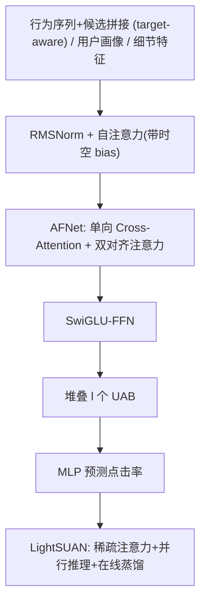
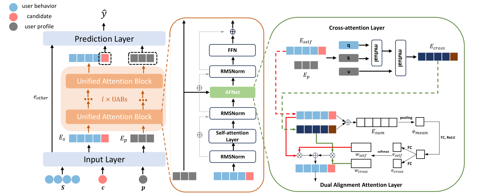
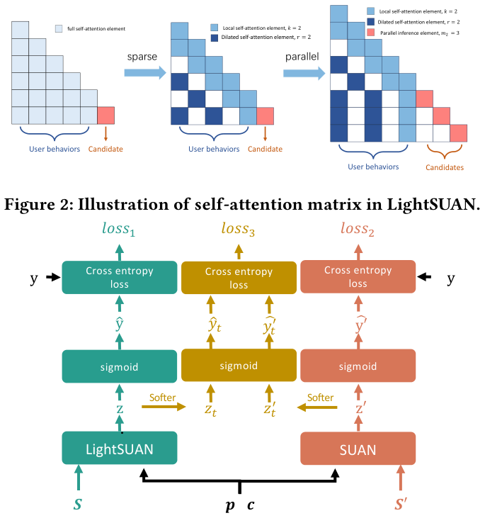

# Exploring Scaling Laws of CTR Model for Online Performance Improvement (探索 CTR 模型的缩放律以提升线上性能)

- **会议/期刊**: RecSys 2025
- **作者与机构**: Weijiang Lai, Beihong Jin 等（中科院软件所/国科大）+ 美团
- **推荐链路定位**: 精排（CTR 预估）
- **研究方向**: CTR 预估与特征交叉 / 序列推荐
- **论文原文**: [https://arxiv.org/abs/2508.15326v2](https://arxiv.org/abs/2508.15326v2)
- **开源代码**: [https://github.com/laiweijiang/SUAN](https://github.com/laiweijiang/SUAN)

## TL;DR (1分钟核心速览)

CTR 模型长期陷入"精度-延迟"两难：能涨点的模型往往推不动线上。本文提出 SUAN（Stacked Unified Attention Network），用统一注意力块 UAB 同时建模序列与非序列特征，使 AUC 在模型规模、序列长度、数据量三个维度上跨越三个数量级呈现幂律缩放；再用稀疏自注意力+并行推理构造轻量 LightSUAN，并以在线蒸馏从高等级 SUAN 迁移知识。在工业数据集上 SUAN 达 AUC 0.7098（RelaImpr +4.80%），蒸馏后 LightSUAN 反超高一等级 SUAN，线上 A/B 提升 CTR 2.81%、CPM 1.69%，推理时延仅 43ms。

## Background & Motivation (背景与核心矛盾)

- **主流范式**: CTR 模型分两支——特征交叉派（DIN、CAN 等）与行为序列派（BST、SIM/ETA/TWIN 等长序列两阶段检索）。
- **前人局限**: ① 现有 CTR 模型已进入瓶颈期，AUC 提升 0.001 即被视为显著，单纯扩大 embedding 维度或预测层参数并不能带来可扩展收益；② 已有缩放律工作（Wukong、HSTU、LSRM）只证明"大模型更强"，却未回答"在严格推理时延约束下线上如何吃到缩放律红利"。
- **核心洞察 (Key Insight)**: 作者将"模型等级 (model grade)"重新定义为 **模型规模 + 输入行为序列长度** 的联合量，并观察到 AUC 对二者均服从幂律且存在约 0.72 的固定上界；同时发现 RMSNorm + pre-norm 是维持缩放律不被异常梯度破坏的关键正则。
- **本文切入点**: 先造一个"可缩放"的 CTR 骨干 SUAN，再用在线蒸馏把高等级教师的能力压进低等级学生，实现"训练时无限大、推理时足够小"。

## Method (核心方法设计)

### 1. 整体框架 (Overall Architecture)

输入层将行为常规特征（item ID、类目 ID）拼接以缓解稀疏，并把候选特征追加到行为序列尾部构成 **target-aware 序列** $E_s\in\mathbb{R}^{L\times n_1d}$；用户画像$E_p$与其余细节特征$e_{other}$分别嵌入。序列经$l$个堆叠 UAB 编码，取末块候选位置表示$E_{block}[-1,:]$与$e_p$、$e_{other}$拼接送入 MLP 输出点击概率$\hat{y}=\sigma(\mathrm{MLP}(\cdot))$，以标准 BCE 优化。线上部署时替换为 LightSUAN（稀疏注意力+并行推理），并通过在线蒸馏与高等级 SUAN 同步训练。

<figure class="paper-figure" markdown="span">
  <figcaption>图1：SUAN 的架构。</figcaption>
</figure>

### 2. 关键设计拆解 (Key Designs)

1. **统一注意力块 UAB（序列与非序列特征一体化建模）**：痛点在于画像特征与行为特征长期分塔建模、特征空间不一致。UAB 先以带相对时间/位置偏置的自注意力建模序列：$\mathrm{bias}_{ij}=f_1(\Delta t_{ij})+f_2(\Delta p_{ij})$，注意力为$\mathrm{softmax}(Q_1K_1^\top/\sqrt{n_1d}+\mathrm{bias})V_1$；随后 AFNet 用 **单向 cross-attention**（序列作 Query、画像作 Key/Value）从画像视角筛除噪声行为，再用 **双对齐注意力** 做通道级门控融合：$w=\mathrm{softmax}([e_{self};e_{cross}])$，$E_{AFN}=w_{self}\odot E_{self}+w_{cross}\odot E_{cross}$。直觉是"画像更准、行为更细"，单向注入避免行为噪声污染画像。
2. **LLM 组件迁移（RMSNorm + pre-norm + SwiGLU）**：首次将 LLM 训练稳定性技巧引入 CTR。RMSNorm 仅用均方根归一化，抑制离群值导致的异常梯度；pre-norm 在块首归一化，避免深层 post-norm 的梯度消失/爆炸；FFN 采用 $(\phi(E W_1)\odot E W_2)W_3$ 的 SwiGLU 门控。消融显示这两项是缩放律成立的必要条件（见下文 Variant F/G）。
3. **训练目标、稀疏化与在线蒸馏**：LightSUAN 用局部窗口 $k$+ 空洞率$r$的稀疏自注意力将复杂度从$O(B l L^2 n_1d)$降至$O(B l L(k+L/r)n_1d)$；并行推理利用因果编码器"行为表示与候选无关"的性质，一次前向处理$m_2$个候选，推理次数降为$\lceil m_1/m_2\rceil$。蒸馏损失为$\mathcal{L}=\mathcal{L}_{ce}(\hat{y},y)+\mathcal{L}_{ce}(\hat{y}',y)+\lambda\mathcal{L}_{ce}(\hat{y}_t,\hat{y}'_t)$，温度$t=2$、$\lambda=t$以抵消$1/t$的梯度缩放；训练时给学生喂$S$、教师喂更长的$S'$，实现"学生看短序列、学教师看长序列的知识"。

<figure class="paper-figure" markdown="span">
  <figcaption>图3：在线蒸馏的示意图。</figcaption>
</figure>

## Experimental Setup & Evaluation Protocol (实验设置与评估协议)

- **数据集与预处理**:

| 数据集 | #Users | #Items | #Interactions | 稀疏度/密度 | 特征/场景说明 |
| :--- | :---: | :---: | :---: | :---: | :--- |
| Industry（美团） | 88,976,000 | 14,054,691 | 1,230,715,133 | 极稀疏 | 近一年最多 1000 条行为，7 天活跃用户采样 |
| Taobao（阿里） | 1,141,729 | 461,527 | 700,000,000 | 极稀疏 | 展示广告系统 22 天行为，含行为类型与时间 |
| Eleme（饿了么） | 14,427,689 | 7,446,116 | 128,000,000 | 极稀疏 | 30 天行为，item+behavior 特征丰富 |

- **数据划分与防穿越**: 按时间窗口采样训练样本（工业集取 3/7/14/30/45/90 天切片做数据缩放实验），属时间切分范式，未使用 Leave-One-Out。
- **排名评测协议**: 离线采用 **AUC** 与相对提升 **RelaImpr**（以 DIN 为基），未报告 Full-Ranking 或采样排序细节；线上 A/B 采用 CTR、CPM 与平均推理时延。
- **对比基线与超参**: 8 个基线分三组——Group I 特征交叉（DIN、CAN）、Group II 长序列两阶段（SoftSIM、HardSIM、ETA、TWIN）、Group III 序列建模（BST、HSTU）。所有模型 embedding 维度 $d=8$、预测层 MLP 结构 [1024,512,256,1]、Dice 激活；SUAN 与 Group III 编码层$l=2$、头数$h=2$；工业/Taobao 长序列长度 1000、短序列 100，Eleme 分别为 50/10；蒸馏$t=\lambda=2$；AUC 做$t$-test，$p<0.05$ 全部显著。

## Key Experimental Results (实验关键数据)

### 1. 主实验对比 (Main Results)

| 数据集 | 指标 | DIN | CAN | ETA | TWIN | BST | HSTU | **SUAN** | **SUAN(L)** |
| :--- | :--- | :---: | :---: | :---: | :---: | :---: | :---: | :---: | :---: |
| Industry | AUC | 0.7002 | 0.7004 | 0.7028 | 0.7028 | 0.7036 | 0.7098 | **0.7098** | **0.7135** |
| Industry | RelaImpr | 0.00% | 0.10% | 1.30% | 1.30% | 1.70% | 4.80% | **4.80%** | **6.64%** |
| Eleme | AUC | 0.6363 | 0.6378 | 0.6410 | 0.6600 | 0.6631 | 0.6669 | **0.6669** | **0.6690** |
| Eleme | RelaImpr | 0.00% | 1.10% | 3.44% | 17.38% | 19.66% | 22.45% | **22.45%** | **23.99%** |
| Taobao | AUC | 0.6198 | 0.6184 | 0.6215 | 0.6370 | 0.6397 | 0.6472 | **0.6472** | **0.6495** |
| Taobao | RelaImpr | 0.00% | -1.17% | 1.42% | 14.36% | 16.61% | 22.87% | **22.87%** | **24.97%** |

> 注：原文表中 SUAN 与 HSTU 数值并列最优（SUAN 标准差 ±0.00004~±0.00048），SUAN(L) 为长序列版本，全面领先。

### 2. 消融实验 (Ablation Study)

| 模型 | Industry | Eleme | Taobao |
| :--- | :---: | :---: | :---: |
| SUAN 完整版 | **0.7098** | **0.6669** | **0.6472** |
| w/o SwiGLU (A) | 0.7093 | 0.6644 | 0.6468 |
| w/o AFNet (B) | 0.7075 | 0.6644 | 0.6431 |
| 双对齐→直接相加 (C) | 0.7080 | 0.6652 | 0.6441 |
| w/o target-aware 序列 (D) | 0.7042 | 0.6638 | 0.6434 |
| w/o 注意力 bias (E) | 0.7040 | 0.6631 | 0.6433 |

| 缩放律正则消融 | size-2 | size-4 |
| :--- | :---: | :---: |
| SUAN | 0.7098±0.00004 | **0.7133±0.00128** |
| LayerNorm 替代 RMSNorm (F) | 0.7092±0.00068 | 0.7097±0.00331 |
| post-norm 替代 pre-norm (G) | 0.7097±0.00019 | 0.7064±0.00463 |

### 3. 关键实验发现 (Key Findings)

1. **缩放律真实存在且可拟合**：工业集上 AUC 对非嵌入参数服从 $\mathrm{AUC}(C)=E_1-A_1/(C-B_1)^\alpha$（$R^2\approx0.998$），对序列长度服从$\mathrm{AUC}(L)=E_2-A_2/L^\beta$，对数据量服从$\mathrm{AUC}(D)=E_3-A_3/D^\gamma$；三者上界$E_1\approx E_2\approx0.72$，而$E_3$更高、$\gamma$ 更小，说明 **扩数据比扩模型等级更划算**。
2. **正则项是缩放律的"守门人"**：size-4 时 Variant F/G 的 AUC 分别跌至 0.7097/0.7064 且方差放大，证明 RMSNorm+pre-norm 通过抑制离群值维持了深层可扩展性；而 Variant E（去注意力 bias）在三个数据集上跌幅最大（0.7098→0.7040），说明相对时空位置信息是行为关系建模的核心。
3. **蒸馏让学生"越级打怪"**：DistilSUAN-3（学生 LightSUAN-1，教师 SUAN-3）AUC 0.7139，比学生自身 0.7095 提升 6‰，并超过更大模型规模的 SUAN-1（0.7133）与更长序列的 SUAN(L)（0.7135）；线上 DistilSUAN-3 相比基线 CTR +2.81%、CPM +1.69%，时延 43ms 反低于原始 SUAN 的 48ms。

## Highlights & Limitations (亮点、对比与审稿批判)

- **与代表作对比 (vs. Prior Work)**: 相比 Wukong（仅做特征交叉缩放）与 HSTU（仅证明 FLOPs 缩放），本文首次把"缩放律"与"线上可部署"闭环打通；相比 SIM/ETA/TWIN 的两阶段长序列检索，SUAN 用单塔因果编码器直接建模长序列，避免了子序列检索的信息损失，且天然支持候选并行推理。
- **可迁移亮点**: ① "高等级教师 + 低等级学生 + 学生看短序列/教师看长序列"的在线蒸馏范式，可迁移到任何受时延约束的精排模型升级；② 局部+空洞稀疏注意力与因果编码器的并行推理改造，是长序列 CTR 降本的通用工程技巧。
- **审稿级局限批判**: ① 缩放律拟合仅在单一工业数据集上完成，公开数据集（Eleme/Taobao）样本量不足以验证三级量级，泛化性存疑；② 离线仅报告 AUC，缺少 GAUC、LogLoss 等排序/校准指标，且未说明负采样与全库排序协议，评估维度偏窄；③ 蒸馏收益依赖教师等级足够高，教师训练成本与在线同步训练的工程复杂度未量化。

## Rating (四维评分)

- **方法创新性 (Novelty)**: ⭐⭐⭐⭐ （UAB 统一序列/非序列建模 + 缩放律正则归因有新意，但注意力组件多为 LLM 组件的迁移组合）
- **评估协议与实验扎实度 (Protocol & Experiments)**: ⭐⭐⭐⭐ （三数据集+线上 A/B+三级量级缩放拟合+显著性检验完整，但离线指标单一、缺排序协议细节）
- **写作与数学规范度 (Clarity & Rigor)**: ⭐⭐⭐⭐ （公式与复杂度分析清晰，幂律拟合给出 $R^2$，符号略密）
- **工业落地与复现价值 (Industrial & Practical Value)**: ⭐⭐⭐⭐⭐ （开源代码、线上 CTR +2.81% 实测、时延反降，工程闭环完整）

