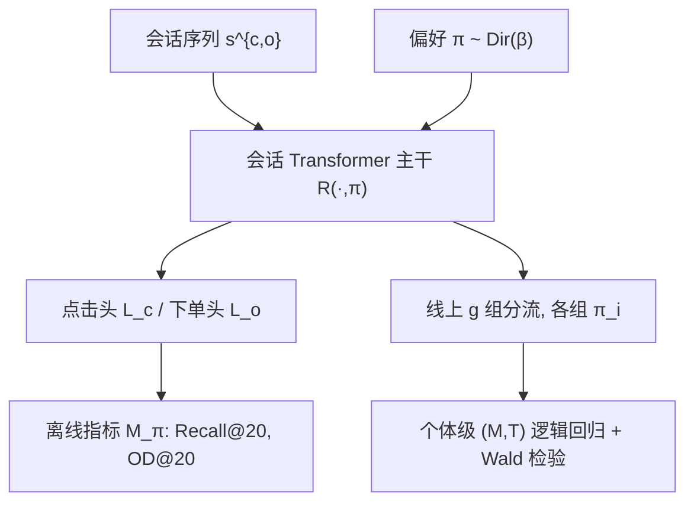

# Identifying Offline Metrics that Predict Online Impact: A Pragmatic Strategy for Real-World Recommender Systems (识别能预测线上影响的离线指标：面向真实推荐系统的务实策略)

- **会议/期刊**: RecSys 2025
- **作者与机构**: Timo Wilm (OTTO GmbH & Co. KGaA), Philipp Normann (TU Wien / 前 OTTO)
- **推荐链路定位**: 精排（会话级 next-item 打分）+ 线上 A/B 分流
- **研究方向**: CTR/CVR 预估与特征交叉 / 序列与会话推荐
- **论文原文**: [https://arxiv.org/abs/2507.09566v1](https://arxiv.org/abs/2507.09566v1)
- **开源代码**: [https://github.com/otto-de/MultiTRON](https://github.com/otto-de/MultiTRON)

## TL;DR (1分钟核心速览)

本文针对"离线指标能否预测线上 KPI"这一长期痛点，提出一种基于帕累托前沿近似的务实策略：训练**单个**偏好条件化模型 $\mathcal{R}(\cdot,\boldsymbol{\pi})$，在推理时按不同偏好向量$\boldsymbol{\pi}_i$将线上流量随机切成$g$组，从而以一次实验、一个模型同时评估多组离线指标与线上 KPI 的关系。在 OTTO 电商平台 2650 万次曝光的大规模线上实验中，验证了 Recall@20 显著正向预测 CTR（$p<10^{-4}$）、新定义的 OD@20 正向预测 CVR（$p=0.008$）、二者乘积预测销量（$p<10^{-4}$），并发现 Recall@20 对 CVR 存在显著负向关系（$p=0.017$）。

## Background & Motivation (背景与核心矛盾)

- **主流范式**: 学术界依赖离线基准（Recall/NDCG）选型，工业界依赖线上 A/B 测试；二者之间存在系统性鸿沟，离线提升常无法转化为线上 KPI 提升。
- **前人局限**: (1) 反事实/Off-policy 评估受偏差-方差权衡制约，难以规模化；(2) 传统"多模型并行部署"的相关性研究需同时训练、部署、维护多个模型变体，在大规模系统中成本不可接受。
- **核心洞察 (Key Insight)**: 帕累托前沿近似技术已能在**单个**深度模型内于推理时访问整条前沿——这意味着"多组不同离线指标配置"可以由同一模型的不同偏好 $\boldsymbol{\pi}$ 实例化，从而把"多模型并行实验"降维成"单模型多偏好分流"。
- **本文切入点**: 用偏好条件化模型 + 随机流量分组 + 个体级逻辑回归，把离线指标与线上 KPI 的对齐关系做成可统计检验的假设。

## Method (核心方法设计)

### 1. 整体框架 (Overall Architecture)

模型以会话序列 $s^{c,o}=[(c_1,o_1),\dots,(c_{T-1},o_{T-1})]$为输入（$c_t$为点击物品，$o_t$为是否已下单），经会话 Transformer 主干（MultiTRON，3 层、隐层 256）编码，同时输出点击与下单两路预测。训练时从 Dirichlet 分布采样偏好$\boldsymbol{\pi}$注入模型输入并标量化多目标损失；推理时对$g$个固定偏好$\{\boldsymbol{\pi}_i\}$分别计算离线指标$\{M_{\boldsymbol{\pi}_i}\}$，线上将流量随机均分为$g$组、每组下发对应$\boldsymbol{\pi}_i$，收集个体级$(M,T)$ 样本后做逻辑回归与 Wald 检验。

### 2. 关键设计拆解 (Key Designs)

1. **偏好条件化帕累托前沿（单模型多配置）**：痛点在于多目标权衡需多模型；本文在训练时采样 $\boldsymbol{\pi}\sim\mathrm{Dir}(\boldsymbol{\beta})$并标量化损失，配合非均匀性正则$\mathcal{L}_{reg}$ 保证前沿覆盖广度：
$$\mathbb{E}_{\boldsymbol{\pi}}\mathcal{L}=\mathbb{E}_{\boldsymbol{\pi}}\Big[\sum_{k=1}^{m}\pi_k\mathcal{L}_k\big(\mathcal{R}(\cdot,\boldsymbol{\pi}),y_k\big)+\lambda\mathcal{L}_{reg}(\boldsymbol{\pi})\Big]$$
直觉：$\boldsymbol{\pi}$成为"连续可调的旋钮"，推理时任意$\boldsymbol{\pi}$ 即对应前沿上一点，故一次部署即可服务全部实验组。

2. **订单密度 OD@20（离线 CVR 代理）**：传统 Recall 只衡量"点没点中"，无法反映"点了会不会买"。本文定义
$$M^{o}_{\boldsymbol{\pi}}\coloneqq\frac{\sum_{i=1}^{C}\mathbb{I}\{\mathrm{rank}(c_i)\le 20,\,o_i=1\}}{\sum_{i=1}^{C}\mathbb{I}\{\mathrm{rank}(c_i)\le 20\}}$$
即"Top-20 中被点击物品的经验下单概率"，直接对齐 post-click CVR 的语义；乘积指标 $M^{c,o}_{\boldsymbol{\pi}}=M^{c}_{\boldsymbol{\pi}}\cdot M^{o}_{\boldsymbol{\pi}}$ 则联合刻画"点得中且买得成"，作为销量的离线代理。

3. **辅助失真损失（单目标系统兼容）**：若系统只有单目标 $\mathcal{L}_1$，则无法构成前沿。本文引入
$$\mathcal{L}_{d}(x)=\mathrm{CE}\big(\mathcal{R}(x,\boldsymbol{\pi})\,\|\,\mathbf{1}/c\big)$$
把预测推向均匀分布，人为制造与 $\mathcal{L}_1$ 的对抗压力，形成第二根轴。开销极低、可无缝插入现有模型，是把该策略推广到单目标工业系统的关键工程补丁。

4. **训练目标、负采样与推理效率**：总损失为采样 softmax 点击损失 $\mathcal{L}_c$与 BCE 下单损失$\mathcal{L}_o$的偏好加权和（$\beta=[0.5,0.5]$，$\lambda=1$）。点击任务采用 sampled softmax 负采样。推理侧仅需一次前向 + 按$\boldsymbol{\pi}_i$ 标量重加权，无额外模型副本，这是相对"多模型并行"的核心成本优势。

## Experimental Setup & Evaluation Protocol (实验设置与评估协议)

- **数据集与预处理**: 使用 OTTO 平台私有会话数据，会话建模为 $(c_t,o_t)$ 对序列，任务为 next-item 点击/下单联合预测。数据统计未在文中以表格披露（工业私有数据），仅给出线上曝光规模。

| 数据集 | #Users | #Items | #Interactions | 稀疏度/密度 | 特征/场景说明 |
| :--- | :---: | :---: | :---: | :---: | :--- |
| OTTO 私有会话数据 | 未披露 | 未披露 | 未披露 | 未披露 | 电商会话，点击+下单双行为；线上 5 组 × ~530 万曝光 ≈ 2650 万 |

- **数据划分与防穿越 (Splitting Strategy)**: 离线采用**时间序切分**（temporal train-test split），测试集用于计算 $\{M_{\boldsymbol{\pi}_i}\}$；线上实验在 2024 年连续两周进行，流量随机均分 5 组（$g=5$，每组 20% 用户）。
- **排名评测协议 (Ranking Protocol)**: 离线指标为 Top-20 截断的 Recall@20 与 OD@20（全候选打分下的截断统计，非采样排序）；线上 KPI 为 CTR、post-click CVR、units sold，均以相对最差组的百分比变化报告。
- **对比基线与超参设置**: 本文非"模型 vs 模型"的精度竞赛，而是"指标 vs KPI"的对齐检验，故无传统 Baseline 表；统计检验采用个体级（$n\approx26.5\times10^6$）逻辑回归 + Wald 检验，$\alpha=0.05$，报告参数估计、p 值与 95% 置信区间。模型超参：3 层 Transformer、隐层 256、学习率$10^{-4}$、batch 1024、训练 10 epoch。

## Key Experimental Results (实验关键数据)

### 1. 主实验对比 (Main Results)

原文以假设检验表替代传统主实验表，此处保留四个假设的完整统计结果（加粗为显著项）：

| 假设 | 离线指标 $M_{\boldsymbol{\pi}}$| 线上 KPI$K_{\boldsymbol{\pi}}$ | 回归参数 | p-value | 95% CI |
| :--- | :--- | :--- | :---: | :---: | :---: |
| $H_1$| Recall@20 | CTR | **0.8985** | **$<10^{-4}$** | [0.870, 0.927] |
| $H_2$ | OD@20 | CVR (post-click) | **1.2608** | **0.0080** | [0.329, 2.193] |
| $H_3$| Recall@20 · OD@20 | units sold | **0.7621** | **$<10^{-4}$** | [0.557, 0.967] |
| $H_4$| Recall@20 | CVR (post-click) | **$-0.204$** | **0.0174** | [$-0.372$,$-0.036$] |

边际效应解读：Recall@20 每提升 1%，CTR 提升约 0.9%，而 CVR 仅下降约 0.2%——即"牺牲 OD 换 Recall"在销量口径上仍是净收益。

### 2. 消融实验 (Ablation Study)

本文为策略/实证型论文，未设传统模块消融；其"消融"实质体现为四个假设的相互对照与辅助失真损失的引入必要性：

| 配置 / 对照 | 关键结论 |
| :--- | :--- |
| 仅 $H_1$（Recall→CTR） | 强正相关，验证点击代理有效 |
| 仅 $H_2$（OD→CVR） | 正相关但方差大（CI 宽），因 CVR 依赖低支撑事件 |
| $H_3$（乘积→销量） | 最强联合代理，$n$ 大故 CI 窄 |
| $H_4$（Recall→CVR） | 显著负相关，证实前沿上的目标冲突 |
| w/o $\mathcal{L}_d$（单目标系统） | 无法构成第二根轴，策略不可用 → 需辅助失真损失 |

### 3. 关键实验发现 (Key Findings)

1. **离线代理存在明确分工**：Recall@20 是 CTR 的强预测子（参数 0.8985，CI 极窄），但对 CVR 是显著负预测子（$-0.204$），说明"点得准"与"买得成"在前沿上天然冲突，单一 Recall 无法同时代理两个 KPI。
2. **OD@20 填补了 CVR 代理的空白**：其回归参数高达 1.2608，但置信区间 [0.329, 2.193] 明显更宽，源于 CVR 依赖低支撑下单事件（绝对差异出现在小数点后第四位），提示工业落地时需更长实验窗口或更大流量。
3. **乘积指标是销量的最优离线代理，且前沿方向可指导决策**：$M^{c}_{\boldsymbol{\pi}}\cdot M^{o}_{\boldsymbol{\pi}}$对销量参数 0.7621 且$p<10^{-4}$；结合$H_4$ 的负向关系可知，在 OTTO 平台上沿有效前沿**牺牲 OD@20 换取 Recall@20** 是驱动销量的更高效路径——这是仅靠离线调参无法得出的运营级结论。

## Highlights & Limitations (亮点、对比与审稿批判)

- **与代表作对比 (vs. Prior Work)**: 相较文献 [23] 在小平台上"并行部署多模型"做相关性研究，本文用单模型多偏好把成本从 $O(g)$个模型降到$O(1)$；相较 off-policy/反事实评估 [15,19,22,25]，本文绕开偏差-方差权衡，直接以真实线上流量做个体级回归；相较纯离线基准研究 [4,5]，本文给出了可统计检验的线上因果性证据。
- **可迁移亮点**: (1) "偏好向量即实验旋钮"的思路可迁移到任何已具备帕累托前沿能力的多目标精排系统，用于低成本探索离线-在线映射；(2) 辅助失真损失 $\mathcal{L}_d$ 是把单目标模型"改造"为可做前沿探索的通用轻量补丁，几乎零改造成本。
- **审稿级局限批判**: (1) 实验仅在 OTTO 单一平台、单一会话推荐场景完成，且数据统计未公开，外部效度与可复现性受限；(2) CVR 与销量的置信区间偏宽，说明结论对流量规模敏感，小平台可能无法复现显著性；此外 $g$增大虽提升前沿覆盖却压缩每组样本量，存在覆盖度-方差的内在张力，文中未给出$g$ 的选取准则。

## Rating (四维评分)

- **方法创新性 (Novelty)**: ⭐⭐⭐⭐ （把帕累托前沿近似从"多目标优化工具"重新定位为"离线-在线对齐实验基础设施"，视角新颖，但单点技术均为已有组件的巧妙组合）
- **评估协议与实验扎实度 (Protocol & Experiments)**: ⭐⭐⭐⭐ （2650 万曝光、5 组随机分流、个体级回归 + Wald 检验 + 置信区间，工业级实证扎实；扣分在于单平台、无公开数据统计、无传统基线对照）
- **写作与数学规范度 (Clarity & Rigor)**: ⭐⭐⭐⭐ （策略五步流程清晰，OD@20 与失真损失定义简洁；但部分符号如 $M^{c,o}_{\boldsymbol{\pi}}$与$K$ 的下标体系略密，统计模型设定细节偏简）
- **工业落地与复现价值 (Industrial & Practical Value)**: ⭐⭐⭐⭐⭐ （代码已并入 MultiTRON 开源，OD@20、乘积指标与失真损失均可直接复用；单模型分流显著降低实验成本，对工业实践者价值极高）

