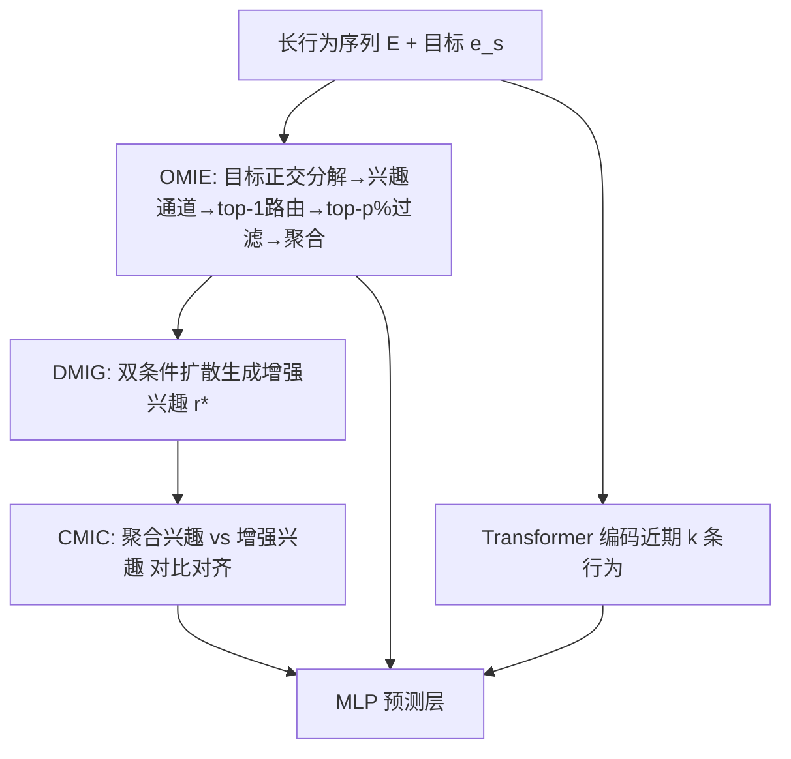
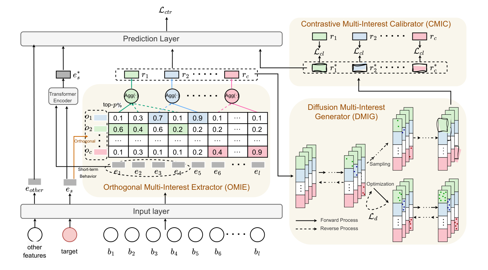

# Modeling Long-term User Behaviors with Diffusion-driven Multi-interest Network for CTR Prediction (扩散驱动多兴趣网络的长周期用户行为建模)

- **会议/期刊**: RecSys 2025
- **作者与机构**: Weijiang Lai, Beihong Jin 等（中科院软件所/国科大）；Yapeng Zhang, Jian Dong, Jun Lei, Xingxing Wang（美团）
- **推荐链路定位**: 精排（CTR 预估）
- **研究方向**: CTR 预估与特征交叉 / 生成式推荐
- **论文原文**: [https://arxiv.org/abs/2508.15311v2](https://arxiv.org/abs/2508.15311v2)
- **开源代码**: [https://github.com/laiweijiang/DiffuMIN](https://github.com/laiweijiang/DiffuMIN)

## TL;DR (1分钟核心速览)

长周期行为建模的两阶段范式（SIM/TWIN 等）只按"与目标相似度"单视角筛选行为，导致兴趣同质冗余、潜在兴趣空间被压缩。DiffuMIN 先用目标嵌入的正交分解构造 $c$ 个兴趣通道，把行为 top-1 路由到通道并聚合出多路"聚合兴趣"；再用以"上下文兴趣 + 兴趣通道"为双条件的扩散模块生成"增强兴趣"，并以对比学习校准。在 Alibaba/Ele.me/工业三数据集上 AUC 相对 DIN(S) 提升 13.96%/7.26%/5.80%，线上 A/B 的 CTR +1.52%、CPM +1.10%，推理仅从 33ms 增至 35ms。

## Background & Motivation (背景与核心矛盾)

- **主流范式**: 长序列建模已从单阶段（SDIM/LinRec 的简化注意力）演进到两阶段——先按目标相似度检索 top-$k$ 行为，再对子序列精细建模（SIM、ETA、TWIN、TWIN-v2）。
- **前人局限**: ① 两阶段的第一阶段只从"目标相似度"单一视角筛选，取回的行为高度同质，多兴趣被压成单兴趣；② 单阶段简化注意力虽快，却难以刻画长序列中耦合的兴趣结构，且噪声行为淹没关键信号。
- **核心洞察 (Key Insight)**: 长周期行为本身蕴含丰富兴趣，问题不在"筛得不够狠"，而在"筛得太窄"——过滤机制天然限制了兴趣空间的上界，需要"先解耦保留、再生成外推"。
- **本文切入点**: 用目标的正交分解把"目标"本身拆成多个正交兴趣方向作为路由锚点，实现多视角解耦抽取；再用扩散模型在兴趣分布内生成增强兴趣，突破过滤带来的空间收缩。

## Method (核心方法设计)

### 1. 整体框架 (Overall Architecture)

输入为完整长行为序列嵌入矩阵 $E\in\mathbb{R}^{l\times d}$、目标嵌入$e_s$与其余特征。近期$k$条行为经 Transformer 编码得到短期兴趣$e_s^*$；完整序列与$e_s$进入 OMIE，经正交分解得兴趣通道、行为路由与通道过滤，聚合出$c$路聚合兴趣$r=[r_1,\dots,r_c]$；DMIG 以$r$与通道$o_i$为条件做扩散采样，生成$c$路增强兴趣$r^*$；CMIC 用对比损失对齐$r$与$r^*$；最后$[r, r^*, e_{other}, e_s^*]$ 拼接进 MLP 输出点击概率。训练时扩散优化与采样两阶段均执行，推理时仅执行采样。

<figure class="paper-figure" markdown="span">
  <figcaption>图1：DiffuMIN 的架构。</figcaption>
</figure>

### 2. 关键设计拆解 (Key Designs)

1. **OMIE 目标导向正交多兴趣抽取**：痛点是用行为间自注意力抽多兴趣复杂度高、且与 CTR 目标脱节。做法是先线性投影 $e_s' = e_s W$，再求正交基$O=[o_1,\dots,o_c]$使$\|e_s' - O^{\top}Oe_s'\|^2$最小且$O^{\top}O=\mathbf{I}$，即把目标拆成$c$个正交兴趣方向；随后算相关性矩阵$A=EO^{\top}$，用 top-1 路由$\Phi_{i,j}=\mathbb{I}[j=\arg\max_{j'}A_{i,j'}]$保证每条行为只归属一个通道（抑制通道间冗余），再在每通道内保留 top-$p\%$行为做均值聚合得$r_j$。正交约束是"去冗余"的几何保证，top-1 硬路由则让每个兴趣方向获得纯净的行为证据。

2. **DMIG 双条件扩散兴趣生成**：痛点是过滤后的聚合兴趣仍只是兴趣空间的一个受限子集。前向过程按标准 DDPM 加噪 $r_{i,t}=\sqrt{\bar\alpha_t}r_{i,0}+\sqrt{1-\bar\alpha_t}\epsilon$；反向去噪网络$\epsilon_\theta$以 Transformer 为骨干，用自注意力把$r_{i,t}$与上下文兴趣$g_1=[r_1,\dots,r_{i-1},r_{i+1},\dots,r_c]$交互（锚定用户个性化），用交叉注意力把$r_{i,t}$与兴趣通道$g_2=o_i$交互（锚定目标导向的兴趣类型）。关键改动是采样起点不用高斯噪声，而是对$r_i$前向扰动到$t$步后仅用$T'\ll T$步反演，既保留个性化又缩短采样链。损失为$\mathcal{L}_d=\frac{1}{c}\sum_i\mathbb{E}\|\epsilon-\epsilon_\theta(r_{i,t},t,g_1,g_2)\|_2^2$。

3. **CMIC 对比校准与训练目标**：扩散生成可能偏离真实偏好，故将同一用户的 $r_i$与其$r_i^*$作正对、mini-batch 内其他用户的$r_i^{*(v)}$作负对，在投影空间中优化$\mathcal{L}_{cl}=-\frac{1}{c|\mathcal{U}|}\sum_u\sum_i\log\frac{\exp(\mathrm{sim}(r_i^{(u)},r_i^{*(u)})/\tau)}{\sum_{v\in\mathcal{U}}\exp(\mathrm{sim}(r_i^{(u)},r_i^{*(v)})/\tau)}$，负样本为 in-batch 免采样。总损失$\mathcal{L}=\mathcal{L}_{ctr}+\lambda_1\mathcal{L}_d+\lambda_2\mathcal{L}_{cl}$，其中$\mathcal{L}_{ctr}$为 BCE。时间开销约$O(blcd)$（$c\ll l$、$T'$ 小），与现有长序列模型同量级。

## Experimental Setup & Evaluation Protocol (实验设置与评估协议)

- **数据集与预处理**:

| 数据集 | #Users | #Items | #Samples | 特征/场景说明 |
| :--- | :---: | :---: | :---: | :--- |
| Industry | 84,262,000 | 16,624,521 | 1,061,530,787 | 美团工业集，近 7 天活跃用户近一年完整行为 |
| Alibaba | 1,141,729 | 461,527 | 700,000,000 | 阿里展示广告 22 天购物行为 |
| Ele.me | 14,427,689 | 7,446,116 | 128,000,000 | 饿了么 30 天点击日志，含时空特征 |

- **数据划分与防穿越 (Splitting Strategy)**: 按各数据集原始时间跨度组织样本，长行为序列最大长度分别设为 5000 / 1500 / 50（不足补零），未额外声明随机划分细节。
- **排名评测协议 (Ranking Protocol)**: 采用 CTR 场景标准的 **AUC**（点级二分类，非全库排序），并报告相对提升 $\text{RelaImpr}=(\frac{\text{AUC}_{model}-0.5}{\text{AUC}_{base}-0.5}-1)\times 100\%$；线上用 CTR 与 CPM。
- **对比基线与超参设置**: 基线含 DIN/CAN（短序列版 DIN(S)/CAN(S) 与长序列版）、SIM（SoftSIM/HardSIM）、ETA、SDIM、TWIN、TWIN-v2；特征维度统一 $d=8$，Adam，训练 1 epoch；DiffuMIN 最优配置$c=4$、$T'=20$、$\tau=0.05$、$\lambda_1=0.01$、$\lambda_2=0.001$，每通道保留 top-20% 行为；AUC 提升 0.001 即视为显著，并做$p<0.05$的$t$ 检验。

## Key Experimental Results (实验关键数据)

### 1. 主实验对比 (Main Results)

| 数据集 | DIN(S) | SIM(Hard) | ETA | SDIM | TWIN | TWIN-v2 | **DiffuMIN** | Improv. |
| :--- | :---: | :---: | :---: | :---: | :---: | :---: | :---: | :---: |
| Industry | 0.6740 | 0.6780 | 0.6778 | 0.6779 | 0.6785 | 0.6788 | **0.6841** | +5.80% |
| Alibaba | 0.6125 | 0.6239 | 0.6220 | 0.6206 | 0.6215 | 0.6220 | **0.6282** | +13.96% |
| Ele.me | 0.6363 | 0.6389 | 0.6398 | 0.6404 | 0.6410 | 0.6400 | **0.6462** | +7.26% |

（Improv. 为相对 DIN(S) 的 RelaImpr；三数据集上 DiffuMIN 均为最优，且 $t$ 检验显著。）

### 2. 消融实验 (Ablation Study)

| 变体 | Industry | Alibaba | Ele.me |
| :--- | :---: | :---: | :---: |
| DiffuMIN | **0.6841** | **0.6282** | **0.6462** |
| A: 单视角相似度过滤替代 OMIE | 0.6810 | 0.6257 | 0.6433 |
| B: 预测层去掉多路聚合兴趣 | 0.6769 | 0.6221 | 0.6385 |
| C: 去掉 CMIC | 0.6834 | 0.6274 | 0.6450 |
| D: 去掉 DMIG + CMIC | 0.6826 | 0.6260 | 0.6448 |
| E: 去掉短期兴趣建模 | 0.6812 | 0.6250 | 0.6450 |

### 3. 关键实验发现 (Key Findings)

1. **多兴趣解耦是最大增益源**：变体 B（预测层丢弃多路聚合兴趣）在 Industry 上掉 0.0072，是全部消融中跌幅最大项；变体 A（退回单视角相似度过滤）也掉 0.0031，说明"正交通道 + 多路保留"而非"筛得更准"才是收益主因。
2. **扩散生成与对比校准互补而非冗余**：去掉 CMIC 掉 0.0007，去掉 DMIG+CMIC 掉 0.0015，即 DMIG 单独贡献约 0.0008；同时 DiffuMIN-VAE 在 Industry/Ele.me 上分别仅 0.6830/0.6444，验证扩散（仅优化条件分布、无后验坍缩）优于 VAE 的生成范式。
3. **双条件引导与"扰动起点"缺一不可**：去掉上下文兴趣引导（W）或通道引导（X）均掉点，两者同时去掉（Y）掉点更多；直接从高斯噪声起采（Z）在相同 $T'$ 下明显更差，需更多采样步才能追平，印证"扰动兴趣作起点"同时提升质量与效率。

## Highlights & Limitations (亮点、对比与审稿批判)

- **与代表作对比 (vs. Prior Work)**: 与 SIM/TWIN 的本质区别在于第一阶段不再输出"一条与目标最像的子序列"，而是输出 $c$ 条正交方向上的兴趣证据，从"压缩"转为"解耦保留"；与 Octopus 等召回侧多兴趣模型相比，本文的通道由**目标正交分解**动态生成而非固定初始化，且面向 CTR 精排而非候选召回；与 DiffRec/DreamRec 等扩散推荐相比，本文首次把扩散用于 CTR 的**用户兴趣**而非物品/序列，且以兴趣通道为条件做目标导向生成。
- **可迁移亮点**: ① "目标正交分解 → 通道路由 → top-$p\%$ 过滤"是一套轻量、可插拔的多视角行为筛选算子，可直接替换 SIM 的第一阶段；② "扰动真实表征作扩散起点 + 少步反演"是降低扩散在线开销的通用技巧，适合任何需要实时生成的推荐模块。
- **审稿级局限批判**: ① 扩散采样虽仅 $T'=20$步，但每步含自注意力与交叉注意力，序列极长或$c$增大时开销会非线性上升，论文仅给出 33ms→35ms 的单场景数据；② 正交分解依赖对目标嵌入做线性投影后求解正交基，$c$与 top-$p\%$均需逐数据集调参（$c\in\{2,4,8\}$），跨场景鲁棒性缺乏敏感性分析；③ 离线仅用 AUC 点级指标，未报告全库排序或校准指标，与真实排序收益的对应关系偏弱。

## Rating (四维评分)

- **方法创新性 (Novelty)**: ⭐⭐⭐⭐ （正交分解构造兴趣通道 + 双条件扩散生成兴趣，两条线在 CTR 场景均为首次组合，几何直觉清晰）
- **评估协议与实验扎实度 (Protocol & Experiments)**: ⭐⭐⭐⭐ （三数据集含十亿级工业集、8 个 SOTA 基线、消融与 7 天线上 A/B 齐全，但仅 AUC 点级指标、缺敏感性分析）
- **写作与数学规范度 (Clarity & Rigor)**: ⭐⭐⭐⭐ （OMIE/DMIG/CMIC 公式链条完整、复杂度分析到位，扩散部分基本沿用 DDPM 标准记号，增量说明清楚）
- **工业落地与复现价值 (Industrial & Practical Value)**: ⭐⭐⭐⭐⭐ （代码开源、线上替换 SIM 即得 CTR +1.52%/CPM +1.10%、推理仅 +2ms，落地证据充分）

