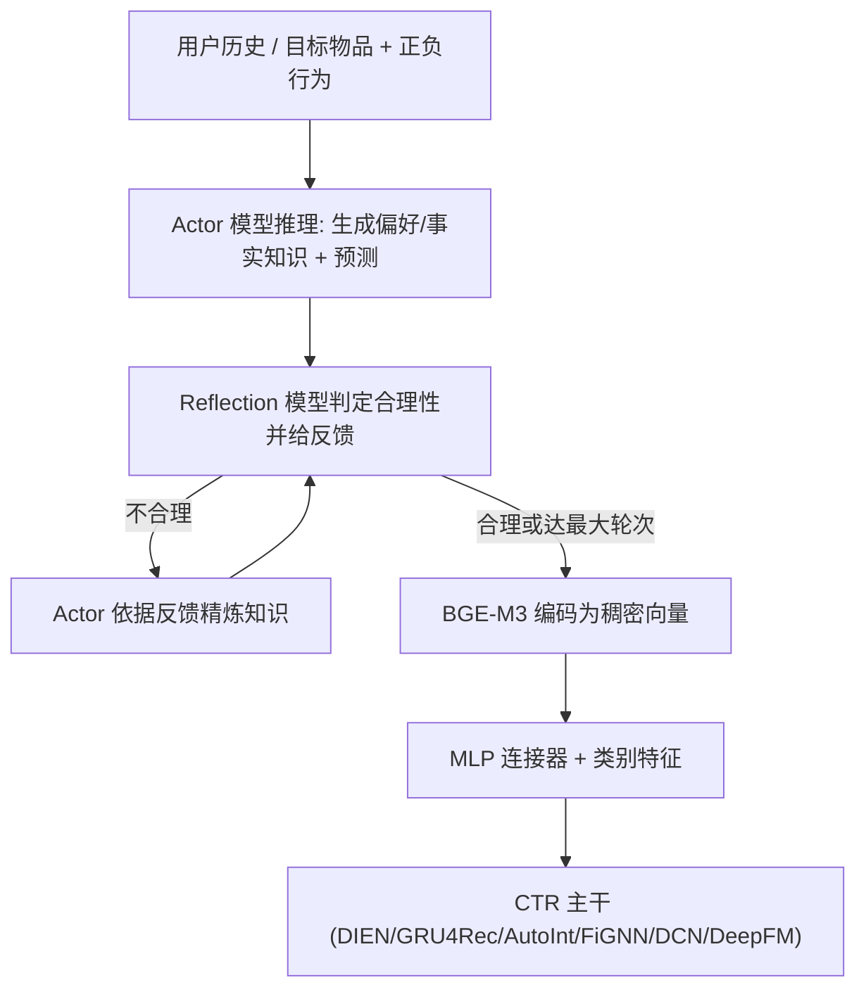
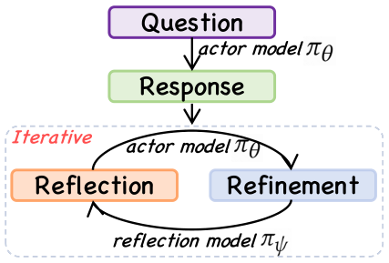

# R4ec: A Reasoning, Reflection, and Refinement Framework for Recommendation Systems (面向推荐系统的推理—反思—精炼框架)

- **会议/期刊**: RecSys 2025
- **作者与机构**: Hao Gu, Yu Xia (中科院自动化所/国科大)；Rui Zhong, Wei Yang, Chi Lu, Peng Jiang, Kun Gai (快手)
- **推荐链路定位**: 精排（LLM 侧信息增强 CTR 主干）
- **研究方向**: CTR/CVR 预估与特征交叉 / 大语言模型推荐
- **论文原文**: [https://arxiv.org/abs/2507.17249v2](https://arxiv.org/abs/2507.17249v2)
- **开源代码**: 暂未开源

## TL;DR (1分钟核心速览)

现有 LLM4Rec 用一次性 CoT 提示抽取用户偏好/物品事实知识，属"System-1"快思考，推理路径上任一错误即污染下游特征。R4ec 训练两个小模型（Qwen-2.5-7B）：actor 负责推理与精炼，reflection 负责判定合理性并给出反馈，二者迭代至反思模型认可为止，形成弱 System-2 慢思考；精炼后的文本知识经 BGE-M3 编码为稠密向量注入 6 种 CTR 主干。在 Amazon-Book / MovieLens-1M 上 AUC 相对提升最高 3.60%、LogLoss 相对下降最高 6.41%，线上广告平台收入 +2.2%、长尾收入 +4.1%。

## Background & Motivation (背景与核心矛盾)

- **主流范式**: LLM 作为知识增强器（KAR 为代表），用 chain-of-thought 提示 GPT-3.5 一次性生成用户偏好与物品事实知识，作为 side-info 喂给下游 CTR 模型。
- **前人局限一（鲁棒性）**: 单次提示属 System-1 直觉式响应，对推理路径中的错误极度敏感，一步错则全错，且幻觉无法被自身察觉。
- **前人局限二（成本）**: 依赖 GPT-3.5 等闭源大模型 API，数百亿用户/千万物品规模下推理延迟与费用不可承受。
- **核心洞察 (Key Insight)**: 人类解题失败后会复盘错误再修正；若让"评判者"与"作答者"分离，可避免模型自评时的自我偏袒（intrinsic self-refine 已被证明常无效甚至退化）。
- **本文切入点**: 用可微调的小模型分别承担 actor（推理+精炼）与 reflection（评判+反馈）两角色，迭代闭环把知识抽取从 System-1 推向弱 System-2。

## Method (核心方法设计)

### 1. 整体框架 (Overall Architecture)

离线阶段用 GPT-4o 按三套提示模板（推理/反思/精炼）在 40% 用户与物品上构造三类数据集，并按"预测是否正确 × 反思是否判定合理"四象限做数据筛选：正确且合理→推理集与反思正例；错误且不合理→送入精炼提示，若精炼后预测转正，则反思样本与精炼样本入集；其余矛盾样本直接丢弃。训练阶段 actor 用 $\mathcal{L}_{reason}+\mathcal{L}_{refine}$ 联合 SFT，reflection 单独 SFT，均用 LoRA。推理阶段对每个用户/物品执行迭代精炼，最终知识经 BGE-M3 编码、MLP 连接器对齐后与类别特征拼接送入 CTR 主干联合训练。

<figure class="paper-figure" markdown="span">
  <figcaption>图1：我们的迭代反思与精炼机制。</figcaption>
</figure>

### 2. 关键设计拆解 (Key Designs)

1. **双角色 actor–reflection 解耦（避免自评偏袒）**：痛点在于同一模型自评时倾向认可自身输出。本文令 $\pi_\theta$生成知识、$\pi_\psi$ 独立判定，反思样本仅保留"反思确实纠错成功"的样本，保证反馈信号可信：
$\langle judge_u, reflect_u\rangle \leftarrow \mathcal{M}\big(P_{user\_reflect}(hist, item, u_{pre})\big)$
物理直觉：评判者与作答者的参数与上下文分布不同，形成近似对抗的监督，比自反思更不易陷入确认偏差。

2. **迭代反思—精炼推理策略（弱 System-2）**：首轮 actor 出知识，若 $\pi_\psi$判为不合理则把反馈拼入上下文重生成，循环至被认可或达最大轮次$T$。对比策略"Reflection as Filter"是并行采样$K$ 条知识再由反思模型筛除、对剩余取平均。实验证明迭代优于过滤，说明"仅筛不纠"不够，必须让反馈真正改写知识。

3. **训练目标、数据构造与推理开销**：actor 损失 $\mathcal{L}_{actor}=\mathbb{E}_{\mathcal{D}_{reason}}[\log\pi_\theta(y|x)]+\mathbb{E}_{\mathcal{D}_{refine}}[\log\pi_\theta(y'|x')]$，reflection 损失$\mathcal{L}_{reflect}=\mathbb{E}_{\mathcal{D}_{reflect}}[\log\pi_\psi(y^*|x^*)]$；无负采样概念，本质是监督式文本生成。线上为控成本做分层推理：物品全量推理一次并缓存，活跃用户全量 LLM 推理，低活用户直接复用其历史行为列表中物品知识的近似结果。

## Experimental Setup & Evaluation Protocol (实验设置与评估协议)

- **数据集与预处理**: 评分阈值二值化（Amazon-Book 评分 >5 为正，MovieLens-1M 评分 >3 为正），未做 k-core 过滤。

| 数据集 | #Users | #Items | #Interactions | 稀疏度/密度 | 特征/场景说明 |
| :--- | :---: | :---: | :---: | :---: | :--- |
| Amazon-Book | 11,906 | 17,332 | 1.4 M | 极稀疏 | 图书评论，评分二值化 |
| MovieLens-1M | 6,040 | 3,706 | 1 M | 较稠密 | 电影评分 1–5 |
| 工业数据集 | 4 亿 | 1000 万 | 23 亿 | 极稀疏 | 广告曝光日志采样 |

- **数据划分与防穿越 (Splitting Strategy)**: 按交互时间戳排序后前 80% 训练、后 20% 测试（全局时间切分，无泄漏）。
- **排名评测协议 (Ranking Protocol)**: 非 ranking 协议，采用 CTR 二分类指标 AUC 与 LogLoss；作者援引 KAR 结论指出 0.001 量级 AUC 提升即具显著性。
- **对比基线与超参设置**: Base（无 LLM 知识）、KAR（GPT-3.5 + CoT）、R2ec（仅推理、无反思精炼，消融对照）；6 个主干 DIEN/GRU4Rec/AutoInt/FiGNN/DCN/DeepFM；actor 与 reflection 默认均为 Qwen-2.5-7B，LoRA $r=8$、$\alpha=16$、dropout 0.05，训练 3 epoch，默认迭代 1 轮，知识编码器 BGE-M3。

## Key Experimental Results (实验关键数据)

### 1. 主实验对比 (Main Results)

以 AutoInt 与 DIEN 两个代表主干为例（完整 6 主干趋势一致）：

| Backbone | Method | LLM | Amazon AUC | Rel.Impr. | Amazon LogLoss | Rel.Impr. | ML-1M AUC | Rel.Impr. |
| :--- | :--- | :--- | :---: | :---: | :---: | :---: | :---: | :---: |
| AutoInt | Base | – | 0.8261 | – | 0.5007 | – | 0.7736 | – |
| AutoInt | KAR | GPT-3.5 | 0.8404 | ↑1.73% | 0.4842 | ↓3.29% | 0.7949 | ↑2.75% |
| AutoInt | R2ec | Qwen2.5-7B | 0.8448 | ↑2.26% | 0.4755 | ↓5.03% | 0.7952 | ↑2.79% |
| AutoInt | **R4ec** | Qwen2.5-7B | **0.8494** | **↑2.82%** | **0.4686** | **↓6.41%** | **0.8008** | **↑3.52%** |
| DIEN | Base | – | 0.8280 | – | 0.5004 | – | 0.7755 | – |
| DIEN | KAR | GPT-3.5 | 0.8360 | ↑0.97% | 0.4872 | ↓2.64% | 0.7938 | ↑2.35% |
| DIEN | R2ec | Qwen2.5-7B | 0.8434 | ↑1.86% | 0.4827 | ↓3.53% | 0.7963 | ↑2.68% |
| DIEN | **R4ec** | Qwen2.5-7B | **0.8488** | **↑2.51%** | **0.4699** | **↓6.09%** | **0.8006** | **↑3.23%** |

线上 A/B（14 天，10% 流量）：整体收入 **+2.2%**、CVR **+1.6%**；长尾数据收入 **+4.1%**、CVR **+3.2%**。

### 2. 消融实验 (Ablation Study)

| 消融维度 | 设置 | Amazon AUC | Amazon LogLoss | ML-1M AUC | ML-1M LogLoss |
| :--- | :--- | :---: | :---: | :---: | :---: |
| 知识编码器 (AutoInt) | BERT | 0.8449 | 0.4768 | 0.7934 | 0.5412 |
| 知识编码器 (AutoInt) | Longformer | 0.8462 | 0.4760 | 0.7953 | 0.5395 |
| 知识编码器 (AutoInt) | **BGE-M3** | **0.8494** | **0.4686** | **0.8008** | **0.5347** |
| 推理策略 (AutoInt) | None | 0.8261 | 0.5007 | 0.7736 | 0.5618 |
| 推理策略 (AutoInt) | Filter | 介于两者之间 | – | – | – |
| 推理策略 (AutoInt) | **Iter** | 最优 | 最优 | 最优 | 最优 |
| 反思模型规模 (actor 固定 7B) | 0.5B → 72B | 平均 ↑1.3% | 平均 ↓3.8% | 同趋势 | 同趋势 |

### 3. 关键实验发现 (Key Findings)

1. **反思精炼的净增益可被干净剥离**：R4ec 相对 R2ec 在 Amazon-Book 上平均再涨 AUC 0.60%、LogLoss 再降 1.93%，ML-1M 上分别为 0.62% 与 0.68%，证明增益来自反思闭环而非仅仅"多用了 LLM 知识"。
2. **小模型反超闭源大模型**：7B 的 R4ec 比 GPT-3.5 的 KAR 平均多 1.36% AUC 相对提升与 3.29% LogLoss 相对下降，说明知识可靠性比模型规模更关键，幻觉抑制比参数堆叠更划算。
3. **反思模型存在规模缩放律但边际递减**：反思模型从 0.5B 增至 72B 带来稳定增益；而 actor 越大，反思带来的增益越小——大 actor 自身错误率已低，反思模型容量成为瓶颈，故默认仅迭代 1 轮以控成本。

## Highlights & Limitations (亮点、对比与审稿批判)

- **与代表作对比 (vs. Prior Work)**: 相比 KAR 的单次 CoT 提示，本文把"一次性抽取"换成"评判—改写"闭环，且用可微调 7B 小模型替代 GPT-3.5 API；相比 intrinsic self-refine，本文用独立 reflection 模型规避自评偏袒；相比 R2ec，多出的反思环节贡献了可量化的稳定增益。
- **可迁移亮点**: (1) "正确性 × 合理性"四象限数据筛选法，可直接迁移到任何 LLM 生成 side-info 的蒸馏管线以剔除噪声监督；(2) 线上分层推理（物品全量缓存 + 用户按活跃度分级）是 LLM 特征工业化落地的实用范式。
- **审稿级局限批判**: (1) 离线仅用 AUC/LogLoss，未报告 NDCG/HR 等排序指标，也未与 SASRec/LightGCN 等序列或图模型对比，评估面偏窄；(2) 迭代推理的延迟与 token 成本未量化，且反思模型规模、迭代轮数、数据构造比例（40%）等多个超参的敏感性分析缺失，复现门槛高（代码未开源）。

## Rating (四维评分)

- **方法创新性 (Novelty)**: ⭐⭐⭐⭐ （首次将 actor–reflection 双角色 System-2 范式系统引入推荐知识抽取，机制清晰但组件均为已有 LLM 技术的重组）
- **评估协议与实验扎实度 (Protocol & Experiments)**: ⭐⭐⭐⭐ （6 主干 × 2 数据集 + 线上 A/B + 缩放律分析较完整，但缺排序指标与强序列基线对比）
- **写作与数学规范度 (Clarity & Rigor)**: ⭐⭐⭐⭐ （三阶段数据构造算法与损失定义清楚，提示模板完整附录，但公式较浅、缺复杂度与延迟分析）
- **工业落地与复现价值 (Industrial & Practical Value)**: ⭐⭐⭐⭐ （4 亿用户广告平台实测 +2.2% 收入、长尾 +4.1%，分层推理设计极具工程参考价值，可惜未开源）

