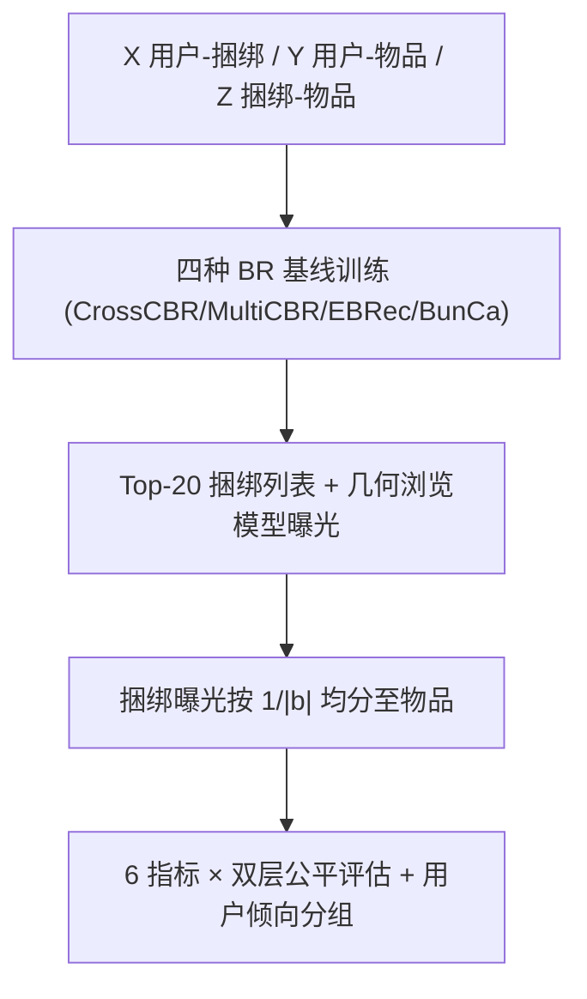

# A Reproducibility Study of Product-side Fairness in Bundle Recommendation (捆绑推荐中商品侧公平性的可复现性研究)

- **会议/期刊**: RecSys 2025
- **作者与机构**: Huy-Son Nguyen, Yuanna Liu, Masoud Mansoury, Mohammad Aliannejadi, Alan Hanjalic, Maarten de Rijke（TU Delft / University of Amsterdam）
- **推荐链路定位**: 重排（Top-K 捆绑列表曝光分配）
- **研究方向**: 去偏公平与工业架构 / 多任务学习与列表级重排
- **论文原文**: [https://arxiv.org/abs/2507.14352v1](https://arxiv.org/abs/2507.14352v1)
- **开源代码**: [https://github.com/Rec4Fun/Fairness_Bundle_RecSys25](https://github.com/Rec4Fun/Fairness_Bundle_RecSys25)

## TL;DR (1分钟核心速览)

捆绑推荐（BR）只对"捆绑包"排序，但供应商真正关心的是包内**单个物品**的曝光，现有公平框架却默认捆绑级公平可代表物品级公平。本文在 Youshu/NetEase/iFashion 三数据集上复现 CrossCBR、MultiCBR、EBRec、BunCa 四种 SOTA，用 6 个曝光公平指标做**捆绑级 + 物品级双层评估**（7:1:2 随机划分、Top-20 全库排序、几何浏览模型 $\gamma=0.5$）。核心发现：BR 模型普遍**放大**流行度偏差（Gini 上升），捆绑级与物品级公平排名不一致，且用户越偏好捆绑交互，曝光越公平。

## Background & Motivation (背景与核心矛盾)

- **主流范式**: BR 以用户-捆绑 $X$、用户-物品$Y$、捆绑-物品$Z$ 三矩阵为输入，用多视图对比学习（CrossCBR/MultiCBR）或因果/增广建模（BunCa/EBRec）优化 Top-K 捆绑排序精度。
- **前人局限**: ① 商品侧公平研究集中在单物品推荐（Top-K、Next-Basket），其"物品即推荐单元"假设在 BR 中失效——曝光先给捆绑、再**间接**分摊给包内物品；② 现有公平指标（如 AWRF）针对单列表设计，无法刻画跨用户聚合的双层曝光。
- **核心洞察 (Key Insight)**: 捆绑流行度与其包内物品平均流行度**并不一致**（图 4：高频捆绑可含冷门物品，反之亦然），因此捆绑级公平无法推出物品级公平；且不同公平指标（效用比例型 vs 统计均等型）会给出互相矛盾的模型排名。
- **本文切入点**: 不做新算法，而是建立统一复现框架，把曝光按 $a_L(i|i\in b)=a_L(b)/|b|$ 下推到物品级，系统量化"偏差如何在双层间传播"。

## Method (核心方法设计)

### 1. 整体框架 (Overall Architecture)

本文是**评估型复现研究**，框架为：统一训练四种 BR 基线 → 对每个用户生成 Top-20 捆绑列表 → 用几何浏览模型 $\gamma(1-\gamma)^{L(b)-1}$计算捆绑曝光 → 按包内物品数均分得到物品曝光 → 在流行/非流行两组上计算 6 个公平指标 → 按用户捆绑倾向$r_u$分组做切片分析。物品流行度并非直接取自$Y$，而是先重构$Y'=(X\times Z)+Y$，把"经由捆绑产生的隐式物品交互"计入，避免低估包内物品真实热度。

### 2. 关键设计拆解 (Key Designs)

1. **双层曝光下推算子（Bundle→Item Exposure Projection）**：痛点是 BR 从不直接对物品排序，物品曝光无定义。本文令物品曝光等于所属捆绑曝光按包大小均分，测试集相关性同理 $y(i|i\in b)=y(b|u)/|b|$，从而让 EUR/RUR/EEL/EER/EED/DP 六个指标可原样复用于物品级。直觉：这是"等权假设"下最保守的归因，能暴露包大小对公平的稀释效应。
2. **效用比例型 vs 统计均等型双族指标**：EUR/RUR 要求曝光正比于效用 $Y(G)$，即$\text{EUR}=\frac{\epsilon_\pi(G^+)/Y(G^+)}{\epsilon_\pi(G^-)/Y(G^-)}$；EED/DP 则只看曝光分布本身$\text{EED}=\|\epsilon_\pi\|_2^2$、$\text{DP}=\epsilon_\pi(G^+)/\epsilon_\pi(G^-)$。两族指标对"公平"的定义根本不同，这正是后文指标分歧的根源。
3. **用户倾向分组（Tendency Score）**：定义 $r_u=\sum_{b\in\mathcal{B}}X_{ub}\big/\sum_{i\in\mathcal{I}}Y_{ui}$，$r_u>1.1$为捆绑偏好组$g_1$、$r_u<0.9$为单品偏好组$g_3$、其间为中性$g_2$，用于检验公平是否只是算法属性还是也依赖用户行为。训练侧沿用各基线原论文最优超参（$d=64$、Xavier 初始化、Adam），无额外负采样改动。

## Experimental Setup & Evaluation Protocol (实验设置与评估协议)

- **数据集与预处理**: 沿用 BR 标准设定，无 5-core 重过滤，直接使用官方划分版本：

| 数据集 | #Users | #Items | #Bundles | U–I | U–B | 平均包大小 | U–B 密度 | c-score |
| :--- | :---: | :---: | :---: | :---: | :---: | :---: | :---: | :---: |
| Youshu | 8,039 | 32,770 | 4,771 | 138,515 | 51,377 | 37.03 | 0.13% | 0.0812 |
| NetEase | 18,528 | 123,628 | 22,864 | 1,128,065 | 302,303 | 77.80 | 0.07% | 0.0599 |
| iFashion | 53,897 | 42,563 | 27,694 | 2,290,645 | 1,679,708 | 3.86 | 0.07% | 0.2917 |

- **数据划分与防穿越 (Splitting Strategy)**: 对每个用户的用户-捆绑交互按 **7:1:2 随机划分**训练/验证/测试（沿用 CrossCBR 设定），非全局时间戳切分，存在轻度未来信息泄漏风险。
- **排名评测协议 (Ranking Protocol)**: **Full-Ranking 全库排序**（对全部未交互捆绑打分），效用指标 $R@20$、$N@20$；公平指标基于 Top-20 列表 + 几何浏览模型（$\gamma=0.5$），流行组按"约 20% 交互量"切分，$G^+$为头部、$G^-$ 为其余 80%。
- **对比基线与超参设置**: CrossCBR、MultiCBR、EBRec、BunCa 四种 SOTA，$d=64$，各基线取原论文最优超参；未报告显著性检验（复现研究以趋势一致性为主）。

## Key Experimental Results (实验关键数据)

### 1. 主实验对比 (Main Results)

捆绑级公平（Youshu / NetEase / iFashion，箭头为指标方向，◦ 表示越接近 0 越公平）：

| 数据集 | 方法 | R@20↑ | N@20↑ | logEUR◦ | logRUR◦ | EEL↓ | EER↑ | EED↓ | logDP◦ |
| :--- | :--- | :---: | :---: | :---: | :---: | :---: | :---: | :---: | :---: |
| Youshu | MultiCBR | 0.286 | 0.168 | 2.667 | 2.249 | 0.476 | 0.486 | 0.660 | 6.024 |
| Youshu | CrossCBR | 0.276 | 0.166 | 2.094 | 2.101 | **0.289** | 0.569 | 0.556 | 5.444 |
| Youshu | EBRec | 0.281 | 0.168 | 2.153 | 2.187 | 0.308 | 0.560 | 0.565 | 5.504 |
| Youshu | BunCa | **0.295** | **0.172** | 2.390 | 2.131 | 0.385 | 0.524 | 0.606 | 5.743 |
| NetEase | MultiCBR | **0.090** | **0.050** | 2.173 | 0.690 | 0.387 | 0.560 | 0.589 | 4.744 |
| NetEase | CrossCBR | 0.081 | 0.043 | **1.908** | **0.644** | **0.288** | **0.613** | **0.544** | **4.464** |
| NetEase | EBRec | 0.088 | 0.048 | 2.241 | 0.693 | 0.413 | 0.547 | 0.603 | 4.817 |
| NetEase | BunCa | 0.089 | 0.048 | 2.515 | 0.755 | 0.519 | 0.500 | 0.661 | 5.110 |
| iFashion | MultiCBR | **0.150** | **0.120** | 1.464 | 0.604 | 0.335 | 0.825 | 0.529 | 4.525 |
| iFashion | CrossCBR | 0.115 | 0.088 | 1.383 | 0.458 | 0.293 | 0.853 | 0.518 | 4.418 |
| iFashion | EBRec | 0.133 | 0.105 | **1.314** | 0.472 | **0.259** | **0.882** | **0.510** | **4.328** |
| iFashion | BunCa | 0.143 | 0.112 | 1.578 | 0.594 | 0.399 | 0.781 | 0.550 | 4.680 |

物品级公平（节选关键列）：

| 数据集 | 方法 | logEUR◦ | logRUR◦ | EEL↓ | EER↑ | EED↓ | logDP◦ |
| :--- | :--- | :---: | :---: | :---: | :---: | :---: | :---: |
| Youshu | MultiCBR | 0.565 | 0.083 | 0.049 | 0.826 | 0.564 | 4.152 |
| Youshu | CrossCBR | **0.437** | 0.079 | 0.049 | 0.848 | 0.585 | 4.025 |
| Youshu | EBRec | 0.486 | 0.093 | **0.048** | 0.840 | 0.577 | 4.074 |
| Youshu | BunCa | 0.523 | 0.084 | **0.048** | 0.834 | 0.571 | 4.111 |
| NetEase | MultiCBR | 0.458 | 0.001 | 0.035 | 0.958 | 0.614 | 2.835 |
| NetEase | CrossCBR | 0.505 | 0.002 | 0.035 | 0.949 | 0.605 | 2.872 |
| NetEase | EBRec | **0.443** | 0.001 | 0.035 | **0.961** | **0.617** | **2.811** |
| NetEase | BunCa | 0.452 | 0.001 | 0.035 | 0.959 | 0.615 | 2.820 |
| iFashion | MultiCBR | 0.547 | 0.076 | 0.039 | 1.087 | 0.529 | 3.868 |
| iFashion | CrossCBR | 0.350 | 0.041 | 0.014 | 1.146 | 0.563 | 3.624 |
| iFashion | EBRec | 0.356 | 0.043 | 0.014 | 1.144 | 0.561 | 3.632 |
| iFashion | BunCa | **0.601** | 0.076 | 0.048 | 1.070 | 0.522 | 3.935 |

### 2. 消融实验 (Ablation Study)

本文为复现研究，无模块消融，但提供了**用户倾向分组切片**这一"准消融"（以 iFashion 为例，$g_1$捆绑偏好 /$g_2$中性 /$g_3$ 单品偏好）：

| 切片 | 层级 | EEL↓ ($g_1$/$g_2$/$g_3$) | EER↑ ($g_1$/$g_2$/$g_3$) | 结论 |
| :--- | :--- | :---: | :---: | :--- |
| iFashion | 捆绑级 | 最低 / 中 / 最高 | 最高 / 中 / 最低 | $g_1$ 曝光最公平 |
| iFashion | 物品级 | 最低 / 中 / 最高 | 最高 / 中 / 最低 | 与捆绑级同向 |
| NetEase | 物品级 | 趋势不一致 | 趋势不一致 | 低 c-score 引入噪声 |

### 3. 关键实验发现 (Key Findings)

1. **BR 系统性放大流行度偏差**：Gini 指数显示四种方法在捆绑与物品两级的曝光均匀性均**低于**输入交互数据，且输入越偏（Youshu）输出越偏；NetEase 上 CrossCBR/BunCa 的物品曝光呈长尾、MultiCBR/EBRec 却接近正态，说明偏差放大方式强依赖模型架构而非仅数据。
2. **捆绑级公平 ≠ 物品级公平**：Youshu 上 CrossCBR 捆绑级 EEL 最优（0.289）但物品级 EEL 与 EBRec/BunCa 持平（0.049 vs 0.048），iFashion 上 EBRec 捆绑级最优（0.259）而物品级 logEUR 反被 BunCa 反超（0.601 vs 0.356），证明"只优化捆绑级"的干预会漏掉包内冷门物品。
3. **精度与公平存在张力，且指标间互相打架**：精度最强的 MultiCBR/BunCa 在多数公平指标上落后于 CrossCBR/EBRec；同时 EED 与 logDP 在三组用户上的物品级排序完全相反（$g_3$的 EED 最优但$g_1$ 的 DP 最优），单一指标评估会得出误导性结论。

## Highlights & Limitations (亮点、对比与审稿批判)

- **与代表作对比 (vs. Prior Work)**: 相较 Raj & Ekstrand 的单物品 Top-K 曝光公平、Li et al. 的 Next-Basket 公平评估，本文首次把公平评估扩展到"捆绑→物品"两层结构；相较 CrossCBR/MultiCBR 等只报精度的 BR 工作，本文补上了商品侧公平这一被忽视的维度，且不改模型、纯评估，结论可直接复用。
- **可迁移亮点**: ① $Y'=(X\times Z)+Y$的"经捆绑重构物品交互"技巧可迁移到任意集合/套餐推荐的流行度统计；② 按$r_u$ 切分用户做公平切片分析，是检验公平结论稳健性的低成本手段。
- **审稿级局限批判**: ① 物品曝光采用 $1/|b|$ 等权均分，忽略了包内物品的实际点击差异，可能高估大包（NetEase 平均 77.8 物品）中冷门物品的曝光；② 7:1:2 随机划分存在时间穿越，且未做显著性检验，NetEase 上指标趋势混乱（作者归因于低 c-score 与噪声）削弱了结论可信度；③ 仅按流行度分组，未覆盖供应商、品类等更贴近真实公平诉求的维度。

## Rating (四维评分)

- **方法创新性 (Novelty)**: ⭐⭐⭐ （无新算法，但"双层曝光下推 + 双族指标对照"的评估框架在 BR 公平领域属首次，问题定义本身有价值）
- **评估协议与实验扎实度 (Protocol & Experiments)**: ⭐⭐⭐⭐ （三领域数据集 × 四 SOTA × 六指标 × 三层用户切片，覆盖充分；扣分在随机划分与缺显著性检验）
- **写作与数学规范度 (Clarity & Rigor)**: ⭐⭐⭐⭐ （指标公式与符号表清晰，$Y'$ 重构与曝光均分定义明确；RQ 组织良好，但部分图表结论依赖目测）
- **工业落地与复现价值 (Industrial & Practical Value)**: ⭐⭐⭐⭐⭐ （代码全开源、超参沿用原论文、结论"捆绑级公平不可替代物品级"对电商套餐/歌单/穿搭推荐的上线审计有直接指导意义）

