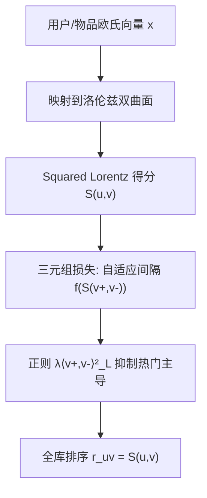
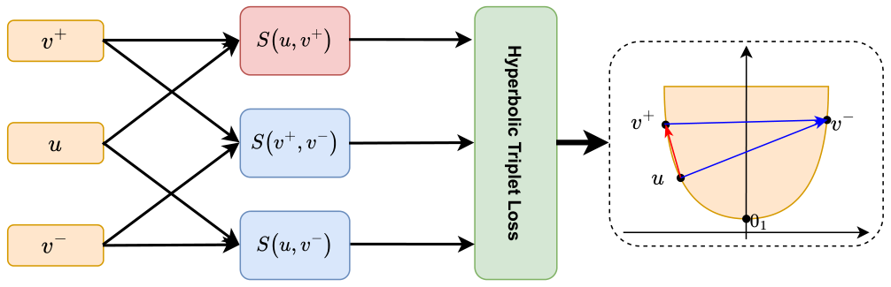

# Leveraging Geometric Insights in Hyperbolic Triplet Loss for Improved Recommendations (利用几何洞察的双曲三元组损失推荐)

- **会议/期刊**: RecSys 2025
- **作者与机构**: Viacheslav Yusupov, Maxim Rakhuba (HSE University); Evgeny Frolov (AIRI & HSE University)
- **推荐链路定位**: 召回（基于隐式反馈的矩阵分解式表征学习）
- **研究方向**: 去偏公平与工业架构 / 协同过滤与双塔召回
- **论文原文**: [https://arxiv.org/abs/2508.11978v1](https://arxiv.org/abs/2508.11978v1)
- **开源代码**: [https://github.com/YusupovV-Lab/TriplH](https://github.com/YusupovV-Lab/TriplH)

## TL;DR (1分钟核心速览)

现有双曲推荐模型（HyperBPR/HyperML）仅建模用户-物品成对关系，且 HyperML 使用固定 margin，导致正负样本分数几乎不可分、流行度偏差严重。本文提出 TriplH：在洛伦兹双曲空间中把 BPR 扩展为三元组损失，用物品-物品得分 $f(S(v^+,v^-))$充当**用户自适应间隔**，并加$\lambda\langle v^+,v^-\rangle_L^2$ 正则抑制热门物品主导。在 4 个基准、Leave-Last-Out + Full-Ranking 协议下，HR@10 最高相对提升 5.9%（ML-1M）、6.9%（Sports），Coverage@10 全面领先，推理时间较 Poincaré 模型快约 3 倍。

## Background & Motivation (背景与核心矛盾)

- **主流范式**: 双曲空间因能低维嵌入层次/幂律分布结构而被引入推荐，代表作为 Poincaré 球上的 HyperML（双曲版 CML + 可训练 margin）与 HyperBPR（双曲版 BPR），以及洛伦兹空间的 LorentzFM。
- **前人局限**: 其一，绝大多数双曲模型只学用户-物品**成对**关系，物品-物品交互在双曲空间几乎未被显式建模，表征容量受限；其二，HyperML 的 margin 是全局固定标量，无法随用户偏好强度自适应，图 2 显示 HyperBPR 的正负样本距离曲线几乎重合，判别性差。
- **核心洞察 (Key Insight)**: 三元组 $(u,v^+,v^-)$ 中正负物品之间的双曲距离本身携带"该用户偏好对比强度"的信息——若两个物品对所有人都很接近（如都热门），则间隔应更小；若差异明显，间隔应更大。因此物品-物品项天然可充当自适应 margin。
- **本文切入点**: 用洛伦兹模型（Squared Lorentz distance）替代 Poincaré 距离以规避反双曲函数数值不稳定，并把 BPR 的 pairwise 损失升级为带自适应间隔的三元组损失。

## Method (核心方法设计)

### 1. 整体框架 (Overall Architecture)

模型在欧氏 $\mathbb{R}^d$中优化用户/物品向量，每步通过$x^\top \to [\sqrt{\beta+\|x\|_2^2}, x^\top]$映射到双曲面$\mathbb{H}^{d,\beta}$，用 Squared Lorentz distance$d_L^2(x,y)=2\beta-2\langle x,y\rangle_L$计算得分$S(u,v)$，再以三元组损失训练；推理时按$r_{uv}=S(u,v)$ 全库排序。该"欧氏优化 + 双曲映射"策略避免了在流形上做黎曼优化，是数值稳定的关键。

### 2. 关键设计拆解 (Key Designs)

1. **洛伦兹三元组损失（自适应间隔）**：痛点在于固定 margin 无法区分"难分"用户。本文把 BPR 的 $\sigma(S(u,v^+)-S(u,v^-))$ 扩展为
$$\mathcal{L}_{\text{Triplet}}(u,v^+,v^-)=\log\sigma\big(S(u,v^+)-S(u,v^-)-f(S(v^+,v^-))\big)+\lambda\langle v^+,v^-\rangle_L^2,$$
其中 $f(x)=ax+b$为可训练线性函数。直觉：$S(v^+,v^-)$越大说明正负物品本身越相似，间隔被自动抬高，迫使模型学到更细粒度的用户偏好差异；图 1 给出几何示意——同时最小化$S(u,v^+)$、最大化$S(u,v^-)$与$S(v^+,v^-)$。

<figure class="paper-figure" markdown="span">
  <figcaption>图1：双曲三元组损失函数最小化用户𝑢到用户正项𝑣+的双曲距离，同时最大化到用户负项𝑣−的距离，以及最大化正项与负项之间的距离。该效果在示意图顶部的2𝐷双曲面上用相应向量直观展示。函数𝑆(·, ·)表示双曲距离。在插图最右侧，红色距离被最小化，而蓝色距离被最大化。</figcaption>
</figure>

2. **物品-物品正则项（去流行度偏差）**：$f(S(v^+,v^-))$无约束增长会让热门物品对之间的间隔被无限放大，导致推荐退化为"推热门"。作者加入$\lambda\langle v^+,v^-\rangle_L^2$ 惩罚正负物品在双曲空间过度接近（即过度共现），从而压制热门-热门对的支配地位。这是本文"去偏"主张的直接算子来源，也是 Coverage@10 提升的机制解释。

3. **训练目标、负采样与推理效率**：总损失即上式，负样本为**均匀随机采样**（非 in-batch、非 hard negative），优化器 AdamW；推理用 Squared Lorentz distance 替代 Poincaré 的指数映射与反双曲函数，图 5 显示推理时间最多降低约 3 倍，且避免触及浮点精度边界。

## Experimental Setup & Evaluation Protocol (实验设置与评估协议)

- **数据集与预处理**: 四个公开基准，未做额外 k-core 过滤（沿用原始版本）：

| 数据集 | #Users | #Items | #Interactions | 平均序列长度 | 场景说明 |
| :--- | :---: | :---: | :---: | :---: | :--- |
| ML-1M | 6,040 | 3,706 | 1,000,209 | 165.60 | 电影评分 |
| Beauty | 22,363 | 12,101 | 198,502 | 8.88 | Amazon 美妆 |
| Clothing | 35,598 | 18,357 | 296,337 | 7.08 | Amazon 服装 |
| Sports | 39,387 | 23,033 | 278,677 | 8.33 | Amazon 运动 |

- **数据划分与防穿越 (Splitting Strategy)**: `Leave-Last-Out`（每个用户最后一条交互作测试，倒数第二条作验证）。
- **排名评测协议 (Ranking Protocol)**: 无偏 `Full-Ranking`（对全部未交互物品排序，**不做目标物品负采样**），指标 HitRate@K 与 NDCG@K，$K\in\{5,10\}$。
- **对比基线与超参设置**: 欧氏基线 MF、BPR、iALS、SANSA；双曲基线 LorentzFM、HyperML、HyperBPR；另设消融基线 TriplE（同损失但欧氏内积 $S(x,y)=x^\top y$）。嵌入维度$d$在$\{10^1,10^2,10^3\}$ 量级扫描（图 4），结果声明统计显著但未给出具体检验统计量。

## Key Experimental Results (实验关键数据)

### 1. 主实验对比 (Main Results)

| 模型 | ML-1M H@10 | ML-1M N@10 | Beauty H@10 | Clothing H@10 | Sports H@10 | Sports N@10 |
| :--- | :---: | :---: | :---: | :---: | :---: | :---: |
| MF | 4.95 | 3.09 | 2.43 | 0.90 | 2.65 | 1.48 |
| BPR | 6.46 | 4.41 | 3.24 | 1.13 | 2.85 | 1.57 |
| iALS | 5.12 | 3.71 | 2.84 | 0.95 | 2.71 | 1.57 |
| SANSA | 7.01 | 4.17 | 3.25 | 1.14 | 2.93 | 1.68 |
| LorentzFM | 5.56 | 3.83 | 3.08 | 1.06 | 2.81 | 1.48 |
| HyperML | 7.14 | 4.76 | 3.43 | 1.23 | 3.03 | 1.81 |
| HyperBPR | 7.06 | 4.61 | 3.75 | 1.27 | 2.98 | 1.75 |
| TriplE | 6.57 | 4.45 | 3.20 | 1.15 | 2.87 | 1.65 |
| **TriplH** | **7.56** | **4.92** | **3.89** | **1.34** | **3.24** | **1.96** |
| Improv.% | +5.9 | +3.4 | +3.7 | +5.5 | +6.9 | +8.3 |

（表中 H/N 为 HitRate/NDCG 百分比；TriplH 在全部 16 个指标格上均为最优，相对次优 HyperBPR/HyperML 的提升幅度见末行。）

### 2. 消融实验 (Ablation Study)

| 变体 | 关键差异 | ML-1M H@10 | Beauty H@10 | Sports H@10 | 结论 |
| :--- | :--- | :---: | :---: | :---: | :--- |
| TriplH (full) | 双曲 + 三元组 + 正则 | **7.56** | **3.89** | **3.24** | 完整模型 |
| TriplE | 欧氏内积替代双曲得分 | 6.57 | 3.20 | 2.87 | 双曲表征贡献 +15.1% / +21.6% / +12.9% |
| HyperBPR | 双曲 pairwise，无自适应间隔 | 7.06 | 3.75 | 2.98 | 三元组项贡献 +7.1% / +3.7% / +8.7% |
| HyperML | 双曲 + 固定 margin | 7.14 | 3.43 | 3.03 | 自适应间隔优于固定 margin |

### 3. 关键实验发现 (Key Findings)

1. **双曲几何是主要增益来源，三元组项是二次增益**：TriplE→TriplH 在 Beauty 上 H@10 从 3.20 升至 3.89（+21.6%），而 HyperBPR→TriplH 仅 +3.7%，说明低维双曲表征容量是主导因素，自适应间隔在稀疏 Amazon 数据上边际收益较小。
2. **低维场景优势被放大**：图 4 显示 $d$ 越小 TriplH 相对 TriplE/HyperBPR 的提升百分比越大，验证双曲空间在参数受限部署（高流量服务）下的性价比。
3. **去偏效果可量化**：图 3 中 TriplH 的 Coverage@10 在四个数据集上均高于 HyperBPR 与 HyperML，且中等流行度物品占比最高，说明 $\lambda\langle v^+,v^-\rangle_L^2$ 正则确实压制了热门物品对间隔的膨胀。

## Highlights & Limitations (亮点、对比与审稿批判)

- **与代表作对比 (vs. Prior Work)**: 相比 HyperML（Poincaré + 固定可训练 margin），本文用物品-物品得分构造**样本级自适应** margin 并换用洛伦兹距离；相比 HyperBPR（纯 pairwise），引入三元关系提升判别性；相比 LorentzFM（BCE + 随机负采样），改用 BPR 式排序损失并显式建模物品-物品项。
- **可迁移亮点**: ①"欧氏优化 + 流形映射"的稳定训练范式可迁移到任何双曲/球面表征学习；②用"正负样本自身相似度"充当自适应 margin 的思路可移植到欧氏对比学习（如 SimCLR 式温度自适应）。
- **审稿级局限批判**: ①实验仅 4 个中小规模基准，无工业级千万级交互验证，且未报告显著性检验的具体统计量；②负采样为均匀随机，未与 hard negative 对比，三元组项在难负样本下的行为未知；③正则系数 $\lambda$与$f$ 的初始化敏感性未做敏感性分析，Coverage 提升与精度提升的权衡曲线缺失。

## Rating (四维评分)

- **方法创新性 (Novelty)**: ⭐⭐⭐⭐ （把物品-物品双曲距离重解释为自适应 margin，几何直觉清晰且有图 1/图 2 的可视化支撑，但本质仍是 BPR 的三元组化改造）
- **评估协议与实验扎实度 (Protocol & Experiments)**: ⭐⭐⭐⭐ （Full-Ranking 无采样、Leave-Last-Out 规范，8 个基线 + TriplE 消融完整；扣分在缺显著性统计量与大规模数据）
- **写作与数学规范度 (Clarity & Rigor)**: ⭐⭐⭐⭐ （洛伦兹距离近似与损失推导简洁，5 页短文信息密度高；但 $f$ 的可训练参数范围与正则的相互作用缺少理论分析）
- **工业落地与复现价值 (Industrial & Practical Value)**: ⭐⭐⭐⭐⭐ （代码开源，推理较 Poincaré 快约 3 倍且数值更稳，低维高效特性直接契合高流量召回场景）

