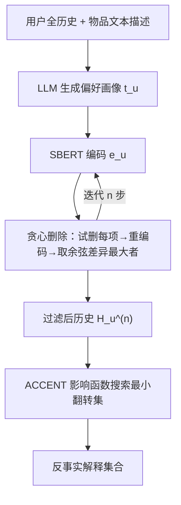
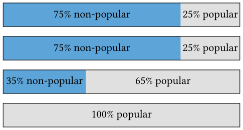

# Mitigating Popularity Bias in Counterfactual Explanations using Large Language Models (利用大语言模型缓解反事实解释中的流行度偏差)

- **会议/期刊**: RecSys 2025 (Short Paper)
- **作者与机构**: Arjan Hasami, Masoud Mansoury (Delft University of Technology)
- **推荐链路定位**: 重排/解释层（推荐结果的反事实解释生成，非打分链路）
- **研究方向**: 去偏公平与可信推荐 / 大语言模型推荐
- **论文原文**: [https://arxiv.org/abs/2508.08946v1](https://arxiv.org/abs/2508.08946v1)
- **开源代码**: [https://github.com/ahasami/llm-augmented-cfs](https://github.com/ahasami/llm-augmented-cfs)

## TL;DR (1分钟核心速览)

反事实解释 (CFE) 通过“删掉哪几条历史就会换推荐”来向用户解释推荐，但基于影响函数的 ACCENT 会因流行度偏差而系统性挑中热门物品，导致解释与用户真实口味错位（图 1：用户历史 75% 小众，反事实集却 100% 热门）。本文提出一个**模型无关的 LLM 预处理步骤**：让 LLM 读用户全历史生成文本画像，再贪心删除“删掉后画像变化最大”的出格物品，把过滤后的历史交给 ACCENT。在 ML-1M 与 Amazon 上，PDS/EPD 两项流行度对齐指标全面优于 ACCENT，ML-1M 整体 EPD 从 0.017 降至 0.014（$p<0.05$），且呈现“小众用户更小众、大片用户更大片”的双向校正。

## Background & Motivation (背景与核心矛盾)

- **主流范式**: 可解释推荐中的 CFE 多基于优化（约束最小化）或图方法，ACCENT 则用鲁棒统计中的**影响函数 (Influence Function)** 近似“删除某交互后打分变化”，免去重训练即可搜索最小翻转集。
- **前人局限**: ① 流行度偏差使热门物品在训练中被更新最多、影响分数最高，ACCENT 天然倾向把它们选进反事实集；② Rashomon 效应下多个反事实集都“形式上合法”，但缺乏“是否符合用户预期”的筛选准则，冷门口味用户会收到完全由大片构成的解释。
- **核心洞察 (Key Insight)**: 用户历史混杂长期口味与一次性消费（如陪朋友看大片），这些**出格项 (out-of-character items)** 既污染影响分数又放大流行度信号；而 LLM 能从物品描述文本中提炼“反复出现的主题/基调”式画像，且已有证据表明 LLM 推荐器流行度偏差更低。
- **本文切入点**: 不改模型、不改解释算法，只在 CFE 之前用 LLM 画像做一次**历史清洗**，缩小候选空间并压制流行度信号。

## Method (核心方法设计)

### 1. 整体框架 (Overall Architecture)

对每个用户 $u$，先把全历史物品的文本描述拼接送入 LLM（Qwen3-8B，量化 Q3_K_M），生成 <300 词、不含具体片名、不落俗套到“动作/喜剧”这类粗类目的偏好画像$t_u$；再用 mxbai-embed-large-v1 编码为向量$e_u$。随后执行$n$步贪心删除：每步对剩余历史中每个物品试删一次、重生成画像并编码，选与当前画像余弦差异最大的物品永久剔除。最终把过滤后的$H_u^{(n)}$ 交给 ACCENT 生成反事实集。整个模块是纯预处理插件，可搭配任意基于历史的 CFE 方法。

<figure class="paper-figure" markdown="span">
  <figcaption>图1：历史记录中同时包含热门和非热门项目的用户，可能期望推荐和反事实解释中也保持类似的平衡。然而，由于流行度偏差，这种一致性往往会被打破。在反事实集合中，这种影响可能更强，因为反事实集合通常较小，因而对此类偏斜更为敏感。</figcaption>
</figure>

### 2. 关键设计拆解 (Key Designs)

1. **LLM 文本画像作为“口味锚点”**：痛点在于影响函数只看梯度权重、不看语义一致性。本文用 $t_u=\mathrm{LLM}(\mathrm{concat}_{i\in H_u}(p_i))$、$e_u=\mathrm{SBERT}(t_u)$ 把“用户是谁”压缩成一个稠密语义锚，使后续删除有可比较的参照系；其有效性直觉是：画像由**反复出现的主题**主导，单条出格消费对画像扰动大，因而可被识别。
2. **贪心最大扰动删除 (Greedy Max-Discrepancy Removal)**：每步选
$$i_j^{*}=\arg\max_{i'\in H_u^{(j-1)}}\left(1-\cos\left(e_u^{(j-1)},\,e_u^{(j-1)}\backslash\{i'\}\right)\right),\quad H_u^{(j)}=H_u^{(j-1)}\backslash\{i_j^{*}\}$$
即“删掉它、画像变得最不像自己”的物品最先出局。相比按属性规则硬过滤，这种“是否适合该用户”的通用判据原则上可迁移到多种错配维度（本文只验证流行度）。
3. **训练目标、负采样与推理效率**：本文**不训练任何模型**——推荐器为 NeuMF（$d=16$，lr$10^{-3}$，weight decay$10^{-3}$），沿用 ACCENT 官方实现与超参；无负采样设计，评估用 100 负例采样排序。代价在于每用户需$n\times h$次 LLM 查询（$h$为历史长度），是主要开销瓶颈；ML-1M 取$n=5$，Amazon 因极稀疏仅取$n=1$。

## Experimental Setup & Evaluation Protocol (实验设置与评估协议)

- **数据集与预处理**:

| 数据集 | #Users | #Items | #Interactions | 密度 | 说明 |
| :--- | :---: | :---: | :---: | :---: | :--- |
| ML-1M | 6,040 | 3,952 | 1,000,209 | 4.19% | 含文本描述与类目 |
| Amazon Video Games | 94,761 | 25,612 | 814,587 | 0.03% | 过滤至用户/物品均 ≥5 交互 |

- **数据划分与防穿越**: 沿用 ACCENT 代码库设定；**注意**：为控制 LLM 成本，仅保留按历史热门占比排序的**两端各 20%**（blockbuster / niche），丢弃中间 60%，并剔除交互 >100 的用户，每数据集取最极端各 250 人；该筛选**只用于生成反事实**，推荐模型仍在全量数据上训练。
- **排名评测协议**: 推荐质量用 `Sampled Ranking`（每测试点随机采 100 未交互物品），nDCG@10 = 0.1303 (ML-1M) / 0.0481 (Amazon)；解释公平性用两个自定义指标——**PDS**（历史与反事实集流行度分箱直方图的 $\chi^2$ 距离，越小越对齐）与 **EPD**（用户级平均流行度偏移平方的全局均值）。
- **对比基线与超参**: 基线为 ACCENT（$k=5$，在 top-5 中找替代项）与 Top Popular 启发式（按 ACCENT 集合大小取历史中最热门物品）；显著性检验$p<0.05$。

## Key Experimental Results (实验关键数据)

### 1. 主实验对比 (Main Results)

| 数据集 | 用户组 | 方法 | PDS ↓ | EPD ↓ |
| :--- | :--- | :--- | :---: | :---: |
| ML-1M | Niche | Top Popular | 1764.31 | 0.111 |
| ML-1M | Niche | ACCENT | 8.58 | 0.012 |
| ML-1M | Niche | **LLM-Augmented** | **5.24** | **0.008** |
| ML-1M | Blockbuster | Top Popular | 2588.44 | 0.070 |
| ML-1M | Blockbuster | ACCENT | 21.58 | 0.017 |
| ML-1M | Blockbuster | **LLM-Augmented** | **16.25** | **0.014** |
| Amazon | Niche | ACCENT | **3.83** | $2.0\times10^{-8}$ |
| Amazon | Niche | LLM-Augmented | 9.13 | **$1.9\times10^{-8}$** |
| Amazon | Blockbuster | ACCENT | 14.29 | $1.4\times10^{-5}$ |
| Amazon | Blockbuster | **LLM-Augmented** | **6.06** | $1.4\times10^{-5}$ |

（ML-1M 整体 EPD：ACCENT 0.017 → 本文 0.014，$p<0.05$，为全文唯一显著项；Amazon Niche 的 PDS 反而劣化。）

### 2. 消融实验 (Ablation Study)

原文未设标准消融表，但提供了两组等价于“组件必要性”的对照：

| 配置 | 效果 |
| :--- | :--- |
| w/o LLM 过滤（ACCENT 原版） | ML-1M 双组 PDS/EPD 均更高 |
| w/o 影响函数（Top Popular） | 指标爆炸（PDS 上千），证明非“随便选热门”即可对齐 |
| 删除步数 $n$：ML-1M$n=5$vs Amazon$n=1$| 稀疏数据下多删即摧毁信号，$n$ 需按密度调 |
| 无 CF 可解率 | ML-1M 14.56% → 21.16%；Amazon 27.09% → 27.31% |

### 3. 关键实验发现 (Key Findings)

1. **双向校正而非单向压制**：图 2a 显示 ML-1M 上 niche 用户的反事实集向左下移动（更冷门、取自长尾更深处），blockbuster 用户向右上移动（更热门、取自画像头部），说明机制是“向用户自身流行度偏好回归”，而非简单去热门化。
2. **收益与历史丰富度强相关**：ML-1M（密度 4.19%）上 PDS 从 8.58/21.58 降至 5.24/16.25；Amazon（0.03%）上仅 blockbuster 组 PDS 明显改善（14.29→6.06），niche 组反而从 3.83 升至 9.13——稀疏历史下 LLM 画像本身不可靠，且删 1 条即大幅扰动。
3. **对齐的代价是可行性**：过滤缩小候选池后，ML-1M 无解率上升 6.6 个百分点（14.56%→21.16%），即部分用户以“拿不到解释”换取“拿到更贴合的解释”，这是部署时必须权衡的取舍。

## Highlights & Limitations (亮点、对比与审稿批判)

- **与代表作对比 (vs. Prior Work)**: 与 ACCENT 的本质区别是**在解释搜索之前改变输入分布**，而非改影响函数或加正则；与“保留最近编辑 / 返回多样反事实集”等 Rashomon 应对策略相比，本文首次引入“解释是否符合用户口味”这一**用户对齐**准则；与 LLM4Rec 中“LLM 直接当推荐器/解释器”的路线相比，本文只把 LLM 当**语义过滤器**，不触碰打分模型。
- **可迁移亮点**: ① “LLM 画像 + 贪心最大扰动删除”可作为通用历史去噪前端，迁移到序列推荐去噪、对比学习增广或用户画像压缩；② PDS/EPD 这对指标可直接复用到任何“解释/推荐列表与用户历史分布对齐”的审计场景。
- **审稿级局限批判**: ① **成本与可扩展性**：每用户 $n\times h$ 次 LLM 调用，且需对每次试删重生成画像，250 用户规模尚可，全量用户不可行，缺少延迟/成本量化；② **评估薄弱**：仅 2 数据集、每集 500 用户、NeuMF 单模型，多数提升不显著，且无用户研究验证“更对齐”是否真被用户感知为更好解释；LLM 画像可能泛化或幻觉，prompt 敏感性未做分析。

## Rating (四维评分)

- **方法创新性 (Novelty)**: ⭐⭐⭐ （把 LLM 语义画像作为 CFE 的偏差感知预处理器，思路简洁新颖，但本质是启发式贪心过滤，缺理论保证）
- **评估协议与实验扎实度 (Protocol & Experiments)**: ⭐⭐⭐ （自定义 PDS/EPD 指标合理、含显著性检验，但数据集与用户采样规模小、多数差异不显著、无用户研究）
- **写作与数学规范度 (Clarity & Rigor)**: ⭐⭐⭐⭐ （问题动机图 1 极具说服力，公式与算法流程清晰，局限自陈诚实；但缺复杂度与成本分析）
- **工业落地与复现价值 (Industrial & Practical Value)**: ⭐⭐⭐ （代码开源、即插即用、模型无关，但 LLM 调用成本高且会抬高无解率，需工程优化后才适合线上解释服务）

