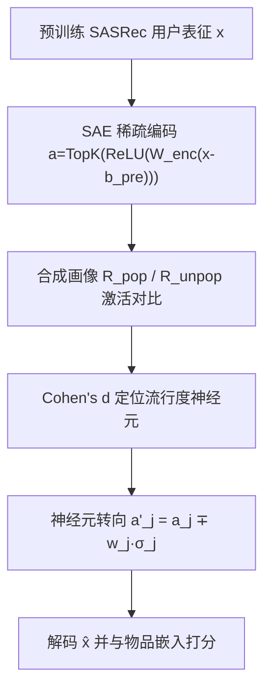

# Opening the Black Box: Interpretable Remedies for Popularity Bias in Recommender Systems (打开黑箱：推荐系统中流行度偏差的可解释矫正)

- **会议/期刊**: RecSys 2025 (Short Paper, 5 页)
- **作者与机构**: Parviz Ahmadov, Masoud Mansoury (Delft University of Technology)
- **推荐链路定位**: 重排 / 后处理（post-hoc，作用于用户表征层）
- **研究方向**: 去偏公平与工业架构 / 序列推荐
- **论文原文**: [https://arxiv.org/abs/2508.17297v1](https://arxiv.org/abs/2508.17297v1)
- **开源代码**: [https://github.com/parepic/PopSteer](https://github.com/parepic/PopSteer)

## TL;DR (1分钟核心速览)

现有流行度去偏方法（重加权、重排、架构改造）普遍是黑箱，无法回答"哪个内部组件导致了偏差"。本文提出 PopSteer：在预训练 SASRec 的用户表征上挂一个稀疏自编码器 (SAE)，用"全流行/全冷门"两组合成用户画像的神经元激活差异（Cohen's $d$）定位编码流行度信号的神经元，再按$d_j$ 符号对激活做定向加减实现"神经元转向"。在 ML-1M 与 Last.fm 的 Leave-One-Out 全库排序协议下，nDCG@10 仅降约 1–3% 即换来长尾覆盖率 +13pp、Gini 指数 −0.08 量级的公平性提升，且优于 IPR/FA*IR/PCT/P-MMF 等基线。

## Background & Motivation (背景与核心矛盾)

- **主流范式**: 流行度去偏分三类——评分重加权（IPR）、列表后处理约束（FA*IR、PCT）、资源分配式训练（P-MMF），均直接干预输出分数或曝光配额。
- **前人局限**: 其一，这些方法只改"结果"不改"表征"，一旦精度与公平性冲突便只能硬性牺牲 nDCG，且常在 nDCG 降到 0.11 以下后仍继续掉点而无公平收益；其二，全部为黑箱操作，无法诊断偏差究竟由模型内部哪一部分编码，也就无法做细粒度、可解释的干预。
- **核心洞察 (Key Insight)**: 稀疏自编码器在 LLM 可解释性中已被证明能把稠密激活分解为单语义神经元；若把 SAE 挂在推荐模型的用户表征上，则"偏好流行品"这一概念应当能被少数高稀疏神经元单独承载，从而可被定位与操纵。
- **本文切入点**: 不改模型结构、不重训推荐器，只在 SAE 隐空间做"神经元级手术"——识别偏差神经元后定向调节其激活强度。

## Method (核心方法设计)

### 1. 整体框架 (Overall Architecture)

流程为：预训练 SASRec 冻结 $\to$取其用户表征$x\in\mathbb{R}^d$训练 SAE 做重构（保持行为保真）$\to$构造$R_{pop}$/$R_{unpop}$两组合成画像并前向 SAE 记录神经元激活$\to$用 Cohen's$d$给每个神经元打"流行度倾向分"$\to$按分数对 top-$N$神经元的激活做加/减转向$\to$ 解码回用户表征，与原始物品嵌入内积生成推荐列表。整个环节为推理期后处理，无需改动底座模型参数。

### 2. 关键设计拆解 (Key Designs)

1. **Top-K 稀疏自编码器（把稠密表征拆成单语义神经元）**：常规 MLP 隐层神经元高度多义，无法归因。SAE 用超完备隐层（$N=4096 \gg d$）配合 ReLU 后仅保留 top-$K$ 激活的硬掩码，迫使每个被激活单元专精一个概念：
$\hat{x}=W_{dec}a+b_{pre},\quad a=\mathrm{TopK}\big(\mathrm{ReLU}(W_{enc}^{\top}(x-b_{pre}))\big)$训练目标为重构损失加防死神经元辅助项$\min\|x-\hat{x}\|_2^2+\gamma\mathcal{L}_{aux}$。稀疏性是后续"精准手术不伤及无辜"的前提。

2. **合成画像 + Cohen's $d$的偏差神经元定位**：真实数据中流行度信号与用户兴趣纠缠，难以分离。作者对每个真实用户保留交互数、把物品逐一替换为头部 20% 或尾部 20% 物品，得到$R_{pop}$与$R_{unpop}$（仅用于探测，不参与 SAE 训练），从而隔离出纯流行度变量。对神经元$j$ 计算效应量：
$d_j=\frac{\mu_{j,pop}-\mu_{j,unpop}}{\sqrt{(\sigma_{j,pop}^2+\sigma_{j,unpop}^2)/2}}$
$d_j>0$表示该神经元偏好流行品，$d_j<0$偏好长尾；$|d_j|$ 越大偏差编码越强。

3. **神经元转向与训练/推理开销**：按归一化 $|d_j|$分配权重$w_j=\alpha\cdot\frac{|d_j|-\min|d|}{\max|d|-\min|d|}$，再对激活做符号相反的方向修正：
$a'_j=a_j+w_j\sigma_j\ \text{若}\ d_j<0;\quad a'_j=a_j-w_j\sigma_j\ \text{若}\ d_j>0$即压制流行神经元、放大长尾神经元，$\alpha$控制整体强度、$N$ 控制干预神经元数量，二者共同构成连续的"公平–精度"调节旋钮。方法本身无额外训练损失（SAE 独立训练），推理时仅多一次 SAE 前向，开销可忽略。

## Experimental Setup & Evaluation Protocol (实验设置与评估协议)

- **数据集与预处理**: 两数据集均做 `5-core` 过滤（用户与物品交互数均 ≥5）：

| 数据集 | #Users | #Items | #Interactions | 密度 | 场景说明 |
| :--- | :---: | :---: | :---: | :---: | :--- |
| ML-1M | 6,040 | 3,417 | 999,611 | 0.048 | 电影评分，含时间戳 |
| Last.fm | 1,363 | 2,976 | 64,286 | 0.016 | 音乐收听，含时间戳 |

- **数据划分与防穿越**: 按时间戳排序后 `Leave-One-Out`——最后一条测试、倒数第二条验证、其余训练，属严格时序切分。
- **排名评测协议**: 序列推荐标准全库排序（对全部未交互物品打分排序），报告 nDCG@10；公平性用长尾覆盖率 LT Cov.@10（推荐中来自尾部 20% 物品的比例，越高越好）与 Gini@10（曝光分布不均度，越低越好）。
- **对比基线与超参**: 底座为 SASRec（lr=0.001，早停 patience=10）；基线含 IPR（$\alpha\in\{0.1,...,1\}$）、FA*IR（$p\in\{0.3,...,0.99\}$，列表长 500）、PCT、P-MMF（$\eta$、$\lambda$网格调参）与 Random。SAE 隐层缩放$s\in\{8,32,64\}$、稀疏度$K\in\{16,32,48\}$；PopSteer 的$\alpha\in\{1.0,...,4.0\}$、$N\in\{1024,...,4096\}$。

## Key Experimental Results (实验关键数据)

### 1. 主实验对比 (Main Results)

原文主结果为 nDCG–公平性二维散点图（图 1、图 2），下表按图中可读数值整理代表性工作点（ML-1M，nDCG≈0.12 附近对比）：

| 方法 | nDCG@10↑ | LT Cov.@10↑ | Gini@10↓ | 说明 |
| :--- | :---: | :---: | :---: | :--- |
| SASRec (原始) | **0.1166** | 0.4917 | 0.7491 | 精度最高、公平最差 |
| Random | ~0.10 | ~0.52 | ~0.74 | 随机扰动，收益有限 |
| IPR | ~0.115 | ~0.53 | ~0.73 | 重加权，曲线陡降 |
| FA*IR | ~0.118 | ~0.55 | ~0.72 | 局部覆盖率略优 |
| PCT | ~0.110 | ~0.55 | ~0.72 | 精度损失明显 |
| P-MMF | ~0.105 | ~0.56 | ~0.71 | 掉点最多、灵活性差 |
| **PopSteer** | 0.1135 ($N$=3072) | **0.5704** | **0.7016** | 同等 nDCG 下公平最优 |
| **PopSteer** ($N$=4096) | 0.1106 | **0.6241** | **0.6677** | 极限公平档，仅降 5% 精度 |

Last.fm 上趋势一致：PopSteer 在 $N$=4096 时 LT Cov. 达 0.9150、Gini 降至 0.4826（原始 0.5859），nDCG 从 0.6247 降至 0.6036（−3.4%）；FA*IR 覆盖率偶有微弱领先，但 Gini 全面劣于 PopSteer。

### 2. 消融实验 (Ablation Study)

以"随机高斯噪声扰动神经元"为对照（$\alpha$与噪声强度$\xi$ 各自调至 nDCG 降幅 ≤10%）：

| 数据集 | $N$ | nDCG (PS / Noise) | LT Cov. (PS / Noise) | Gini (PS / Noise) |
| :--- | :---: | :---: | :---: | :---: |
| ML-1M | 0 | 0.1166 / 0.1166 | 0.4917 / 0.4917 | 0.7491 / 0.7491 |
| ML-1M | 2048 | 0.1167 / 0.1129 | 0.5346 / 0.5440 | 0.7315 / 0.7376 |
| ML-1M | 3072 | 0.1135 / 0.1103 | **0.5704** / 0.5463 | **0.7016** / 0.7367 |
| ML-1M | 4096 | 0.1106 / 0.1110 | **0.6241** / 0.5485 | **0.6677** / 0.7394 |
| Last.fm | 2048 | 0.6126 / 0.5932 | **0.9167** / 0.8598 | **0.4876** / 0.5885 |
| Last.fm | 4096 | 0.6036 / 0.6015 | **0.9150** / 0.8628 | **0.4826** / 0.5878 |

### 3. 关键实验发现 (Key Findings)

1. **公平收益来自"选对神经元"而非"扰动幅度"**：随机噪声在 $N$从 1024 增至 4096 时 Gini 几乎不动（ML-1M 0.7387→0.7394），而 PopSteer 单调下降至 0.6677，证明增益可归因于 Cohen's$d$ 的定向选择。
2. **干预强度与公平性近似线性可控**：ML-1M 上 $N$每增 1024，LT Cov. 约 +2~5pp、Gini 约 −0.01~−0.03，且 nDCG 在$N\le2048$ 时几乎无损（0.1166→0.1167），说明存在"免费公平"区间。
3. **可解释性可被反证**：图 3 中手动关闭 $d_j>1$的流行神经元，Gini 持续下降；关闭$d_j<-1$ 的长尾神经元则 Gini 上升——双向验证了神经元语义标签的真实性，而非事后附会。

## Highlights & Limitations (亮点、对比与审稿批判)

- **与代表作对比**: IPR/FA*IR 在输出分数或列表前缀上做约束，PCT/P-MMF 在曝光配额上做优化，三者均"知其然不知其所以然"；PopSteer 首次把 LLM 可解释性工具链（SAE + 神经元转向）迁移到推荐去偏，干预发生在表征层而非结果层，因而能给出"为什么偏"的答案。
- **可迁移亮点**: (1) "合成画像隔离单一变量 + 效应量排序"的探测范式可复用于性别/地域等其他偏差维度；(2) 推理期激活转向无需重训底座，适合已上线模型的低成本公平性补丁。
- **审稿级局限批判**: (1) 仅在 SASRec 单一底座、两个中小规模数据集上验证，未涉及图模型或工业级双塔，泛化性存疑；(2) 合成画像用"随机替换为头/尾物品"构造，破坏了物品间语义共现，可能高估流行度信号的独立性；SAE 隐层 4096 与 $K$、$\alpha$、$N$ 多个超参需逐数据集调优，且公平性以覆盖率/Gini 衡量，缺少对用户效用侧（如长尾推荐准确率）的细粒度评估。

## Rating (四维评分)

- **方法创新性 (Novelty)**: ⭐⭐⭐⭐ （首次将 SAE 神经元级可解释性引入推荐流行度去偏，思路新颖，但属跨领域工具迁移而非理论突破）
- **评估协议与实验扎实度 (Protocol & Experiments)**: ⭐⭐⭐ （Leave-One-Out 全库排序协议规范、消融对照设计巧妙，但仅两数据集、单底座、5 页短文，缺显著性检验与用户侧评估）
- **写作与数学规范度 (Clarity & Rigor)**: ⭐⭐⭐⭐ （SAE 与 Cohen's $d$ 公式定义清晰、动机链条完整，但主结果以散点图呈现、缺精确数值表，复现需读图估数）
- **工业落地与复现价值 (Industrial & Practical Value)**: ⭐⭐⭐⭐ （代码开源、推理仅增一次 SAE 前向、无需重训底座，作为线上公平性后处理插件落地成本低）

