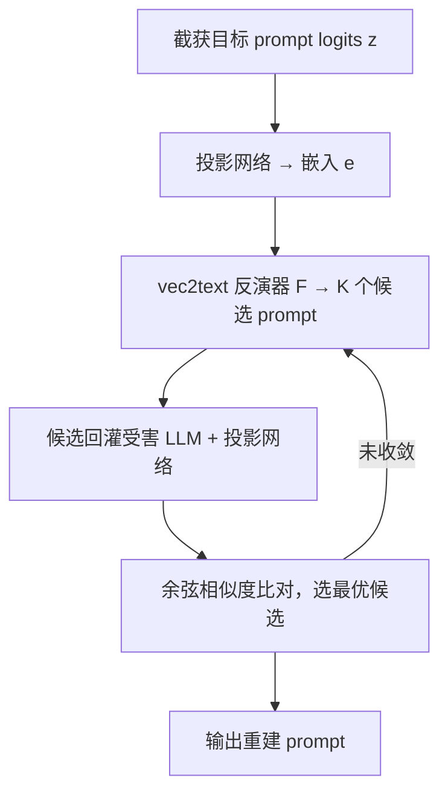
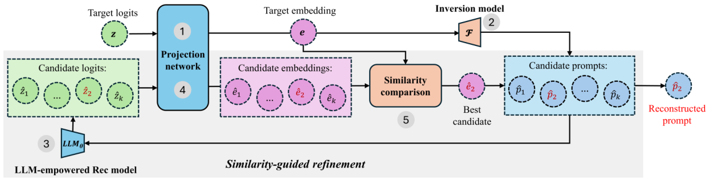

# Privacy Risks of LLM-Empowered Recommender Systems: An Inversion Attack Perspective (LLM 赋能推荐系统的隐私风险：反演攻击视角)

- **会议/期刊**: ACM RecSys 2025
- **作者与机构**: Yubo Wang, Min Tang, Nuo Shen, Shujie Cui, Weiqing Wang（Monash University）
- **推荐链路定位**: 端到端生成式（LLM 推理服务侧）
- **研究方向**: 去偏公平、可信隐私与工业架构 / 大语言模型推荐
- **论文原文**: [https://arxiv.org/abs/2508.03703v2](https://arxiv.org/abs/2508.03703v2)
- **开源代码**: [https://github.com/xuemingxxx/Attack_RecSys](https://github.com/xuemingxxx/Attack_RecSys)

## TL;DR (1分钟核心速览)

LLM 赋能推荐系统把用户画像、交互历史全部塞进 prompt，而系统回传给推荐服务做后处理的 **logits** 成为新的泄露面。本文首次系统研究该场景下的反演攻击：复现 vec2text 框架，并用 **Similarity-Guided Refinement（相似度引导精炼）** 以 beam search 生成候选、回灌受害模型比对余弦相似度迭代收敛。在 Movie/Book 两域、TallRec/CoLLM 两模型上，可恢复近 **65%** 交互物品、**87%** 年龄性别推断正确，文本相似度指标普遍超 85%（Movie-TallRec）。

## Background & Motivation (背景与核心矛盾)

- **主流范式**: P5/TallRec/CoLLM 等把指令、上下文、用户画像 $P_i$与历史交互$V_{ui}$拼成完整 prompt$P=[P_{task};P_{context};P_i;V_{ui}]$，由 LLM 自回归输出推荐。
- **前人局限**: 已有攻击（CheatAgent 篡改文本提曝光、Ning 等投毒 1% 训练数据）只关心**推荐准确率被破坏**，完全忽略隐私；而通用 LLM 反演研究依赖**语义丰富的输出文本**，推荐任务常输出 "Yes/No" 这类稀疏短响应，输出级反演直接失效。
- **核心洞察 (Key Insight)**: 推荐系统为后处理会把 **next-token logits** 回传，而 logits 中残留的输入信息与输出语义丰富度无关——即便推荐质量下降，logits 仍编码输入细节。
- **本文切入点**: 用 logits 级反演替代输出级反演，把"逐 token 生成合理序列"重构为"在高维 logit 空间定位最接近真实分布的点"。

## Method (核心方法设计)

### 1. 整体框架 (Overall Architecture)

攻击者仅黑盒访问受害推荐接口，可大量查询并截获 logits。流程为：目标 prompt 的 logits $\mathbf{z}$先经投影网络对齐到反演模型词表，得到定长嵌入$\mathbf{e}\in\mathbb{R}^{B\times T\times d}$；T5-base 反演器$\mathcal{F}$将$\mathbf{e}$解码为候选 prompt 集合；候选回灌受害模型与投影网络得到各自嵌入，用余弦相似度与$\mathbf{e}$ 比对，最接近者作为最终重建。训练语料由合成流水线在**与受害模型训练集不相交**的公开数据上生成，模拟真实黑盒场景。

<figure class="paper-figure" markdown="span">
  <figcaption>图2：所提出的反演框架概览。给定目标提示z的logits，我们的攻击包含5个步骤：1）首先将z投影为嵌入e，然后2）用我们的反演模型F将e反向为一组提示候选{ ˆ𝑝1, . . . , ˆ𝑝𝑘}。3）这些候选将被输入LLM赋能的推荐模型，并4）通过投影网络得到其对应的嵌入。5）最后我们通过余弦相似度比较每个候选嵌入与目标嵌入的相似性。对应嵌入与目标最接近的候选提示</figcaption>
</figure>

### 2. 关键设计拆解 (Key Designs)

1. **域对齐合成语料流水线（Domain-Aligned Synthetic Corpus）**：通用 one-million-instructions 语料训练的反演器在推荐域 ItemMatch≈0，因为测试 prompt 含大量 OOV 物品标题，低阶 logits 统计与训练词槽映射崩塌。作者按 userId 分组、按时间倒序、以阈值 $k$划分偏好/非偏好、每 prompt 采样至多$n$ 个标题，覆盖二分类/直接推荐/序列/评分预测/冷启动五类任务各 10+ 模板，Movie 与 Book 各生成 150 万条 prompt。直觉：恢复 logits 到 prompt 空间的映射，前提是训练分布与受害域词表对齐。

2. **相似度引导精炼（Similarity-Guided Refinement）**：基础反演只输出"看似合理"的序列，缺乏对真实分布的全局校验。每轮以 beam width $K=5$ 生成候选，选与目标嵌入余弦相似度最大者：
$$\hat{P}^{(t+1)}=\arg\max_{1\le k\le K}\cos\big(LLM_\theta(\hat{P}^{(t)}_k),\ \mathbf{e}\big)$$
当相邻两轮相似度增益低于 $\epsilon=10^{-5}$ 即停止（多数样本 2 轮内收敛）。物理直觉：把生成问题转为**嵌入空间最近点搜索**，用受害模型自身作为"真值裁判"，纠正逐 token 贪心带来的语义漂移。

3. **训练目标与开销**：反演器以标准 seq2seq 负对数似然训练（T5-base，222M 参数，lr $2\times10^{-4}$，bf16，最多 50 epoch，按验证集 ItemMatch 早停）。攻击**无需负采样**；在线开销为每样本$K$ 次受害模型前向 + 1 次反演解码，2 轮内收敛使成本可控，但仍是查询密集型攻击。

## Experimental Setup & Evaluation Protocol (实验设置与评估协议)

- **数据集与预处理**: 受害模型训练用 ML-1M 与 Amazon Books Reviews（300 万评分/21.2 万书），按 80/10/10 划分；反演语料另用 ML-25M/ML-32M 与 Kaggle 1M Users Book Ratings/Goodreads 构造，**与受害训练集严格不相交**，测试集仅用于评估攻击。

| 数据集 | 角色 | 规模/说明 | 备注 |
| :--- | :---: | :---: | :--- |
| ML-1M | 受害模型训练 | 电影评分 | 80/10/10 划分 |
| Amazon Books | 受害模型训练 | 3M 评分 / 212K 书 | 80/10/10 划分 |
| InvInst_movie | 反演训练 | 150 万 prompt | $k=4$，$n\sim U(3,11)$ |
| InvInst_book | 反演训练 | 150 万 prompt | 同上 |

- **数据划分与防穿越**: 比例划分（80/10/10）；反演语料与受害训练数据来源隔离，测试集对反演模型不可见。
- **排名评测协议**: 非排名任务，采用文本生成指标 BLEU / ROUGE-L / Token-level F1，外加两个推荐定制指标：$\text{ItemMatch}=|T\cap\hat{T}|/|T|$（无序物品召回率）与$\text{ProfileMatch}=N_{correct}/N_{total}$（年龄+性别同时精确恢复比例）。
- **对比基线与超参**: 基线为 Generic（LLaMA logits 上训练的原始 vec2text）与 Generic-Rec（同语料换受害模型 logits 微调）；本文 RecAtk-Spec / RecAtk-Refined。反演器统一 T5-base，beam $K=5$，$\epsilon=10^{-5}$。

## Key Experimental Results (实验关键数据)

### 1. 主实验对比 (Main Results)

攻击 TallRec（Movie / Book）：

| 模型 | ItemMatch | ProfileMatch | BLEU | ROUGE | F1 |
| :--- | :---: | :---: | :---: | :---: | :---: |
| Generic | 0.0011 / 0.0015 | 0 / 0 | 1.52 / 1.43 | 0.144 / 0.158 | 0.199 / 0.192 |
| Generic-Rec | 0 / 0.0004 | 0 / 0 | 1.61 / 1.53 | 0.175 / 0.198 | 0.227 / 0.231 |
| RecAtk-Spec | 0.6086 / 0.3277 | 0.8550 / 0.8337 | 84.89 / 70.36 | 0.915 / 0.780 | 0.906 / 0.767 |
| **RecAtk-Refined** | **0.6471 / 0.3463** | **0.87 / 0.8337** | **85.84 / 70.44** | **0.924 / 0.782** | **0.918 / 0.768** |

攻击 CoLLM（Movie / Book）：

| 模型 | ItemMatch | ProfileMatch | BLEU | ROUGE | F1 |
| :--- | :---: | :---: | :---: | :---: | :---: |
| Generic | 0.0014 / 0.0036 | 0 / 0 | 2.12 / 2.56 | 0.136 / 0.160 | 0.187 / 0.196 |
| Generic-Rec | 0.0001 / 0.0002 | 0 / 0 | 1.36 / 1.44 | 0.153 / 0.177 | 0.203 / 0.212 |
| RecAtk-Spec | 0.4741 / 0.2297 | 0.4463 / 0.2110 | 66.38 / 51.06 | 0.760 / 0.627 | 0.766 / 0.652 |
| **RecAtk-Refined** | **0.5125 / 0.2612** | **0.5012 / 0.2830** | **67.58 / 53.16** | **0.770 / 0.647** | **0.776 / 0.663** |

### 2. 消融实验 (Ablation Study)

Movie 域、TallRec 场景下的组件与因素消融：

| 变体 | ItemMatch | ProfileMatch | BLEU | 说明 |
| :--- | :---: | :---: | :---: | :--- |
| RecAtk-Refined | **0.6471** | **0.870** | **85.84** | 完整方法 |
| RecAtk-Spec（去精炼） | 0.6086 | 0.8550 | 84.89 | 精炼带来 +3.9pt ItemMatch |
| Generic-Rec（去域对齐） | 0 | 0 | 1.61 | 域对齐是成败前提 |
| RecAtk-Refined-VPD（受害模型 AUC 0.658→0.589） | 0.6252 | 0.827 | 82.89 | 推荐质量下降影响极小 |

### 3. 关键实验发现 (Key Findings)

1. **域对齐是攻击成败的分水岭**：通用语料反演器 ItemMatch 近乎 0，换域对齐语料后 Movie 达 61%、Book 达 33%，ProfileMatch 从 0 跃至 83%+；这与 Morris 等的残差信息理论一致——OOV 标题使 logits 低阶统计与训练词槽映射断裂。
2. **画像字段是最稳定泄露源**：ProfileMatch 高达 83.3%–87.0%，因年龄性别词表小、位置固定、信号强；而物品标题受长度与词频影响，Book 域仅 83% 标题在训练语料出现、平均 8.93 token（Movie 4.87），导致 ItemMatch 从 65% 跌至 35%。
3. **泄露与推荐质量近乎解耦**：将 TallRec AUC 从 0.6576 压到 0.5889 后，ItemMatch 仅从 0.647 降至 0.625、ProfileMatch 仍 >0.82，说明 logits 中的 token 级输入信号不随推荐性能退化而消失；此外 prompt 物品数从 3 增至 11 时四项指标齐降约 20%–24%，长 prompt 是攻击的天然瓶颈。

## Highlights & Limitations (亮点、对比与审稿批判)

- **与代表作对比 (vs. Prior Work)**: 相比 CheatAgent（测试期改文本提曝光）与 Ning 等（1% 投毒误导决策），本文首次把威胁模型从"破坏准确率"转向"窃取隐私"；相比通用 LLM 反演（Morris 等 vec2text），本文指出推荐输出语义稀疏使输出级反演失效，必须走 logits 级路径，并补上域对齐语料与相似度精炼两块拼图。
- **可迁移亮点**: ①"合成域对齐语料 + 回灌受害模型做相似度裁判"的精炼范式可迁移到任意黑盒 LLM 服务的 prompt 泄露审计；②ItemMatch/ProfileMatch 两个定制指标可直接复用于推荐隐私评测基准。
- **审稿级局限批判**: ①攻击需每样本 $K$ 次受害模型前向，查询成本与延迟在真实限流接口下可能不可行，论文未给出查询预算-精度曲线；②反演语料依赖与受害域同源的公开数据，跨域迁移（如 Movie 语料攻 Book 系统）未验证，且长 prompt 下指标掉 20%+ 说明方法对复杂真实会话的威胁被高估。

## Rating (四维评分)

- **方法创新性 (Novelty)**: ⭐⭐⭐⭐ （首次定义 LLM 推荐 logits 反演问题，精炼机制虽为 vec2text 改良但问题建模新颖）
- **评估协议与实验扎实度 (Protocol & Experiments)**: ⭐⭐⭐⭐ （两域两模型 + 定制指标 + 受害质量受控实验完整，缺查询预算与跨域迁移分析）
- **写作与数学规范度 (Clarity & Rigor)**: ⭐⭐⭐⭐ （五步流程与公式清晰，残差信息理论引用到位，但部分归因停留在相关性层面）
- **工业落地与复现价值 (Industrial & Practical Value)**: ⭐⭐⭐⭐ （代码与 300 万条合成语料全开源，直接可作为 LLM 推荐服务的隐私红队工具）

