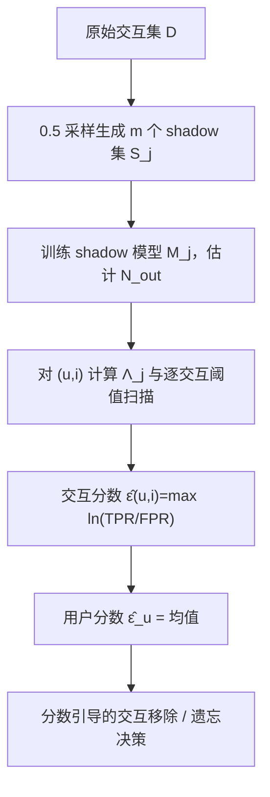

# RecPS: Privacy Risk Scoring for Recommender Systems (推荐系统隐私风险评分)

- **会议/期刊**: ACM RecSys 2025
- **作者与机构**: Jiajie He, Yuechun Gu, Keke Chen（University of Maryland, Baltimore County）
- **推荐链路定位**: 训练数据治理 / 模型遗忘（非在线排序链路，作用于离线训练与数据移除决策）
- **研究方向**: 去偏公平、可信隐私与工业架构
- **论文原文**: [论文原文链接](https://arxiv.org/abs/2507.18365v4)
- **开源代码**: [开源代码仓库链接](https://anonymous.4open.science/r/RsLiRA-4BD3/readme.md)

## TL;DR (1分钟核心速览)

推荐系统训练数据缺乏可量化的个体隐私风险度量，用户无法判断哪条交互更敏感。本文提出 RecPS：从差分隐私的假设检验解释出发，把交互级隐私风险定义为 $\epsilon_{(u,i)}=\sup\ln\frac{\Pr(M_0(D_{0,(u,i)})\in O)}{\Pr(M_0(D_{1,(u,i)})\in O)}$，并用新设计的交互级成员推断攻击 RecLiRA（离线 LiRA 适配 NCF/LightGCN）以$\ln(\mathrm{TPR}/\mathrm{FPR})$ 估计该分数，再取均值扩展到用户级。在 ML-1M、Amazon Digital Music、Amazon Beauty 三个基准上，RecLiRA 的 AUC 全面超过 MINER（如 ADM 上 0.9988 vs 0.8449），且分数引导的交互级移除在 ADM 上仅损失 9.71%（LGCN）/15.56%（NCF）效用即可让 top-5% 敏感用户全部降分至阈值以下，远优于整用户移除的 10.79%/37.05%。

## Background & Motivation (背景与核心矛盾)

- **主流范式**: 工业界 RecSys 隐私保护仍以受控访问为主（保效用但无量化风险），学术界的联邦推荐与 DP 训练则分别存在"不保护模型本身"与"噪声+梯度裁剪导致效用大幅下降"的问题。
- **前人局限**: ①现有 RecSys MIA 多为用户级（Item-Diff、DL-MIA），无法改造为交互级，而交互级 MIA（MINER、联邦场景方法）攻击力弱或无法计算 TPR/FPR；②已有隐私分数工作（Song & Mittal）仅用 MIA 的 TPR，缺乏与 DP 的理论挂钩；③现有推荐遗忘（Chen et al.）只能整用户移除，直接引发冷启动与效用崩塌。
- **核心洞察 (Key Insight)**: 即便模型未加 DP 噪声，对仅差一条已知记录 $r$的两个数据集，统计学习过程本身存在样本级隐私界$\epsilon_r$；而 DP 的假设检验解释给出$\ln(\mathrm{TPR}/\mathrm{FPR})\le\epsilon$，因此 TPR/FPR 比值（而非 TPR 本身）才是理论上可辩护的分数估计量。
- **本文切入点**: 用高质量交互级 MIA 逼近该理想界，把"哪条交互敏感"变成可计算、可审计的数值。

## Method (核心方法设计)

### 1. 整体框架 (Overall Architecture)

RecPS 分两阶段。**离线准备**：从原训练集 $D$以 0.5 概率独立采样生成$m\approx500$个 shadow 数据集$S_j$并训练同构 shadow 模型$M_j$；对每个 OUT 记录计算置信度特征$\phi(q)$，用至少 30 个 OUT 样本估计高斯分布$\mathcal{N}_{out}(\mu_{out},\sigma_{out})$。**在线评分**：对目标交互$(u,i)$，在每个 shadow 模型上算$\Lambda_j=1-\Pr(Z>\phi(q_j)),\,Z\sim\mathcal{N}_{out}$，再在 OUT 模型给出的候选阈值集合上扫描，取使$\ln(\mathrm{TPR}/\mathrm{FPR})$ 最大的阈值作为该交互的分数；用户级分数取交互分数均值。分数最终服务于两类下游决策：整用户移除 vs. 按分数排序的部分交互移除。

### 2. 关键设计拆解 (Key Designs)

1. **交互级隐私分数的 DP 推导（把"敏感度"锚定在不可区分性上）**：痛点在于此前分数无理论依据。作者令 $D_{0,(u,i)}=D_{1,(u,i)}\cup\{(u,i)\}$，定义$\epsilon_{(u,i)}=\sup\ln\frac{\Pr(M_0(D_{0,(u,i)})\in O)}{\Pr(M_0(D_{1,(u,i)})\in O)}$，并证明理想 MIA 的$\ln(\mathrm{TPR}/\mathrm{FPR})$恰为该界的最佳估计，故$\hat\epsilon_{(u,i)}=\ln(\mathrm{TPR}_{A,(u,i)}/\mathrm{FPR}_{A,(u,i)})\le\epsilon_{(u,i)}$，MIA 越强估计越紧。直觉：分数衡量的是"攻击者能否把这条记录与某个具体用户绑定"，这是所有下游攻击（重构、属性推断）可归因的前提。

2. **用户级分数的均值聚合（避免长交互用户被高估）**：由 $D_{0,u}=D_{1,u}\cup I_u$可推出用户风险被$\prod_{i\in I_u}\epsilon_{u,i}$上界，但连乘会让交互多的用户分数爆炸。作者改用$\hat\epsilon_u=\frac{1}{|I_u|}\sum_{(u,i)\in I_u}\hat\epsilon_{(u,i)}$，把用户分数解释为"平均单条交互的暴露程度"，使跨用户可比。

3. **RecLiRA：把离线 LiRA 移植到推荐打分模型**：NCF/LightGCN 输出 $p\in[0,1]$，可视为二分类置信度$(p,1-p)$。作者定义$q=|p-(1-p)|=|2p-1|$并做 logit 变换$\phi(q)=\log\frac{q}{1-q}$，使 IN/OUT 样本的$\phi$近似高斯；$\Lambda_j=1-\Pr(Z>\phi(q_j))$即该样本为 IN 的单侧检验 p 值式置信。关键工程点是**逐交互阈值搜索**：不用全局$T=0.5$，而是在 OUT shadow 模型产生的$\Lambda$值集合上枚举阈值，取$\ln(\mathrm{TPR}/\mathrm{FPR})$最大者，从而在低 FPR 区榨出高比值——这正是分数质量的核心来源。代价为离线$O(mT+kt)$、在线每样本$O(mt)$，$m\approx500$ 是统计显著性的硬门槛。

## Experimental Setup & Evaluation Protocol (实验设置与评估协议)

- **数据集与预处理**: 仅保留交互数 $>20$ 的用户；仅用评分（1–5）作为隐式交互。

| 数据集 | #Users | #Items | #Interactions | 稀疏度/密度 | 特征/场景说明 |
| :--- | :---: | :---: | :---: | :---: | :--- |
| MovieLens-1M | 6,040 | 3,706 | 1,000,209 | 密度约 4.47% | 电影评分，稠密 |
| Amazon Digital Music | 840,372 | 456,992 | 1,584,082 | 密度约 4.1e-6 | 音乐评论，极稀疏 |
| Amazon Beauty | 1,210,271 | 249,274 | 2,023,070 | 密度约 6.7e-6 | 美妆评论，极稀疏 |

- **数据划分与防穿越 (Splitting Strategy)**: 按时间戳排序后 `Leave-One-Out` 变体——每用户最后一条为测试、倒数第二条为验证，其余为训练；训练负采样比 1:4。目标模型与 shadow 模型在**用户级**按 8:2 无重叠切分（80% 用户训目标模型，20% 训 shadow），严格避免 shadow 与目标模型共享用户造成攻击泄漏。
- **排名评测协议 (Ranking Protocol)**: 推荐效用用 $\mathrm{HR@100}$（对候选集排序取 top-100 与真实交互求交）；MIA 质量用 AUC 与**低 FPR 区 TPR**（$<0.1$），后者才是隐私分数真正依赖的区间。
- **对比基线与超参设置**: 模型为 NCF 与 LightGCN（$d=64$、3 层图卷积）；SGD，lr=0.001，batch=256，最多 30 epoch，连续 5 epoch 不升即早停。MIA 基线为改造适配 NCF/LGCN 的 MINER（原版面向 KG 长尾推荐，作者验证改造版在低 FPR 下不弱于原文报告的 ~0.15@5%FPR）。shadow 数$m\approx500$，OUT 估计样本$k\approx30$。

## Key Experimental Results (实验关键数据)

### 1. 主实验对比 (Main Results)

交互级 MIA 质量（AUC，越高说明分数估计越可靠）：

| 数据集 | 模型 | RecLiRA AUC | MINER AUC | 低 FPR 区表现 |
| :--- | :---: | :---: | :---: | :--- |
| ML-1M | LightGCN | **0.9430** | 0.8310 | RecLiRA 在 FPR<0.1 显著更高 TPR |
| ML-1M | NCF | **0.9169** | 0.8727 | 同上 |
| ADM | LightGCN | **0.9988** | 0.8449 | 近乎完美分离 |
| ADM | NCF | **0.9984** | 0.4888 | MINER 在 NCF 上接近随机 |
| Beauty | LightGCN | **0.9971** | 0.9226 | — |
| Beauty | NCF | **0.9984** | 0.6786 | — |

隐私-效用权衡（HR@100 相对下降，越低越好）：

| 移除策略 | ML-1M LGCN | ADM LGCN | ADM NCF |
| :--- | :---: | :---: | :---: |
| 移除 top-5% 敏感用户全部交互 | 显著下降 | 10.79% | 37.05% |
| 移除其 top-70% 敏感交互（分数引导） | 下降更小 | **9.71%** | **15.56%** |
| 随机移除同比例交互 | — | 降分效率显著更差 | 同左 |

### 2. 消融实验 (Ablation Study)

| 配置 | 关键观测 | 说明 |
| :--- | :--- | :--- |
| 全局阈值 $T=0.5$ vs. 逐交互阈值搜索 | 后者在低 FPR 区 TPR/FPR 更高 | 阈值搜索是分数质量的关键算子 |
| 分数引导移除 vs. 随机移除 | 前者使 100% top-5% 用户降分至 $\theta$ 以下，后者远不能 | 验证分数具备真实排序信息 |
| 整用户移除 vs. 交互级部分移除 | ADM 上 NCF 37.05% → 15.56% | 细粒度是效用保全的核心 |
| 移除后重评分数（隐私洋葱效应） | 分数变化落在 $[-0.03,0.015]$，约 10–20% 用户分数上升 | 交互级移除可将升分用户再减 1–7% |

### 3. 关键实验发现 (Key Findings)

1. **MIA 强度直接决定分数可用性**：MINER 在 ADM-NCF 上 AUC 仅 0.4888（等同随机），此时 $\ln(\mathrm{TPR}/\mathrm{FPR})$ 无意义；RecLiRA 把同一组合拉到 0.9984，说明"隐私评分"这一任务的实际瓶颈不在定义而在攻击器质量。
2. **细粒度移除的效用收益是数量级的**：ADM 上 NCF 从整用户移除的 37.05% 降到 15.56%，LGCN 从 10.79% 降到 9.71%，且 100% 的 top-5% 用户分数被压到阈值 $\theta$ 以下——隐私目标达成而效用损失减半以上。
3. **隐私洋葱效应真实存在但可控**：移除 top-5% 用户后，剩余用户分数变化仅 $[-0.03,0.015]$，约 10–20% 用户分数反升；改用交互级移除后升分用户再降 1–7%，说明"移除他人数据会抬高你的相对暴露度"这一动态必须纳入治理流程。

## Highlights & Limitations (亮点、对比与审稿批判)

- **与代表作对比 (vs. Prior Work)**: 相比 Item-Diff/DL-MIA 等用户级 MIA，RecLiRA 首次给出可用的交互级攻击并支撑细粒度评分；相比 MINER，它在 NCF/LightGCN 上低 FPR 区 TPR 大幅领先；相比 Song & Mittal 仅用 TPR 的分数，本文用 TPR/FPR 比值并与 DP 的 $\epsilon$ 严格对应，理论上更可辩护；相比 Chen et al. 的整用户遗忘，本文提供"删哪些交互"的决策依据。
- **可迁移亮点**: ①"逐样本阈值搜索最大化 TPR/FPR"可直接搬到任何需要低 FPR 区审计的场景（如 DP-SGD 审计、版权成员推断）；②用 shadow 模型集成把黑盒打分模型转成二分类置信度再做 LiRA，是模型无关的通用适配套路。
- **审稿级局限批判**: ①成本高——$m\approx500$个 shadow 模型训练对工业级 RecSys 几乎不可承受，论文未给出蒸馏或单次训练审计的降本方案；②适用范围窄——仅支持输出概率的 NCF/LightGCN，MF/ALS 等纯排序打分模型明确不适用；③评估局限——未报告多次运行的方差与显著性检验，且"分数降至$\theta$以下"这一隐私目标本身依赖$\theta$ 的人为设定，缺少与真实攻击者成功率的端到端验证。

## Rating (四维评分)

- **方法创新性 (Novelty)**: ⭐⭐⭐⭐ （首次把 RecSys 隐私评分锚定在 DP 的假设检验解释上，并以 TPR/FPR 替代 TPR，理论动机扎实；但 LiRA 骨架本身为移植而非全新构造）
- **评估协议与实验扎实度 (Protocol & Experiments)**: ⭐⭐⭐⭐ （三数据集 × 两模型 × 用户级 8:2 隔离切分较严谨，低 FPR 区指标选得准；扣分在缺少方差/显著性报告与端到端攻击验证）
- **写作与数学规范度 (Clarity & Rigor)**: ⭐⭐⭐⭐ （DP→MIA→分数的推导链条清晰，算法伪代码完整，复杂度分析到位；用户级连乘上界到均值聚合的过渡略简）
- **工业落地与复现价值 (Industrial & Practical Value)**: ⭐⭐⭐ （代码已开源、流程可复现，但 500 个 shadow 模型的训练开销与仅限概率输出模型的约束，使其短期内更适合作为合规审计工具而非线上常驻组件）

