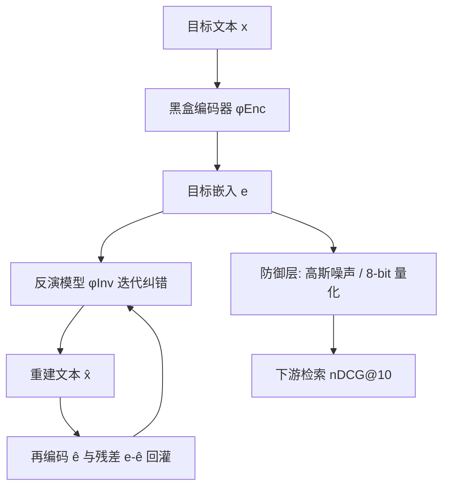
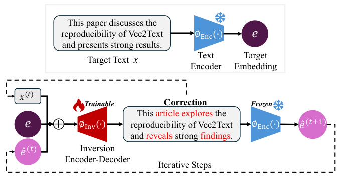

# Rethinking the Privacy of Text Embeddings: A Reproducibility Study of "Text Embeddings Reveal (Almost) As Much As Text" (重思文本嵌入的隐私性：Vec2Text 可复现性研究)

- **会议/期刊**: RecSys 2025（Reproducibility Track, Oral）
- **作者与机构**: Dominykas Seputis, Yongkang Li, Karsten Langerak, Serghei Mihailov（University of Amsterdam）
- **推荐链路定位**: 召回 / 向量检索（Embedding 存储与传输环节的隐私风险）
- **研究方向**: 去偏公平、可信隐私与工业架构
- **论文原文**: [论文原文链接](https://arxiv.org/abs/2507.07700v1)
- **开源代码**: [开源代码仓库链接](https://github.com/dqmis/vec2text-repro)

## TL;DR (1分钟核心速览)

推荐与检索系统普遍以"只传嵌入、不传原文"作为隐私保护手段，而 Vec2Text 声称可从黑盒嵌入中近乎逐字还原原文（32-token 文本 BLEU 达 97.3）。本文在 NQ/MSMARCO 与 10 个 BEIR 数据集上系统复现该攻击，确认其域内有效性（gtr-nq-32 复现 BLEU 98.5、Exact-match 94.0），同时揭示其**对输入长度高度敏感**、域外性能显著衰减；并首次验证密码类无语义文本可被部分还原（Easy 档 Exact-match 36%），进而提出**免调参 8-bit 量化防御**，在 nDCG@10 几乎无损（0.281→0.281）的前提下将 BLEU 从 59.1 压至 19.0。

## Background & Motivation (背景与核心矛盾)

- **主流范式**: 工业推荐/检索系统将用户文本（Query、新闻标题、用户画像描述）编码为稠密向量后存入向量库（Faiss/Qdrant），第三方仅接触嵌入，被视为天然脱敏。
- **前人局限**: ① Vec2Text 报告的 97.3 BLEU 与同期 GEIA 仅 1.0 BLEU 相差两个数量级，结果可信度存疑；② 已有复现工作（Zhuang et al.）仅用 NQ 单数据集，无法覆盖距离度量、池化方式、嵌入维度等训练因子。
- **核心洞察 (Key Insight)**: 高维嵌入空间结构不透明，攻击效果强烈依赖"训练长度—推理长度"匹配；且量化引入的离散化误差恰好破坏反演所需的细粒度信息，却保留检索所需的粗粒度几何关系。
- **本文切入点**: 以"复现 + 扩展"双轨结构，既验证原结论，又把攻击面推进到密码场景，并把防御从"需精调 $\lambda$ 的高斯噪声"换成"零超参量化"。

## Method (核心方法设计)

### 1. 整体框架 (Overall Architecture)

本文不提出新攻击模型，而是围绕 Vec2Text 的**迭代纠错反演框架**做受控复现与防御扩展。给定黑盒编码器 $\phi_{\text{Enc}}(\cdot)$与目标嵌入$e=\phi_{\text{Enc}}(x)$，反演模型$\phi_{\text{Inv}}(\cdot)$（T5-base 初始化，约 235M 参数）在第$t$步将目标嵌入、上一步生成文本的嵌入$\hat{e}^{(t)}$、二者残差$e-\hat{e}^{(t)}$以及上一步词级嵌入拼接为输入，解码出修正文本$x^{(t)}$，循环至预设步数。推理端采用 token 级贪心 + 序列级 beam search。本文在此闭环上叠加三类扩展实验：超参帕累托分析、密码重建、量化防御。

<figure class="paper-figure" markdown="span">
  <figcaption>图1：Vec2Text 框架从黑盒编码器 𝜙Enc(·) 生成的嵌入 𝑒 中重建目标文本 𝑥。我们训练一个基于编码器-解码器的反演模型 𝜙Inv(·)，该模型迭代生成修正文本 𝑥(𝑡)，并旨在最小化 ˆ𝑒(𝑡+1) 与目标嵌入 𝑒 之间的差异。𝑥(𝑡) 和 ˆ𝑒(𝑡+1) 作为下一次迭代的输入，直到完成预定义的步数。</figcaption>
</figure>

### 2. 关键设计拆解 (Key Designs)

1. **迭代纠错输入构造（复现对象的核心算子）**：单步反演无法弥合离散 token 与连续嵌入的鸿沟，故每步输入为四段拼接
$\text{Input}=\text{concat}\big(\text{EmbToSeq}(e),\ \text{EmbToSeq}(\hat{e}^{(t)}),\ \text{EmbToSeq}(e-\hat{e}^{(t)}),\ (w_1,\dots,w_n)\big)$，
其中 $\text{EmbToSeq}(e)=W_2\sigma(W_1 e)$ 为各路独立参数的 MLP 投影。残差项显式告诉模型"还差多少语义"，使 50 步 + beam search 能把 BLEU 从单步 50.7 推到 97.3。

2. **高斯噪声防御的复现与边界**：原防御为 $\phi_{\text{noisy}}(x)=\phi_{\text{Enc}}(x)+\lambda\cdot\epsilon,\ \epsilon\sim\mathcal{N}(0,1)$。复现确认$\lambda=0.01$是甜点：BLEU 大幅下降而 nDCG@10 基本持平；但$\lambda$ 需精调，偏大即伤检索，这是本文提出替代方案的直接动因。

3. **免调参 8-bit 量化防御（本文增量）**：量化误差是**结构化、有界**的，对反演所需的细粒度方向信息破坏更大，对检索所需的粗粒度排序关系破坏更小。采用 Absolute Maximum 量化
$\phi^{q}_{\text{Enc}}(x)=\text{round}\big(\tfrac{127}{\max(\phi_{\text{Enc}}(x))}\cdot\phi_{\text{Enc}}(x)\big),\quad \hat{\phi}_{\text{Enc}}(x)=\tfrac{\max(\phi_{\text{Enc}}(x))}{127}\cdot\phi^{q}_{\text{Enc}}(x)$，
以及 Zeropoint 量化（$S=\tfrac{255}{\max-\min}$，$Z=-\text{round}(S\cdot\min)-128$，$\phi^q=\text{round}(S\cdot\phi+Z)$）。全程无训练、无超参，可直接插在向量库写入侧。

4. **训练目标与推理开销**：反演模型沿用标准语言建模损失（teacher forcing），本文**不重训**，直接加载官方权重以保证可比性；推理开销由步数 × beam 宽度决定，是后文帕累托分析的核心变量。

## Experimental Setup & Evaluation Protocol (实验设置与评估协议)

- **数据集与预处理**: 域内用 NQ、MSMARCO；域外用 BEIR 中 10 个数据集（Quora、Signal1M、Climate-Fever、Robust04、BioASQ、TREC-News、ArguAna、FiQA、NFCorpus、SciFact）；密码实验用 2015 年 000Webhost 泄露衍生的 Password Strength 数据集（Easy/Medium/Hard 三档）。原文未公开划分，作者通过逆向日志推断采样规模在 90–1000 之间，本文统一固定为 200（域外）/1000（域内与检索）。

| 数据集 | 规模/采样 | 平均 Token 长度 | 用途 |
| :--- | :---: | :---: | :--- |
| NQ | 1000 样本 | 32（截断） | 域内重建 |
| MSMARCO | 1000 样本 | 32 / 81（截断） | 域内重建 |
| Quora | 200 样本 | 15.7 | 域外重建 |
| Signal1M | 200 样本 | 23.7 | 域外重建 |
| Climate-Fever | 200 样本 | 73.4 | 域外重建 |
| Robust04 / BioASQ / SciFact / TREC-News | 200 样本 | 127.3–128.0 | 域外重建（长文本） |
| Password Strength | 1000/档 | 3.5 / 4.6 / 11.2 | 敏感信息重建 |
| BEIR 5 子集 | 1000 query + 1000 doc | — | 防御实验（nDCG@10 + BLEU） |

- **数据划分与防穿越 (Splitting Strategy)**: 沿用原作者给定的 train/val/test 划分；因原始划分文件缺失，本文按代码仓库配置逆向重建，属复现研究中的已知偏差来源。
- **排名评测协议 (Ranking Protocol)**: 检索侧采用 BEIR 标准 `Full-Ranking`（全库排序，报告 nDCG@10）；重建侧报告 BLEU、Token F1、Exact-match 与 Cosine 相似度，均为全样本生成后统计，无负采样。
- **对比基线与超参设置**: 基线即"原文报告值 vs. 本文复现值"的成对比较；反演模型为 gtr-nq-32（GTR-base 编码器 + NQ 训练，32 token）与 ada-ms-128（text-embeddings-ada-002 + MSMARCO 训练，128 token）。默认推理配置为 50 步迭代 + beam size 8。原文未做显著性检验，本文以"偏差超过 10%"作为标记阈值。

## Key Experimental Results (实验关键数据)

### 1. 主实验对比 (Main Results)

**域内重建（NQ / MSMARCO，节选）**

| 编码器-模型 | 方法 | BLEU↑ (原/复现) | Token F1↑ | Exact-match↑ | Cosine↑ |
| :--- | :--- | :---: | :---: | :---: | :---: |
| gtr-nq-32 | Base [0 step] | 31.9 / 31.4 | 67 / 67 | 0.0 / 0.0 | 0.91 / 0.91 |
| gtr-nq-32 | [20 steps] | 83.9 / 83.6 | 96 / 95 | 40.2 / **58.2** | 0.99 / 0.98 |
| gtr-nq-32 | [50 steps + sbeam] | 97.3 / **98.5** | 99 / 99 | 92.0 / **94.0** | 0.99 / 0.99 |
| ada-ms-128 (32 tok) | [50 steps + sbeam] | 83.4 / 43.4 | 96 / 74 | 60.9 / 4.8 | 0.99 / 0.92 |
| ada-ms-128 (81 tok) | [50 steps + sbeam] | 55.0 / 54.3 | 84 / 84 | 8.0 / 8.1 | 0.99 / 0.99 |

**域外重建（Vec2Text 50 步 + beam 8，节选）**

| 数据集 | Token 长度 | BLEU↑ (原/复现) | Token F1↑ (原/复现) |
| :--- | :---: | :---: | :---: |
| Quora | 15.7 | 95.5 / 95.1 | 98.6 / 98.5 |
| Signal1M | 23.7 | 80.7 / **57.7** | 92.5 / **80.1** |
| MSMARCO | 72.1 | 59.6 / 58.1 | 86.1 / 84.9 |
| Climate-Fever | 73.4 | 44.9 / 54.8 | 82.6 / 80.5 |
| NQ | 94.7 | 32.7 / **14.7** | 72.7 / **53.0** |
| Robust04 | 127.3 | 15.5 / 14.8 | 54.5 / **43.9** |
| BioASQ | 127.4 | 22.8 / **8.6** | 59.5 / **42.7** |
| SciFact | 127.4 | 16.6 / **9.1** | 59.5 / **43.8** |

### 2. 消融与扩展实验 (Ablation & Extensions)

**量化防御（gtr-nq-32，BEIR 5 子集）**

| 量化方式 | ArguAna nDCG/BLEU | FiQA nDCG/BLEU | NFCorpus nDCG/BLEU | Quora nDCG/BLEU | SciFact nDCG/BLEU |
| :--- | :---: | :---: | :---: | :---: | :---: |
| w/o 量化 | 0.281 / 59.1 | 0.207 / 38.5 | 0.246 / 63.1 | 0.844 / 35.9 | 0.261 / 56.6 |
| Absolute Maximum | 0.281 / **19.0** | 0.206 / **16.0** | 0.245 / **20.7** | 0.844 / **27.3** | 0.256 / **24.2** |
| Zeropoint | 0.279 / **19.0** | 0.208 / **16.0** | 0.245 / **20.5** | 0.844 / **27.4** | 0.256 / **24.8** |

**密码重建（1000 样本/档）**

| 强度档 | 平均 Token 长度 | gtr-nq-32 Exact-match / F1 | ada-ms-128 Exact-match / F1 |
| :--- | :---: | :---: | :---: |
| Easy | 3.5 | 0 / 37 | **36 / 36** |
| Medium | 4.6 | 0 / 21 | **22 / 22** |
| Hard | 11.2 | 0 / 3 | **4 / 6** |

### 3. 关键实验发现 (Key Findings)

1. **攻击有效性成立，但强依赖长度匹配**：gtr-nq-32 在 32-token 上复现 BLEU 98.5 甚至略超原文，而 ada-ms-128 在 32-token 上从 83.4 崩到 43.4、Exact-match 从 60.9 崩到 4.8——差异根源是原文未公开的 ada-ms-32 检查点，这同时说明**反演模型对训练长度外的输入几乎失效**，构成天然的防御窗口。
2. **域外性能随文本变长单调衰减且复现值系统性偏低**：Quora（15.7 token）几乎无损复现（95.1 vs 95.5），而 BioASQ/SciFact（127.4 token）复现 BLEU 仅 8.6/9.1，不足原文一半；作者归因于原文使用了多个训练更充分的检查点且样本量低至 90，暴露了原研究**实验报告不充分**的可复现性缺陷。
3. **量化是"高性价比"防御，噪声是"高上限"防御**：8-bit 量化在 5 个数据集上 nDCG@10 最大跌幅仅 0.005，却把 BLEU 平均压掉约 65%（如 ArguAna 59.1→19.0）；而高斯噪声需精调 $\lambda=0.01$ 才能兼顾，工程上量化明显更易部署。但量化并非消除信息，只是抬高攻击成本——知晓量化方案的自适应攻击者仍可训练量化感知反演模型。

## Highlights & Limitations (亮点、对比与审稿批判)

- **与代表作对比 (vs. Prior Work)**: 相较 Vec2Text 原文，本文补齐了长度敏感性这一未被量化的失效模式；相较 Zhuang et al. 的单数据集复现，本文覆盖 10 个 BEIR 数据集与两种编码器族；相较原文的医学文本敏感信息实验，本文把攻击面推进到无语义密码串，威胁刻画更贴近真实账号泄露场景。
- **可迁移亮点**: ① "训练长度—推理长度失配导致性能崩塌"这一现象可直接迁移到**用户行为序列反演**与**跨域嵌入迁移**的隐私评估；② 量化作为"检索无损、反演有害"的非对称扰动，可推广到任何"向量出域"的推荐架构（联邦召回、第三方向量库托管）。
- **审稿级局限批判**: ① 未重训任何模型，全部结论建立在官方检查点之上，ada-ms-32 缺失导致 MSMARCO 32-token 一组对比不成立，削弱了结论完整性；② 量化防御仅评估了非自适应攻击者，缺少量化感知反演与去量化去噪的对抗实验，防御强度可能被高估；③ 密码实验样本仅 1000/档且未报告置信区间，36% 与 4% 的差异缺乏统计检验支撑。

## Rating (四维评分)

- **方法创新性 (Novelty)**: ⭐⭐⭐ （复现为主、增量为辅，量化防御思路朴素但切中"免调参可部署"的工程痛点，缺乏理论下界分析）
- **评估协议与实验扎实度 (Protocol & Experiments)**: ⭐⭐⭐⭐ （10 个 BEIR 数据集 + 双编码器 + 三类扩展实验覆盖全面，但受限于缺失检查点与未做显著性检验）
- **写作与数学规范度 (Clarity & Rigor)**: ⭐⭐⭐⭐ （问题形式化与量化公式定义清晰，对复现偏差的归因坦诚，帕累托前沿分析直观）
- **工业落地与复现价值 (Industrial & Practical Value)**: ⭐⭐⭐⭐⭐ （代码与实验配置全开源，量化防御零训练零超参，可直接插入现有向量库写入链路，对推荐系统隐私合规有直接指导意义）

