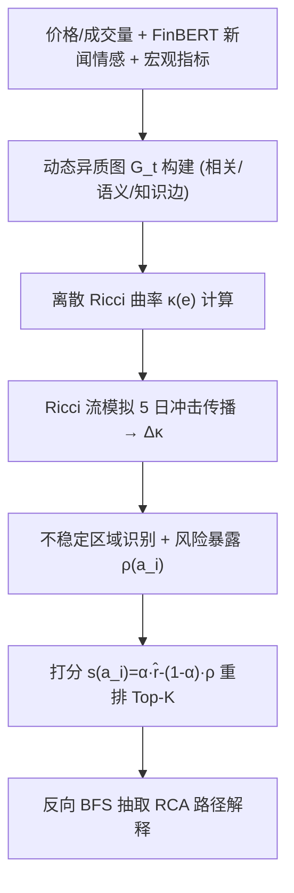
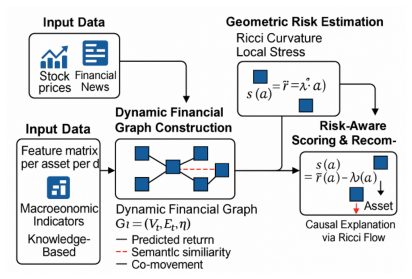

# RicciFlowRec: A Geometric Root Cause Recommender Using Ricci Curvature on Financial Graphs (基于 Ricci 曲率的金融图几何根因推荐器)

- **会议/期刊**: ACM RecSys 2025 (Late Breaking Results Track)
- **作者与机构**: Zhongtian Sun (University of Kent), Anoushka Harit (University of Cambridge)
- **推荐链路定位**: 重排 (Re-ranking) —— 在基础收益预测之上做风险感知的资产重排
- **研究方向**: 去偏公平、可信隐私与工业架构 / 图神经网络与知识图谱推荐
- **论文原文**: [https://arxiv.org/abs/2508.09334v1](https://arxiv.org/abs/2508.09334v1)
- **开源代码**: 暂未开源

## TL;DR (1分钟核心速览)

金融资产推荐的主流做法依赖相关性信号或黑箱神经模型，既无法解释局部冲击如何沿资产间依赖传播，也无法在结构突变时保持排序稳定。本文提出 RicciFlowRec：在股票-宏观指标-新闻实体构成的动态异质图上计算离散 Ricci 曲率刻画局部结构张力，再用 Ricci 流模拟 5 日冲击传播，把曲率变化量 $\rho(a_i)$作为结构风险惩罚项注入打分函数$s(a_i)=\alpha\hat{r}_i-(1-\alpha)\rho(a_i)$。在 S&P 500 (2018–2023, 450 支股票) 的合成波动冲击协议下，NDCG@10 达 0.512（较最强基线 SS-GNN 提升 4.9%），Top-10 波动降至 0.041（降低 28.1%），RCA 归因保真度 0.78。

## Background & Motivation (背景与核心矛盾)

- **主流范式**: 金融推荐系统多基于收益相关性、情感打分（FinBERT-Ranker）或时序图神经网络（FinGNN、GAT）做资产排序与组合构建。
- **前人局限**: 其一，相关性信号与不透明神经模型对市场冲击脆弱，且无法回答"波动源自何处"；其二，现有因果/时序图方法只建模局部邻域交互，无法刻画**长程依赖下的冲击级联**——高收益资产可能潜藏几何不稳定，在市场结构漂移时引发连锁失效。
- **核心洞察 (Key Insight)**: 流形的**曲率**天然编码结构健康度——负曲率边对应瓶颈/发散（系统性压力源），正曲率边对应冗余紧耦合（鲁棒）；而曲率的**时间演化**（Ricci 流）恰好刻画冲击沿依赖边的传播路径。
- **本文切入点**: 把"根因归因"转化为图上的曲率梯度回溯问题，并将曲率风险作为可解释惩罚项直接进入重排打分。

## Method (核心方法设计)

### 1. 整体框架 (Overall Architecture)

每个交易日 $t$构建异质金融图$\mathcal{G}_t=(\mathcal{V}_t,\mathcal{E}_t,\mathbf{W}_t)$：节点含 S&P 500 股票、宏观指标（国债收益率、CPI）与 spaCy 抽取的新闻实体；边由三类信号加权融合——30 日滚动对数收益 Pearson 相关、FinBERT 新闻嵌入余弦相似、板块/供应链知识链接，并按 top-$k$阈值裁剪。随后对全部边计算离散 Ricci 曲率，模拟 Ricci 流传播压力，识别不稳定区域，对基础收益预测做风险惩罚重排，并为 Top-$K$ 资产回溯输出 RCA 子图解释。

<figure class="paper-figure" markdown="span">
  <figcaption>图2：RicciFlowRec 流程概览。输入数据融合为动态图，其中 Ricci 曲率和流为风险感知的资产评分提供信息。</figcaption>
</figure>

### 2. 关键设计拆解 (Key Designs)

1. **Ollivier-Ricci 曲率做结构压力探测**：局部邻域无法反映长程结构脆弱性，故对每条边用邻域分布的最优传输距离定义曲率 $\kappa(u,v)=1-\frac{W_1(\mu_u,\mu_v)}{d(u,v)}$，其中$W_1$ 为节点邻域分布间的 Wasserstein-1 距离。负曲率边即结构瓶颈，构成系统性压力的候选根因；该量随图演化逐日重算，形成市场健康度的拓扑指纹。

2. **Ricci 流模拟冲击传播与根因回溯**：静态曲率无法区分"固有瓶颈"与"正在恶化的瓶颈"。作者令曲率修正边权按 $\frac{d}{dt}w_{uv}(t)=-\kappa(u,v)\cdot w_{uv}(t)$演化，并定义曲率漂移$\Delta\kappa(u,v)=\kappa_{t+\Delta t}(u,v)-\kappa_t(u,v)$；$|\Delta\kappa|$大的边标记为时序不稳定。RCA 路径从 Top 资产出发做反向 BFS，仅穿越$|\Delta\kappa|>\theta$的边，取累计$|\Delta\kappa|$ 最大的路径作为解释。直觉是：曲率变化最快的方向即压力传导方向。

3. **风险感知打分与训练/推理开销**：结构暴露定义为邻域曲率扰动之和 $\rho(a_i)=\sum_{v\in\mathcal{N}(a_i)}|\Delta\kappa(a_i,v)|$，最终打分$s(a_i)=\hat{r}_i^{(t+\tau)}-\lambda\cdot\rho(a_i)$（实现中等价于$\alpha\hat{r}-(1-\alpha)\text{Risk}$，$\alpha=0.7$）。基础收益预测器可为 LSTM 或 GAT，本文不引入额外负采样，属"预测+惩罚重排"范式而非对比学习训练；252 日滚动窗口单次管线约 5 分钟，在线推理更新 <200 ms。

## Experimental Setup & Evaluation Protocol (实验设置与评估协议)

- **数据集与预处理**: S&P 500 成分股，筛选 2018–2023 年价格与成交量完整的 450 支股票；新闻来自 Twitter Financial News Sentiment（50 万+ 带时间戳推文），FinBERT 计算极性并按股票-日聚合，未提及股票记中性 0；特征按训练集统计量归一化。

| 数据集 | #Assets | #News/Tweets | 时间跨度 | 边类型 | 场景说明 |
| :--- | :---: | :---: | :---: | :---: | :--- |
| S&P 500 + Twitter FinNews | 450 | 500,000+ | 2018–2023 | 相关/语义/知识 | 日频动态异质图，含宏观指标与新闻实体节点 |

- **数据划分与防穿越 (Splitting Strategy)**: 按时间顺序划分，2021–2022 作为验证集；滚动窗口 $W=252$ 交易日，特征归一化仅用训练集统计量，避免未来信息泄漏。
- **排名评测协议 (Ranking Protocol)**: 非标准全库排序，而是**合成冲击压力测试协议**——随机选取节点注入波动率抬升与负面情感冲击，令其沿曲率流传播，评估排序在扰动下的表现；指标为 NDCG@10、Top-10 Volatility（Top-10 得分在扰动下的标准差，越低越好）、RCA Fidelity（被扰动节点经曲率回溯成功识别的比例）。
- **对比基线与超参设置**: 五类基线——FinBERT-Ranker（情感排序）、GAT（2 层 2 头，64 隐单元，dropout 0.3）、CausalRec（逆倾向加权反事实推荐）、FinGNN（时序结构金融 GNN）、SS-GNN（自监督掩码+对比 GNN）；统一输入、划分与扰动协议，Adam ($lr=0.001$) + 早停，以验证集 NDCG@10 网格搜索调参。关键超参：Forman-Ricci 曲率、流迭代 50 次、预测视界$H=5$、$\alpha=0.7$、RCA 最大 6 跳、$\theta=-0.05$。

## Key Experimental Results (实验关键数据)

### 1. 主实验对比 (Main Results)

| Model | NDCG@10 ↑ | Top-10 Volatility ↓ | RCA Fidelity ↑ |
| :--- | :---: | :---: | :---: |
| FinBERT-Ranker | 0.421 | 0.083 | 0.00 |
| GAT | 0.445 | 0.077 | 0.00 |
| CausalRec | 0.458 | 0.064 | 0.58 |
| FinGNN | 0.471 | 0.069 | 0.62 |
| SS-GNN | 0.488 | 0.057 | 0.65 |
| **RicciFlowRec (ours)** | **0.512** | **0.041** | **0.78** |
| Improv. vs 最强基线 | +4.9% | -28.1% | +20.0% |

### 2. 消融实验 (Ablation Study)

| 变体 | NDCG@10 ↑ | Top-10 Volatility ↓ | RCA Fidelity ↑ |
| :--- | :---: | :---: | :---: |
| RicciFlowRec (full) | **0.512** | **0.041** | **0.780** |
| w/o Flow（去 Ricci 流传播） | 0.489 | 0.054 | 0.620 |
| w/o RCA Penalty（去风险惩罚项） | 0.494 | 0.049 | 0.440 |

超参敏感性：$\alpha\in\{0.5,0.7,0.9\}$时 AUC 分别为 0.781/0.794/0.776，$\alpha=0.7$最优；$\theta\in\{-0.03,-0.05,-0.07\}$时 RCA Fidelity 为 0.849/0.857/0.846，$\theta=-0.05$ 最优，整体对超参不敏感。

### 3. 关键实验发现 (Key Findings)

1. **Ricci 流是归因保真度的主要来源**：去掉流传播后 RCA Fidelity 从 0.780 跌至 0.620（-20.5%），说明静态曲率只能定位"固有瓶颈"，必须靠曲率的时间演化才能把冲击源与传播路径区分开。
2. **风险惩罚项是稳定性的主要来源**：去掉 RCA 惩罚后 Top-10 波动从 0.041 升至 0.049（+19.5%），而归因保真度暴跌至 0.440（-43.6%），表明曲率风险信号同时承担了"降波动"与"可解释"双重职责，二者并非独立收益。
3. **几何信号优于纯语义/纯结构基线**：FinBERT-Ranker 与 GAT 的 RCA Fidelity 均为 0（不具备归因能力），而 RicciFlowRec 在 NDCG@10 上仍领先 SS-GNN 4.9%，说明曲率惩罚并未以牺牲排序质量为代价换取鲁棒性。

## Highlights & Limitations (亮点、对比与审稿批判)

- **与代表作对比 (vs. Prior Work)**: 相较 FinBERT-Ranker 仅聚合情感、GAT/FinGNN 仅建模局部或时序结构交互，本文首次把**离散曲率与几何流**引入推荐排序，将"风险"从标量预测变为可回溯的图结构量；相较 CausalRec 的逆倾向加权反事实校正，本文的因果性来自曲率梯度的几何传播而非倾向得分估计，解释粒度细到边与路径。
- **可迁移亮点**: (1) 曲率漂移 $|\Delta\kappa|$ 作为"结构不稳定性"的通用代理信号，可迁移到社交推荐中的信任网络去噪、跨域推荐中的域间桥接边识别；(2) "预测分 - 结构风险惩罚"的重排范式可直接嫁接在任意召回/粗排模型之上，改造成本极低。
- **审稿级局限批判**: (1) 评估完全依赖**合成扰动**而非真实市场冲击回测，且缺少与收益预测类指标（如 AUC、夏普比率）的联合评估，Late Breaking 6 页篇幅下实验规模偏小、无显著性检验；(2) 曲率计算（Wasserstein 最优传输 + 50 次流迭代）在 450 节点图上尚可，但扩展到全市场数千节点时复杂度与延迟未做分析，且 $\lambda$/$\alpha$与$\theta$ 的耦合调参缺乏理论指导。

## Rating (四维评分)

- **方法创新性 (Novelty)**: ⭐⭐⭐⭐ （首次将 Ricci 曲率与几何流用于推荐侧根因归因，几何直觉清晰，但曲率工具本身在复杂网络分析中已成熟，属跨域迁移创新）
- **评估协议与实验扎实度 (Protocol & Experiments)**: ⭐⭐⭐ （合成冲击协议设计有想法，但仅单一数据集、无真实回测、无显著性检验，Late Breaking 定位下实验深度有限）
- **写作与数学规范度 (Clarity & Rigor)**: ⭐⭐⭐⭐ （公式简洁、符号统一，曲率与流的定义与直觉解释到位；但 Ollivier 与 Forman 曲率在正文与实现中超参描述不一致，$\alpha$与$\lambda$ 两种打分写法并存略显混乱）
- **工业落地与复现价值 (Industrial & Practical Value)**: ⭐⭐⭐ （推理 <200 ms、管线 5 分钟具备原型可用性，但未开源、依赖 GraphRicciCurvature 与 FinBERT 外部组件，全市场扩展性与真实交易验证尚缺）

