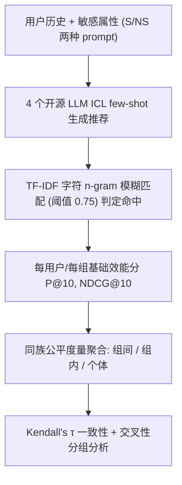

# Stairway to Fairness: Connecting Group and Individual Fairness (通往公平的阶梯：连接组公平与个体公平)

- **会议/期刊**: RecSys 2025 (Short Paper)
- **作者与机构**: Theresia Veronika Rampisela, Maria Maistro, Tuukka Ruotsalo, Falk Scholer, Christina Lioma（哥本哈根大学、LUT 大学、RMIT 大学）
- **推荐链路定位**: 重排 / 评估（面向 LLM 生成式推荐的公平性评测）
- **研究方向**: 去偏公平、可信隐私与工业架构 / 大语言模型推荐
- **论文原文**: [https://arxiv.org/abs/2508.21334v1](https://arxiv.org/abs/2508.21334v1)
- **开源代码**: [https://github.com/theresiavr/stairway-to-fairness](https://github.com/theresiavr/stairway-to-fairness)

## TL;DR (1分钟核心速览)

本文直击推荐系统公平性研究中一个长期悬空的问题：组公平与个体公平究竟是何关系？前人要么只评其一，要么对两者使用不同度量族（如组用 Gini、个体用 SD），导致分数不可比、结论不可通约。作者首次用**同一族可同时作用于组与个体的度量**（SD、Gini、Atkinson）在 ML-1M、JobRec、LFM-1B 三个数据集、4 个开源 LLM 的 8 组运行上做系统对比，结论是：**对组高度公平的推荐，对个体可能极不公平**；组间公平分数会系统性掩盖组内与个体层面的巨大效能差异。

## Background & Motivation (背景与核心矛盾)

- **主流范式**: 推荐公平性被划分为组公平（组间效能/曝光均等）与个体公平（相似用户相似对待），现有工作大多只评其中一类，或对两类各用一套度量族。
- **前人局限**: (i) 度量族不同导致分数在敏感度、理论/经验值域上不可比；(ii) 即便同时评两类，也常针对不同公平对象（用户效能差异 vs. 物品曝光差异），无法真正对齐比较。因此"提升一类公平会如何影响另一类"始终无实证答案。
- **核心洞察 (Key Insight)**: 若用**同一族度量**（SD/Gini/Atk 均可同时定义在组与个体上）统一口径，就能把两类公平放到同一把尺子上；而 Gini/Atk 含"除以均值"项，天然对低效能模型给出更差的公平分，SD 则不含此项——这一形式差异本身就会改变结论。
- **本文切入点**: 以"同一度量族 + 多种用户分组方式（1/2/3 个敏感属性、含交叉性）"为控制变量，实证刻画组间、组内、个体三层不公平的分解关系。

## Method (核心方法设计)

### 1. 整体框架 (Overall Architecture)

本文是**评估方法论研究**而非新模型：输入为 4 个开源 LLM（Llama-3.1-8B、Qwen2.5-7B、GLM-4-9B、Ministral-8B）在 ICL few-shot 提示下的推荐列表，先做模糊字符串匹配判定命中，再计算每用户/每组的基础效能分（P@10、NDCG@10），最后用同一族公平度量在"组间 / 组内 / 个体"三个层级聚合，并通过 Kendall's $\tau$ 检验不同度量在模型排序上的一致性。

### 2. 关键设计拆解 (Key Designs)

1. **同族度量的三层分解（Between / Within / Individual）**：痛点是组公平与个体公平历来用不同度量、无法比较。本文选取 SD、Gini、Atkinson 三种**可同时定义于组与个体**的度量，并将 Atkinson 按可加分解性拆为组间与组内两部分（无残差）：
$$\mathrm{Atk} = \mathrm{Atk}_{b\text{-}group} + \mathrm{Atk}_{w\text{-}group},\qquad \mathrm{Atk}_{ind} \approx \mathrm{Atk}_{b\text{-}group} + \mathrm{Atk}_{w\text{-}group}$$
直觉上，Atkinson 的可分解性使得"组间公平好但组内极差"这一现象可以被定量拆开，而不是被单一聚合分掩盖。

2. **交叉性分组与"阶梯"现象**：痛点是以往组公平多只用单一敏感属性分组，组数少、易"看起来公平"。本文对 3 个敏感属性做全部 $2^3-1=7$ 种组合分组（ML-1M 最多 12 组、JobRec 36 组、LFM-1B 29 组），并对比 1/2/3 属性下的公平分。核心发现是随分组属性增多，**组间公平单调变差（呈阶梯状，故得名 Stairway），而组内公平基本稳定**，说明组间公平的改善并不自动传导到组内。

3. **度量一致性检验与推理开销**：用 Kendall's $\tau$衡量"个体公平度量对模型的排序"与"组公平度量排序"是否等价（$\tau \ge 0.9$视为等价）。结果显示**没有任何个体度量能稳定等价于任何组度量**；唯一稳定强相关的是 CV（$\tau \in [0.64, 0.79]$），原因在于 CV 与 Gini/Atk 同样含"除以均值"项。推理侧用 vllm + RecLM-eval，温度固定为 0 保证确定性，prompt 中最多各取 10 条最近 train/val 交互，且**不做采样候选列表**以避免虚高。

## Experimental Setup & Evaluation Protocol (实验设置与评估协议)

- **数据集与预处理**:

| 数据集 | #Users(测试) | #Items | #Interactions | 过滤/稀疏度 | 特征/场景说明 |
| :--- | :---: | :---: | :---: | :---: | :--- |
| ML-1M | 620 | 3,030 | 467,218 | 5-core，评分<3 丢弃，4/5 映射为 1 | 电影；敏感属性 gender/age/occupation |
| JobRec | 523 | 19,912 | 210,921 | 5-core，经验>60 年剔除 | 职位；degree/experience/major |
| LFM-1B | 16,611 | 51,204 | 15,024,267 | 50-core（5-core 过稀疏） | 音乐艺人；gender/age/country |

- **数据划分与防穿越 (Splitting Strategy)**: 采用**全局时间戳切分**，train/val/test = 3:1:1；并额外剔除 train 中交互数 $\le t$的用户/物品（ML-1M、LFM-1B 取$t=5$，JobRec 取$t=2$），保证测试集至少 500 用户。
- **排名评测协议 (Ranking Protocol)**: 属**生成式自由生成 + 模糊匹配**协议，而非 Full-Ranking 或 Sampled Ranking——LLM 直接生成物品名，用 TF-IDF 字符 n-gram 相似度 $\ge 0.75$ 判定命中；prompt 中通过年份/播放量等约束收窄搜索空间，**不提供采样候选列表**。
- **对比基线与超参设置**: 主对比为 4 个同量级开源 LLM × 2 种 prompt（S 含敏感属性 / NS 不含），共 8 组运行；$k=10$；另在附录用 UserKNN、NeuMF 验证结论一致性。公平度量覆盖 Min、Range、SD、MAD、Gini、CV、FStat、KL、GCE、Atk 共 10 种组度量与 SD/Gini/Atk 三种个体度量。

## Key Experimental Results (实验关键数据)

### 1. 主实验对比 (Main Results)

以 NDCG@10 为基础分，摘取代表性效能与公平数值（Grp. 为三属性交叉分组，Ind. 为个体）：

| 数据集 | 模型 (prompt) | NDCG↑ | Gini(Grp.)↓ | Atk(Grp.)↓ | Gini(Ind.)↓ | Atk(Ind.)↓ |
| :--- | :--- | :---: | :---: | :---: | :---: | :---: |
| ML-1M | **GLM-4-9B (NS)** | **0.231** | **0.130** | **0.015** | **0.705** | **0.636** |
| ML-1M | Qwen2.5-7B (S) | 0.221 | 0.195 | 0.039 | 0.715 | 0.644 |
| ML-1M | Ministral-8B (S) | 0.208 | 0.275 | 0.049 | 0.736 | 0.673 |
| ML-1M | Llama-3.1-8B (NS) | 0.140 | 0.255 | 0.036 | 0.799 | 0.751 |
| JobRec | **Qwen2.5-7B (NS)** | **0.050** | 0.740 | 0.473 | 0.947 | 0.937 |
| JobRec | Ministral-8B (NS) | 0.050 | 0.757 | 0.522 | 0.949 | 0.944 |
| JobRec | GLM-4-9B (NS) | 0.041 | 0.828 | 0.547 | 0.956 | 0.948 |
| LFM-1B | **GLM-4-9B (S)** | **0.463** | **0.139** | **0.002** | **0.461** | **0.358** |
| LFM-1B | Llama-3.1-8B (S) | 0.415 | 0.161 | 0.004 | 0.502 | 0.400 |
| LFM-1B | Ministral-8B (S) | 0.208 | 0.358 | 0.013 | 0.750 | 0.694 |

关键对照：ML-1M 上 GLM-4-9B 的组间 Gini 仅 0.130（组间极公平），但个体 Gini 高达 0.705——**组间公平分比个体公平分"好看"约 5.4 倍**；LFM-1B 上该比值为 0.139 vs. 0.461（约 3.3 倍）。

### 2. 消融实验 (Ablation Study)

本文无模型组件消融，其"消融"等价于**分组粒度与度量族的控制变量实验**（GLM-4-9B, NS）：

| 配置 | #Groups | SD(Grp.)↓ | Gini(Grp.)↓ | Atk(Grp.)↓ | SD(Ind.)↓ | Gini(Ind.)↓ |
| :--- | :---: | :---: | :---: | :---: | :---: | :---: |
| ML-1M 单属性 (1) | 2–3 | 低 | 低 | 低 | — | — |
| ML-1M 双属性 (2) | 4–6 | 中 | 中 | 中 | — | — |
| ML-1M 三属性 (3) | 12 | 较高 | 较高 | 较高 | 0.320 | 0.721 |
| ML-1M 个体 (Ind.) | 620 | — | — | — | **0.320** | **0.721** |
| LFM-1B 三属性 (3) | 29 | 0.130 | 0.139 | 0.002 | 0.378 | 0.461 |
| JobRec 三属性 (3) | 36 | 0.023 | 0.834 | 0.518 | 0.147 | 0.974 |

### 3. 关键实验发现 (Key Findings)

1. **组间公平与个体公平不可互为代理**：Kendall's $\tau$检验显示，没有任何个体公平度量能稳定等价（$\tau \ge 0.9$）于任何组公平度量；唯一稳定强相关的是 CV（$\tau \in [0.64, 0.79]$），根源在于 CV 与 Gini/Atk 共享"除以均值"结构，而 SD 与个体公平甚至出现负相关（如 LFM-1B 上 SD 对 Gini 的$\tau = -0.57$）。
2. **组内不公平几乎等于个体不公平，且恒高于组间不公平**：在 JobRec 与 LFM-1B 的全部 7 种分组方式下，组内不公平始终高于组间不公平，且与个体不公平量级相当（个别情形如 JobRec 的 SD 甚至略超个体不公平），说明"组间公平"这一层聚合几乎无法反映真实用户间的效能落差。
3. **交叉性越强、公平越难，且阶梯式恶化**：随分组属性从 1 增至 3，组间公平单调变差（呈阶梯状），而组内公平基本稳定；即便组数达到用户数的约 7%（LFM-1B 29 组 / 16,611 用户），组间公平分仍会掩盖组内巨大差异。此外 S 与 NS prompt 的效能/公平总体相当，说明**把敏感属性写进 prompt 对公平改善有限**（Ministral-8B 在 LFM-1B 上例外，疑与其较强性别偏置有关）。

## Highlights & Limitations (亮点、对比与审稿批判)

- **与代表作对比 (vs. Prior Work)**: 相较仅评组公平的 LLMRec 公平工作（如用 Gini 评组间差异）与仅评个体公平的工作（如用 SD 评个体效能方差），本文的本质区别是**统一度量族 + 三层分解 + 交叉性分组**，从而首次让"组公平 vs. 个体公平"的对比在数学上可比；相较概念性讨论两者可能冲突的理论工作，本文给出了首个系统性实证证据。
- **可迁移亮点**: (i) 用 Atkinson 的可加分解性把公平损失拆成"组间 + 组内"两项，可直接作为训练正则加入损失函数；(ii) 用 Kendall's $\tau$ 检验"某度量能否作为另一度量的代理"，这一协议可迁移到任何多度量评测场景（如准确性 vs. 多样性）。
- **审稿级局限批判**: (i) 评测依赖 LLM 自由生成 + 0.75 模糊匹配阈值，该阈值缺乏敏感性分析，匹配误差可能同时污染效能与公平分；(ii) 实验仅覆盖 4 个 7–9B 开源模型与 3 个数据集，且 JobRec 上所有模型 NDCG 均极低（$\le 0.05$），Gini/Atk 因含均值除法而被放大，跨数据集的可比性受限；此外未给出任何公平缓解策略的实证验证，仅停留在"诊断"层面。

## Rating (四维评分)

- **方法创新性 (Novelty)**: ⭐⭐⭐⭐ （非新模型，但"同族度量 + 三层分解 + 交叉性分组"的评估框架首次让两类公平可比，问题定位精准）
- **评估协议与实验扎实度 (Protocol & Experiments)**: ⭐⭐⭐⭐ （3 数据集 × 8 运行 × 10 种组度量 + $\tau$ 一致性检验较完整，但模糊匹配阈值与低 NDCG 场景削弱了结论稳健性）
- **写作与数学规范度 (Clarity & Rigor)**: ⭐⭐⭐⭐ （RQ 驱动、图表与度量定义清晰，Atkinson 分解交代严谨；部分度量公式置于附录，正文自洽性略打折）
- **工业落地与复现价值 (Industrial & Practical Value)**: ⭐⭐⭐⭐ （代码与预处理全开源，结论可直接指导工业界在损失函数中同时加入组间与组内公平项；但推理侧依赖 LLM 生成，线上部署成本高）

