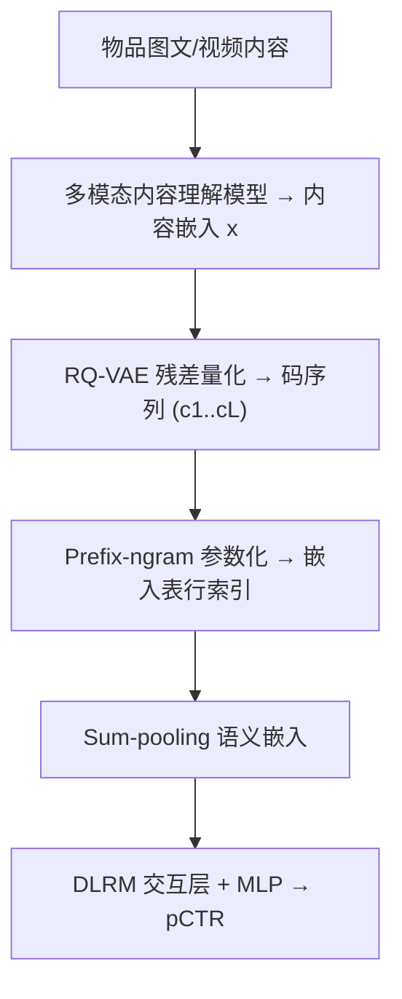

# Enhancing Embedding Representation Stability in Recommendation Systems with Semantic ID (用语义 ID 增强推荐系统嵌入表征稳定性)

- **会议/期刊**: RecSys 2025
- **作者与机构**: Carolina Zheng, Minhui Huang, Dmitrii Pedchenko, Kaushik Rangadurai 等（Columbia University & AI at Meta）
- **推荐链路定位**: 精排（Ads Ranking 稀疏特征 + 用户行为序列特征）
- **研究方向**: 生成式推荐与离散语义 ID / 冷启动与长尾推荐
- **论文原文**: [https://arxiv.org/abs/2504.02137v1](https://arxiv.org/abs/2504.02137v1)
- **开源代码**: 暂未开源

## TL;DR (1分钟核心速览)

工业推荐中原始 item ID 基数爆炸、曝光长尾、ID 生命周期短（ID drifting），迫使系统用随机哈希压缩嵌入表，但随机碰撞带来矛盾梯度与表征漂移。本文提出 **Semantic ID prefix-ngram**：先用多模态内容嵌入训练 RQ-VAE 得到粗到细的离散语义码，再把「所有前缀元组」映射到嵌入表，使碰撞由随机变为语义有意义。在 Meta 广告排序生产数据上，全量 Eval NE 相对随机哈希降低 0.05%，新物品段降低 0.41%，线上旗舰模型 NE 提升 0.15%，A/A 预测方差下降 43%。

## Background & Motivation (背景与核心矛盾)

- **主流范式**: DLRM 类模型把原始 item ID 经哈希映射到固定大小嵌入表 $E\in\mathbb{R}^{H\times d_m}$，靠 sum-pooling 得到稀疏特征表征。
- **前人局限**: ① 随机哈希碰撞使语义无关物品共享同一行嵌入，收到互相矛盾的梯度，污染表征；② ID drifting 下旧物品退出、新物品进入，哈希行的语义随时间漂移，新 ID 权重近乎随机初始化。
- **核心洞察 (Key Insight)**: 物品的**粗粒度语义类别**（如"食品""披萨"）在时间上远比原始 ID 稳定；若碰撞按语义发生，则新物品可继承同类旧物品的已学权重，长尾物品可向头部同类物品借力。
- **本文切入点**: 用 RQ-VAE 的分层码本构造固定、有语义的 ID 空间，并设计能同时利用粗/细粒度信息的 token 参数化方式。

## Method (核心方法设计)

### 1. 整体框架 (Overall Architecture)

离线阶段：多模态内容理解模型（图文对齐预训练）产出物品内容嵌入 $\mathbf{x}$；RQ-VAE 在近三个月内容嵌入上训练，得到$L$层、每层$K$个码字的残差量化器，物品被编码为粗到细的码序列$(c_1,\dots,c_L)$。在线阶段：按 prefix-ngram 参数化把码序列映射为若干嵌入表行索引，sum-pooling 后送入 DLRM 的交互层与 MLP 输出点击概率；同一套语义特征同时用于目标物品稀疏特征与用户行为序列特征。

### 2. 关键设计拆解 (Key Designs)

1. **RQ-VAE 分层语义码（稳定 ID 空间的来源）**：痛点是用随机哈希无法保证「同语义同表征」。RQ-VAE 逐层量化残差，第 $l$ 层码字逼近剩余残差：
$\mathbf{r}^l = \mathbf{z} - \sum_{i=1}^{l-1}\mathbf{v}^i_{c^i},\quad c^l = \arg\min_{c}\|\mathbf{v}^l_c - \mathbf{r}^l\|_2$训练损失为重建项加码本承诺项（$\beta=0.5$，含 stop-gradient）。直觉：$c_1$是粗桶（食品），$c_2$细化（披萨），$c_3$ 再细化（英文披萨），层级越深量化越精确，天然支持「按粒度控制信息量」。

2. **Prefix-ngram 参数化（本文核心增量）**：痛点是若只用完整 $L$元组（trigram/fourgram），基数$K^L$ 爆炸且无法共享粗粒度知识；若只用扁平映射则丢失层级。prefix-ngram 把**所有前缀**都映射为独立嵌入行：
$p_i=\sum_{t=1}^{i}K^{\,i-t}(c_t+1)-1,\quad i\in[1..n]$即物品同时获得$(c_1)$、$(c_1,c_2)$、…、$(c_1,\dots,c_n)$ 多个粒度的表征并求和。直觉：细粒度前缀保证区分度，粗粒度前缀让长尾/新物品与同类头部物品共享权重，实现跨物品知识迁移；超出表容量时再做取模哈希。

3. **训练目标、负采样与推理效率**：排序模型用标准交叉熵（二分类 CTR），无显式负采样环节；RQ-VAE 离线训练一次后冻结，线上仅做码本查表 + 嵌入查表，额外开销可忽略。生产配置 $L=6$、$K=2048$、prefix-5gram、$H\approx 5\times10^7$。

## Experimental Setup & Evaluation Protocol (实验设置与评估协议)

- **数据集与预处理**: 采用 Meta 生产广告排序数据的简化模型（保留全部稠密特征与用户行为序列，稀疏模块仅保留目标物品，去掉约 100 个其他稀疏特征）。训练用连续 4 天数据、单 epoch 时序训练，评估用次日最初 6 小时数据。

| 数据集 | #Users | #Items | #Interactions | 稀疏度/密度 | 特征/场景说明 |
| :--- | :---: | :---: | :---: | :---: | :--- |
| Meta Ads 生产数据 | 未披露 | 目标物品 >10 亿（含 3 个月历史） | 未披露（4 天曝光/转化样本） | 极度长尾：0.1% 头部占 25% 曝光，94.4% 尾部仅占 25% | 图文/视频内容嵌入 + 用户行为序列 |

- **数据划分与防穿越 (Splitting Strategy)**: **全局时间戳切分**——按时间顺序训练 4 天，评估次日 6 小时，严格防穿越；另有 20 天 vs 4 天训练时长对比实验。
- **排名评测协议 (Ranking Protocol)**: 工业场景采用 **NE（Normalized Entropy，归一化交叉熵）** 作为主指标（越低越好），非 Full-Ranking 排序指标；按物品曝光量分 head/torso/tail 与新物品分桶评估。
- **对比基线与超参设置**: 基线为 Individual Embeddings（IE，每 ID 独立嵌入，仅作参照）与 Random Hashing（RH，平均碰撞因子 3 或 5）；SemID 用 $L=3$、$K=2048$、prefix-3gram，嵌入维度未单独披露，碰撞因子与 RH 对齐。

## Key Experimental Results (实验关键数据)

### 1. 主实验对比 (Main Results)

分桶 Eval NE（越低越好，括号为相对 RH 的增益）：

| 物品分桶 | 占比 | RH | IE | SemID | Gain vs RH | Gain vs IE |
| :--- | :---: | :---: | :---: | :---: | :---: | :---: |
| Head (25% 累计曝光) | 0.1% | 0.80105 | 0.80101 | 0.80108 | +0.00% | +0.01% |
| Torso (75%) | 5.6% | 0.83589 | 0.83583 | **0.83580** | −0.01% | −0.00% |
| Tail (100%) | 100% | 0.83904 | 0.83886 | **0.83872** | **−0.04%** | −0.02% |
| 训练中见过物品 | — | 0.82626 | 0.82612 | **0.82600** | −0.03% | −0.02% |
| **新物品（冷启动）** | — | 0.83524 | 0.83453 | **0.83180** | **−0.41%** | **−0.33%** |
| 全部物品 | — | 0.82663 | 0.82645 | **0.82621** | −0.05% | −0.03% |

Token 参数化对比（Train NE Gain，相对基线）：

| RQ-VAE $K\times L$ | 参数化 | Train NE Gain |
| :--- | :--- | :---: |
| [2048]×3 | Trigram | −0.028% |
| [2048]×4 | Fourgram | −0.035% |
| [2048]×4 | All bigrams | −0.091% |
| [2048]×3 | Prefix-3gram | −0.141% |
| [2048]×5 | Prefix-5gram | −0.208% |
| [2048]×6 | Prefix-6gram | **−0.215%** |

### 2. 消融实验 (Ablation Study)

| 配置 | Train NE Gain | Eval NE Gain |
| :--- | :---: | :---: |
| Bypass 聚合 + SemID | −0.056% | −0.085% |
| Transformer 聚合 + SemID | −0.071% | −0.110% |
| PMA 聚合 + SemID | **−0.073%** | **−0.100%** |
| 训练 20 天 vs 4 天（RH） | — | −0.18% |
| 训练 20 天 vs 4 天（SemID） | — | **−0.23%** |
| 旗舰模型 + 6 个稀疏语义特征 | −0.063% | −0.071% |
| 旗舰模型 + 1 个序列语义特征 | −0.110% | −0.123% |

### 3. 关键实验发现 (Key Findings)

1. **收益几乎全部来自长尾与新物品**：全量增益仅 −0.05%，但新物品段达 −0.41%（vs RH）/ −0.33%（vs IE），头部段基本中性（+0.00%）。这直接验证了「语义碰撞 = 知识迁移」假设——新物品继承同类已训权重，而非随机初始化或无关权重。
2. **层级前缀是效果的必要条件**：同等码本下 Prefix-3gram（−0.141%）显著优于 Trigram（−0.028%）与 Fourgram（−0.035%），说明粗粒度前缀提供的跨物品共享比单纯增加细粒度区分更重要；且深度越深、码本越大越好（Prefix-6gram 达 −0.215%）。
3. **表征稳定性可量化**：分布漂移敏感度（前后 42h NE 差）SemID 为 0.0073，优于 RH 的 0.0083；20 天长训时 SemID 增益（−0.23%）大于 RH（−0.18%），说明 ID drifting 越严重、SemID 优势越大。线上 A/A 预测方差降 43%，注意力熵更低、更聚焦最近高信号 token。

## Highlights & Limitations (亮点、对比与审稿批判)

- **与代表作对比 (vs. Prior Work)**: 相比 TIGER/Semantic ID 原始工作（Singh et al. 2023; Rajput et al. 2024）只把完整码序列当 token，本文指出**参数化方式本身**才是效果关键，提出 prefix-ngram 显式利用层级；相比 collision-free hashing（Liu et al. 2022）与 double hashing（Zhang et al. 2020），本文不是"减少碰撞"而是"让碰撞有语义"，从根上解决表征漂移。
- **可迁移亮点**: ① prefix-ngram 的"多粒度前缀求和"可直接迁移到任何使用 RQ-VAE/VQ 码本的生成式召回或语义 ID 场景；② 用 A/A 复制物品的预测差异（AAR）作为表征稳定性指标，是工业界可复用的低成本诊断工具。
- **审稿级局限批判**: ① 全部实验基于 Meta 内部广告数据，无公开数据集复现，且仅报告 NE 而无 Recall/NDCG 等排序指标，外部可比性弱；② RQ-VAE 依赖强内容理解模型，冷启动物品若内容缺失则语义 ID 失效；③ 生产配置 $L=6$、$K=2048$意味着$K^L$ 级潜在空间，prefix 取模哈希仍会引入残余随机碰撞，论文未量化该部分影响。

## Rating (四维评分)

- **方法创新性 (Novelty)**: ⭐⭐⭐⭐ （prefix-ngram 本身是轻量工程技巧，但"语义碰撞替代随机碰撞"的问题重构与分层前缀利用有清晰的理论直觉支撑）
- **评估协议与实验扎实度 (Protocol & Experiments)**: ⭐⭐⭐⭐ （分桶/新物品/漂移敏感度/长训/线上 A/B 多维验证完整，但缺公开数据集与标准排序指标）
- **写作与数学规范度 (Clarity & Rigor)**: ⭐⭐⭐⭐ （RQ-VAE 与参数化公式定义清晰，NE 与 AAR 指标交代明确，复杂度分析略简）
- **工业落地与复现价值 (Industrial & Practical Value)**: ⭐⭐⭐⭐⭐ （已在 Meta 广告系统上线一年以上，0.15% 线上增益 + 43% 方差下降，工程链路完整，唯代码未开源）

