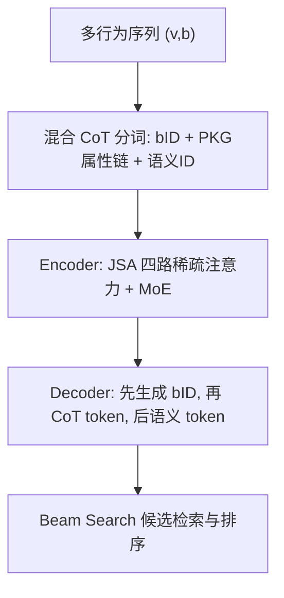
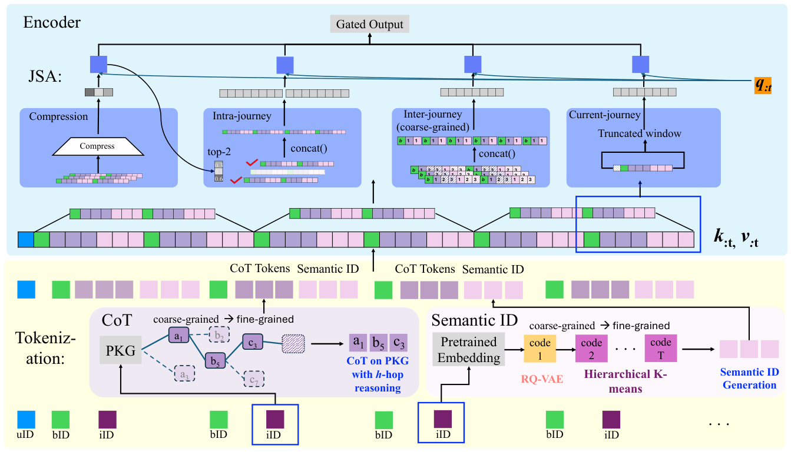

# GRACE: Generative Recommendation via Journey-Aware Sparse Attention on Chain-of-Thought Tokenization (基于思维链分词与旅程感知稀疏注意力的生成式推荐)

- **会议/期刊**: RecSys 2025
- **作者与机构**: Luyi Ma, Wanjia Sherry Zhang, Kai Zhao, Abhishek Kulkarni 等（Walmart Global Tech）
- **推荐链路定位**: 端到端生成式（行为-物品序列生成式检索）
- **研究方向**: 生成式推荐与离散语义ID / 序列与会话推荐
- **论文原文**: [https://arxiv.org/abs/2507.14758v1](https://arxiv.org/abs/2507.14758v1)
- **开源代码**: 暂未开源

## TL;DR (1分钟核心速览)

针对多行为生成式推荐中「语义 token 缺乏确定性属性信息」与「token 化后全注意力二次复杂度 + 多尺度旅程建模不足」两大痛点，GRACE 提出混合 CoT 分词（行为 token + PKG 属性链 token + RQ-VAE 语义 ID）与旅程感知稀疏注意力 JSA（压缩/旅程内/旅程间/当前窗口四路门控融合）。在 Walmart 真实 Home/Electronics 数据、Leave-One-Out + Full-Ranking 协议下，Home 域 HR@10 相对 MBGen 提升 +106.9%，长序列注意力激活参数降低 48%。

## Background & Motivation (背景与核心矛盾)

- **主流范式**: 生成式推荐以 TIGER 为代表，用 RQ-VAE 将物品文本嵌入量化为粗到细的语义 ID，再以 encoder-decoder 自回归生成下一物品 token；MBGen 进一步把行为类型也 token 化，扩展到多行为序列推荐（MBSR）。
- **前人局限**: 其一，RQ-VAE 语义 ID 由无监督重构目标驱动，缺乏品牌、价格、品类等**确定性属性**，生成时无法做确定性推理，易在共享语义簇内混淆；其二，token 化使序列长度线性膨胀、注意力矩阵二次膨胀，且 MBGen 的静态分词 + 全注意力难以区分「同一旅程内连续兴趣」与「跨旅程跳转」两种截然不同的多尺度模式。
- **核心洞察 (Key Insight)**: 用户购物本质是「从粗粒度品类到细粒度商品」的层级导航过程，PKG 上的 h-hop 属性路径天然构成一条可解释的思维链；同时用户历史可分解为多个并行/交错的 shopping journey，注意力只需在旅程内、旅程间、当前窗口三个尺度上稀疏取用。
- **本文切入点**: 把 PKG 属性链作为 CoT token 插入行为 token 与语义 token 之间，并用可训练的四路稀疏注意力替代全注意力，一次性回应 RQ1（显式信息）与 RQ2（效率与多尺度）。

## Method (核心方法设计)

### 1. 整体框架 (Overall Architecture)

输入为用户多行为交互序列 $s_u=[(v_1,b_1),\dots,(v_{n-1},b_{n-1})]$，每个$(v,b)$被展开为「行为 token（bID）→ h-hop PKG CoT token（品类/价格带/品牌）→ T 级语义 ID」的混合 token 串，序列首位加 user token。编码器由多个「JSA 注意力层 + MoE 层」堆叠，解码器同构并以因果语言建模逐 token 生成：先出行为 token，再出 CoT token 引导，最后出语义 token 定位物品，beam search 检索候选并按$P(b_n,v_n|s_u)$ 排序。分词阶段全部基于预训练嵌入与既有 PKG，不引入可训练参数。

<figure class="paper-figure" markdown="span">
  <figcaption>图2：GRACE框架示意图，包含混合分词与旅程感知稀疏注意力（JSA）。混合分词（底部）包含思维链token和语义ID。JSA（顶部）由压缩注意力、旅程内注意力、旅程间注意力和当前旅程注意力组合而成。</figcaption>
</figure>

### 2. 关键设计拆解 (Key Designs)

1. **混合 Chain-of-Thought 分词（补确定性信息）**：语义 ID 只保留隐式相似性，缺少可判别的硬属性。本文将 PKG 返回的 h-hop 属性按粗到细顺序 $PKG[v]=[a_1,b_5,c_3,\dots]$逐节点转为 token，插在行为 token 与语义 token 之间，形成$[b\text{-}tok,\;PT,\;PRICE,\;BRAND,\;s^1_v,\dots,s^T_v]$ 的推理链。直觉上，先生成品类 token 等于在解码早期就把候选空间裁剪到局部语义簇（图 5 热力图显示 PT 与 L1 语义簇高度集中对应），后续语义 token 只需在簇内消歧。

2. **旅程感知稀疏注意力 JSA（四路门控融合）**：全注意力既贵又无法区分多尺度旅程。JSA 将输出写为四路稀疏注意力的可学习门控加权：
$\boldsymbol{o}=\sum_{j\in\{comp,intra,inter,current\}} g_j\cdot \mathrm{SparseAttn}_j(Q,K,V)$其中 (a) **压缩路**：按块长$l$、步长$d$切分，用 MLP 将每块 K/V 压成单向量$\bar{K}_{block}=\mathrm{MLP}(K_{block})$，得到$\tilde{K}_{comp}$做块级粗读；(b) **旅程内选择路**：以$\pi_{select}=\mathrm{Softmax}(\mathrm{Sum}(Q^{\top}\tilde{K}_{comp}))$打分选 top-$N$个原始块拼接后精读，捕捉被其他旅程打断的非相邻同旅程物品；(c) **旅程间路**：每物品仅保留$M_g$个 CoT token 与$M_s$个语义 token 构成粗粒度序列，建模高层旅程跳转；(d) **当前窗口路**：截断窗口$w$ 做局部注意力。四路互补，使注意力预算按语义尺度而非位置均匀分配。

3. **训练目标、负采样与推理效率**：损失为因果语言建模的交叉熵 $\mathcal{L}_{ce}=-\sum_{batch} y\log P(b_n,v_n|s_u,\Phi,\Psi)$，**无负采样**（全库 beam search 生成式检索，天然规避采样偏差）。效率上，序列长 50/100/200 时激活参数分别为 43,092 / 144,576 / 522,042，相对全注意力降低 32% / 43% / 48%，且降幅随长度增长而扩大。

## Experimental Setup & Evaluation Protocol (实验设置与评估协议)

- **数据集与预处理**: Walmart.com 真实多行为数据（Click / ATC / Like / Remove），每个域取 10,000 条用户序列；关键预处理是**行为合并**——同一物品的多行为按 ATC > Like > Click 优先级只保留一个，强制模型学习序列转移而非「同物品复现」的平凡解，因此整体准确率上限约 20%。

| 数据集 | #Items | #Items/#Users | 平均序列长 | 行为分布说明 |
| :--- | :---: | :---: | :---: | :--- |
| Home | 48,421 | 4.84 | 171.54 | ATC 33.5% / Click 54.9% / Like 1.4% / Remove 10.2% |
| Electronics | 32,098 | 3.21 | 85.43 | ATC 21.5% / Click 68.8% / Like 1.6% / Remove 8.2% |

- **数据划分与防穿越 (Splitting Strategy)**: `Leave-One-Out`，序列最后一条交互 $(v_n,b_n)$ 为预测目标，其余为历史；序列统一截断至 50。
- **排名评测协议 (Ranking Protocol)**: 无偏 `Full-Ranking`——真值物品在**全库所有物品**中排序，不使用采样负例；beam size = 10 生成 top-10 候选，报告 HR@K / NDCG@K（K=5,10）。
- **对比基线与超参设置**: 8 个基线覆盖三类——序列推荐（GRU4Rec、SASRecM、BERT4RecM、RETR、TIGER）、多行为序列（SASRecB、BERT4RecB、MBHT、MB-STR）、多行为生成式（MBGen）。骨干为 Switch Transformer，hidden 256、6 头 × 64 维、batch 512、lr 0.001、AdamW、A100 训练 50k 步；语义 ID 为 2 级 RQ-VAE（码本 64）+ 随机第 3 级防碰撞；显著性 $p<0.01$。

## Key Experimental Results (实验关键数据)

### 1. 主实验对比 (Main Results)

目标行为（ATC）物品预测任务，Home / Electronics 两域：

| 模型 | Home HR@10 | Home NDCG@10 | Elec HR@10 | Elec NDCG@10 |
| :--- | :---: | :---: | :---: | :---: |
| GRU4Rec | 1.75 | 1.17 | 7.62 | 5.49 |
| SASRecM | 6.36 | 3.98 | 21.94 | 15.07 |
| RETR | 7.31 | 4.63 | 24.22 | 17.49 |
| TIGER | 4.07 | 2.24 | 19.60 | 12.42 |
| MBHT | 2.97 | 1.84 | 23.95 | 16.84 |
| MBGen | 8.52 | 4.80 | 27.83 | 18.00 |
| **GRACE** | **17.63** | **9.92** | **33.97** | **21.49** |
| Improv. vs MBGen | +106.9% | +106.7% | +22.1% | +19.4% |

### 2. 消融实验 (Ablation Study)

Home 域，NDCG@10，覆盖三类任务（Target / Behavior-Specific / Behavior-Item）：

| 变体 | Target | Behavior-Spec. | Behavior-Item |
| :--- | :---: | :---: | :---: |
| w/o CoT & JSA (= MBGen) | 4.80 | 10.97 | 7.49 |
| w/o CoT (= MBGen+JSA) | 4.84 | 11.88 | 8.16 |
| w/o JSA（保留全部 CoT） | 8.79 | 10.42 | 6.13 |
| w/o CoT & Inter-journey | 2.92 | 8.63 | 5.88 |
| w/o CoT & Comp. & Intra. | 3.16 | 9.42 | 5.50 |
| **GRACE（全量）** | **9.92** | **13.01** | **7.69** |

### 3. 关键实验发现 (Key Findings)

1. **CoT token 与 JSA 是互补而非可替代的**：去掉全部 CoT 使 Target NDCG@10 从 9.92 腰斩至 4.84（>50% 跌幅）；但仅加 CoT 不加 JSA 时，Behavior-Specific 与 Behavior-Item 反而低于 MBGen（10.42 / 6.13 vs 10.97 / 7.49）——说明更长的 CoT 序列会稀释全注意力的多任务学习能力，必须由 JSA 重新分配注意力预算才能兑现收益。
2. **旅程间注意力是多行为任务的关键，压缩+旅程内是目标行为任务的关键**：去掉 Inter-journey 使 Behavior-Specific 跌至 8.63、Behavior-Item 跌至 5.88（全表最低），印证高层旅程跳转对行为预测不可替代；而去掉压缩与旅程内选择使 Target 跌至 3.16，说明 ATC 预测更依赖对历史片段的压缩摘要与关键块精选。
3. **收益在稀疏高基数域与低频行为上更显著**：Home 域 #Item/#User 比更高（4.84 vs 3.21）、基线更弱，故相对提升达 +106.9%，而 Electronics 仅 +22.1%；分行为看，Electronics 的 Like 行为 NDCG@10 从 9.00 提升到 16.97（近翻倍），Home 的 ATC 提升 +62.5%，表明混合分词对稀疏、低频繁行为信号的增益最大。

## Highlights & Limitations (亮点、对比与审稿批判)

- **与代表作对比 (vs. Prior Work)**: 相比 TIGER，本文把 token 化从「物品级语义」推进到「行为 + PKG 属性链 + 语义」三级结构，补上了确定性属性；相比 MBGen，本文保留其 balanced semantic ID 但以 JSA 替换全注意力，在同等生成式框架下同时解决效率与多尺度建模；相比 DeepSeek 的 NSA 类通用稀疏注意力，JSA 的四路划分是**按推荐旅程语义**而非位置模式设计的，消融显示直接套用通用稀疏注意力会忽略旅程间转移（Inter 路缺失导致最大跌幅）。
- **可迁移亮点**: (1) 把业务知识图谱的层级属性作为「前置 CoT token」插入生成序列，可在任意 RQ-VAE/TIGER 式框架上零成本加装，且天然提供可解释的生成路径；(2) 四路门控稀疏注意力的「压缩—选择—粗粒度跳转—局部窗口」模板可直接迁移到长序列会话推荐与 POI 轨迹建模。
- **审稿级局限批判**: 其一，实验仅限 Walmart 单平台两个品类、每域 1 万条序列，且行为合并后准确率上限约 20%，缺乏公开基准（如 Taobao/Retailrocket）与线上 A/B 验证，泛化性证据偏弱；其二，JSA 引入块长 $l$、步长$d$、top-$N$、$M_g/M_s$、窗口$w$及四路门控等多组超参，论文仅报告$w$、top-$N$、beam 的敏感性，其余超参的鲁棒性与调参成本未讨论，且 48% 的激活参数下降未换算为实际 wall-clock 延迟或吞吐收益。

## Rating (四维评分)

- **方法创新性 (Novelty)**: ⭐⭐⭐⭐ （PKG 属性链 CoT 分词与旅程语义驱动的四路稀疏注意力组合新颖，但各组件均可追溯至 RQ-VAE、NSA 等前作，属系统性集成创新）
- **评估协议与实验扎实度 (Protocol & Experiments)**: ⭐⭐⭐ （Full-Ranking + Leave-One-Out + $p<0.01$ 显著性值得肯定，但仅两个私有域数据集、无公开基准与线上验证，消融覆盖面尚可）
- **写作与数学规范度 (Clarity & Rigor)**: ⭐⭐⭐⭐ （四路注意力公式与门控聚合定义清晰、图示完整，但部分符号（如 $M_g/M_s$ 的层级选择规则）描述偏简，缺复杂度推导细节）
- **工业落地与复现价值 (Industrial & Practical Value)**: ⭐⭐⭐⭐ （源自 Walmart 真实场景、长序列注意力降 48% 具直接工程价值，但代码未开源、超参较多，复现门槛中等）

