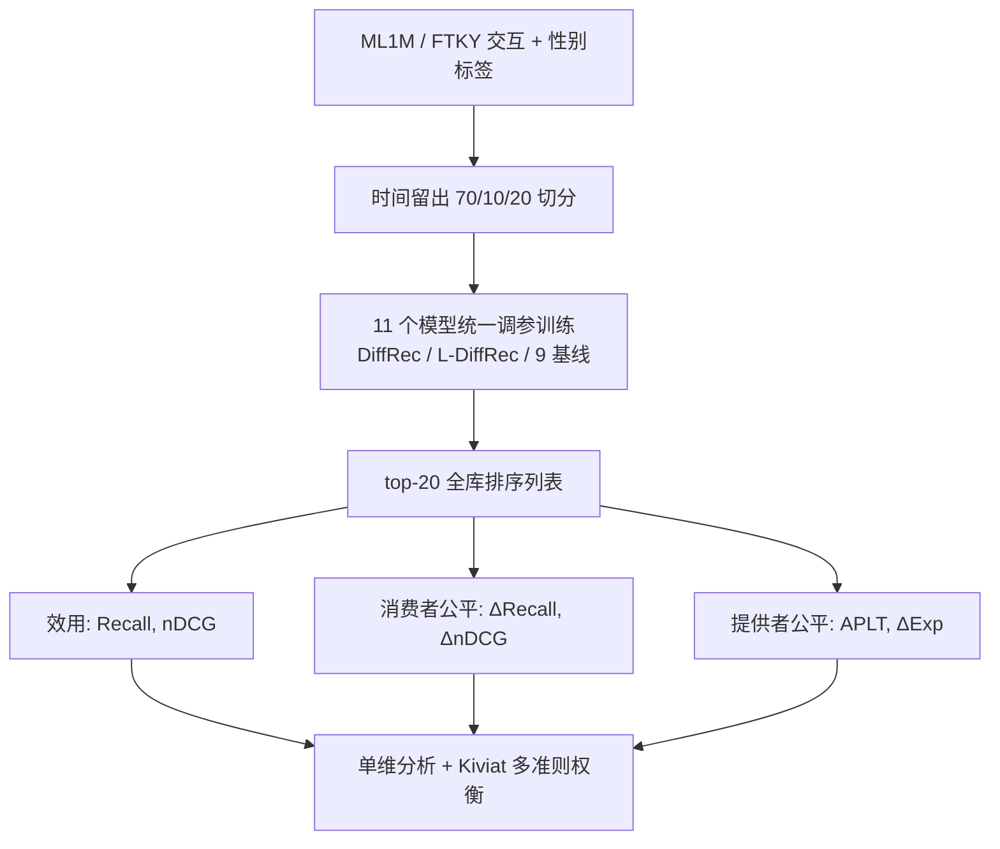

# How Fair is Your Diffusion Recommender Model? (你的扩散推荐模型有多公平？)

- **会议/期刊**: ACM RecSys 2025 (Late-Breaking Results track)
- **作者与机构**: Daniele Malitesta, Fragkiskos D. Malliaros (Université Paris-Saclay, CentraleSupélec, Inria)；Giacomo Medda, Mirko Marras, Ludovico Boratto (University of Cagliari)；Erasmo Purificato (European Commission, JRC)
- **推荐链路定位**: 召回（全库排序评估）
- **研究方向**: 生成式推荐与离散语义ID / 去偏公平、可信隐私与工业架构
- **论文原文**: [https://arxiv.org/abs/2409.04339v2](https://arxiv.org/abs/2409.04339v2)
- **开源代码**: [https://github.com/danielemalitesta/FairDiffRec](https://github.com/danielemalitesta/FairDiffRec)

## TL;DR (1分钟核心速览)

本文是首个针对扩散式推荐（DiffRec 及其轻量变体 L-DiffRec）的公平性实证研究。动机来自 CV/NLP 领域已证实扩散模型会放大训练分布中的偏见，而推荐领域尚无对应检验。作者在 ML1M 与 Foursquare Tokyo 两个含性别标签的数据集上，以时间留出划分 + Full-Ranking top-20 协议，对比 9 个 SOTA 推荐器，从效用（Recall/nDCG）、消费者公平（ΔRecall/ΔnDCG）与提供者公平（APLT/ΔExp）三维度做单维与多准则（Kiviat）分析。结论：DiffRec 效用领先但公平性垫底（ML1M 上 ΔnDCG=2.03% 远逊 XSimGCL 的 1.34%），而 L-DiffRec 通过聚类隐空间显著缓解不公平，甚至在 FTKY 上取得最佳权衡。

## Background & Motivation (背景与核心矛盾)

- **主流范式**: 扩散推荐将用户隐式反馈视为含噪信号，前向加高斯噪声、反向去噪重建交互向量，DiffRec 在效用上超越 VAE/GAN 系生成推荐；L-DiffRec 进一步用 LightGCN 预训练嵌入聚类 + VAE 压缩到低维隐空间以支持大规模场景。
- **前人局限**: (1) 扩散模型在 CV/NLP/图生成中已被反复证实会放大数据固有偏见（如职业-性别刻板生成），但推荐领域完全缺乏对应实证；(2) 现有公平性研究集中于 BPRMF/LightGCN/VAE 等传统族，扩散族是否继承甚至加剧偏见完全未知。
- **核心洞察 (Key Insight)**: 扩散模型的目标是"恢复训练分布"，而推荐数据分布本身编码了流行度与人群偏见，因此去噪过程可能把偏见当作"真实信号"一并重建；反之，若在隐空间做聚类式压缩（L-DiffRec），聚类操作天然打散了流行度主导的粗粒度模式，可能起到隐式去偏作用。
- **本文切入点**: 不做新模型，而是构建一个严格可控的公平性基准，用单维 + 多准则双视角回答"DiffRec 是否公平"，并定位 L-DiffRec 的架构差异作为未来去偏设计的线索。

## Method (核心方法设计)

### 1. 整体框架 (Overall Architecture)

本文为实证基准研究，无新模型。整体流程为：选定被审对象（DiffRec、L-DiffRec）与 9 个跨族基线（矩阵分解 BPRMF、邻域 ItemkNN、神经 NeuMF、图 LightGCN/UltraGCN/XSimGCL、线性 EASE、生成 MultiVAE/RecVAE），统一在 RecBole 框架下以验证集 Recall@20 网格搜索调参；随后在 ML1M/FTKY 上按时间留出切分训练，生成 top-20 列表，分别计算效用、消费者公平、提供者公平六项指标；最后做单维横向对比与三维归一化 Kiviat 多准则权衡分析。

### 2. 关键设计拆解 (Key Designs)

1. **双视角公平度量体系（消费者 + 提供者）**：消费者公平采用人口统计均等（demographic parity）的操作化——受保护组（女性）与非受保护组的效用绝对差，$\Delta\text{nDCG}=|\text{nDCG}_{F}-\text{nDCG}_{M}|$，$\Delta\text{Recall}$同理，越接近 0 越公平；提供者公平用短头/长尾二分（前 20% 流行物品为短头，其余为长尾，长尾为受保护组），以$\text{APLT}$（top-$k$中长尾占比，越高越好）与$\Delta\text{Exp}$（两组曝光份额绝对差，越低越好）刻画。该设计的直觉是：扩散模型若只重建高频共现模式，则长尾曝光与少数群体效用会同时塌缩，两个视角能交叉验证同一偏见机制。
2. **L-DiffRec 的聚类隐空间机制（作为"无意去偏"的对照）**：DiffRec 直接在 $|\mathcal{I}|$维离散交互向量上做前向/反向扩散，$q(\mathbf{x}_t|\mathbf{x}_{t-1})=\mathcal{N}(\mathbf{x}_t;\sqrt{1-\beta_t}\mathbf{x}_{t-1},\beta_t\mathbf{I})$，完整保留逐物品的偏好细节（也完整保留偏见）；L-DiffRec 先将物品嵌入聚为$C$簇，把$\mathbf{x}_0$拆成$C$个子向量$\{\mathbf{x}_0^c\}_{c=1}^{C}$，经 VAE 压缩后在低维隐空间并行扩散再解码重建。作者的关键观察是：这一压缩瓶颈虽带来轻微效用损失（ML1M Recall 10.38% vs 10.71%），却迫使模型学习簇级而非物品级的粗粒度模式，从而削弱流行度驱动的曝光集中，实证上表现为 APLT 从 6.18% 升至 10.81%、ΔExp 从 93.67% 降至 87.26%。
3. **多准则权衡分析（Kiviat 归一化）**：单维指标可能掩盖"以效用换公平"的此消彼长，故对 nDCG、ΔnDCG、APLT 做 min-max 归一化至 $[0,1]$ 并将 ΔnDCG 反转为"越高越好"，绘制雷达图比较五代表模型的综合形状。该方法的价值在于把"是否 Pareto 占优"可视化：XSimGCL 在 ML1M 上形状最均衡，DiffRec 则呈明显"效用尖、公平塌"的偏斜形态。

## Experimental Setup & Evaluation Protocol (实验设置与评估协议)

- **数据集与预处理**: 两数据集均要求用户最少 20 次交互；物品侧按流行度前 20% 划为短头、其余为长尾。

| 数据集 | #Users | #Items | #Interactions | 稀疏度 | 特征/场景说明 |
| :--- | :---: | :---: | :---: | :---: | :--- |
| ML1M | 6,040 | 3,650 | 1,000,130 | 95.46% | 电影评分；性别 M 71.7% / F 28.3% |
| FTKY | 7,240 | 5,779 | 353,769 | 99.15% | 东京 POI 签到；性别 M 87.9% / F 12.1% |

- **数据划分与防穿越 (Splitting Strategy)**: 采用**时间留出切分**（temporal hold-out，70%/10%/20%），与 DiffRec 原文及公平性文献 [7] 保持一致，避免未来交互泄漏。
- **排名评测协议 (Ranking Protocol)**: **Full-Ranking 全库未交互物品排序**，取 top-20 列表计算全部六项指标，无负采样偏差；指标均以百分比表示。
- **对比基线与超参设置**: 9 个基线覆盖 MF/邻域/神经/图/线性/生成六族；DiffRec 与 L-DiffRec 使用官方实现，其余用 RecBole；各模型网格搜索后以验证集 Recall@20 最优配置为准；未报告显著性检验（Late-Breaking 短文限制）。

## Key Experimental Results (实验关键数据)

### 1. 主实验对比 (Main Results)

| 模型 | ML1M Recall↑ | ML1M nDCG↑ | ML1M ΔnDCG↓ | ML1M APLT↑ | ML1M ΔExp↓ | FTKY Recall↑ | FTKY ΔnDCG↓ | FTKY APLT↑ |
| :--- | :---: | :---: | :---: | :---: | :---: | :---: | :---: | :---: |
| BPRMF | 10.67 | 12.94 | 1.57 | 12.47 | 86.29 | 12.17 | 0.22 | 9.93 |
| ItemkNN | 9.87 | 12.22 | 1.98 | 8.01 | 91.18 | 11.77 | 0.19 | 18.27 |
| NeuMF | 10.44 | 12.67 | 1.54 | 11.75 | 87.36 | 12.48 | 0.09 | 10.20 |
| LightGCN | 10.16 | 13.09 | 1.43 | 8.11 | 91.32 | 11.03 | 0.47 | 7.42 |
| UltraGCN | 10.74 | 12.82 | **0.06** | 13.73 | 84.98 | 12.22 | 0.29 | 5.36 |
| XSimGCL | 10.46 | 12.80 | 1.34 | 10.50 | 88.78 | **13.07** | 0.23 | 11.06 |
| EASE | 6.45 | 8.62 | 1.66 | 9.00 | 90.54 | 6.19 | 0.10 | 6.32 |
| RecVAE | 9.68 | 12.86 | 2.07 | 5.38 | 94.10 | 12.30 | 0.29 | 7.27 |
| **DiffRec** | 10.71 | **13.19** | 2.03 | 6.18 | 93.67 | **13.10** | 0.22 | 10.75 |
| **L-DiffRec** | 10.38 | 12.85 | 2.25 | 10.81 | 87.26 | 12.48 | **0.02** | **16.97** |

（Improv. 视角：DiffRec 在 ML1M nDCG 上较最强图基线 LightGCN 提升 +0.76%，但 ΔnDCG 比 UltraGCN 差 33 倍；L-DiffRec 在 FTKY 上 APLT 较 DiffRec 提升 +57.9%、ΔExp 降低 8.7%。）

### 2. 消融实验 (Ablation Study)

本文为基准研究，无传统消融，但 L-DiffRec 相对 DiffRec 的"架构替换"本身构成受控对照：

| 配置 | ML1M Recall | ML1M ΔnDCG | ML1M APLT | FTKY ΔnDCG | FTKY APLT | FTKY ΔExp |
| :--- | :---: | :---: | :---: | :---: | :---: | :---: |
| DiffRec（全维扩散） | **10.71** | **2.03** | 6.18 | 0.22 | 10.75 | 88.57 |
| L-DiffRec（聚类隐空间） | 10.38 | 2.25 | **10.81** | **0.02** | **16.97** | **80.85** |
| Δ（L − 原） | −0.33 | +0.22 | +4.63 | −0.20 | +6.22 | −7.72 |

### 3. 关键实验发现 (Key Findings)

1. **扩散模型确实放大偏见，且呈"效用-公平"强对立**：DiffRec 在 ML1M 上取得最高 nDCG 13.19%，但 ΔnDCG 2.03% 为全表最差之一（UltraGCN 仅 0.06%），Kiviat 图显示其形状为"效用尖峰 + 公平塌陷"，与 CV 领域扩散模型放大偏见的结论一致。
2. **聚类隐空间是有效的隐式去偏器**：L-DiffRec 仅牺牲 0.33% Recall，即换来 ML1M APLT +4.63%、FTKY APLT +6.22% 与 ΔExp −7.72%，在 FTKY 上 ΔnDCG 低至 0.02% 为全表最优，说明压缩瓶颈迫使模型放弃物品级流行度记忆、转向簇级模式。
3. **公平性结论高度依赖数据域**：ML1M（电影，个体偏好驱动）上图模型 UltraGCN/XSimGCL 最公平，扩散族垫底；FTKY（POI，群体出行驱动）上生成族 EASE/L-DiffRec 与 ItemkNN 反而最公平，提示偏见放大强度与域内偏好形成机制强相关，单一数据集结论不可外推。

## Highlights & Limitations (亮点、对比与审稿批判)

- **与代表作对比 (vs. Prior Work)**: 与 DiffRec 原文 [Wang et al., SIGIR'23] 只报效用不同，本文首次把公平性作为一等评估维度；与既有公平性基准（如 [2,7] 覆盖 BPRMF/LightGCN/XSimGCL）相比，本文补上了扩散族这一空白格；与 CV 领域扩散偏见研究 [16,5,12] 相比，本文把"生成分布恢复即偏见恢复"的机制假设迁移到推荐并给出量化证据。
- **可迁移亮点**: (1) "聚类/压缩瓶颈作为隐式去偏正则"这一观察可直接迁移到其他生成式推荐（如 RQ-VAE 语义 ID 的码本粒度调节）；(2) 双视角（消费者 + 提供者）+ Kiviat 归一化权衡图是一套低成本、可复用的公平性体检模板。
- **审稿级局限批判**: (1) 仅覆盖 DiffRec 一族且明确排除 T-DiffRec 与其他扩散推荐（如 POI/序列扩散），结论外推性有限；(2) 未做显著性检验、未报告方差与多次运行，且 L-DiffRec 在 ML1M 上 ΔnDCG 反而更差（2.25% vs 2.03%），与"缓解不公平"的叙事存在张力，作者未深入解释该数据集上的反向现象；(3) 未剖析偏见来源（如生成后数据分布如何变化），仅停留在现象层。

## Rating (四维评分)

- **方法创新性 (Novelty)**: ⭐⭐⭐ （无新模型，但首次将扩散推荐与公平性交叉，L-DiffRec 聚类机制的"无意去偏"观察具启发性）
- **评估协议与实验扎实度 (Protocol & Experiments)**: ⭐⭐⭐ （Full-Ranking + 时间切分 + 11 模型 6 指标较规范，但缺显著性检验与多轮方差，且仅两数据集）
- **写作与数学规范度 (Clarity & Rigor)**: ⭐⭐⭐⭐ （问题定义清晰、指标操作化明确、Kiviat 可视化直观；受短文篇幅限制公式从简）
- **工业落地与复现价值 (Industrial & Practical Value)**: ⭐⭐⭐⭐ （代码开源、基于 RecBole 易复现；"聚类粒度调公平"是低改造成本的工程抓手，但线上 A/B 与延迟评估缺失）

