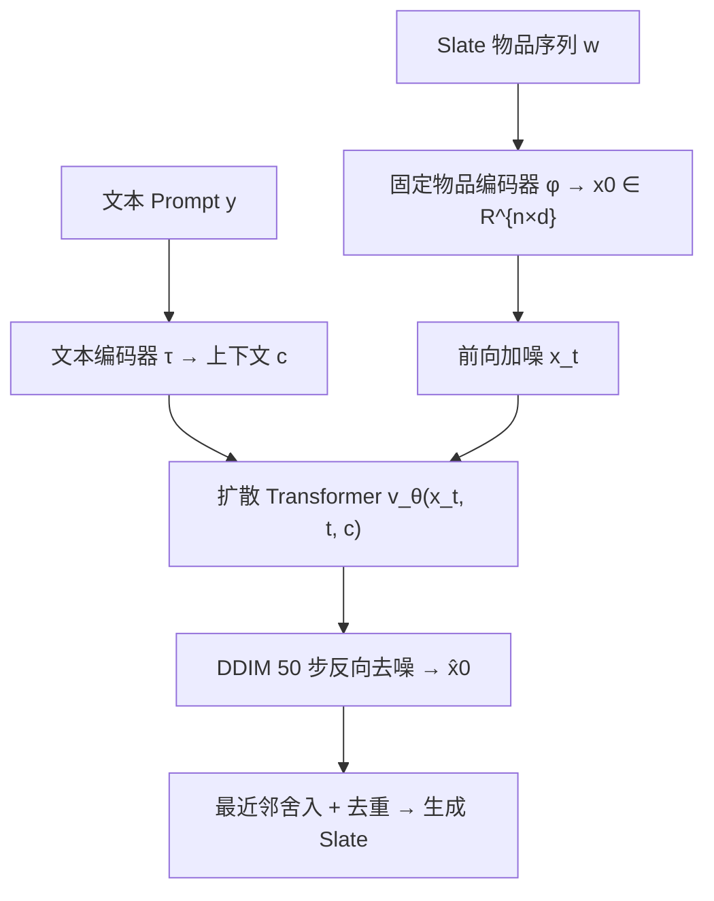
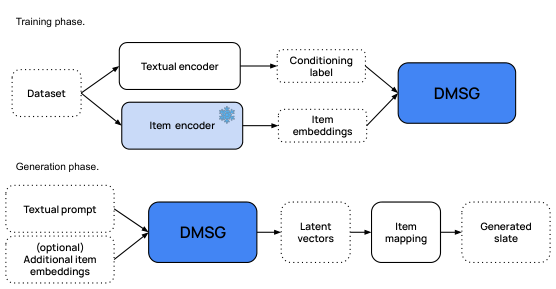

# Prompt-to-Slate: Diffusion Models for Prompt-Conditioned Slate Generation (提示到列表：面向提示条件列表生成的扩散模型)

- **会议/期刊**: RecSys 2025
- **作者与机构**: Federico Tomasi, Francesco Fabbri, Justin Carter, Elias Kalomiris, Mounia Lalmas, Zhenwen Dai（Spotify）
- **推荐链路定位**: 端到端生成式（替代召回+排序的整组 Slate 生成）
- **研究方向**: 生成式推荐与离散语义ID / 多任务学习与列表级重排
- **论文原文**: [https://arxiv.org/abs/2408.06883v3](https://arxiv.org/abs/2408.06883v3)
- **开源代码**: 暂未开源（仅引用预训练文本编码器 [all-MiniLM-L6-v2](https://huggingface.co/sentence-transformers/all-MiniLM-L6-v2)）

## TL;DR (1分钟核心速览)

针对 Slate 生成中"组合爆炸 + 传统方法假设用户只消费单物品"的核心痛点，本文提出 DMSG：把整组 Slate 编码为定长潜向量序列，用条件扩散 Transformer 在连续潜空间建模 Slate 的**联合分布**，仅以自然语言 Prompt 为条件、无需任何用户历史。在 Spotify MPD / Curated 与 Amazon Bundle 三个数据集上，以相似度加权的 NDCGSim/MAPSim 全列表评测，Curated 上 NDCGSim@30 相对最强基线 BM25 提升 +17%、MAPSim@30 提升 +12.9%；线上两周 A/B（100 万用户）重复曝光 −13.4%、主动策展 +6.8%，P99 延迟 150ms。

## Background & Motivation (背景与核心矛盾)

- **主流范式**: Slate 生成（歌单、电商 Bundle、视频列表）主流用 RL 或 Transformer 序列模型，在物品级排序基础上拼装列表，或假设用户只从 Slate 中挑"最优一件"以规避组合复杂度。
- **前人局限**: ① RL 类方法依赖强假设（单物品选择）与大量交互数据，冷启动/编辑场景失效；② LLM 自回归解码需物品在词表中有先验曝光，目录动态增删时需重训映射，且逐 token 解码难以保证整组列表的结构一致性。
- **核心洞察 (Key Insight)**: Slate 的"好"体现在**整组共现结构**（co-consumption）而非单物品相关性；扩散模型在高维连续空间建模联合分布 + 固有随机性，天然同时给出相关性与多样性，且潜空间解码器可插拔，目录变化只需更新映射函数。
- **本文切入点**: 将 Slate 生成重构为"Prompt → 潜向量序列"的条件生成问题，用扩散 Transformer 一次性采样整组列表。

## Method (核心方法设计)

### 1. 整体框架 (Overall Architecture)

DMSG 由三部分组成：(i) **编码模块**：固定（非联合训练）物品编码器 $\phi$把离散物品$w_i$映射为$d=80$维向量，Slate 补齐/截断到定长$n$（音乐 32、Bundle 5），得到$\boldsymbol{x}_0=\phi(\boldsymbol{w})\in\mathbb{R}^{n\times d}$；(ii) **条件模块**：文本编码器$\tau$（3 层 encoder-only Transformer，8 头、隐维 128）把 Prompt 编码为上下文$c$；(iii) **扩散 Transformer**：3 层 Transformer + 320 维 ResBlock，通过 cross-attention 注入$c$，预测速度场$\boldsymbol{v}_\theta$。训练时对$\boldsymbol{x}_0$加噪并回归速度；推理时从$\boldsymbol{x}_T\sim\mathcal{N}(0,\boldsymbol{I})$出发，用 DDIM 仅 50 步去噪得$\hat{\boldsymbol{x}}_0$，再经最近邻舍入映射回离散物品，重复项做掩码后取次近邻。

<figure class="paper-figure" markdown="span">
  <figcaption>图1：DMSG 在训练（上）和推理（下）阶段的概览。</figcaption>
</figure>

### 2. 关键设计拆解 (Key Designs)

1. **速度预测 + SNR+1 加权的扩散损失**：直接预测噪声 $\boldsymbol{\epsilon}$ 在低信噪比段梯度不稳，本文改用 v-prediction 并采用 "SNR+1" 加权：
$$\mathcal{L}_{\text{DMSG}}(\theta)=\mathbb{E}_{t,\boldsymbol{x}_0,\boldsymbol{v}}\left[\left\|\boldsymbol{v}-\boldsymbol{v}_\theta\left(\sqrt{\bar{\alpha}_t}\boldsymbol{x}_0+\sqrt{1-\bar{\alpha}_t}\boldsymbol{\epsilon},\,t,\,c\right)\right\|^2\right]$$
其中 $\boldsymbol{v}_t=\alpha_t\boldsymbol{\epsilon}_t-\sigma_t\boldsymbol{x}_t$。直觉：速度目标在全部噪声水平上量纲一致，避免了$\epsilon$-prediction 在高噪声端对语义结构的"过拟合噪声"，实测收敛更快、生成质量更高。

2. **固定物品编码器 + 可插拔解码（目录解耦）**：若联合训练编码器，目录一变就需重训整个扩散模型。本文冻结 $\phi$（音乐用 Word2Vec 共现嵌入，Bundle 用 all-MiniLM-L6-v2 零样本嵌入），仅保留舍入映射$p_w(\boldsymbol{w}|\boldsymbol{x}_0)$ 可更新。这样新物品只需进入嵌入空间即可被生成，模型主体对目录演化保持稳定——这是相对 LLM 词表方案的关键工程优势。

3. **DDIM 加速与推理开销**：标准 DDPM 需上千步反向迭代，无法满足实时推荐。采用非马尔可夫 DDIM 将推理压缩到 50 步，单张 NVIDIA L4 上 P99 延迟 150ms（对照组生产系统 500ms）。训练侧 1000 epoch、Adam、lr $10^{-4}$，无需负采样（生成式建模天然规避了 BPR/InfoNCE 的负样本构造问题）。

## Experimental Setup & Evaluation Protocol (实验设置与评估协议)

- **数据集与预处理**:

| 数据集 | #Users | #Items | #Interactions/Slates | 稀疏度/密度 | 特征/场景说明 |
| :--- | :---: | :---: | :---: | :---: | :--- |
| Curated | — | — | 30,000 歌单 | — | 平台编辑精选歌单，含标题/描述/关键词 |
| MPD | — | — | 100K 歌单（从 1M 采样） | — | Spotify 百万歌单子集，2010–2017 |
| Bundle | — | 11,000 | 5,444 bundles | — | Amazon 商品 Bundle，序列长 5 |

- **数据划分与防穿越 (Splitting Strategy)**: **Slate 级 80/20 比例划分**（按整条 Slate 而非交互切分），测试集仅用于评测，无时间戳切分。
- **排名评测协议 (Ranking Protocol)**: 非传统 Full-Ranking，而是**参考 Slate 对齐评测**：生成 Slate 与参考 Slate 逐位置比对，未命中项按嵌入余弦相似度给软相关性 $s_i=\text{cos\_sim}(\text{item}_i,\text{ref}_i)$，得到 NDCGSim@K 与 MAPSim@K；辅以 BertScore（语义相似）与 CategorySim（类目重叠加权）。每个 Prompt 采样 5 条 Slate 取均值再跨 Prompt 聚合，报告均值±标准差。作者明示该指标为**下界估计**（等价相关但不在参考集中的物品被低估）。
- **对比基线与超参设置**: 4 个无个性化基线——Popularity、Prompt2Vec（句嵌入+2 层 FC + 最近邻）、BM25、S2S（Transformer encoder-decoder）。物品嵌入维 $d=80$，扩散步数$T$ 训练默认、推理 50 步；未报告显著性检验，仅给标准差。

## Key Experimental Results (实验关键数据)

### 1. 主实验对比 (Main Results)

| 数据集 | 方法 | NDCGSim | MAPSim | BertScore | CategorySim |
| :--- | :--- | :---: | :---: | :---: | :---: |
| Curated@30 | BM25 | 0.6054 | 0.7955 | 0.8928 | 0.4677 |
| Curated@30 | S2S | 0.3761 | 0.4763 | 0.6531 | 0.2153 |
| Curated@30 | **DMSG** | **0.7087** | **0.8978** | **0.9314** | **0.4783** |
| Curated@30 | Improv. | +17.0% | +12.9% | +4.3% | +2.3% |
| MPD@30 | BM25 | **0.5614** | 0.7373 | 0.8444 | 0.3674 |
| MPD@30 | S2S | 0.3506 | 0.5247 | 0.7762 | 0.2337 |
| MPD@30 | **DMSG** | 0.5210 | **0.8119** | **0.8796** | **0.4792** |
| Bundle@5 | BM25 | 0.0955 | 0.4998 | 0.5338 | 0.1940 |
| Bundle@5 | Prompt2Vec | 0.1862 | 0.3292 | 0.3452 | 0.0678 |
| Bundle@5 | **DMSG** | **0.3157** | **0.5690** | **0.5784** | **0.4069** |

### 2. 消融实验 (Ablation Study)

| 变体 (MPD) | NDCGSim@30 | MAPSim@30 | BertScore | CategorySim@30 |
| :--- | :---: | :---: | :---: | :---: |
| DMSG (no post-process) | 0.5138 | 0.7343 | 0.8744 | 0.4789 |
| DMSG (random sort) | 0.5134 | 0.7330 | 0.8744 | 0.4788 |
| DMSG (centroid sort) | **0.5210** | **0.8119** | **0.8796** | **0.4792** |

### 3. 关键实验发现 (Key Findings)

1. **相关性提升主要来自"整组结构"而非单物品匹配**：Curated 上 DMSG 的 MAPSim 比 BM25 高 12.9%，但 CategorySim 仅高 2.3%——说明 BM25 已能做好类目对齐，DMSG 的增益来自 Slate 内部共现结构的建模，而非更准的类目检索。
2. **多样性是扩散随机性的"免费副产品"**：Bundle 上 DMSG 的曝光分布整体低于参考流行度（图 3），而 BM25 系统性偏向热门；同一 Prompt 多次采样时 BertScore 稳定在 ~0.8 且 Slate 间重叠度低（图 4），证明新鲜度不以质量为代价。
3. **后处理影响有限但方向明确**：按潜空间质心排序使 MAPSim 从 0.7343 升至 0.8119（+10.6%），说明模型把最相关物品放在潜分布中心附近；随机打乱几乎无变化，证明生成顺序本身已具结构语义。

## Highlights & Limitations (亮点、对比与审稿批判)

- **与代表作对比 (vs. Prior Work)**: 相比 RL 式 Slate 生成（依赖单物品选择假设与大量交互），DMSG 直接建模联合分布、无需奖励函数；相比 LLM 自回归推荐（需物品在词表中有先验、目录变动需重训），DMSG 用固定物品嵌入 + 可插拔解码实现目录解耦；相比 S2S 逐 token 解码，扩散一次性生成整组潜向量，天然保证列表级一致性。
- **可迁移亮点**: ① "固定物品编码器 + 可更新舍入映射"的目录解耦范式，可直接迁移到任何需要频繁增删物品的生成式推荐系统；② 用潜空间质心排序作为轻量后处理，几乎零成本提升头部位置相关性。
- **审稿级局限批判**: ① 评测协议为参考 Slate 对齐的软相似度指标，非标准 Full-Ranking，且未做显著性检验，跨方法可比性存疑；② 线上 A/B 显示主动策展 +6.8% 的同时播放时长 −5.6%、跳过率 +3%，说明"新鲜度换留存"的权衡未被充分优化，且模型未做任何个性化/在线微调，长期留存影响未知。

## Rating (四维评分)

- **方法创新性 (Novelty)**: ⭐⭐⭐⭐ （首次将潜空间扩散用于纯 Prompt 条件的整组 Slate 生成，v-prediction + 目录解耦设计有明确工程洞察，但扩散骨架本身非新）
- **评估协议与实验扎实度 (Protocol & Experiments)**: ⭐⭐⭐ （三数据集 + 两周百万用户线上 A/B 难得，但软相似度指标非标准排序协议、缺显著性检验、消融仅覆盖后处理）
- **写作与数学规范度 (Clarity & Rigor)**: ⭐⭐⭐⭐ （问题形式化与扩散推导清晰，架构图与训练/推理流程交代完整，复杂度与延迟有量化）
- **工业落地与复现价值 (Industrial & Practical Value)**: ⭐⭐⭐⭐ （P99 150ms 优于生产基线、目录解耦便于部署，但代码未开源、物品编码器依赖领域特定方案，复现门槛中等）

