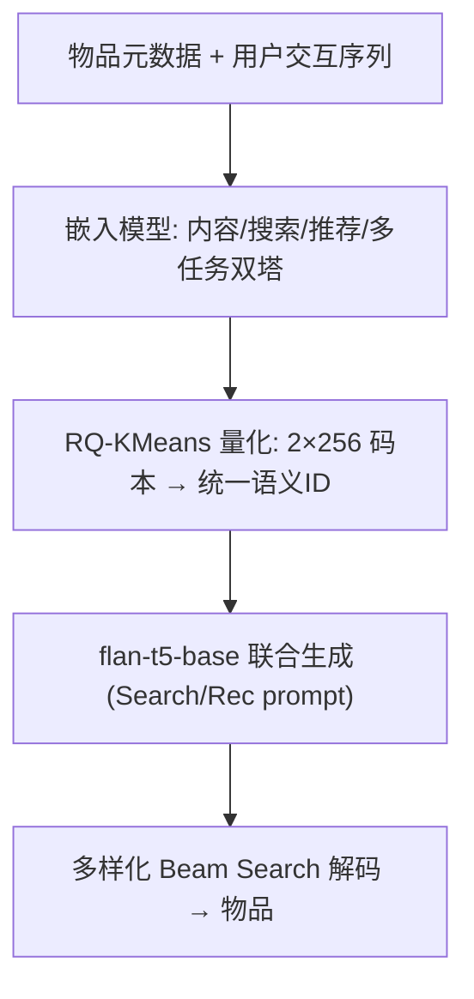

# Semantic IDs for Joint Generative Search and Recommendation (面向联合生成式搜索与推荐的语义ID)

- **会议/期刊**: RecSys 2025 (Late-Breaking Results)
- **作者与机构**: Gustavo Penha, Edoardo D'Amico, Marco De Nadai 等 (Spotify)
- **推荐链路定位**: 端到端生成式 (生成式检索 / 生成式推荐)
- **研究方向**: 生成式推荐与离散语义ID / 大语言模型推荐
- **论文原文**: [https://arxiv.org/abs/2508.10478v1](https://arxiv.org/abs/2508.10478v1)
- **开源代码**: [faiss (RQ-KMeans 量化器)](https://github.com/facebookresearch/faiss)（模型代码暂未开源）

## TL;DR (1分钟核心速览)

本文针对"统一生成式模型同时服务搜索与推荐时，语义ID该用哪个任务的嵌入来构建"这一核心痛点，系统对比了任务专属（Search-based / Rec-based）、令牌分离（Separate / Prefix-share）与嵌入融合（Fused_concat / Fused_SVD / Multi-task）共 7 种语义ID构建策略。在 MovieLens-25M 构建的 S&R 数据集上，以 Recall@30 为指标、5 次随机种子均值评估，发现**多任务双塔嵌入 + 统一 RQ-KMeans 语义ID** 取得最佳权衡（Search 0.046 / Rec 0.049），避免了任务专属ID"一边倒"的 5x 与 60% 互损。

## Background & Motivation (背景与核心矛盾)

- **主流范式**: LLM 生成式检索/推荐将物品映射为离散 Semantic ID（由预训练嵌入经量化器分词得到），TIGER、DSI 用内容嵌入，RIPOR 用搜索微调嵌入，TokenRec 用协同过滤嵌入。
- **前人局限**: 任务专属嵌入虽在单任务最优，但在联合模型中互相拖累——搜索微调ID使检索提升约 5x 却令推荐 R@30 从 0.062 跌至 0.026（降 60%）；推荐微调ID则反向翻转（搜索仅 0.004）。
- **核心洞察 (Key Insight)**: 语义ID的质量完全由底层嵌入空间决定，而单任务嵌入空间是"过拟合"的；联合模型需要的是一个**跨任务共享、语义对齐**的嵌入空间，而非两套专属ID。
- **本文切入点**: 用同时在搜索（query-item 对比损失）与推荐（item-item 共现对比损失）上微调的双塔编码器产出统一嵌入，再量化为一套共享语义ID。

## Method (核心方法设计)

### 1. 整体框架 (Overall Architecture)

输入为物品元数据（标题、年份、描述、类型、标签、genome tags）与用户交互序列。核心链路：先用不同监督信号训练物品嵌入模型（内容/搜索/推荐/多任务），再经量化器（默认 RQ-KMeans，2 个码本 × 256）离散化为语义ID，最后将 ID 序列送入 `flan-t5-base` 联合生成模型，搜索 prompt 与推荐 prompt 共享同一套 ID 词表，通过多样化 beam search 解码输出物品。训练时搜索与推荐任务联合优化，推理时按任务类型切换 prompt 前缀。

### 2. 关键设计拆解 (Key Designs)

1. **多任务双塔嵌入 (Multi-task Bi-encoder)**：痛点在于单任务嵌入过拟合。做法是共享一个编码器，同时优化搜索对比损失与推荐对比损失之和：
$$\mathcal{L}_{mt}=\mathcal{L}_{search}+\mathcal{L}_{rec},\quad \mathcal{L}_{search}=-\log\frac{\exp(s(q,d^+)/\tau)}{\sum_{d^-}\exp(s(q,d^-)/\tau)}$$
其中 $\mathcal{L}_{rec}$ 为 item-item 共现对的同构 InfoNCE。直觉：共享编码器迫使物品表征同时携带"可被查询检索"与"可被协同过滤召回"的双重语义，形成正则化效应。

2. **嵌入融合的三种变体 (Fused_concat / Fused_SVD)**：直接拼接 $\boldsymbol{v}^{concat}_i=[\boldsymbol{v}^{search}_i;\boldsymbol{v}^{rec}_i]$会因维度不对等（386 vs 256）使高维空间主导；Fused_SVD 先用截断 SVD 对齐维度再逐元素相加$\boldsymbol{v}^{svd}_i=\boldsymbol{v}^{search}_i+\boldsymbol{v}^{rec}_i$，缓解维度偏置，推荐侧提升明显但搜索侧受损。

3. **令牌分离策略 (Separate / Prefix-share)**：Separate 为两任务各建一套ID（词表翻倍至 1024），Prefix-share 用 1 个共享码本 + 2 个任务专属码本。二者均因任务间知识无法共享、失去表征正则化而劣于嵌入级融合，验证了"先融合嵌入再量化"优于"先量化再分离令牌"。

**训练目标与推理效率**：生成模型以标准自回归交叉熵联合训练 3 epoch（LR 0.002, batch 128, AdamW）。负采样：搜索用 in-batch 随机负样本，推荐用共现正样本 + in-batch 负样本，全程免显式难负采样。推理用 beam=60、多样性惩罚 0.25、30 组的多样化 beam search 以提升召回物品多样性。

## Experimental Setup & Evaluation Protocol (实验设置与评估协议)

- **数据集与预处理**: 基于 MovieLens-25M 构建，每物品用 Gemini-2.0-flash 生成 20 条自然语言查询（10 训练 / 10 测试），刻意消除搜索侧流行度偏置（均匀分布）。

| 数据集 | #Users | #Items | #Interactions | 稀疏度/密度 | 特征/场景说明 |
| :--- | :---: | :---: | :---: | :---: | :--- |
| ML-25M (S&R) | 162K | 62,138 | 1.24M | ~0.012% | 元数据 + 每物品 20 条合成查询 |

- **数据划分与防穿越 (Splitting Strategy)**: 推荐侧按**全局时间戳切分**，每用户最后一次交互作测试；搜索侧查询按 10/10 固定划分训练/测试。
- **排名评测协议 (Ranking Protocol)**: 采用 `Full-Ranking` 式生成式检索评估，指标为 **Recall@30**；每模型跑 5 个随机种子取均值，配对 Student's t 检验 + Bonferroni 校正，95% 置信区间。
- **对比基线与超参设置**: 7 种语义ID构建策略互相对比；嵌入维度搜索侧 386、推荐侧 256；量化默认 RQ-KMeans（2×256 码本），消融另测 Dictionary Encoding、ResidualLFQ、RQ-VAE。

## Key Experimental Results (实验关键数据)

### 1. 主实验对比 (Main Results)

| 语义ID构建方法 | Search R@30 (All) | Rec R@30 (All) | Rec Head (Top1%) | Rec Torso |
| :--- | :---: | :---: | :---: | :---: |
| Search based (RIPOR式) | **0.072** | 0.026 | 0.090 | 0.070 |
| Rec. based (TokenRec式) | 0.004 | **0.062** | **0.170** | 0.035 |
| Separate | 0.028 | 0.032 | 0.120 | 0.051 |
| Prefix-share | 0.007 | 0.021 | 0.058 | 0.010 |
| Fused_concat | 0.048 | 0.018 | 0.045 | 0.041 |
| Fused_SVD | 0.033 | 0.038 | 0.105 | 0.060 |
| **Multi-task (本文推荐)** | 0.046 | 0.049 | 0.135 | 0.024 |

### 2. 消融实验 (Ablation Study)

固定 Multi-task 嵌入，仅替换量化器：

| 量化方法 | Search R@30 | Rec R@30 |
| :--- | :---: | :---: |
| **RQ-KMeans** | **0.046** | **0.049** |
| Dictionary Encoding | 0.019 | 0.029 |
| ResidualLFQ | 0.018 | 0.023 |
| RQ-VAE | 0.002 | 0.024 |

### 3. 关键实验发现 (Key Findings)

1. **任务专属ID是"零和博弈"**：Search-based 搜索 R@30 达 0.072（约为 Multi-task 的 1.57x），但推荐仅 0.026（比 Multi-task 低 47%）；Rec-based 反之，证实单任务嵌入空间无法兼顾双目标。
2. **嵌入级融合 > 令牌级分离**：Multi-task（0.046/0.049）与 Fused_SVD（0.033/0.038）全面优于 Separate（0.028/0.032）与 Prefix-share（0.007/0.021），说明共享表征的正则化收益大于任务专属令牌的灵活性。
3. **流行度分层揭示内容嵌入的价值**：在 Torso（非头部 99%）物品上，Search-based 嵌入的推荐 R@30 达 0.070，反超 Rec-based 的 0.035——长尾物品上协同信号稀疏，内容语义成为更可靠的召回依据。
4. **轻量量化器反超学习式量化**：RQ-KMeans 在搜索/推荐上分别比 RQ-VAE 高 23x / 2x，与 Hong et al. 关于 RQ-VAE 不稳定的观察一致，暗示本设定下码本学习并非瓶颈。

## Highlights & Limitations (亮点、对比与审稿批判)

- **与代表作对比 (vs. Prior Work)**: 相较 TIGER/DSI（纯内容嵌入，未针对任务微调）与 RIPOR/TokenRec（单任务微调嵌入），本文首次在**联合生成模型**语境下系统量化"任务专属 vs 跨任务"语义ID的权衡，并给出可操作的折中方案；与同期 Shi et al. 的 Prefix-share 相比，本文实证其量化不稳定性。
- **可迁移亮点**: (1) "先融合嵌入、再统一量化"的两阶段范式可直接迁移到多业务场景（如短视频+电商）的共享ID构建；(2) 流行度分层（Head/Torso）分析可作为诊断语义ID泛化性的标准工具。
- **审稿级局限批判**: (1) 搜索查询由 LLM 合成且强制均匀分布，与真实搜索日志的流行度长尾严重不符，结论外推性存疑；(2) 仅用 flan-t5-base 与单一数据集，未报告推理延迟/吞吐，且 Multi-task 在 Torso 上仅 0.024（低于 Search-based 的 0.070），长尾推荐仍是短板。

## Rating (四维评分)

- **方法创新性 (Novelty)**: ⭐⭐⭐ （问题定义清晰、策略空间覆盖完整，但方法本身为已有组件的系统性组合，缺乏新算子）
- **评估协议与实验扎实度 (Protocol & Experiments)**: ⭐⭐⭐ （5 种子 + 显著性检验规范，但单数据集、合成查询、缺延迟评估削弱说服力）
- **写作与数学规范度 (Clarity & Rigor)**: ⭐⭐⭐⭐ （策略分类清晰、图表直观，公式简洁，权衡分析逻辑严密）
- **工业落地与复现价值 (Industrial & Practical Value)**: ⭐⭐⭐⭐ （Spotify 工业背景、统一ID显著降低词表与工程开销，量化器基于开源 FAISS 易复现）

