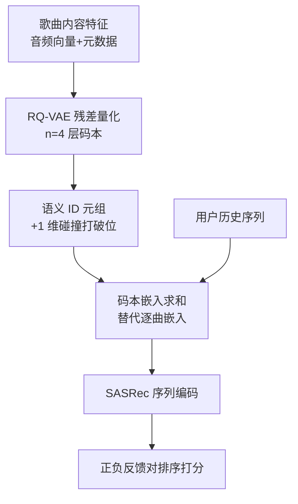

# Semantic IDs for Music Recommendation (面向音乐推荐的语义 ID)

- **会议/期刊**: RecSys 2025 (Industry Track)
- **作者与机构**: M. Jeffrey Mei, Samuel E. Sandberg, Oliver Bembom, Andreas F. Ehmann (SiriusXM Radio Inc.); Florian Henkel (Spotify)
- **推荐链路定位**: 召回（next-song 序列召回）
- **研究方向**: 生成式推荐与离散语义 ID / 序列推荐
- **论文原文**: [https://arxiv.org/abs/2507.18800v1](https://arxiv.org/abs/2507.18800v1)
- **开源代码**: 暂未开源

## TL;DR (1分钟核心速览)

音乐曲库动辄千万级，逐曲独立嵌入使 $N\times h$参数占据模型绝大部分显存，限制隐层维度与实时推理。本文用 RQ-VAE 将歌曲内容特征量化为$n=4$层、码本大小$k$的语义 ID 元组，以共享码本嵌入替代逐曲嵌入。在 Spotify 开源数据与 Pandora 私有数据上（时间切分、同用户正负反馈对排序，等价分层 AUC），$k=8192$即超越基线且参数降 99%（Pandora 降约 75%）；线上 1000 万用户 30 天 A/B 中听歌时长中性，但每 seed 不同歌曲数 +1.82%、曲目重复率 −1.26%（$p\ll10^{-4}$）。

## Background & Motivation (背景与核心矛盾)

- **主流范式**: 在线电台 next-song 推荐普遍采用 SASRec 类 Transformer 序列模型，每首歌学习一个独立 $h$ 维嵌入，参数量随曲库线性膨胀。
- **前人局限**: ① 哈希/随机 ID 虽能共享参数，但伪随机映射破坏内容相似性（同歌手歌曲 ID 不相邻），且对 OOV 曲目泛化差；② 训练前矩阵分解无法泛化到无反馈新歌，训练后分解则训练期模型复杂度仍被显存锁死，易欠拟合。
- **核心洞察 (Key Insight)**: 若用内容特征（音频向量、danceability 等属性）训练出"相似歌曲共享前缀码字"的离散 ID，则码本嵌入天然承担参数共享与正则化双重角色，且碰撞风险远低于哈希。
- **本文切入点**: 把 TIGER 式 RQ-VAE 语义 ID 首次系统迁移到音乐推荐，并回答"省下的参数该加在码本 $k$还是隐层$h$"这一工程问题。

## Method (核心方法设计)

### 1. 整体框架 (Overall Architecture)

离线阶段：对每首歌的内容特征（Spotify 为 8 维 audio vector + speechiness/danceability/energy 等属性，剔除 popularity；Pandora 为私有音频嵌入 + 流派/发行年元数据）训练 RQ-VAE，得到 $n=4$ 层残差量化码字，再追加 1 维"碰撞打破位"（同前 4 码的歌曲按序递增），构成 5 元组语义 ID。在线阶段：序列模型输入侧将歌曲索引替换为语义 ID 各层码本嵌入之和，其余结构与基线完全一致；输出侧仍对候选歌曲打分。训练与推理仅嵌入表规模改变，故可直接复用现有 SASRec 管线。

### 2. 关键设计拆解 (Key Designs)

1. **RQ-VAE 语义 ID 生成（内容相似 $\to$码字共享）**：痛点在于随机 ID 无结构。RQ-VAE 逐层对残差量化，第$l$层码字$c_l=\arg\min_{c\in\mathcal{C}_l}\|\boldsymbol{r}_{l-1}-\boldsymbol{e}_c\|_2^2$，残差$\boldsymbol{r}_l=\boldsymbol{r}_{l-1}-\boldsymbol{e}_{c_l}$，总重构损失为$\mathcal{L}_{\text{RQVAE}}=\|\boldsymbol{x}-\sum_{l=1}^{n}\boldsymbol{e}_{c_l}\|_2^2+\beta\sum_l\|\boldsymbol{r}_{l-1}-\text{sg}[\boldsymbol{e}_{c_l}]\|_2^2$。直觉：前几层码字编码粗粒度（流派/音色），后层编码细粒度，同歌手歌曲自然共享前缀，使码本嵌入获得跨曲泛化能力。
2. **码本 vs 隐层的参数预算分配（$k$优先于$h$）**：语义 ID 把嵌入表从$N\times h$压到$n\times k\times h$，省下的预算可回投模型。实验发现 Pandora 上等参数量下增大$k$优于增大$h$——码本扩容直接提升 ID 表达分辨率（减少碰撞、细化语义粒度），而$h$ 扩容仅增加每码字容量，边际收益递减；Spotify 上二者近似等价，作者归因于反馈类型差异（隐式 play/skip vs 显式 thumb）。
3. **训练目标与推理效率**：序列模型沿用 SASRec 的 next-item 二元交叉熵（正样本为实际播放/点赞，负样本为同序列内跳过/点踩），无额外负采样改造；语义 ID 仅改变输入嵌入查表方式。推理时嵌入表缩小 75%–99%，Pandora 线上训练成本降约 20%，内存占用减半，满足实时打分约束。

## Experimental Setup & Evaluation Protocol (实验设置与评估协议)

- **数据集与预处理**: 均仅保留 radio station 场景，含正负反馈。

| 数据集 | 粒度 | 反馈类型 | 最大序列长 | 回看窗口 | #序列 | #曲目 |
| :--- | :---: | :---: | :---: | :---: | :---: | :---: |
| Spotify (开源) | Session | play / skip | 20 | 同日 | $8\times10^6$|$3\times10^6$ |
| Pandora (私有) | User | thumb-up / down | 400 | 1 年 | $10^7$|$10^6$ |

- **数据划分与防穿越 (Splitting Strategy)**: 全局时间戳切分，测试集取训练期之后两周的反馈，严格防穿越；仅保留测试期内同时含至少一条正、负反馈的用户/会话，且模型输入（除该正负对外）非空。
- **排名评测协议 (Ranking Protocol)**: 非全库排序，而是**同用户/同会话内正负反馈对的成对排序准确率**，对用户/会话取平均，等价于分层 AUC（stratified AUC）；无采样负例比例概念。
- **对比基线与超参设置**: 基线为 SASRec 变体（Pandora 基线隐层 $h=60$），Pandora 另设"歌曲分解"变体（track 嵌入 = song + artist + genre 之和）；语义模型$n=4$，$k$在 64–32768 间扫描，$h$ 同步扫描；'v0' 为随机分配 ID，'v1' 为训练语义 ID。

## Key Experimental Results (实验关键数据)

### 1. 主实验对比 (Main Results)

离线以"达到/超越基线所需码本规模与参数缩减"为核心指标（原文为图 1–2，此处整理为表）：

| 数据集 / 设定 | 基线 AUC 参照 | 达标最小 $k$ | 参数缩减 | v1 vs v0 |
| :--- | :---: | :---: | :---: | :---: |
| Spotify (song-only) | 灰虚线基线 | 4096 持平 / **8192 超越** | **~99%** | v1 明显优于 v0，差距随 $k$ 增大收敛 |
| Pandora (song-only) | $h=60$ 基线 | **32768 持平** | **~75%** | v1 优于 v0 |
| Pandora (song 分解) | 同参基线 | 可持平 | ~75% | v1 ≈ v0（几乎无差） |
| Pandora 仅 artist+genre | — | — | — | 精度低约 **10%** |

线上 A/B（1000 万听众、30 天、$k=16384,h=120$、参数减约 50%）：

| 指标 | 变化 | $p$-value |
| :--- | :---: | :---: |
| 收听时长 | −0.08% | 0.53 |
| 歌曲完成率 | −0.04% | 0.22 |
| 新歌（<120 天）播放 | **+0.81%** | $\ll10^{-4}$ |
| 每 seed 不同歌曲数 | **+1.82%** | $\ll10^{-4}$ |
| 每 seed 不同歌手数 | **+0.51%** | $\ll10^{-4}$ |
| 曲目重复率 | **−1.26%** | $\ll10^{-4}$ |

### 2. 消融实验 (Ablation Study)

| 配置 | 关键观察 |
| :--- | :--- |
| w/o 语义 ID（逐曲嵌入基线） | 参数最多，精度为参照线 |
| w/ v0 随机 ID | 可省参数，song-only 下精度低于 v1 |
| w/ v1 训练语义 ID | song-only 下最优；加元数据后优势消失 |
| w/ 仅 artist+genre 共享嵌入 | 精度较完整模型低约 10%，说明语义 ID 仍贡献正则化 |
| 增大 $k$vs 增大$h$（等参数） | Pandora 偏好$k$；Spotify 二者近似 |

### 3. 关键实验发现 (Key Findings)

1. **参数效率成立但非"免费午餐"**：Spotify 上 $k=8192$即超越基线且参数降 99%，Pandora 需$k=32768$ 才持平（降 75%），说明曲库越大、内容特征越丰富，语义 ID 的相对收益越高；Pandora 达标门槛更高与其显式反馈稀疏、序列更长有关。
2. **语义 ID 与元数据嵌入功能重叠**：加入 artist/genre 分解后 v1 与 v0 几乎无差，但去掉语义 ID 仅留 artist+genre 精度掉约 10%，证明随机 ID 在此场景主要起正则化作用（与哈希正则化文献一致），而非提供语义结构。
3. **收益集中在低反馈用户且线上可复现**：离线 Spotify 短会话、Pandora 低反馈用户提升最大；线上低活跃用户完成率显著上升、每 seed 不同歌曲数 +1.82%、重复率 −1.26%，且总时长中性——多样性提升未以留存为代价，对冷启动/低活用户长期转化有潜在价值。

## Highlights & Limitations (亮点、对比与审稿批判)

- **与代表作对比 (vs. Prior Work)**: 相较 TIGER/RQ-VAE 语义 ID 工作（Rajput et al.），本文首次在音乐域做系统实证并给出"$k$优先于$h$"的工程结论；相较哈希/随机 ID（v0），本文证明内容驱动 ID 在 song-only 场景显著更优；相较训练前矩阵分解，语义 ID 可泛化到无反馈新歌（内容特征即可编码）。
- **可迁移亮点**: ① "碰撞打破位"这一低成本去重技巧可直接用于任何 RQ-VAE 语义 ID 管线；② 以"等参数量下 $k$vs$h$ 的等高线扫描"作为超参决策方法，可迁移到其他码本类生成式召回。
- **审稿级局限批判**: ① 评估为成对排序准确率而非全库 Full-Ranking，无法反映真实召回截断下的性能，且未报告 NDCG/Recall@K；② 线上指标以多样性为主、核心时长中性，长期留存与 LTV 收益仅为推测；③ 仅 4 页短文，RQ-VAE 训练细节、码本利用率与碰撞率均未披露，复现门槛高（Pandora 数据私有）。

## Rating (四维评分)

- **方法创新性 (Novelty)**: ⭐⭐⭐ （语义 ID 迁移至音乐域属应用创新，RQ-VAE 与碰撞位设计无本质突破，但"$k$优先于$h$"的实证结论有工程价值）
- **评估协议与实验扎实度 (Protocol & Experiments)**: ⭐⭐⭐⭐ （离线双数据集 + 1000 万用户 30 天线上 A/B，时间切分防穿越严谨，但缺全库排序指标与显著性检验细节）
- **写作与数学规范度 (Clarity & Rigor)**: ⭐⭐⭐ （4 页短文结构清晰、结论直给，但公式与 RQ-VAE 训练细节几乎省略，码本利用率等关键量缺失）
- **工业落地与复现价值 (Industrial & Practical Value)**: ⭐⭐⭐⭐ （参数降 75%–99%、训练成本降 20%，可直接嵌入现有 SASRec 管线；但代码未开源、Pandora 数据私有，复现受限）

