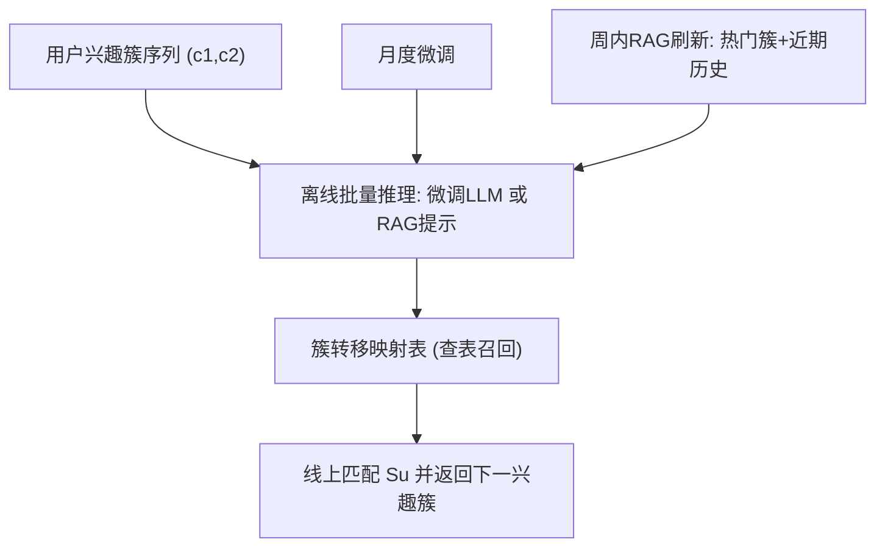
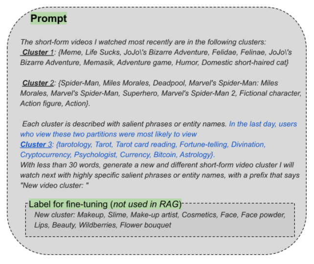
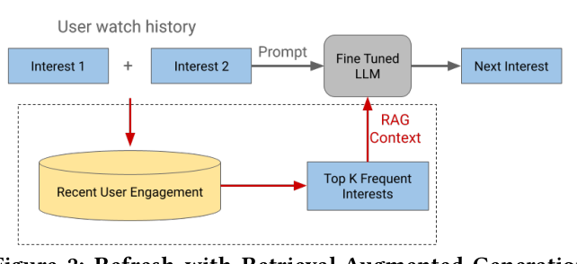

# Balancing Fine-tuning and RAG: A Hybrid Strategy for Dynamic LLM Recommendation Updates (平衡微调与RAG：面向动态LLM推荐更新的混合策略)

- **会议/期刊**: RecSys 2025 (Industry Track)
- **作者与机构**: Changping Meng, Hongyi Ling, Jianling Wang, Yifan Liu, Shuzhou Zhang, Dapeng Hong, Mingyan Gao, Onkar Dalal, Ed Chi, Lichan Hong, Haokai Lu, Ningren Han（Google / Google DeepMind）
- **推荐链路定位**: 端到端生成式（离线预计算兴趣簇转移表 + 在线查表召回）
- **研究方向**: 大语言模型推荐 (LLM4Rec) / 生成式推荐
- **论文原文**: [https://arxiv.org/abs/2510.20260v1](https://arxiv.org/abs/2510.20260v1)
- **开源代码**: 暂未开源

## TL;DR (1分钟核心速览)

本文针对 LLM 推荐系统"初始微调后无法跟上用户兴趣实时漂移"的工业痛点，以十亿级短视频平台的 LLM 兴趣探索系统为案例，系统对比了持续微调与 RAG 在成本、敏捷性、知识注入三方面的权衡，提出**月度微调 + 周内多次 RAG 刷新**的混合更新策略。离线 hit rate 与线上 A/B（Gemini 1.5 底座）显示：Satisfied User Outcomes 相对提升 0.11%（95% CI [0.00%, 0.21%]），Satisfaction Rate 提升 0.25%，Dissatisfaction Rate 与 Negative Interaction 分别下降 0.05% 与 0.04%，在十亿用户规模下统计显著。

## Background & Motivation (背景与核心矛盾)

- **主流范式**: LLM 推荐系统通常先在领域知识与历史交互上做一次（或周期性）微调，将用户兴趣簇序列映射到"下一个新颖兴趣簇"，并因在线服务成本过高而**离线预计算全量簇序列转移表**、线上仅做查表召回。
- **前人局限**: ① 微调成本高、周期以月计，只能捕捉静态快照，无法反映实时兴趣漂移；② 纯 RAG 虽可低成本高频刷新，但缺乏长期领域知识内化，且检索上下文可能引入噪声。
- **核心洞察 (Key Insight)**: 作者用"后继兴趣"（successor interest）稳定性分析量化漂移——对连续三元组 $(c_1,c_2,c_{next})$ 统计 top-5 后继簇的月环比 Jaccard 相似度，均值仅 **0.17（方差 0.07）**，证明主流转移模式月度间剧烈变化，静态微调模型必然过期。
- **本文切入点**: 不做二选一，而是把"长期知识适应"交给低频微调、把"实时趋势注入"交给高频 RAG，形成分层更新节奏。

## Method (核心方法设计)

### 1. 整体框架 (Overall Architecture)

系统输入是用户最近 $k=2$个兴趣簇序列$S_u=\{c_1,c_2\}$，输出为预测的下一个新颖兴趣簇$c_n\in\mathcal{C}$。由于在线逐用户调用 LLM 在十亿规模下不可行，系统对全部$k$长簇序列集合$\mathcal{S}$离线批量推理，生成转移映射表；线上将$S_u$匹配到某个$S\in\mathcal{S}$ 后直接查表召回。更新环节分两条腿：微调腿按月重训模型参数以固化领域知识与任务风格；RAG 腿以天/周级频率，将最新热门簇与用户近期观看历史注入提示词，重新批量推理刷新转移表。二者共享同一提示词骨架（图 1 黑线为微调提示词，蓝线为 RAG 追加的近期历史），保证更新只改变"知识来源"而不改变任务定义。

<figure class="paper-figure" markdown="span">
  <figcaption>图1：新颖兴趣预测的提示词。黑线为微调提示词。新增蓝线为注入近期观看历史的RAG版本。标签仅用于微调，不用于RAG。</figcaption>
</figure>
<figure class="paper-figure" markdown="span">
  <figcaption>图2：基于检索增强生成的刷新。微调每月刷新一次，而RAG在一周内多次刷新。</figcaption>
</figure>

### 2. 关键设计拆解 (Key Designs)

1. **RAG 的粒度与检索相似度设计（决定注入什么知识）**：痛点在于全局提示会把无关簇噪声带入目标簇对。作者对比 instance-level（针对每个簇对检索其 top-1 高频后继簇）与 global-level（全库 top-100 高频对构造统一提示），选择前者；检索相似度上对比 frequency-based（同簇对内高频样本）与 trend-based（频率变化最大样本），实验证明 frequency-based 最优，且上下文只放 top-1 簇即可满足效果，兼顾成本。直觉是：转移预测本质是条件分布估计，条件化到具体簇对的高频统计比全局先验更贴近真实行为。
2. **混合更新节奏（决定何时更新）**：微调按月执行，RAG 刷新可达天级/周内多次。离线对比三种映射：无 RAG 固定映射、每两天 RAG 刷新、仅 day1 计算后冻结。结果显示两种 RAG 版本均优于固定基线，每两天刷新略高；同时 RAG 输出与无 RAG 输出仅 **7.8%** 完全一致（而无 RAG 重复提示的自一致率为 37.5%），说明 RAG 确实实质性改变了生成内容而非仅做复述。
3. **自动化质量门禁与训练目标**：微调样本为 $[(c_1,c_2),c_{next}]$ 的监督式下一簇预测，损失即标准 token 级交叉熵（论文未展开公式）。工业落地关键在于两道自动检查：分区映射生成的 exact match rate 低于 **90%** 则中止流水线；测试集 recall 低于 **1.5%** 则判定失败并转人工排查。该门禁把"模型是否退化"变成可自动拦截的发布条件，是本文最具工程迁移价值的设计之一。

## Experimental Setup & Evaluation Protocol (实验设置与评估协议)

- **数据集与预处理**: 来源为大规模短视频平台的正向观看交互日志；每条序列内对视频簇 ID 去重，剔除长度少于 2 的序列，再构造连续三元组 $(c_1,c_2,c_{next})$ 并统计后继簇频次。论文未披露用户/物品规模与稀疏度统计表（工业场景保密），故此处不列表格。

- **数据划分与防穿越 (Splitting Strategy)**: 采用**时间切分**语义——离线评估按日期滚动生成映射（day1 固定 vs 每两天刷新），线上 A/B 按日期观察 treatment 与 control 的相对差异，天然避免未来信息泄漏。

- **排名评测协议 (Ranking Protocol)**: 非传统 Top-N 排序评测。离线指标为 **hit rate**（预测的下一簇是否出现在真实用户序列中）与 exact match rate；线上为大规模 A/B 的用户级满意度指标，报告均值与 **95% 置信区间**。

- **对比基线与超参设置**: 基线为 (1) 无 RAG 固定映射、(2) 每两天 RAG 刷新、(3) day1 后冻结的 RAG 映射；底座模型为 **Gemini 1.5**，序列长度 $K=2$，RAG 上下文取 top-1 高频簇。

## Key Experimental Results (实验关键数据)

### 1. 主实验对比 (Main Results)

线上 A/B（十亿用户，treatment 为混合更新策略，control 为仅微调）：

| 指标 | 相对变化 | 95% 置信区间 | 结论 |
| :--- | :---: | :---: | :--- |
| Satisfied User Outcomes | **+0.11%** | [0.00%, 0.21%] | 统计显著 |
| Satisfaction Rate | **+0.25%** | [0.01%, 0.48%] | 统计显著 |
| Dissatisfaction Rate | **−0.05%** | [−0.08%, −0.01%] | 显著下降 |
| Negative Interaction | **−0.04%** | [−0.08%, −0.01%] | 显著下降 |

离线 hit rate 对比（图 3a）：

| 映射版本 | 刷新频率 | 相对表现 |
| :--- | :---: | :--- |
| 无 RAG 固定映射 | 不刷新 | 基线（最低） |
| RAG 映射（day1 冻结） | 一次 | 优于基线 |
| RAG 映射（每两天刷新） | 2 天 | **最优（略高于冻结版）** |

### 2. 消融实验 (Ablation Study)

论文以设计维度对比替代传统模块消融：

| 设计维度 | 选项 | 结果 |
| :--- | :--- | :--- |
| RAG 粒度 | instance-level vs. global-level | instance-level 更优（global 引入噪声） |
| 检索相似度 | frequency-based vs. trend-based | frequency-based 最优 |
| 上下文簇数量 | top-1 vs. 更多 | top-1 已足够，成本更低 |
| 更新节奏 | 仅微调 vs. 微调+RAG | 混合策略全面占优 |

### 3. 关键实验发现 (Key Findings)

1. **兴趣漂移是刚性的、可量化的**：top-5 后继兴趣的月环比 Jaccard 仅 0.17，且 top-k 簇重叠随检索日期推进持续下降（图 3b），从数据侧直接证伪"一次微调长期可用"的假设。
2. **RAG 不是复述而是重写**：RAG 输出与无 RAG 输出仅 7.8% 一致，远低于无 RAG 重复提示的 37.5% 自一致率，说明性能增益来自真实的新知识注入，而非解码随机性。
3. **刷新频率存在边际收益递减**：每两天刷新仅比 day1 冻结略高，说明"是否用 RAG"比"多频繁刷新"更关键；这为工业界以更低成本（周级刷新）落地提供了依据，也解释了线上仅在 day1 与 day4 两次刷新即可获得显著收益。

## Highlights & Limitations (亮点、对比与审稿批判)

- **与代表作对比 (vs. Prior Work)**: 与文献 [15] 的纯微调兴趣探索系统相比，本文不改任务定义与提示骨架，仅增加 RAG 知识注入通道与更新节奏分层，属于"最小侵入式"升级；与通用 RAG4Rec 工作相比，本文不追求检索器结构创新，而是把 RAG 定位为**低成本参数外知识刷新机制**，并以十亿级线上指标而非离线 recall 作为最终判据。
- **可迁移亮点**: ① "低频重训 + 高频检索刷新"的分层更新范式可直接迁移到任何离线预计算映射表的 LLM 推荐管线；② exact match rate ≥90%、recall ≥1.5% 的双阈值自动门禁，是把 LLM 流水线纳入 CI/CD 的实用模板。
- **审稿级局限批判**: ① 全文仅 4 页，缺少数据集统计、成本量化（GPU 小时/推理费用）与延迟数据，"cost-effective" 主要靠定性论述；② 线上增益绝对值很小（0.04%–0.25%），虽在十亿规模显著，但缺乏与纯高频微调基线（如周级微调）的直接成本-收益对照，混合策略的最优性尚未被严格证明；③ 单一平台、单一任务（兴趣簇转移）验证，外部效度有限。

## Rating (四维评分)

- **方法创新性 (Novelty)**: ⭐⭐⭐ （机制本身是微调与 RAG 的工程组合，无新模型结构，但"分层更新节奏 + 漂移量化"的问题刻画有工业洞察价值）
- **评估协议与实验扎实度 (Protocol & Experiments)**: ⭐⭐⭐⭐ （十亿用户真实 A/B 并报告 95% CI，离线+线上双验证；扣分在于缺少成本与延迟的定量对照）
- **写作与数学规范度 (Clarity & Rigor)**: ⭐⭐⭐ （4 页短文结构清晰、图表直观，但公式与符号体系极简，关键超参与数据统计披露不足）
- **工业落地与复现价值 (Industrial & Practical Value)**: ⭐⭐⭐⭐⭐ （更新范式与质量门禁可直接复用，代价是未开源且依赖内部平台数据，复现门槛高）

