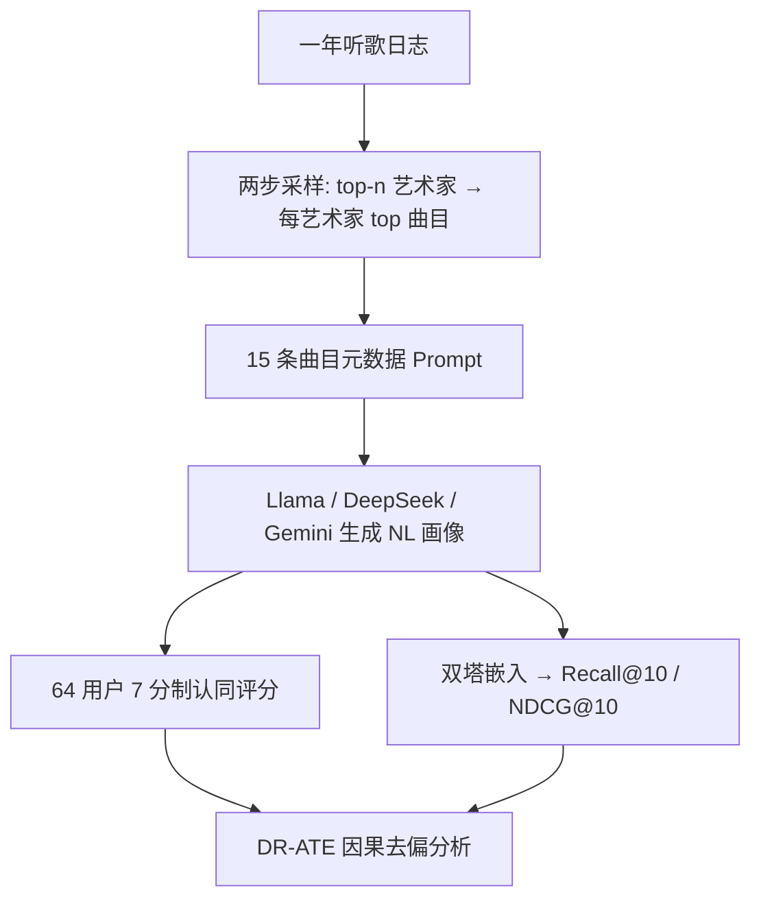

# Biases in LLM-Generated Musical Taste Profiles for Recommendation (LLM 生成音乐品味画像中的偏差研究)

- **会议/期刊**: RecSys 2025
- **作者与机构**: Bruno Sguerra, Elena V. Epure, Manuel Moussallam (Deezer Research); Harin Lee (MPI CBS / MPIEA)
- **推荐链路定位**: 召回（画像作为用户表征用于双塔检索）
- **研究方向**: 大语言模型推荐 / 去偏与公平性
- **论文原文**: [https://arxiv.org/abs/2507.16708v1](https://arxiv.org/abs/2507.16708v1)
- **开源代码**: [https://github.com/deezer/recsys25_llm_biases](https://github.com/deezer/recsys25_llm_biases)

## TL;DR (1分钟核心速览)

LLM 从听歌历史自动生成自然语言品味画像，被视为可解释、可编辑的用户表征新范式，但"用户是否认同"与"画像是否公平"此前无人系统检验。本文在 Deezer 上对 64 名真实用户做在线研究（每人评 12 份自生成 + 5 份他人随机画像），并用双重稳健 (DR) 估计控制品味混淆后度量流派/国别的平均处理效应 (ATE)。核心发现：画像质量主要由 LLM 选型决定（$F(2,1076)=5.16, p=0.006$）而非时间窗口；Rap 内容显著拉低评分、Metal 显著拉高；且用户认同度与下游 Recall@10 仅弱相关，暴露"可解释性"与"算法效用"的错位。

## Background & Motivation (背景与核心矛盾)

- **主流范式**: 用 LLM 将用户消费的物品元数据总结为一段自然语言画像，再经提示或双塔嵌入驱动推荐，替代不可解释的 CF 隐向量。
- **前人局限**: ① 现有工作几乎只评测下游指标（Recall/NDCG），从未验证用户是否"认得自己"；② 音乐场景是隐式反馈且曲库巨大，元数据易超上下文，采样策略与 LLM 固有社会偏见叠加，画像质量可能随用户/物品属性系统性漂移。
- **核心洞察 (Key Insight)**: LLM 虽未直接在交互数据上训练，却继承了预训练语料的文化与流派分布偏差——同一份元数据，不同模型会给出质量迥异的画像。
- **本文切入点**: 把"画像质量"拆成**用户自认同**（7 点 Likert）与**下游相关性**两个维度，用因果推断剥离"用户本就爱听该流派"的混淆，量化真实偏差。

## Method (核心方法设计)

### 1. 整体框架 (Overall Architecture)

研究分三阶段闭环：先用"艺术家-曲目"两步采样从一年听歌日志抽取 top-15 曲目元数据，喂给三个 LLM（Llama 3.2、DeepSeek-R1、Gemini 2.0 Flash）生成画像；再让 64 名用户对 12 份自生成画像 + 5 份随机他人画像打 7 分制认同分；最后将画像与曲目元数据经微调双塔嵌入到共享空间，在留出集上算 Recall@10/NDCG@10，并与用户评分做回归对齐分析。

### 2. 关键设计拆解 (Key Designs)

1. **两步艺术家-曲目采样（解决上下文超限与冗余）**：音乐用户曲库极大且常整张专辑/歌单循环，纯频次采样会因重复收听产生冗余画像。做法是先取窗口内 top-$n$ 艺术家，再取每艺术家最高频曲目，共 15 条。图 1 显示随窗口从 7d 增至 365d，top-15 曲目的 Jaccard 相似度单调上升并趋于平台，说明长窗口采样更稳定，故设 30/90/180/365 天四档窗口做对照。

2. **相对评分 $\delta r_{u,i}$与双重稳健 ATE（剥离品味混淆）**：绝对评分因人而异，故定义$\delta r_{u,i} = r_{u,i} - \mathrm{median}\{r_{u,j}: p_j \in P_u^-\}$，即自画像评分减去该用户对随机他人画像评分的中位数，作为"相对代表性"。为排除"金属迷给金属画像打高分"这类混淆，采用 DR 估计：

$$\mathrm{ATE}=\frac{1}{N}\sum_i\left[\frac{T_i(Y_i-\hat{Y}_1(X))}{PS(X)}+\hat{Y}_1(X)\right]-\frac{1}{N}\sum_i\left[\frac{(1-T_i)(Y_i-\hat{Y}_0(X))}{1-PS(X)}+\hat{Y}_0(X)\right]$$

其中 $T_i$为"某流派占比高于中位数"，$X$含用户长期流派比、画像流派构成、年龄与 GS-score，$\hat{Y}$用梯度提升回归、$PS$ 用逻辑回归，1K 次自助法给 CI。只要结果模型或倾向模型之一正确即一致，比裸线性回归更可信。

3. **训练目标与推理开销**：下游用 bi-encoder 微调，以音乐专用 cross-encoder ranker 为教师蒸馏；每画像以采样曲目为正例、年内未交互曲目为负例，共 100K 三元组，AdamW、1 epoch、batch=10、max_len=512。测试时每用户 10 正 + 1K 负采样排序，5 个随机种子取均值。画像生成是一次性离线调用，在线仅需嵌入检索，开销与常规双塔召回同量级。

## Experimental Setup & Evaluation Protocol (实验设置与评估协议)

- **数据集与预处理**: Deezer 内部数据，64 名参与者（40 男/23 女/1 非二元，22–48 岁），取 2024-04-01 起一年流媒体日志，仅计收听时长 >30s 的流；元数据来自 Music Story。用户特征含 GS-score（专家-通才）、曲目中位排名（主流度）、曲目平均年代、活跃度。

| 数据集 | #Users | #Items | #Interactions | 稀疏度/密度 | 特征/场景说明 |
| :--- | :---: | :---: | :---: | :---: | :--- |
| Deezer 用户研究 | 64 | 全曲库 | 1 年日志 | 极稀疏 | 每用户 12 份画像（3 模型 × 4 窗口）+ 5 份随机负例 |
| 下游训练集 | 64 | — | 100K 三元组 | — | 正例=采样曲目，负例=年内未交互 |

- **数据划分与防穿越 (Splitting Strategy)**: 下游测试集从用户交互中另抽 10 首**未用于画像生成**的曲目作正例，1K 负例均排除训练期已见交互，属时间隔离式留出。
- **排名评测协议 (Ranking Protocol)**: `Sampled Ranking`，正负比 10:1000，报告 Recall@10 与 NDCG@10，5 次随机种子平均。
- **对比基线与超参设置**: 画像生成对比 Llama 3.2 / DeepSeek-R1 / Gemini 2.0 Flash（temperature=0.8，默认上下文）；统计上用双向 ANOVA、Cohen's $d$、5K 次自助法线性回归与 1K 次自助法 DR-ATE，显著性以 95% CI 是否跨零判定。

## Key Experimental Results (实验关键数据)

### 1. 主实验对比 (Main Results)

用户认同评分（$\delta r_{u,i}$ 均值，含 95% CI）与下游指标：

| 模型 | 画像均长(字符) | 平均 $\delta r_{u,i}$ | Recall@10 (%) | NDCG@10 (%) |
| :--- | :---: | :---: | :---: | :---: |
| Llama 3.2 | 638.16±117.54 | **最高（CI 重叠但持续领先）** | 中 | 中 |
| DeepSeek-R1 | 543±153.06 | 中 | 随窗口上升 | 随窗口上升 |
| Gemini 2.0 Flash | 396.43±70.62 | 中 | **随窗口上升最明显** | **随窗口上升最明显** |
| 随机他人画像（负基线） | — | 显著低于自画像 | — | — |

ANOVA：模型主效应 $F(2,1076)=5.16, p=0.0059$显著；时间窗口$F(3,1076)=1.59, p=0.191$与交互项$F(6,1076)=0.28, p=0.947$ 均不显著。

### 2. 消融实验 (Ablation Study)

以 DR-ATE 替代朴素回归作为"去混淆消融"，并对比不同模型对同一元数据的响应差异：

| 分析设置 | Rap | Metal | US 曲目 | Belgium/World | Canada |
| :--- | :---: | :---: | :---: | :---: | :---: |
| 朴素线性系数（含混淆） | 负 | 正 | 正 | 混杂 | 混杂 |
| DR-ATE（去混淆后） | **稳定负** | **稳定正** | 正 | Gemini/DeepSeek 不显著，Llama 下降 | DeepSeek/Llama 正，Gemini CI 跨零 |
| 时间窗口 30→365d | 评分几乎不变 | 同左 | 同左 | 同左 | 同左 |

### 3. 关键实验发现 (Key Findings)

1. **模型选型 >> 数据窗口**：窗口对评分无显著影响（$p=0.191$），而模型间差异显著（$p=0.0059$），说明画像"风格"（Llama 爱点名艺术家、Gemini 简短高层、DeepSeek 纠结"remastered"等元数据）比"看了多长历史"更决定用户是否买账。
2. **流派偏差在去混淆后依然稳健**：Rap 内容在所有模型上 ATE 一致为负、Metal 一致为正，且不同 LLM 对同一 Belgium/World 元数据反应分化（Llama 掉分、另两者无感），指向模型特有的内容表征偏差而非单纯品味对齐。
3. **认同度与效用错位**：$\delta r_{u,i}$ 对 Recall@10/NDCG@10 的回归系数除 DeepSeek 外仅呈弱正相关；且下游指标随窗口变长而升（因测试正例取自整年），与用户评分"窗口无关"的结论方向相反——优化推荐指标未必提升用户信任。

## Highlights & Limitations (亮点、对比与审稿批判)

- **与代表作对比 (vs. Prior Work)**: 相较仅报告下游增益的 LLM 画像工作（如基于 5 条物品的提示总结），本文首次引入 64 人真实用户认同实验；相较常规公平性研究只看敏感属性，本文用 DR-ATE 同时控制品味与曝光混淆，把"相关性"升级为"因果效应"。
- **可迁移亮点**: ① $\delta r_{u,i}$ 相对评分设计可低成本迁移到任何"自生成 vs 随机"的用户研究；② DR-ATE + 自助法 CI 的流程可直接复用于检验任意画像/解释模块的群体偏差。
- **审稿级局限批判**: ① 样本仅 64 人且全部来自同一公司内部，统计功效有限，Rap/Metal 效应可能受小样本与元数据标注质量干扰；② 仅测 3 个 LLM、单一音乐域，结论外推性存疑；③ 下游采用 10:1000 采样排序而非全库 Full-Ranking，Recall 绝对值不可与全库协议直接比较。

## Rating (四维评分)

- **方法创新性 (Novelty)**: ⭐⭐⭐⭐ （首个将用户自认同与 DR 因果 ATE 结合审视 LLM 画像偏差的研究，问题视角新颖，但方法本身为成熟统计工具的巧妙组合）
- **评估协议与实验扎实度 (Protocol & Experiments)**: ⭐⭐⭐ （用户研究 + 下游任务双轨设计扎实，但 64 人样本、采样排序协议与单域限制削弱统计强度）
- **写作与数学规范度 (Clarity & Rigor)**: ⭐⭐⭐⭐ （$\delta r$ 与 ATE 公式定义清晰、CI 报告规范，附录含完整 prompt 与用户反馈，可复现性强）
- **工业落地与复现价值 (Industrial & Practical Value)**: ⭐⭐⭐⭐ （代码与用户研究数据全开源，画像生成离线一次性、在线仅嵌入检索，Deezer 真实场景验证，落地路径明确）

