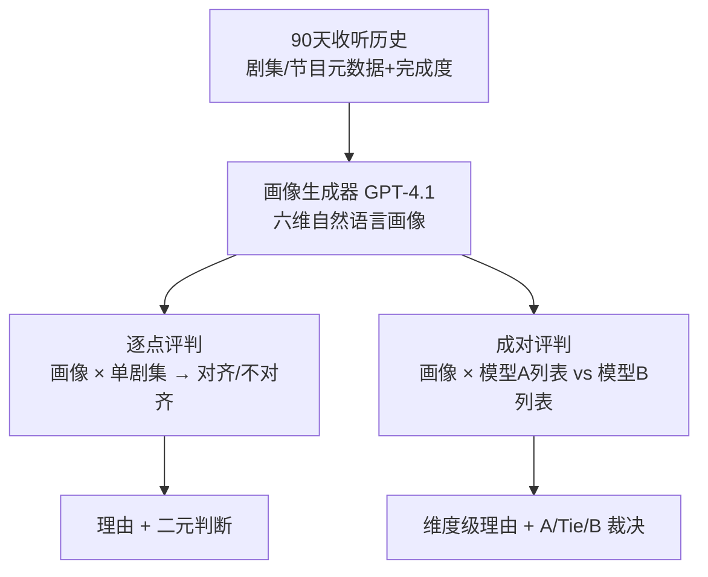
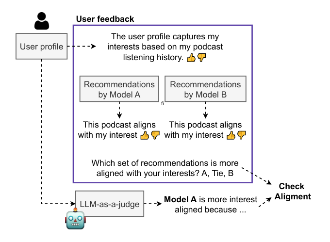

# Evaluating Podcast Recommendations with Profile-Aware LLM-as-a-Judge (面向播客推荐的画像感知 LLM 评判框架)

- **会议/期刊**: RecSys 2025 (Prague)
- **作者与机构**: Francesco Fabbri, Gustavo Penha, Edoardo D'Amico, Alice Wang, Marco De Nadai, Jackie Doremus, Paul Gigioli, Andreas Damianou, Oskar Stål, Mounia Lalmas（全部来自 Spotify）
- **推荐链路定位**: 离线评测 / 模型选择（pre-deployment model selection），不涉及在线服务链路
- **研究方向**: 大语言模型推荐 (LLM4Rec) / 去偏公平与工业架构
- **论文原文**: [https://arxiv.org/abs/2508.08777v1](https://arxiv.org/abs/2508.08777v1)
- **开源代码**: 暂未开源

## TL;DR (1分钟核心速览)

播客推荐面临"离线指标有曝光偏差、A/B 测试昂贵且难以覆盖冷启新场景"的两难，且长音频的隐式反馈（听 10 分钟就停）语义极度模糊。本文提出 **LaaJ（Profile-Aware LLM-as-a-Judge）**：先从用户近 90 天收听元数据蒸馏出自然语言画像（内容偏好 + 收听模式六维），再以零样本 GPT-4.1 做**剧集级逐点**与**模型级成对**两种评判。在 47 名真实用户、277 条剧集标注的对照研究中，LaaJ-Profile 逐点 ROC-AUC 达 0.6442、模型选择一致率 MSA 0.6596，均优于喂原始历史的 LaaJ-History（0.6170）与非 LLM 的 sBERT-Sim（0.5106）。

## Background & Motivation (背景与核心矛盾)

- **主流范式**: 播客推荐依赖离线排序指标（Hit Rate / Recall）做模型选择，上线前辅以人工定性评估，上线后靠 A/B 测试验证。
- **前人局限**: 其一，离线指标只在"用户已曝光物品"上计算，存在严重曝光偏差，且在新货架/新功能等冷启场景下完全失效；其二，A/B 测试慢、贵、可测模型数量受限，无法支撑快速迭代。
- **核心洞察 (Key Insight)**: 搜索有显式 query 作为"内容假设"来锚定相关性判断，而推荐没有——因此评测的本质困难是**缺失一个可解释的用户意图假设**。作者主张该假设可以被显式构造为自然语言画像。
- **本文切入点**: 用 LLM 把收听行为压缩成结构化画像，再让 LLM 以画像为"内容假设"去推理候选剧集的对齐度，从而在离线指标与 A/B 测试之间补上可扩展的中间层。

## Method (核心方法设计)

### 1. 整体框架 (Overall Architecture)

框架分两阶段。**阶段一（画像生成）**：取用户最近 3 个月收听最多的节目与剧集元数据（标题、简介、转写文本、主题标签、收听完成度），由 GPT-4.1 以固定模板输出 JSON 画像，覆盖六个可解释维度——收听习惯、参与深度（略读 vs 深听）、格式偏好（结构化访谈 vs 闲聊）、探索 vs 专精、跨领域好奇心、逐集细粒度兴趣标签。**阶段二（评判）**：将画像与候选剧集元数据一并送入零样本 Judge，以 Chain-of-Thought 先产出理由再给二元判断；模型级比较时对两个模型各 3 条剧集的有序列表做成对裁决（A / Tie / B），并随机打乱 A/B 身份标签以抑制位置偏置。全流程无微调、无后校准。

<figure class="paper-figure" markdown="span">
  <figcaption>图1：LLM-as-a-Judge 评估流程。系统以根据收听历史合成的用户画像和两组推荐剧集为输入，输出剧集级匹配与模型级比较的理由及二元判断。</figcaption>
</figure>

### 2. 关键设计拆解 (Key Designs)

1. **自然语言画像作为显式内容假设（Profile as Content Hypothesis）**：痛点是原始收听序列冗长、噪声大、且隐式反馈语义歧义（听 10 分钟可能是厌恶也可能是被打断），直接喂给 LLM 会稀释信号。本文改为让 LLM 先做一次"有损但语义化"的压缩，把行为痕迹映射到主题、语气、格式、主持人风格等多维偏好上。其有效性直觉在于：评判任务从"从噪声行为中反推意图"退化为"比对两个已语义化的描述"，推理负担大幅下降，同时画像本身可被人审阅、可解释。
2. **逐点 + 成对双模评判与位置去偏**：逐点模式回答"这一集是否契合该用户"，对应传统 relevance 判断；成对模式模拟 A/B 测试，回答"哪一版列表更契合"，对应模型选择。成对时随机交换 A/B 标签，避免 LLM 固有的首位偏好污染结论。两种模式共享同一画像，使"剧集级诊断"与"模型级决策"在同一语义空间内自洽。
3. **训练目标、负采样与推理效率**：本文**无训练损失、无负采样**——Judge 与画像生成器均为零样本调用，评测成本即两次 LLM 推理（一次画像、N 次评判），画像可离线缓存复用，因此对同一用户评测多个候选模型时边际成本仅为评判调用。这既是其可扩展性的来源，也是其无法针对领域校准的根源。

## Experimental Setup & Evaluation Protocol (实验设置与评估协议)

- **数据集与预处理**: 采用 Spotify 真实用户对照研究，非公开基准。47 名参与者，每人由系统自动生成画像，随后展示两个匿名模型各 3 条剧集（含节目名、简介、封面、可播放片段），共收集 **277 条逐点人工标注**（覆盖 227 个唯一剧集，人均 5.89 条）与 **47 条模型级比较**（每人一次）。

| 数据对象 | 规模 | 说明 |
| :--- | :---: | :--- |
| 参与用户 | 47 | 真实 Spotify 用户，画像由 90 天历史生成 |
| 逐点标注 | 277 | 5 点 Likert，二值化为对齐/不对齐 |
| 模型级比较 | 47 | 每人一次 A/B/Tie 三选一 |
| 唯一剧集 | 227 | 人均 5.89 条标注 |
| 对比模型 | 2 | Model A 偏内容侧；Model B 偏协同过滤侧 |

- **数据划分与防穿越 (Splitting Strategy)**: 无训练/测试划分（零样本评测），画像仅使用标注时点之前的 90 天历史，天然避免未来信息泄漏。
- **排名评测协议 (Ranking Protocol)**: 非传统 Full-Ranking 或 Sampled Ranking，而是**人工标注对齐的二分类/三分类一致性协议**。指标为 ROC-AUC（逐点）、MSA 模型选择一致率（成对）、W/T/L 胜负平计数、RSM 强错配召回率。
- **对比基线与超参设置**: 三个 judge——LaaJ-Profile（本文）、LaaJ-History（喂完整原始历史，消融画像压缩的价值）、sBERT-Sim（Sentence-BERT 画像-剧集余弦相似度，阈值 0.5 判对齐，非 LLM 基线）。画像生成与评判统一使用 GPT-4.1，静态提示模板，无微调、无后校准。

## Key Experimental Results (实验关键数据)

### 1. 主实验对比 (Main Results)

| Judge | ROC-AUC ↑ | MSA ↑ | W/T/L vs. 人工 | RSM ↑ |
| :--- | :---: | :---: | :---: | :---: |
| **LaaJ-Profile (本文)** | 0.6442 | **0.6596** | 30/1/16 | **0.6667** |
| LaaJ-History | **0.6476** | 0.6170 | 28/1/18 | **0.6667** |
| sBERT-Sim | 0.4871 | 0.5106 | 21/3/23 | 0.5000 |

逐点混淆矩阵显示 LaaJ-Profile 与人工总体一致率约 **75%**，但存在 **17%** 的假阳性（LLM 判对齐而用户判不对齐），印证 LLM 正向偏置。成对侧，24 次 LLM 判 A 中有 20 次与人工一致（真阳率极高），但 LLM 仅给出 **1 个 Tie**，而人工给出 **8 个 Tie**，说明 Judge 过度果断。

### 2. 消融实验 (Ablation Study)

| 配置 | ROC-AUC | MSA | 结论 |
| :--- | :---: | :---: | :--- |
| LaaJ-Profile（完整） | 0.6442 | 0.6596 | 基准 |
| w/o 画像压缩（LaaJ-History） | 0.6476 | 0.6170 | 逐点持平，成对掉 4.3 pt |
| w/o LLM 推理（sBERT-Sim） | 0.4871 | 0.5106 | 全面崩塌，接近随机 |
| 画像源 5 集 → 20 集 | 0.51 → 0.59 | — | 上下文越丰富越准，+8% |

### 3. 关键实验发现 (Key Findings)

1. **画像压缩在成对判断上净赚、在逐点上不亏**：LaaJ-Profile 逐点 ROC-AUC 与喂原始历史的 LaaJ-History 几乎持平（0.6442 vs. 0.6476），但模型级 MSA 提升 4.3 个百分点（0.6596 vs. 0.6170）。说明"多面兴趣的摘要"对**跨模型比较**这类需要整体把握的任务尤为关键，而对单条剧集的局部判断，原始细节与摘要信息量相当。
2. **非 LLM 语义相似度完全不可用**：sBERT-Sim 的 ROC-AUC 仅 0.4871、MSA 0.5106，均贴近随机猜测，且 W/T/L 为 21/3/23。这直接证明"画像-剧集嵌入余弦相似"无法替代多维权衡推理，LLM 的推理环节是性能的必要条件而非装饰。
3. **画像覆盖度是性能的单调驱动因子，但用户对画像深度的满意度分化**：画像所用剧集数从 5 增至 20，与人工一致率从 0.51 升至 0.59（+8%）；然而问卷显示用户普遍认可画像的"高层概括"，却对"是否抓住深层兴趣"意见分裂，反馈集中于缺失喜爱主持人、语气风格刻画不足、主题受近期收听过度影响。这揭示了**近期性 vs. 长期兴趣**的固有张力。

## Highlights & Limitations (亮点、对比与审稿批判)

- **与代表作对比 (vs. Prior Work)**: 相较 Zheng et al. 的通用 LLM-as-a-Judge 偏好数据集与 Gu et al. 的评测综述，本文把该范式首次落到**个性化排序**而非对话质量；相较 Dong et al. 的 persona-conditioned 评判，本文的画像**由行为痕迹自动蒸馏**而非人工撰写，且任务从对话评估转为推荐列表比较；相较 Jones et al. 指出的播客离线评测空白，本文给出了可运行的框架与真实用户验证。
- **可迁移亮点**: 其一，"行为 → 自然语言画像 → LLM 推理"的两级压缩范式可低成本迁移到短视频、长文档、电商等长内容域，尤其适合新货架冷启前的模型预筛；其二，成对评判时随机打乱模型身份标签是抑制位置偏置的零成本工程技巧，可直接复用。
- **审稿级局限批判**: 其一，**样本量与外推性存疑**——仅 47 名用户、277 条标注、单一平台单一内容域，且无跨 judge 模型（如 Claude / Llama）的鲁棒性对比，结论的统计效力有限；其二，**Judge 系统性偏置未处理**——17% 假阳性与"几乎不给 Tie"的过度果断会系统性高估模型质量，作者亦承认未做偏置校准，仅留作未来工作；此外全流程依赖 GPT-4.1 闭源调用，成本与可复现性对学术界不友好。

## Rating (四维评分)

- **方法创新性 (Novelty)**: ⭐⭐⭐ （把"内容假设"这一 IR 概念显式化为自然语言画像来驱动 LLM 评判，思路清晰且切中推荐评测痛点，但技术组件本身均为现成 LLM 零样本调用，缺少机制层面的新算子）
- **评估协议与实验扎实度 (Protocol & Experiments)**: ⭐⭐⭐ （有真实用户对照研究与多指标设计，消融干净；但 47 人规模偏小、单平台单域、无跨 judge 模型验证、无显著性检验，外推性受限）
- **写作与数学规范度 (Clarity & Rigor)**: ⭐⭐⭐⭐ （问题动机层层递进、图示与提示模板完整透明、指标定义明确；但全文无形式化建模，属系统/实证类论文而非方法推导类）
- **工业落地与复现价值 (Industrial & Practical Value)**: ⭐⭐⭐⭐ （直接来自 Spotify 生产场景，画像可缓存、评判可并行，天然适配上线前模型预筛；扣分在于闭源模型依赖与代码未开源）

