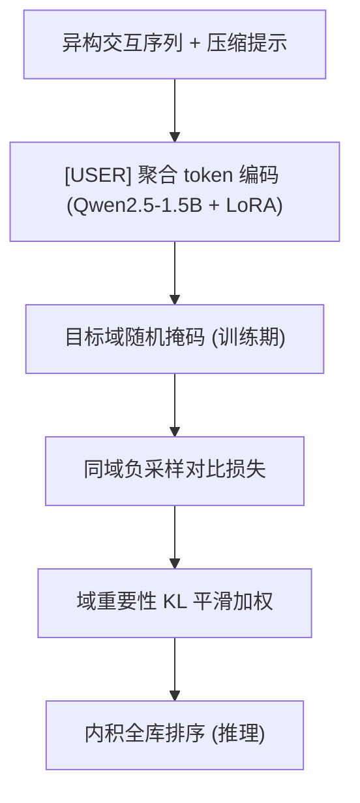
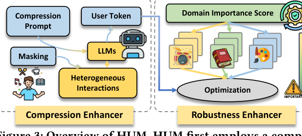

# Heterogeneous User Modeling for LLM-based Recommendation (面向LLM推荐的异构用户建模)

- **会议/期刊**: RecSys 2025
- **作者与机构**: Honghui Bao, Wenjie Wang, Xinyu Lin, Fengbin Zhu, Teng Sun, Fuli Feng, Tat-Seng Chua（NUS / USTC / 山东大学）
- **推荐链路定位**: 召回（语义表征 + 内积全库排序）
- **研究方向**: 大语言模型推荐 / 跨域与多场景推荐
- **论文原文**: [https://arxiv.org/abs/2507.04626v2](https://arxiv.org/abs/2507.04626v2)
- **开源代码**: [https://github.com/HonghuiBao2000/HUM](https://github.com/HonghuiBao2000/HUM)

## TL;DR (1分钟核心速览)

开放域推荐要求 LLM 从用户跨多域的异构行为中抽取偏好，但直接喂入混合序列反而掉点（图2(a)），且训练被信息量大的域主导，出现"域跷跷板"（图2(b)：Auto 域 +27.4% 时 Scientific 域 -15.1%）。HUM 用压缩提示 + 专用 `[USER]` 聚合 token 把异构序列压成单一用户向量，配合目标域随机掩码逼模型跨域取信息；再用基于经验风险的域重要性分数做 KL 平滑加权。在 Amazon 六域、`Full-Ranking` 协议下，R@10 全面超越 Recformer/LLM-Rec，Books 域 R@10 达 0.0667（较 LLM-Rec 相对提升约 34%）。

## Background & Motivation (背景与核心矛盾)

- **主流范式**: 多域推荐分两支——ID-based（SASRec/STAR/SyNCRec/UniCDR）靠 ID embedding 学用户表征；semantic-based（UniSRec/Recformer/LLM-Rec）把物品标题拼成文本序列，取 LLM 末层 `[EOS]` 隐向量作用户表征，内积打分。
- **前人局限**: ① ID-based 依赖充足交互，冷启动泛化差；② semantic-based 只做"整体语义摘要"，没有显式训练去过滤与目标域无关/冲突的噪声交互，表征被稀释；③ 多域联合训练时信息量大的域主导损失下降，产生域跷跷板。
- **核心洞察 (Key Insight)**: 作者实测发现，直接把异构序列喂给 Qwen 版 LLM-Rec 反而比单域序列更差——LLM 本身不会"压缩"异构信息，且强 backbone 会放大域间不平衡。因此异构用户建模需要两个显式能力：**强压缩**与**强鲁棒**。
- **本文切入点**: 不改 LLM 结构，而是用"提示 + 专用聚合 token + 掩码"赋予压缩能力，用"域重要性平滑加权"赋予鲁棒性。

## Method (核心方法设计)

### 1. 整体框架 (Overall Architecture)

用户输入为 `{压缩提示, 历史物品标题 t1..tL, [USER]}`，物品输入为 `{压缩提示, 标题 tv, [USER]}`，二者共享同一 LLM（Qwen2.5-1.5B + LoRA）编码，取 `[USER]` 末层隐向量作表征，内积 + 同域负采样对比学习训练；训练时对目标域历史物品按比例 $r$随机掩码，并按域重要性$w_i$ 加权各域损失；推理时关闭掩码，对目标域全库物品算内积排序。

<figure class="paper-figure" markdown="span">
  <figcaption>图3：HUM概览。HUM首先采用压缩增强器压缩异构用户行为。随后，它应用鲁棒性增强器以缓解领域冲突（即领域跷跷板现象）。</figcaption>
</figure>

### 2. 关键设计拆解 (Key Designs)

1. **压缩提示 + `[USER]` 聚合 token**：痛点在于 `[EOS]` 预训练语义是"终止符"而非"信息聚合器"，直接拿来当表征载体在异构输入下会引入噪声。本文插入专用 `[USER]` 作为显式聚合锚点，并用提示 "Compress the following description about the user or item into the last token:" 借 LLM 指令跟随能力做有监督压缩，表征为 $\boldsymbol{e}_u=\mathrm{LLM}(X_u)$、$\boldsymbol{e}_v=\mathrm{LLM}(X_v)$。直觉：把"摘要"从隐式副产物变成显式训练目标，锚点 token 不被噪声 token 稀释。

2. **目标域掩码机制**：随机遮蔽用户历史中目标域物品（比例 $r$），$X'_u\leftarrow \mathrm{Mask}(X_u,r)$。迫使模型从其他域的交互中挖掘可迁移信号，从而在无显式监督下学会区分"有用跨域上下文"与"噪声"。消融显示掩码在 Books/CDs 上贡献显著，且$r$ 存在甜点（约 20%–30%），过高则目标域信息丢失。

3. **域重要性平滑加权（鲁棒增强器）**：以各域平均损失定义重要性 $DI_i=\mathcal{L}(d_i,\theta)/\sum_j\mathcal{L}(d_j,\theta)$，欠优化域权重更高。直接使用会因稀疏域损失高方差而不稳，故加 KL 正则$\min_w\sum_i w_i\mathcal{L}(d_i,\theta)+\frac{1}{\alpha}\mathrm{KL}(\boldsymbol{w},\boldsymbol{w}^{t-1})$，KKT 闭式解为
$$w_i^{t}=w_i^{t-1}\cdot\frac{\exp(\alpha\cdot\mathcal{L}(d_i,\theta))}{\sum_j w_j^{t-1}\cdot\exp(\alpha\cdot\mathcal{L}(d_j,\theta))}$$
最终损失 $\mathcal{L}_{\mathrm{HUM}}=\sum_i w_i\cdot\mathcal{L}(d_i,\theta)$。直觉：把"域采样比例"变成随训练动态自适应的软课程，抑制富域霸权。

4. **训练目标与推理开销**：基础损失为同域 $N=10$负样本的 softmax 对比损失$\mathcal{L}=-\sum_{i=1}^{B}\log\frac{\exp(\langle\boldsymbol{e}^i_u,\boldsymbol{e}_{v^+}\rangle)}{\exp(\langle\boldsymbol{e}^i_u,\boldsymbol{e}_{v^+}\rangle)+\sum_{j=1}^{N}\exp(\langle\boldsymbol{e}^i_u,\boldsymbol{e}_{v_j}\rangle)}$；负采样为同域均匀采样（非 in-batch、非 hard negative）。推理需对目标域全部物品前向编码一次，属"每物品一次 LLM 前向"的重开销范式，是其主要工程瓶颈。

## Experimental Setup & Evaluation Protocol (实验设置与评估协议)

- **数据集与预处理**: Amazon Review 六域（Scientific/Office/Books/CDs/Auto/Tools），按域间相似度挑选以兼顾"强相似 + 强差异"；`5-core` 过滤，每域采样 10,000 用户，历史截断至 10。

| 数据集 | #Users | #Items | 交互规模 | 说明 |
| :--- | :---: | :---: | :---: | :--- |
| Books / Office / Scientific / CDs / Auto / Tools | 各 10,000 | 各域全量 | 每用户 ≤10 条历史 | 六域异构，含强相似与强差异域对 |
| 冷域（Instruments/Games/Arts/Sports） | 各 10,000 | — | — | 仅用于泛化测试，不参与训练 |

- **数据划分与防穿越 (Splitting Strategy)**: 采用 Amazon 两个**绝对时间戳**做全局时间切分（非 Leave-One-Out），训练/验证/测试按时间先后，避免未来交互泄漏。
- **排名评测协议 (Ranking Protocol)**: 无偏 `Full-Ranking`——在目标域**全部物品**中对真值物品排序，非采样排序；指标 Recall@{5,10}、NDCG@{5,10}。
- **对比基线与超参**: ID-based（SASRec、STAR、SyNCRec、UniCDR）与 semantic-based（IDGenRec、UniSRec、Recformer、LLM-Rec）共 8 个基线；backbone Qwen2.5-1.5B + LoRA，学习率 {1e-5, 2e-5, 5e-5}，batch size 2，50 epochs，early stopping patience 5，4×RTX A5000。

## Key Experimental Results (实验关键数据)

### 1. 主实验对比 (Main Results)

六域 R@10 / N@10（节选代表性基线，完整见原文 Table 1）：

| 域 | 指标 | Recformer | LLM-Rec | HUM | Improv.(vs LLM-Rec) |
| :--- | :---: | :---: | :---: | :---: | :---: |
| Books | R@10 | 0.0513 | 0.0497 | **0.0667** | +34.2% |
| Books | N@10 | 0.0261 | 0.0243 | **0.0322** | +32.5% |
| Office | R@10 | 0.0136 | 0.0120 | **0.0155** | +29.2% |
| Scientific | R@10 | 0.0191 | 0.0238 | **0.0246** | +3.4% |
| CDs | R@10 | 0.0121 | 0.0143 | **0.0161** | +12.6% |
| Auto | R@10 | 0.0116 | 0.0106 | **0.0153** | +44.3% |
| Tools | R@10 | 0.0078 | 0.0074 | **0.0098** | +32.4% |

ID-based 全线溃败（如 STAR 在 CDs 上 R@10 = 0.0000），印证语义表征在长尾稀疏场景的优势。

### 2. 消融实验 (Ablation Study)

| 变体 | Scientific R@10 | Books R@10 | CDs R@10 | Tools R@10 |
| :--- | :---: | :---: | :---: | :---: |
| (0) HUM | **0.0246** | **0.0667** | **0.0161** | 0.0098 |
| (1) w/o prompt | 0.0223 | 0.0595 | 0.0105 | 0.0097 |
| (2) w/o user token | 0.0236 | 0.0539 | 0.0149 | **0.0104** |
| (3) w/o prompt & user token | 0.0217 | 0.0563 | 0.0136 | 0.0091 |
| (4) w/o mask | 0.0239 | 0.0667 | 0.0155 | 0.0113 |

### 3. 关键实验发现 (Key Findings)

1. **压缩提示是最大单点贡献**：去掉提示后 CDs R@10 从 0.0161 跌至 0.0105（-34.8%），Books 从 0.0667 跌至 0.0595，说明"显式指令压缩"比换 token 更关键；而 `[USER]` token 在 Books 上单独去掉即掉 19.2%，二者互补。
2. **掩码与 token 存在域间权衡**：去掉掩码在 Tools 上反而升到 0.0113、Auto 的 N@10 也略升，说明掩码收益依赖目标域与其他域的信息互补度，并非全域普适；掩码比例 $r$ 存在甜点（约 20%–30%），过高则目标域信息损失反噬。
3. **鲁棒性与泛化双验证**：图7 显示 HUM w/o DI 仍优于 LLM-Rec-Qwen，加上 DI 后六域曲线更平（缓解跷跷板）；冷域测试中 HUM 在 Games R@10 达 0.0094（LLM-Rec-Qwen 0.0074），且"有效压缩比单纯增大模型"更能带来泛化；噪声注入 20%→100% 时 HUM 始终高于 LLM-Rec-Qwen，且十域设置下相对提升幅度大于两域，说明异构度越高收益越大。

## Highlights & Limitations (亮点、对比与审稿批判)

- **与代表作对比 (vs. Prior Work)**: 相比 LLM-Rec（BERT/OPT 取 `[EOS]` 做整体语义摘要），HUM 把"压缩"变成显式训练目标并加掩码去噪；相比 Recformer（token 级用户注意力 + 序列之序列），HUM 用单 token 聚合大幅降低表征维度与噪声敏感度；相比 UniCDR 等 ID-based 跨域方法，HUM 不依赖重叠用户与充足交互，天然适配冷域。
- **可迁移亮点**: ① "专用聚合 token + 压缩提示"可平移到任何用 LLM 做用户/物品表征的召回任务；② 域重要性 KL 平滑加权是一套与模型无关的通用多任务/多场景损失加权方案，可直接替换 MMoE 类门控的辅助损失权重。
- **审稿级局限批判**: ① 推理需对目标域每个物品做一次 LLM 前向，全库排序的在线延迟与算力成本极高，论文未给出延迟/吞吐数据；② 域重要性依赖"平均损失"作代理，与真实域性能未必单调相关，且 $\alpha$、掩码率$r$、域划分粒度均需调参，缺少敏感性系统分析；③ 仅在 Amazon 评论文本域验证，缺少工业级行为日志与线上 A/B。

## Rating (四维评分)

- **方法创新性 (Novelty)**: ⭐⭐⭐⭐ （把"压缩"从隐式副产物变为显式提示+锚点 token 训练目标，并用域重要性平滑加权治跷跷板，思路清晰但组件均为已有技术的巧妙组合）
- **评估协议与实验扎实度 (Protocol & Experiments)**: ⭐⭐⭐⭐ （六域 + 四冷域 + 噪声注入 + 可扩展性 + 全库排序，覆盖全面；但缺显著性检验与延迟实测）
- **写作与数学规范度 (Clarity & Rigor)**: ⭐⭐⭐⭐ （公式简洁、KKT 闭式解推导完整，符号统一；压缩机制缺乏理论分析，作者亦在 Future Work 中承认）
- **工业落地与复现价值 (Industrial & Practical Value)**: ⭐⭐⭐ （代码已开源、LoRA 微调成本可控，但每物品一次 LLM 前向的推理开销是召回上线的硬约束）

