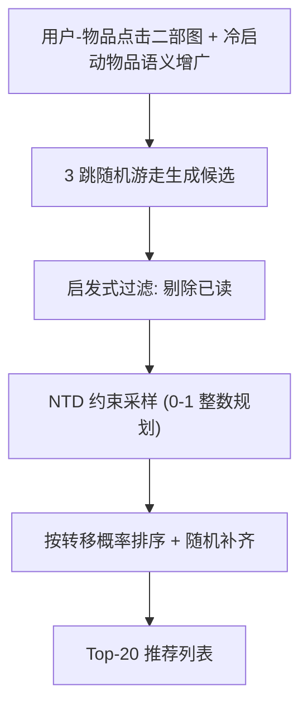
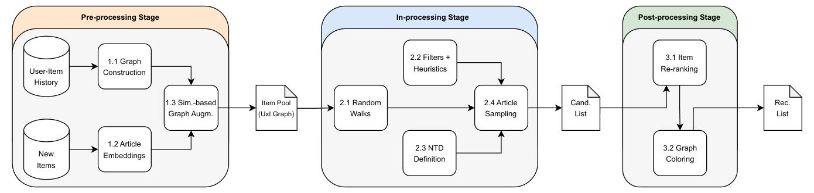

# D-RDW: Diversity-Driven Random Walks for News Recommender Systems (多样性驱动的随机游走新闻推荐)

- **会议/期刊**: RecSys 2025
- **作者与机构**: Runze Li, Lucien Heitz, Oana Inel, Abraham Bernstein（苏黎世大学信息学系）
- **推荐链路定位**: 重排（含 in-processing 候选生成）
- **研究方向**: 多任务学习与列表级重排 / 去偏公平与可信推荐
- **论文原文**: [https://arxiv.org/abs/2508.13035v1](https://arxiv.org/abs/2508.13035v1)
- **开源代码**: [https://github.com/recommenders-team/recommenders](https://github.com/recommenders-team/recommenders)（论文正文另给出 Informfully/Experiments 参考实现）

## TL;DR (1分钟核心速览)

新闻推荐中多样性优化长期被放在后处理重排阶段，只能对候选列表做局部调整，且无法让编辑以可解释方式注入"规范价值"。本文提出 D-RDW，把"规范目标分布 (NTD)"写成线性约束，嵌入随机游走的候选采样环节，用二元整数规划求解满足情感/党派配额的推荐列表。在 EB-NeRD small 全库排序协议下，D-RDW 在 RADio 规范多样性、Gini/ILD 传统多样性上全面进入前三，而训练与推理能耗比神经模型低一个数量级（2.81 vs 326.55 Ws 训练，11.76 vs 63.23 Ws 推理）。

## Background & Motivation (背景与核心矛盾)

- **主流范式**: 新闻推荐的多样性几乎全部通过后处理重排实现（G-KL、PM-2、MMR 等），在神经模型（NRMS/LSTUR/NPA）输出的候选列表上做二次调整。
- **前人局限**: 其一，重排只能看到候选列表而非全库，多样性优化被"候选截断"锁死；其二，传统随机游走（$RP^3\beta$、RWE-D）虽能兼顾准确性与多样性，但参数只暴露图结构属性（跳数、节点度），无法让编辑指定"要多少比例的反对党报道"这类内容维度。
- **核心洞察 (Key Insight)**: 若把编辑的规范诉求表达为物品属性上的目标分布，则"选哪些物品"就退化为一个带线性约束的 0-1 整数规划，随机游走只负责提供候选与采样目标函数。
- **本文切入点**: 在随机游走管线中新增 NTD 采样步骤，把多样性从"事后修补"前移为"模型内生约束"，同时保持白盒可解释与轻量。

## Method (核心方法设计)

### 1. 整体框架 (Overall Architecture)

D-RDW 分三阶段：预处理阶段用用户-物品二部图建模点击关系，冷启动物品通过语义嵌入（all-mpnet-base-v2）找最相似的 3 个已入图物品并继承其用户连边完成图增广；处理中阶段执行 3 跳随机游走得到候选，施加启发式过滤（剔除用户历史已读），再按 NTD 做约束采样；后处理阶段按转移概率或预测分排序，不足配额时随机补齐，可选图着色算法保证列表内类别分布均匀（仅用于在线可视化，不干扰离线多样性）。训练与推理全程无梯度，仅需 CPU。

<figure class="paper-figure" markdown="span">
  <figcaption>图1：D-RDW 流程包含三个阶段：1）用于图构建的预处理阶段，2）用于生成候选列表的处理中阶段，3）用于创建推荐列表的后处理步骤。</figcaption>
</figure>

### 2. 关键设计拆解 (Key Designs)

1. **规范目标分布 NTD 的线性约束建模**：痛点是编辑只能调图参数、无法表达内容诉求。本文将每个属性维度写成指示矩阵行，与选择向量 $\boldsymbol{X}\in\{0,1\}^{|\mathcal{I}|}$ 相乘构成等式约束：

$$\begin{bmatrix}\boldsymbol{I}^\top\\ \boldsymbol{P}^\top\\ \boldsymbol{S}^\top\end{bmatrix}\boldsymbol{X}=\begin{bmatrix}20\\ 15\\ 10\end{bmatrix}$$

其中 $\boldsymbol{I}$为全 1 向量（控制列表长度 20），$\boldsymbol{P}_i=1$表示物品$i$涉政、$\boldsymbol{S}_i=1$ 表示情感为正。物理直觉：把"配额"翻译成线性方程组，使多样性目标从不可控的黑盒打分变成可审计的硬约束。

2. **带采样目标的约束满足求解**：线性方程组多解时，引入可选目标 $\max\sum_i c_i x_i$，默认$c_i$ 取随机游走转移概率（亦可换成时效性等任意数值特征），从而在满足配额的前提下最大化相关性。若无法凑满 20 条，则迭代将目标规模减 1，寻找满足 NTD 比例的最大子集——这一"软降级"机制避免了约束不可行时整体失败。

3. **训练目标、负采样与推理效率**：D-RDW 无参数、无损失函数、无负采样，全部"训练"仅为构图与图增广；推理为随机游走 + 整数规划采样 + 排序，单用户 20 条推荐平均 11.76 Ws，比 NRMS 的 63.23 Ws 低约 5.4 倍，比训练侧低两个数量级。同一 NTD 采样器可剥离为独立重排器，直接挂到神经模型输出上（G-KL/PM-2 即复用该采样逻辑）。

## Experimental Setup & Evaluation Protocol (实验设置与评估协议)

- **数据集与预处理**: RecSys 2024 Challenge 的 EB-NeRD small（丹麦新闻），测试集 15,339 用户，全库 4,400+ 文章。情感用 XLM-RoBERTa 打分为 $[-1,1]$ 后离散为 4 桶（20%/30%/30%/20%）；党派按提及划分为政府党 15%、反对党 15%、两者兼有 15%、独立/外国党 15%、无党派 40%。类别维度刻意不纳入 NTD，用于检验 NTD 采样的外溢效应。

| 数据集 | #Users | #Items | #Interactions | 稀疏度/密度 | 特征/场景说明 |
| :--- | :---: | :---: | :---: | :---: | :--- |
| EB-NeRD small (test) | 15,339 | 4,400+ | 每会话中位 11 曝光 / 1 点击 | 极稀疏 | 丹麦新闻，含情感与党派标注 |

- **数据划分与防穿越 (Splitting Strategy)**: 沿用官方 Challenge 划分，直接使用 test split 的 impression 记录，不做额外时间切分。
- **排名评测协议 (Ranking Protocol)**: 采用**全库排序**——从 4,400+ 文章池中排序取 Top-20，而非仅在会话内 11 条曝光中排序。作者明确指出该设定下准确率指标不可比，故仅对基座模型报告 AUC，多样性指标（RADio、Gini、ILD）在 Top-20 上计算。
- **对比基线与超参设置**: 神经基座 LSTUR / NPA / NRMS（原超参，AUC 均未超 0.6），各自叠加 G-KL / PM-2 / MMR 三种 NTD 重排；随机游走基线 $RP^3\beta$、RWE-D（均 3 跳、冷启动物品连 3 个最相似物品的用户）；Random 基线。能耗按 CPU 125W / GPU 450W 折算瓦秒。

## Key Experimental Results (实验关键数据)

### 1. 主实验对比 (Main Results)

| 模型 | 重排 | Act.↑ | Repr.↑ | Sent. Gini↓ | Party Gini↓ | Sent. ILD | Party ILD | 训练能耗(Ws)↓ | 推理能耗(Ws)↓ | AUC |
| :--- | :--- | :---: | :---: | :---: | :---: | :---: | :---: | :---: | :---: | :---: |
| NTV（目标值） | — | 1.000 | 1.000 | 0.000 | 0.000 | 0.779 | 0.789 | — | — | 1.000 |
| NRMS | — | 0.204 | 0.362 | 0.544 | 0.880 | 0.624 | 0.326 | 326.55 | 63.23 | 0.549 |
| NRMS | G-KL | 0.307 | 0.544 | **0.133** | **0.250** | **0.779** | **0.789** | 326.55 | 30.15 | — |
| NRMS | PM-2 | **0.316** | 0.544 | 0.150 | **0.250** | 0.776 | **0.789** | 326.55 | 23.86 | — |
| NRMS | MMR | 0.315 | 0.571 | 0.204 | 0.270 | 0.767 | 0.807 | 326.55 | 52.36 | — |
| LSTUR | — | 0.190 | 0.372 | 0.645 | 0.874 | 0.552 | 0.343 | 351.12 | 69.84 | 0.564 |
| $RP^3\beta$ | — | 0.222 | 0.376 | 0.755 | 0.856 | 0.439 | 0.392 | **2.75** | **1.27** | **0.565** |
| RWE-D | — | 0.256 | 0.372 | 0.802 | 0.842 | 0.377 | 0.433 | 3.15 | 0.27 | 0.554 |
| **D-RDW** | — | 0.374 | **0.556** | **0.133** | **0.250** | 0.810 | **0.789** | 2.81 | 11.76 | 0.554 |
| Random | — | 0.180 | 0.366 | 0.634 | 0.873 | 0.564 | 0.346 | — | 0.50 | 0.500 |

### 2. 消融实验 (Ablation Study)

原文未设传统"逐模块移除"消融，而是以**NTD 维度留出**与**采样器迁移**两种方式做等价验证：

| 配置 | Cat. Calib.↓ | Sent. Gini↓ | Party Gini↓ | 说明 |
| :--- | :---: | :---: | :---: | :--- |
| D-RDW 完整 NTD | 0.407 | 0.133 | 0.250 | 情感+党派双约束 |
| 神经基座（无 NTD） | 0.433–0.509 | 0.544–0.645 | 0.874–0.880 | 无任何约束 |
| 神经基座 + NTD 重排 | 0.433–0.483 | 0.133–0.226 | 0.250–0.270 | 仅后处理施加 NTD |
| D-RDW（类别维度未入 NTD） | 0.407 | — | — | 检验外溢效应 |

### 3. 关键实验发现 (Key Findings)

1. **NTD 是多样性的主导因子，而非模型架构**：只要施加同一 NTD，无论 D-RDW 还是 NRMS+G-KL，Sent./Party Gini 都从 0.54–0.88 骤降至 0.133/0.250，恰好命中 NTV 目标值；未施加 NTD 的 $RP^3\beta$/RWE-D 虽同为随机游走，Gini 仍高达 0.755–0.802。这说明增益来自约束采样而非图传播本身。
2. **in-processing 优于 post-processing 的边界在"候选覆盖"**：D-RDW 的 Activation 达 0.374，高于所有重排变体（0.282–0.316），因为它在全库候选上采样；而重排器受限于神经模型 Top-N 候选，Repr. 最高仅 0.575，D-RDW 为 0.556 且能耗仅为其 1/3–1/5。
3. **能耗优势是数量级的，且准确率不塌陷**：D-RDW 训练 2.81 Ws、推理 11.76 Ws，比 NRMS 训练低 116 倍、推理低 5.4 倍；AUC 0.554 与 NPA 持平、仅比最优 $RP^3\beta$（0.565）低 0.011，在新闻这种 AUC 普遍低于 0.6 的困难域内属可接受折衷。

## Highlights & Limitations (亮点、对比与审稿批判)

- **与代表作对比 (vs. Prior Work)**: 相比 $RP^3\beta$/RWE-D，D-RDW 首次把内容属性（情感、党派）纳入游走约束，从"只能调图参数"升级为"可指定内容配额"；相比 G-KL/PM-2/MMR 等重排器，它把多样性优化前移到候选生成，突破候选截断天花板；相比 NRMS 等神经模型，它以两个数量级更低的能耗换取可解释的白盒决策链。
- **可迁移亮点**: 其一，"配额即线性约束 + 整数规划采样"的范式可直接迁移到电商多属性供给均衡（如品牌/价格带配额）与短视频创作者扶持；其二，NTD 采样器可剥离为即插即用重排模块，挂载到任意黑盒召回/精排输出之后，改造成本极低。
- **审稿级局限批判**: 其一，评估仅覆盖单一数据集 EB-NeRD small 与单一 NTD 配置，且全库排序设定下无法报告 NDCG/HR 等准确率指标，多样性-准确性权衡缺乏细粒度曲线；其二，整数规划求解在物品池扩大或约束维度增多时复杂度上升，论文未给出规模化复杂度分析与可行性失败的定量比例；此外图着色步骤仅服务可视化，未做在线用户实验验证规范 nudges 的实际接受度。

## Rating (四维评分)

- **方法创新性 (Novelty)**: ⭐⭐⭐⭐ （把规范价值形式化为线性约束嵌入随机游走采样，思路朴素但首次落地 Helberger 协商式推荐框架，白盒可解释性是真差异点）
- **评估协议与实验扎实度 (Protocol & Experiments)**: ⭐⭐⭐ （全库排序协议诚实且说明充分，但仅单数据集、单 NTD 配置，缺准确率-多样性权衡曲线与显著性检验）
- **写作与数学规范度 (Clarity & Rigor)**: ⭐⭐⭐⭐ （三阶段管线与整数规划表述清晰，算法伪代码完整；约束不可行时的降级策略交代明确，但复杂度分析缺失）
- **工业落地与复现价值 (Industrial & Practical Value)**: ⭐⭐⭐⭐⭐ （无梯度、CPU 可跑、能耗低一个数量级，采样器可独立复用，对新闻等短生命周期高更新场景极具工程吸引力）

