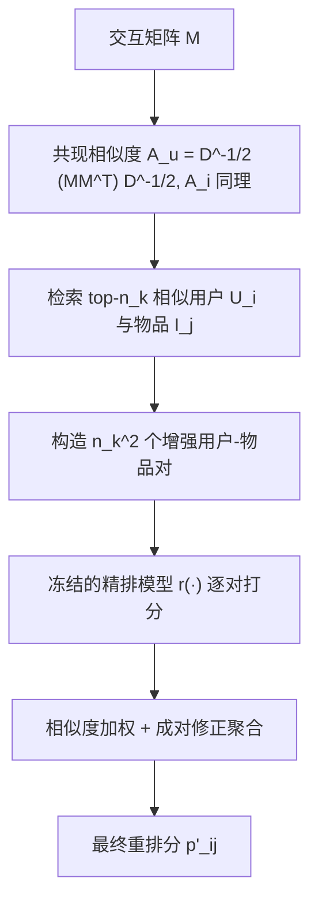
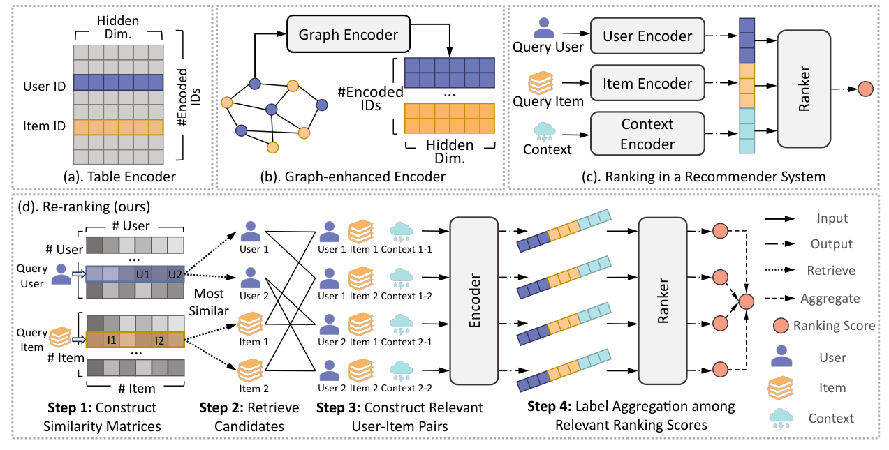

# Non-parametric Graph Convolution for Re-ranking in Recommendation Systems (推荐系统重排中的非参数图卷积)

- **会议/期刊**: RecSys 2025 (Main)
- **作者与机构**: Zhongyu Ouyang, Soroush Vosoughi (Dartmouth College); Mingxuan Ju (Snap Inc. / Notre Dame); Yanfang Ye (Notre Dame)
- **推荐链路定位**: 重排 (Ranking / Re-ranking 阶段，作用于已训练 CTR 精排模型之上)
- **研究方向**: 多任务学习与列表级重排 / 图神经网络与知识图谱推荐
- **论文原文**: [https://arxiv.org/abs/2507.09969v1](https://arxiv.org/abs/2507.09969v1)
- **开源代码**: [https://github.com/zyouyang/RecSys2025_NonParamGC](https://github.com/zyouyang/RecSys2025_NonParamGC)

## TL;DR (1分钟核心速览)

精排阶段长期只用 ID 查表 + 上下文特征，图结构知识几乎只在召回阶段被利用；而把图编码器塞进精排（GCM 式做法）虽能涨点，却因每步训练都要做邻居消息传递，训练开销暴涨约 480%、推理暴涨约 605%，在分布式工业架构下不可行。本文提出**非参数图卷积**：训练完全不动，仅在测试时用用户-用户、物品-物品共现相似度检索 top-$n_k$邻居，构造$n_k^2$ 个增强用户-物品对，查询已训练好的精排模型并对打分做加权聚合作为最终重排分。在 4 个基准、7 个 CTR 基线上平均提升 8.1%，额外总开销仅约 0.5%。

## Background & Motivation (背景与核心矛盾)

- **主流范式**: 召回阶段用 LightGCN/NGCF/SimGCL 等图协同过滤传播高阶信号；精排阶段则用 DCN/DeepFM/AutoInt 等 CTR 模型，输入是用户 ID、物品 ID 与上下文特征的拼接，ID 嵌入来自独立查表。
- **前人局限**: ① GCM 类做法把图消息传递嵌入精排训练，单对样本需查询其邻居嵌入，复杂度随 batch 二次增长，且每步重复执行，分布式机器间通信带宽成为瓶颈；② 现有工业管线以 i.i.d. 表格数据为核心，接入非 i.i.d. 图数据需大量工程改造与模型重训。
- **核心洞察 (Key Insight)**: 作者先用对照实验证明"图确实有用"——仅把 DCNV2 的查表编码器换成图编码器，四个数据集上 Recall/NDCG 普遍上涨（ML-1M NDCG@10 +13.26%，Amazon-Books Recall@10 +13.79%），但训练时间 +124%~+544%、推理时间 +140%~+649%。即**收益来自图结构信号本身，代价来自"训练期反复传播"这一实现方式**，二者可以解耦。
- **本文切入点**: 把图卷积降级为**测试期一次性、无参数**的增强算子——不学任何图参数、不参与反向传播，只在推理时用共现相似度做一次"隐式卷积"。

## Method (核心方法设计)

### 1. 整体框架 (Overall Architecture)

给定一个已训练好的精排模型 $r(\cdot)$（如 DCNV2）与一个查询对$(i,j)$：先离线用交互矩阵$\mathbf{M}$预计算用户侧与物品侧的归一化共现相似度矩阵；推理时对用户$i$取 top-$n_k$相似用户$\mathcal{U}_i$、对物品$j$取 top-$n_k$相似物品$\mathcal{I}_j$，笛卡尔积构造$n_k^2$个增强对；将每个增强对的拼接特征送入**同一个冻结的**$r(\cdot)$得到打分，再按相似度权重加权平均，得到最终重排分$p'_{ij}$。整个过程无训练、无新参数、可插拔。

<figure class="paper-figure" markdown="span">
  <figcaption>图1：(a) 用户/物品ID嵌入的表编码器；(b) 图增强的用户/物品ID编码器；(c) 用户与物品之间排序分数的计算；(d) 按步骤说明的策略整体框架。</figcaption>
</figure>

### 2. 关键设计拆解 (Key Designs)

1. **共现相似度矩阵与非参数"卷积"**：痛点是不想引入任何图参数与训练期传播。作者直接用 $\mathbf{A}_u=\mathbf{D}_u^{-1/2}(\mathbf{M}\mathbf{M}^{\top})\mathbf{D}_u^{-1/2}$、$\mathbf{A}_i=\mathbf{D}_i^{-1/2}(\mathbf{M}^{\top}\mathbf{M})\mathbf{D}_i^{-1/2}$定义相似度，其中$\hat{\mathbf{A}}_u[i,j]$即用户$i,j$ 共同交互的物品数。度归一化消除热门节点主导问题——这与 LightGCN 的对称归一化同源，但**只在测试时算一次**，等价于把一层图卷积"外置"为检索+聚合，故称非参数。

2. **成对修正的加权聚合**：朴素做法用 $\text{Weight}(\mathcal{M}_{ij})[u,v]=A_u[i,u]\cdot A_i[j,v]$直接加权平均，但最相似对（权重为 1 的那对）贡献占比过低（示例中仅约 53%），会把结果拉离原始预测。作者先按最大值归一化权重到$[0,1]$，再把最相似对的权重改写为与其他所有对的成对互补和：
$$\text{Weight}(\mathcal{M}_{ij})[u',v']=\sum_{(u,v)\neq(u',v')}\left(1-\text{Weight}(\mathcal{M}_{ij})[u,v]\right)$$
示例中该对占比由 53% 提升至约 71%，保证增强不偏离原模型判断太远。

3. **训练目标、负采样与推理效率**：**无新增训练目标**——模型仍用原 BCE 损失 $\mathcal{L}=-\frac{1}{N}\sum y_{ij}\log p_{ij}+(1-y_{ij})\log(1-p_{ij})+\lambda\sum_l\|\mathbf{w}^{(l)}\|_2^2$训练，本文策略完全不介入。推理开销为对每个查询多算$n_k^2$次前向，随$n_k$二次增长；但 top-$n_k$ 邻居可离线预计算，属数据集级一次性成本。

## Experimental Setup & Evaluation Protocol (实验设置与评估协议)

- **数据集与预处理**: 显式评分经阈值二值化为 0/1 标签。

| 数据集 | #Users | #Items | #Interactions | 稀疏度 | 特征/场景说明 |
| :--- | :---: | :---: | :---: | :---: | :--- |
| ML-1M | 6,041 | 3,261 | 998,539 | 0.9493 | 稠密，电影 |
| Yelp2018 | 77,278 | 45,639 | 2,103,896 | 0.9994 | 稀疏，本地生活 |
| Amazon-Books | 68,498 | 65,549 | 2,954,716 | 0.9993 | 稀疏，图书 |
| Anime | 55,119 | 7,364 | 6,270,078 | 0.9846 | 稠密，动漫 |

- **数据划分与防穿越 (Splitting Strategy)**: 随机 `比例划分` 0.8/0.1/0.1（train/valid/test），非时间切分。
- **排名评测协议 (Ranking Protocol)**: 报告 NDCG@{10,20} 与 Recall@{10,20}；本质是 CTR 二分类打分后按分数排序，测试集内全候选排序（非采样负例排序），结果取 5 个随机种子均值。
- **对比基线与超参设置**: 7 个 CTR 基线 NFM、DeepFM、xDeepFM、DCN、DCNV2、AutoInt、EulerNet；AdamW + BCE，网格搜索以验证集 AUC 选超参；$n_k\in\{1,2,5,10\}$ 网格调优；RTX 3090 训练，相似度矩阵在 128GB CPU 上预计算，框架 RecBole。

## Key Experimental Results (实验关键数据)

### 1. 主实验对比 (Main Results)

以 DCN 与 DCNV2 为代表（完整 7 基线见原文表 2），NDCG@10 / Recall@20 如下：

| 数据集 | 模型 | NDCG@10 | +Ours | %Δ | Recall@20 | +Ours | %Δ |
| :--- | :--- | :---: | :---: | :---: | :---: | :---: | :---: |
| ML-1M | DCN | 10.07 | **11.19** | +11.08 | 14.97 | **16.11** | +7.64 |
| ML-1M | DCNV2 | 10.76 | **10.91** | +1.39 | 15.55 | **16.12** | +3.69 |
| Yelp2018 | DCN | 2.20 | **2.46** | +11.73 | 9.87 | **10.75** | +8.93 |
| Yelp2018 | NFM | 2.92 | **3.35** | +14.58 | 11.23 | **12.30** | +9.58 |
| Amazon-Books | DCN | 1.91 | **2.20** | +15.15 | 7.53 | **8.27** | +9.94 |
| Amazon-Books | NFM | 2.67 | **3.04** | +13.69 | 9.10 | **9.81** | +7.85 |
| Anime | DCN | 13.90 | **14.17** | +1.94 | 23.76 | **25.26** | +6.32 |
| Anime | AutoInt | 12.32 | **13.27** | +7.66 | 22.75 | **24.44** | +7.45 |

### 2. 消融实验 (Ablation Study)

原文未设传统"移除模块"式消融，而以**编码器替换对照 + 超参敏感性 + 聚合权重设计**三类分析替代：

| 配置 | 关键结果 | 说明 |
| :--- | :--- | :--- |
| DCNV2 + 查表编码器 (Tab.) | ML-1M NDCG@10 = 10.87 | 基线 |
| DCNV2 + 图编码器 (Graph) | ML-1M NDCG@10 = 12.31 (+13.26%) | 图有效但训练 +124%、推理 +140% |
| DCNV2 + 本文策略 | ML-1M NDCG@10 = 10.91 (+1.39%) | 几乎零额外训练开销 |
| 朴素加权 vs. 成对修正聚合 | 最相似对占比 53% → 71% | 修正后避免偏离原预测 |
| $n_k$敏感性 | 稠密集$n_k$小更优，稀疏集$n_k$ 大更优 | 见原文图 4 |

### 3. 关键实验发现 (Key Findings)

1. **稀疏集收益远大于稠密集**：Yelp2018/Amazon-Books 上 DCN 的 NDCG@10 提升 11.73%/15.15%，而 ML-1M/Anime 仅 1.94%~11.08%。原因是稀疏图中节点邻居少、训练期协同信号不足，测试期注入的图知识正好补偿；稠密图嵌入已充分训练，提升空间小。
2. **效率优势是量级性的**：图编码器方案训练时间 +124%~+544%、推理 +140%~+649%；本文策略训练时间增量为 0，整体（训练+推理）额外开销平均仅约 0.5%，却能达到与图编码器方案可比的排序水平（原文图 3）。
3. **$n_k$与图密度强耦合**：稠密图（ML-1M、Anime）小$n_k$即可，稀疏图需更大$n_k$才够；且随$n_k$增大，最相似对贡献占比上升且分布更集中（ML-1M$n_k{=}2$峰值 0.70–0.71，$n_k{=}10$ 升至 0.85–0.86），说明大邻域下聚合更保守、更贴近原预测。

## Highlights & Limitations (亮点、对比与审稿批判)

- **与代表作对比 (vs. Prior Work)**: 与 GCM 的本质区别在于图卷积**不参与训练**，把参数化消息传递换成测试期检索+加权，规避分布式邻居查询；与 LightGCN/SimGCL 等召回期图方法相比，本文不改动嵌入学习，而是直接作用于含上下文特征的 CTR 打分函数，属正交增强；与常规 TTA（测试时增强）相比，增强样本不是图像变换而是**图结构导出的协同邻居对**，且带成对修正权重。
- **可迁移亮点**: ① "把昂贵结构先验外置到推理期"这一思路可迁移到序列/知识图谱增强的精排；② 成对修正权重（用 $1-w$ 互补和抬升主对占比）是通用的聚合稳定技巧，可用于任何多视图打分融合。
- **审稿级局限批判**: ① 推理开销随 $n_k^2$二次增长，在线高 QPS 场景下$n_k{=}10$意味着单次请求 100 次前向，需靠缓存或蒸馏缓解，论文未给出线上延迟数据；② 相似度矩阵为$|U|\times|U|$、$|I|\times|I|$ 稠密形式，十亿级物品下无法物化，论文回避了大规模稀疏检索（ANN）下的近似误差问题；③ 划分采用随机比例而非时间切分，存在轻度信息泄漏风险，且未报告显著性检验。

## Rating (四维评分)

- **方法创新性 (Novelty)**: ⭐⭐⭐⭐ （"非参数图卷积=测试期检索+加权聚合"视角简洁新颖，但本质是 TTA 与共现相似度的组合，理论深度有限）
- **评估协议与实验扎实度 (Protocol & Experiments)**: ⭐⭐⭐⭐ （4 数据集 × 7 基线 × 5 种子覆盖充分，稀疏/稠密分层分析到位；扣分在随机划分与缺显著性检验）
- **写作与数学规范度 (Clarity & Rigor)**: ⭐⭐⭐⭐ （四步流程与公式定义清晰、图示直观；聚合权重公式存在拼写瑕疵且缺复杂度严格推导）
- **工业落地与复现价值 (Industrial & Practical Value)**: ⭐⭐⭐⭐⭐ （零重训、可插拔、代码开源，训练零增量开销，对现有 CTR 管线极其友好，落地门槛极低）

