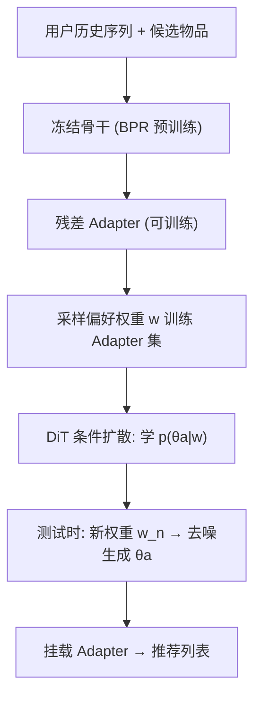
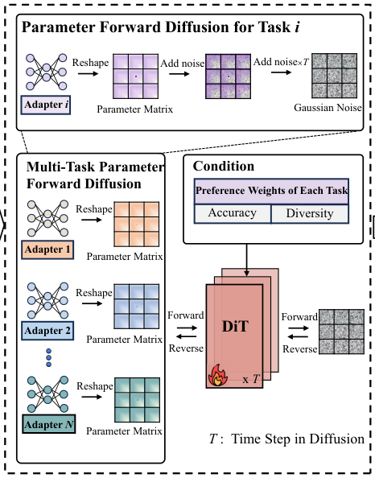

# Paragon: Parameter Generation for Controllable Multi-Task Recommendation (面向可控多任务推荐的参数生成)

- **会议/期刊**: RecSys 2025
- **作者与机构**: Chenglei Shen, Jiahao Zhao, Xiao Zhang, Weijie Yu (人大高瓴), Ming He, Jianping Fan (联想 AI Lab)
- **推荐链路定位**: 重排 / 测试时模型自适应
- **研究方向**: 多任务学习与列表级重排 / 生成式推荐
- **论文原文**: [https://arxiv.org/abs/2410.10639v2](https://arxiv.org/abs/2410.10639v2)
- **开源代码**: [https://github.com/bubble65/Paragon](https://github.com/bubble65/Paragon)

## TL;DR (1分钟核心速览)

线上推荐的任务需求（准确率 vs 多样性权重）会突发变化，传统多任务模型只能重训，代价高昂。Paragon 将"重训"重构为"参数生成"：先用 adapter tuning 在采样偏好权重下得到一批最优适配器参数，再训练 DiT 扩散模型学习 $p(\boldsymbol{\theta}_a\mid\boldsymbol{w})$，测试时给定新权重直接去噪生成适配器参数并挂载到冻结骨干上。在 MovieLens-1M、Amazon Food 与工业数据集上，Avg.HV 与 Pearson 相关性逼近 Retrain 上界，响应时间从约 300s 降至约 2.6s（降幅 ≥94.6%）。

## Background & Motivation (背景与核心矛盾)

- **主流范式**: 现有多任务推荐（MMoE/PLE、Pareto MTL、CMR 超网络）在**静态环境**下优化固定偏好权重 $\boldsymbol{w}$，训练与测试共用同一目标函数。
- **前人局限**: ① 线上需求突变（如黑五、用户从"求准"转向"求探索"）时，必须重建目标函数并重训重部署，分钟级延迟不可接受；② 离散存储 $N$套任务参数在连续权重空间$\mathcal{W}$ 下不可行，无法覆盖细粒度需求。
- **核心洞察 (Key Insight)**: 重训的本质只是**参数更新**，因此可把"权重空间 $\mathcal{W}\to$参数空间$\Theta$"的映射建模为条件生成问题$g_{\boldsymbol{\xi}}:\mathcal{W}\to\Theta$，把测试时的优化问题转成一次扩散推理。
- **本文切入点**: 只生成轻量 adapter 参数（骨干冻结），既保留基础推荐能力，又大幅压缩生成模型的学习复杂度与推理开销。

## Method (核心方法设计)

### 1. 整体框架 (Overall Architecture)

三阶段闭环：**(1) 适配器准备**——冻结 BPR 预训练的骨干，在 $[0,1]$上采样准确率权重$w_1$（$w_2=1-w_1$），以$\ell_i=w_1\ell_{\text{acc}}+w_2\ell_{\text{div}}$为目标独立训练残差 adapter，得到"权重–最优参数"配对数据集；**(2) 参数扩散训练**——将 adapter 参数矩阵视为"图像"，以偏好权重为条件训练 DiT 去噪器，采用 classifier-free guidance 同时学条件/无条件分布；**(3) 测试时生成**——给定新权重$\boldsymbol{w}_n$，从高斯噪声迭代去噪$T$步得到$\boldsymbol{\theta}_{a,n,0}$，reshape 后载入 adapter，与冻结骨干组合直接出推荐列表。

<figure class="paper-figure" markdown="span">
  <figcaption>图 3：所提出的 Paragon 的概览。</figcaption>
</figure>

### 2. 关键设计拆解 (Key Designs)

1. **可微多样性损失（把 α-NDCG 变成可训练目标）**：多样性不可微是可控优化的第一道坎。作者对 α-DCG 做 sigmoid 软排序平滑，令 $\text{Rank}_k=1+\sum_{j\neq k}\text{sigmoid}((s_j-s_k)/T)$，类别覆盖计数$C_{k,l}=\sum_{j\neq k}y_{j,l}\cdot\text{sigmoid}((s_j-s_k)/T)$，损失为
$$\ell_{\text{diversity}}=-\sum_{k=1}^{|\mathcal{C}|}\sum_{l=1}^{|\mathcal{M}|}\frac{y_{k,l}(1-\alpha)^{C_{k,l}}}{\log_2(1+\text{Rank}_k)}$$
温度 $T$ 控制排序近似的锐度；该式直接惩罚"同类别重复占位"，使 adapter 能在梯度下降中学会"打散"列表。

2. **条件扩散参数生成 + CFG（核心创新）**：超网络（MLP）是判别式映射，难以刻画多峰的条件参数分布。Paragon 改用扩散：训练目标
$$\ell_{\text{diff}}=\mathbb{E}_{\boldsymbol{\theta}_{a,i,0},\boldsymbol{\epsilon}\sim\mathcal{N}(0,1),t}\left[\left\|\boldsymbol{\epsilon}-\boldsymbol{\epsilon}_{\boldsymbol{\xi}}(\boldsymbol{\theta}_{a,i,t},\boldsymbol{w}_i,t)\right\|^2\right]$$
以概率 $p_{\text{uncond}}$将$\boldsymbol{w}_i$置空$\varnothing$实现 CFG；采样时用$\tilde{\boldsymbol{\epsilon}}=(1+\gamma)\boldsymbol{\epsilon}_{\boldsymbol{\xi}}(\boldsymbol{\theta}_{a,n,t},\boldsymbol{w}_n)-\gamma\boldsymbol{\epsilon}_{\boldsymbol{\xi}}(\boldsymbol{\theta}_{a,n,t},t)$ 放大条件信号。直觉上，去噪过程恰好模拟了"从随机初始化到收敛参数"的优化轨迹，因此生成结果天然落在高奖励参数流形上。

3. **训练目标、负采样与推理效率**：总损失即式 (4) 的加权和，$\ell_{\text{acc}}$用 BPR（训练 9 负样本，验证/测试 99 负样本）；生成侧仅需$\ell_{\text{diff}}$。推理开销为$T$ 步 DiT 前向（约 2.5s），与数据集规模几乎无关，而 Retrain 随数据量线性增长。

## Experimental Setup & Evaluation Protocol (实验设置与评估协议)

- **数据集与预处理**:

| 数据集 | #Users | #Items | #Interactions | 密度 | 特征/场景说明 |
| :--- | :---: | :---: | :---: | :---: | :--- |
| MovieLens-1M | 6,034 | 3,125 | 994,338 | 7.805% | 18 类，5-core 过滤 |
| Amazon Food | 4,905 | 2,420 | 53,258 | 0.448% | 156 类经 GloVe+K-means 聚为 30 类 |
| Industrial Data | 3,628 | 3,181 | 72,391 | 0.627% | 电子商城点击，≥10 交互过滤 |

- **数据划分与防穿越**: `Leave-One-Out` 划分训练/验证/测试，历史序列截断至 20。
- **排名评测协议**: 验证/测试采用 99 负样本的 `Sampled Ranking`；指标为 NDCG@10（准确率）与 α-NDCG@10（多样性），并汇总为 Avg.HV（归一化超体积）与 Pearson r-a / r-d（与 Retrain 上界的可控性相关性）。
- **对比基线与超参**: Retrain（Linear Scalarization，理论上界）、CMR（超网络）、Soup（模型汤）、MMR（后处理启发式）、LLM-CMTR（llama3-7B-Instruct）；骨干为 SASRec / GRU4Rec / TiSASRec，embedding 与 hidden 均为 64，Adam lr=1e-3。

## Key Experimental Results (实验关键数据)

### 1. 主实验对比 (Main Results)

以 TiSASRec 为骨干（其余骨干结论一致）：

| 数据集 | 方法 | Avg.HV | Pearson r-a | Pearson r-d |
| :--- | :--- | :---: | :---: | :---: |
| MovieLens-1M | Retrain | 0.2301 | / | / |
| | CMR | 0.1769 | 0.9286 | 0.9903 |
| | Soup | 0.1483 | 0.8033 | 0.8858 |
| | MMR | 0.1815 | 0.8946 | 0.8684 |
| | LLM-CMTR | 0.0625 | -0.0663 | 0.0999 |
| | **Paragon** | **0.2532** | **0.9923** | **0.9914** |
| Amazon Food | Retrain | 0.2232 | / | / |
| | CMR | 0.2064 | -0.6279 | 0.9828 |
| | **Paragon** | **0.2394** | **0.8759** | **0.9851** |
| Industrial | Retrain | 0.2777 | / | / |
| | CMR | 0.3315 | 0.8855 | 0.9300 |
| | **Paragon** | 0.2862 | **0.9968** | **0.9984** |

响应时间（表 3）：Retrain 在 MovieLens-1M 上约 293–304s，Paragon 仅 2.55–2.68s，**降幅 94.6%–99.2%**，且跨数据集几乎恒定。

### 2. 消融实验 (Ablation Study)

| 变体 | Avg.HV | Pearson r-a | Pearson r-d | 说明 |
| :--- | :---: | :---: | :---: | :--- |
| Retrain（参照） | 0.2301 | 1.000 | 1.000 | 重训上界 |
| Hypernetwork 替代扩散 | 较低 | 较低 | 较低 | 判别式映射，鲁棒性差 |
| Pre cond. | >Retrain | 较高 | 较高 | 仅前置条件注入 |
| Pre&Post | 最优 | 较高 | 较高 | HV 最佳 |
| Adap-norm | 可接受 | **最优** | **最优** | 注意力聚合条件注入 LayerNorm |
| Post-Adap | >Retrain | 较高 | 较高 | 后置自适应 |

### 3. 关键实验发现 (Key Findings)

1. **扩散生成优于超网络生成**：在等幅高斯扰动下，Paragon 生成参数的 NDCG@10 与 α-NDCG@10 波动最小（图 5），说明扩散模型学到的是参数分布而非点映射，鲁棒性显著更强。
2. **可控性接近上界且无"精度塌陷"**：Paragon 的 Pearson r-a/r-d 在多数设定下 >0.98，而 CMR 在 Amazon Food 上 r-a 为 **-0.6279**（权重变化时精度不跟随，控制失效），MMR 因后处理破坏原列表导致精度不可控波动。
3. **可扩展至第三效用（公平性）**：加入公平性权重 $\{0,1\}$后，公平设定下男女组 NDCG@10 绝对差 AD 稳定更小，且准确率–多样性负相关关系几乎不受影响（图 6），证明框架对$p>2$ 的效用维度可平滑扩展。

## Highlights & Limitations (亮点、对比与审稿批判)

- **与代表作对比**: 相比 CMR 的超网络点映射，Paragon 用扩散建模**条件参数分布**，天然抗扰动；相比 Soup 的线性参数插值，它不假设任务与权重呈线性关系（Soup 仅在极端权重处贴合 Retrain）；相比 MMR 的后处理，它从参数层面控制，不破坏原排序结构。
- **可迁移亮点**: ① "冻结骨干 + 生成 adapter"的范式可迁移到任何需要多目标切换的召回/精排模型；② 可微 α-NDCG 软排序技巧可直接用于列表级多样性与公平性优化。
- **审稿级局限批判**: ① 扩散采样需 $T$ 步 DiT 前向，虽远快于重训，但相对在线毫秒级重排仍有延迟，且需为每个新权重单独生成一套参数，批量并发场景的显存/缓存策略未讨论；② 实验仅覆盖准确率、多样性、公平性三类效用，且多样性依赖物品类别标签，在无类目体系或类目极细的场景下可微损失的有效性存疑。

## Rating (四维评分)

- **方法创新性 (Novelty)**: ⭐⭐⭐⭐ （把重训重构为条件参数生成，扩散+CFG 用于推荐模型参数属新颖组合，但"生成网络参数"在 CV 领域已有先例）
- **评估协议与实验扎实度 (Protocol & Experiments)**: ⭐⭐⭐⭐ （三骨干×三数据集含工业数据，HV+双 Pearson 指标设计合理，但采样排序而非全库排序、缺显著性检验）
- **写作与数学规范度 (Clarity & Rigor)**: ⭐⭐⭐⭐ （三阶段流程与公式定义清晰，可微多样性损失推导完整，扩散符号稍显密集）
- **工业落地与复现价值 (Industrial & Practical Value)**: ⭐⭐⭐⭐⭐ （开源代码，94.6%+ 时延降幅且与数据规模无关，对线上动态调权场景落地价值极高）

