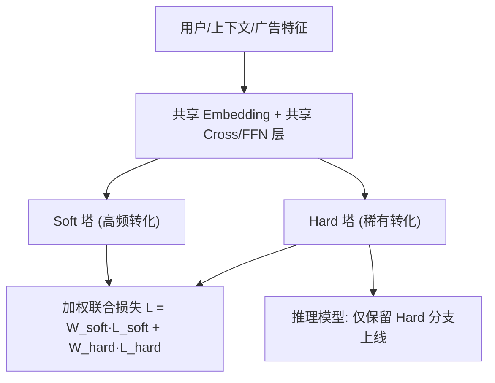
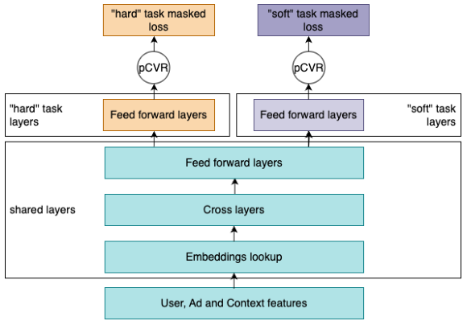

# Practical Multi-Task Learning for Rare Conversions in Ad Tech (广告技术中稀有转化的实用多任务学习)

- **会议/期刊**: RecSys 2025 (Industry Track, 4页短文)
- **作者与机构**: Yuval Dishi, Ophir Friedler, Yonatan Karni, Natalia Silberstein, Yulia Stolin (Teads, 以色列)
- **推荐链路定位**: 精排 (pCVR 预估，直接驱动排序与竞价)
- **研究方向**: 多任务学习与列表级重排 / CTR-CVR 预估与特征交叉
- **论文原文**: [https://arxiv.org/abs/2507.20161v1](https://arxiv.org/abs/2507.20161v1)
- **开源代码**: 暂未开源

## TL;DR (1分钟核心速览)

针对广告系统中稀有转化（CVR < 1%，如高价购买）与高频转化（如落地页浏览，CVR > 30%）共用一个单任务模型时，动态范围过宽导致低预测区间校准失准、稀有事件数据稀疏的问题，本文提出以**历史时间衰减 CVR 统计自动划分 soft/hard 两类任务**（而非依赖广告主人工标签），共享 Embedding 与若干 Cross/FFN 层后分叉为两个同构塔，按加权损失联合训练；线上仅保留 hard 分支构成"推理模型"以零额外开销服务。在数亿条 Teads 日志上离线 RIG +4.08%、AUC +0.69%，线上 A/B 实现 CPA 中位数降 2.0%、转化量升 2.6%。

## Background & Motivation (背景与核心矛盾)

- **主流范式**: 工业 pCVR 模型普遍采用 Deep & Cross 架构，历史上以**单一模型覆盖所有转化类型**；MTL 路线（ESMM、DCMT、Pan et al.）则通过联合建模 CTR/CVR 或不同转化类型来缓解稀疏。
- **前人局限**: ① 单模型下 soft 事件 CVR 可超 30%、hard 事件低于 0.1%，跨两个数量级的动态范围使模型在 <1% 的低预测区间校准严重失真，而这恰是高价广告主最关心的区间；② Pan et al. 等 MTL 依赖**人工标注的转化类型**定义任务，标签噪声与不一致性在规模化场景下直接劣化模型质量。
- **核心洞察 (Key Insight)**: 转化的"稀有/高频"属性本质上是**可观测的经验频率**，而非广告主主观意图标签；用历史统计定义任务，能让任务划分与生产环境中的真实事件频率对齐，且天然随数据漂移自适应。
- **本文切入点**: 用时间衰减滑动窗口 CVR 与阈值 $\alpha$ 自动切分 soft/hard 任务，构建"共享底层 + 双同构塔"的 MTL，并配套线上流量路由与稳定性机制完成全量部署。

## Method (核心方法设计)

### 1. 整体框架 (Overall Architecture)

模型输入用户、上下文、广告属性等特征，先经共享 Embedding 层（可选叠加若干共享 Cross 与 FFN 层）得到公共表征，随后分叉为 soft 塔与 hard 塔两个结构完全相同的任务塔。每个 mini-batch 样本仅对其所属任务的损失分量产生贡献，总损失为两任务损失的加权和；训练阶段两塔共存以共享泛化收益，服务阶段则从完整计算图中**裁剪出仅含 hard 分支的子图**作为推理模型，使线上开销与单任务基线持平。

<figure class="paper-figure" markdown="span">
  <figcaption>图1：MTL架构</figcaption>
</figure>

### 2. 关键设计拆解 (Key Designs)

1. **数据驱动的 soft/hard 任务划分**：痛点在于人工标签噪声大且与真实频率脱节。本文对每个转化 setup 计算**近期滑动窗口内的时间衰减 CVR**（转化/点击比值，近期样本权重更高），以 $\text{CVR} > \alpha$判为 soft、$\text{CVR} \le \alpha$判为 hard，阈值$\alpha$ 由离线验证选取（使购买类与特定广告主类型自然落入 hard）。直觉上，这把任务分配绑定到经验结果而非元数据，模型行为与生产观测频率一致，且无需人工维护标签体系。

2. **共享-专用分层 MTL 与损失加权**：总损失为
$$\mathcal{L} = W_{\text{soft}}\cdot\mathcal{L}_{\text{soft}} + W_{\text{hard}}\cdot\mathcal{L}_{\text{hard}}$$
其中共享层数与权重 $W_{\text{soft}}, W_{\text{hard}}$均为超参。共享层让 hard 任务从 soft 任务的稠密信号中吸收泛化表征，专用塔则避免两任务在输出端相互拉扯；实验显示$W_{\text{hard}}=W_{\text{soft}}=0.5$ 的均衡配置最优，说明 soft 信号作为辅助任务的价值存在但不宜压过主任务。

3. **推理模型裁剪与流量路由稳定性**：服务时仅保留 hard 分支，训练期的多任务收益被"固化"进共享底层而不带来推理成本。线上路由组件按候选分类打散流量，且**线上阈值略低于离线阈值**以缓冲边界样本抖动；针对历史 CVR 逐日波动导致同一转化在 soft/hard 间跳变的问题，引入融合历史 CVR、广告主类型、转化类别的多要素稳定化机制，保证训练与服务的一致性。

## Experimental Setup & Evaluation Protocol (实验设置与评估协议)

- **数据集与预处理**: 基于 Teads 生产环境**数亿条日志记录**，无公开数据集；转化 setup 按历史统计划分为 soft/hard 两个种群，离线评估聚焦 hard 种群。

| 数据集 | 规模 | 任务划分 | 评估种群 | 特征/场景说明 |
| :--- | :---: | :---: | :---: | :--- |
| Teads 生产日志 | 数亿条记录 | 时间衰减 CVR + 阈值 $\alpha$ | Hard 转化种群 | 用户/上下文/广告属性，Deep & Cross 骨干 |

- **数据划分与防穿越 (Splitting Strategy)**: 采用**时间切分**——模型以数月历史日志训练，评估在后续日志上进行；历史 CVR 统计使用滑动窗口并做时间衰减，避免未来信息泄漏。
- **排名评测协议 (Ranking Protocol)**: 工业 pCVR 场景，采用**全量日志上的概率校准类指标**而非 Top-K 排序：主指标为 RIG（log-loss 的线性变换）与 AUC；线上采用等预算切分的 A/B 测试，按广告主维度聚合 CPA ratio 与 Conversion ratio。
- **对比基线与超参设置**: 基线为生产在用的**单任务全类型 CVR 模型**（等价于 $W_{\text{hard}}=1.0, W_{\text{soft}}=0$的退化配置）；超参扫描覆盖损失权重 6 组配置与共享层数 1–4 层；线上聚合采用中位数、花费加权几何均值$\exp\!\left(\frac{\sum_i s_i \ln m_i}{\sum_j s_j}\right)$ 及三档高价值广告主分组（约占平台活动 30%/50%/70%）。

## Key Experimental Results (实验关键数据)

### 1. 主实验对比 (Main Results)

离线对比（hard 转化种群，相对单任务基线）：

| 方法 | RIG | AUC |
| :--- | :---: | :---: |
| 单任务基线（全类型 CVR） | — | — |
| **Best MTL（调参后）** | **+4.08%** | **+0.69%** |

线上 A/B（hard 转化段，等预算切分）：

| 聚合方式 | CPA Ratio | Conversion Ratio |
| :--- | :---: | :---: |
| Median | **-2.0%** | **+2.6%** |
| Spend-Weighted | **-3.4%** | **+3.0%** |
| Group I（~30% 活动量） | **-5.1%** | **+4.8%** |
| Group II（~50% 活动量） | **-4.1%** | **+4.8%** |
| Group III（~70% 活动量） | **-2.4%** | **+2.2%** |

### 2. 消融实验 (Ablation Study)

| 配置 | 关键设置 | RIG（相对 hard-only 基线） |
| :--- | :--- | :---: |
| $W_{\text{hard}}{=}0.2, W_{\text{soft}}{=}0.8$ | soft 主导 | +0.86% |
| $W_{\text{hard}}{=}0.5, W_{\text{soft}}{=}0.5$ | 均衡（最优） | **+1.17%** |
| $W_{\text{hard}}{=}0.6, W_{\text{soft}}{=}0.4$ | 略偏 hard | +1.16% |
| $W_{\text{hard}}{=}0.8, W_{\text{soft}}{=}0.2$ | 强偏 hard | +0.80% |
| $W_{\text{hard}}{=}0.9, W_{\text{soft}}{=}0.1$ | 近 hard-only | +0.55% |
| 共享 1 层 | 仅共享 Embedding 之上 1 层 | +0.03% |
| 共享 2 层 | — | +0.11% |
| 共享 3 层 | — | +0.19% |
| 共享 4 层 | 共享最深 | **+0.21%** |

### 3. 关键实验发现 (Key Findings)

1. **辅助任务存在"甜点区"而非单调增益**：$W_{\text{soft}}$ 从 0.1 增至 0.5 时 RIG 由 +0.55% 升至 +1.17%，但继续增至 0.8 反降至 +0.86%，说明 soft 信号在均衡权重下提供最优正则化，过度倾斜则稀释 hard 任务的优化焦点。
2. **共享深度收益递减但方向一致**：共享层从 1 层增至 4 层，RIG 由 +0.03% 单调升至 +0.21%，验证跨任务共享表征对稀疏 hard 任务的正向迁移；但 3→4 层仅增 0.02%，提示共享容量接近饱和，更深共享可能引入任务冲突。
3. **线上收益在高价值广告主上被放大**：CPA 降幅从全体中位数的 2.0% 扩大至 Group I 的 5.1%，转化量提升从 2.6% 升至 4.8%，与"稀有高价转化是高风险客户核心诉求"的动机完全吻合，也说明离线 RIG 提升确实转化为业务价值而非指标幻觉。

## Highlights & Limitations (亮点、对比与审稿批判)

- **与代表作对比 (vs. Prior Work)**: 相较 ESMM 联合 CTR/CVR、DCMT 引入因果去偏、Wang et al. 处理位置偏差，本文不解决选择偏差而是解决**任务定义本身**；与最接近的 Pan et al. 相比，本质差异在于用历史统计替代人工标签，把任务划分从"元数据驱动"转为"经验频率驱动"，在规模化广告平台上更鲁棒。
- **可迁移亮点**: ① "训练多塔、推理裁单塔"的 inference model 技巧可零成本迁移到任何多任务精排系统；② 用时间衰减频率统计自动定义任务边界，可直接复用于低 CTR 事件、低频用户行为等其他稀有事件建模。
- **审稿级局限批判**: ① 全文仅 4 页且无公开数据集与代码，RIG/AUC 提升缺乏多随机种子方差与显著性检验，复现性弱；② 阈值 $\alpha$ 与线上路由阈值均为经验设定，论文未给出敏感性分析，且历史 CVR 的逐日漂移虽用稳定化机制缓解，但其对训练-服务一致性的定量影响未评估。

## Rating (四维评分)

- **方法创新性 (Novelty)**: ⭐⭐⭐ （数据驱动任务划分与推理裁剪组合实用且新颖，但 MTL 骨架本身为成熟范式，理论贡献有限）
- **评估协议与实验扎实度 (Protocol & Experiments)**: ⭐⭐⭐⭐ （数亿级日志离线 + 等预算线上 A/B + 多档聚合口径完整，唯缺显著性检验与公开数据）
- **写作与数学规范度 (Clarity & Rigor)**: ⭐⭐⭐⭐ （4 页短文结构紧凑、公式简洁，但超参选择依据与稳定性机制细节披露偏少）
- **工业落地与复现价值 (Industrial & Practical Value)**: ⭐⭐⭐⭐⭐ （已全量替换生产基线，推理零额外开销，CPA 降 2%–5% 的收益可直接量化，工程参考价值极高）

