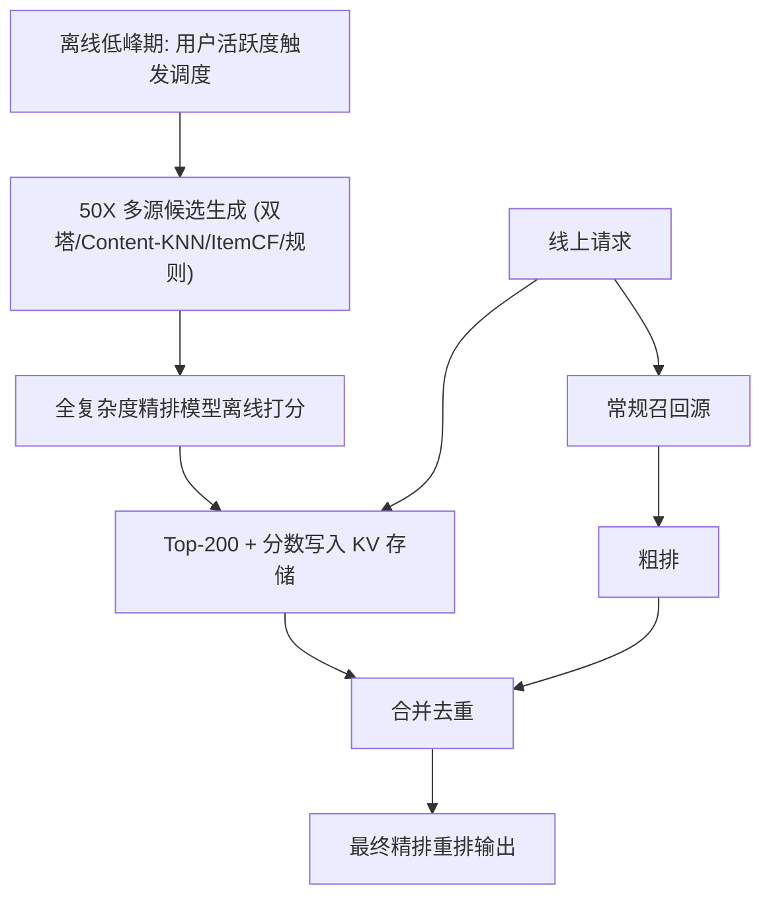
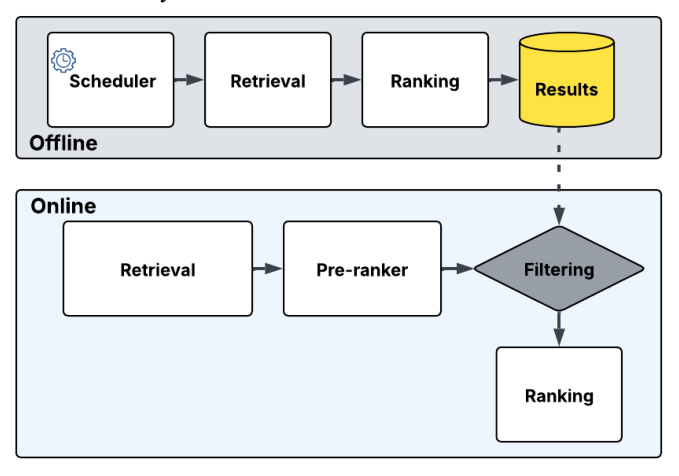

# RADAR: Recall Augmentation through Deferred Asynchronous Retrieval (基于延迟异步检索的召回增强框架)

- **会议/期刊**: RecSys 2025
- **作者与机构**: Amit Jaspal, Qian Dang, Ajantha Ramineni (Meta Platforms, Inc.)
- **推荐链路定位**: 召回（跨级注入精排，绕过粗排）
- **研究方向**: 多任务学习与列表级重排 / 协同过滤与双塔召回
- **论文原文**: [论文原文链接](https://arxiv.org/abs/2506.07261v1)
- **开源代码**: 暂未开源

## TL;DR (1分钟核心速览)

工业级推荐漏斗中，召回阶段受最严苛延迟预算约束，只能用双塔内积/KNN 等轻量模型，导致 Recall@200 仅个位数，成为整条链路的召回天花板。RADAR 提出把"候选生成"与"在线服务约束"彻底解耦：在离线低峰期用**与线上完全相同的全复杂度精排模型**对 50 倍放大的候选池预打分，将 Top-200 存入低延迟 KV 存储；线上请求时直接取出这批已精排候选，**跳过召回与粗排**，与常规来源合并后进入最终精排。离线 Recall@200 从 DNN 双塔的 8.1% 提升至 16.5%（约 2 倍），两周线上 A/B 测试取得 +0.8% 顶线互动指标提升与 +6% 独特物品消费增长，延迟与稳定性不变。

## Background & Motivation (背景与核心矛盾)

- **主流范式**: 工业系统采用 召回 $\to$粗排$\to$精排 三级漏斗，召回输出$O(10^3)$、粗排裁剪至数百、精排最终排序；召回必须满足最紧的延迟预算，故只能依赖点积双塔或 KNN 索引等廉价信号。
- **前人局限**: ① 召回模型表达能力与精排存在结构性鸿沟，离线模拟中标准 user-to-item / item-to-item 召回的 Recall@200 仅个位数（图 1），大量高互动物品根本无法进入候选集；② 已有混合架构（TwERC 等）虽引入图邻居、缓存分数等补充源，但候选仍被"服务端实时可算"这一约束锁死，无法把最强模型用在超大候选池上。
- **核心洞察 (Key Insight)**: 系统在低峰时段存在大量闲置/可抢占算力，而用户兴趣中"长期稳定偏好"部分本身变化缓慢——这部分完全可以在会话开始前用最贵的模型算好。
- **本文切入点**: 把精排模型的计算从"在线实时"搬到"离线异步"，用算力换召回质量，且不触碰线上延迟预算。

## Method (核心方法设计)

### 1. 整体框架 (Overall Architecture)

RADAR 是双路径架构。**离线路径**按用户活跃度触发调度（高活用户每日刷新、低活用户每周/双周刷新），在低峰期用弹性可抢占算力对目标用户执行 50 倍放大的多源召回（双塔 DNN、Content-KNN、ItemCF、规则源），随后用**与线上最终精排完全一致的复杂模型**对这 50 倍候选逐一打分，取 Top-200 及分数写入低延迟 KV 存储。**在线路径**在用户请求到达时并行查询常规召回源与 RADAR KV：常规候选走粗排，RADAR 候选因已被更强模型打过分而**直接跳过粗排**，两路合并去重后统一送入最终精排重排。二者形成互补分工——RADAR 负责常青内容与长期稳定兴趣，在线源负责会话内即时意图与新上传物品。

<figure class="paper-figure" markdown="span">
  <figcaption>图2：RADAR端到端系统架构</figcaption>
</figure>

### 2. 关键设计拆解 (Key Designs)

1. **离线全复杂度预排序（Deferred Ranking）**：痛点是线上精排模型因延迟无法作用于 $10^3$以上候选。RADAR 将同一精排模型$f_{\theta}$作用于离线候选池$\mathcal{C}^{\text{off}}_u$（$|\mathcal{C}^{\text{off}}_u| \approx 50 \times |\mathcal{C}^{\text{on}}_u|$），取$\mathcal{S}_u = \text{TopK}_{i \in \mathcal{C}^{\text{off}}_u} f_{\theta}(u,i)$，$K=200$。直觉：召回瓶颈的本质不是"候选不够多"而是"打分不够准"，把最准的打分器前移即可同时解决两者。
2. **粗排旁路与互补性重调（Bypass + De-overlap）**：RADAR 候选跳过粗排，避免被中等复杂度模型二次误杀；同时**反向重调在线召回生成器**，使其专注即时意图与新物品，把长期兴趣让给 RADAR。早期实验发现候选重叠严重、增量价值被稀释，经数轮调优后 RADAR 独有候选占比达约 60%，这是线上收益成立的关键工程前提。
3. **训练目标、负采样与推理效率**：本文为系统/架构论文，未引入新损失函数，离线打分直接复用生产精排模型的多目标输出；线上额外开销仅为一次 KV 查询与 200 条候选的合并去重，实测延迟与稳定性无变化，离线作业运行于可抢占算力层，对专用资源净影响极小。

## Experimental Setup & Evaluation Protocol (实验设置与评估协议)

- **数据集与预处理**: 大规模视频平台真实用户互动日志（工业私有数据，未公开统计量），以用户真实互动视频为 ground truth。

| 数据集 | #Users | #Items | #Interactions | 稀疏度/密度 | 特征/场景说明 |
| :--- | :---: | :---: | :---: | :---: | :--- |
| 工业视频平台日志 | 未披露 | 十亿级物品库 | 未披露 | 未披露 | 短视频/视频消费场景，含活跃度分层 |

- **数据划分与防穿越 (Splitting Strategy)**: 未明确披露，采用离线回放式评估（以历史互动为标签），并额外做两周线上 A/B 对照。
- **排名评测协议 (Ranking Protocol)**: 采用 `Recall@200` 检索指标，属全库未交互物品排序口径下的召回度量；未使用采样负例排序。
- **对比基线与超参设置**: 基线为 DNN 双塔（协同过滤 + 内容表征）、Item-KNN、Content-KNN；消融通过"是否放大候选池 / 是否使用全复杂度模型"两维正交组合完成；线上 A/B 为期两周，对照组为标准三级漏斗。

## Key Experimental Results (实验关键数据)

### 1. 主实验对比 (Main Results)

| 检索来源 | Recall@200 | 相对 DNN 提升 |
| :--- | :---: | :---: |
| Content-KNN | 5.1% | −37.0% |
| Item-KNN | 7.2% | −11.1% |
| DNN 双塔 | 8.1% | — |
| **RADAR** | **16.5%** | **+103.7%** |

线上 A/B（两周）：顶线互动指标 **+0.8%**（统计显著，与长期留存相关），独特物品消费 **+6%**，延迟与系统稳定性无退化。

### 2. 消融实验 (Ablation Study)

| 配置 | 模型放大 | 候选池放大 | Recall@200 |
| :--- | :---: | :---: | :---: |
| (A) RADAR 完整配置 | 是 | 是 | **16.5%** |
| (B) 仅放大候选池（粗排级模型） | 否 | 是 | 12.5% |
| (C) 仅放大模型（在线候选池） | 是 | 否 | 12.1% |
| (D) 双不放大（基线式） | 否 | 否 | 10.2% |

用户分层（RADAR vs. DNN）：高活 16.2% vs. 8.2%；中活 **17.3% vs. 7.9%**；沉默 6.5% vs. 6.9%（**负收益**）。

### 3. 关键实验发现 (Key Findings)

1. **候选池放大与模型放大存在正向协同，而非简单叠加**：单独放大候选池得 12.5%、单独放大模型得 12.1%，二者叠加达 16.5%，超出各自增益之和（+2.3 / +1.9 → 实际 +6.3），说明"更多候选"必须配"更强打分器"才能兑现价值，反之亦然。
2. **收益高度依赖用户活跃度与刷新节奏的匹配**：中活用户增益最大（+9.4pt），因其使用频率与 RADAR 刷新周期同步；高活用户因缓存列表被快速耗尽、短期兴趣漂移快而增益收窄；沉默用户出现负收益（6.5% vs. 6.9%），因兴趣无法推断且缓存过期，反而不如在线 DNN 的实时热门兜底。
3. **线上收益的瓶颈是候选重叠而非模型能力**：早期实验中 RADAR 候选大量与在线召回重复，增量价值被稀释；经在线召回侧重调后 RADAR 独有候选占比升至约 60%，才释放出 +0.8% 顶线提升，说明该架构的落地关键在"分工设计"而非"模型替换"。

## Highlights & Limitations (亮点、对比与审稿批判)

- **与代表作对比 (vs. Prior Work)**: 与 TwERC 等混合架构的本质区别在于，TwERC 仍将候选限制在服务端实时可算范围内（图邻居、缓存分数作为补充源），而 RADAR 首次把**生产级精排模型**整体搬到离线、作用于 50 倍候选池，并配合使用自适应刷新节奏，实现候选生成与在线约束的完全解耦；相较 accelerator-backed 深度匹配召回，RADAR 不追求召回模型本身变强，而是直接消除召回-精排的模型鸿沟。
- **可迁移亮点**: ① "把最贵模型前移到离线、用算力换召回"这一思路可迁移至任何存在低峰闲置算力且用户长期兴趣稳定的场景（电商、内容社区）；② "反向重调上游召回以制造互补性"是提升任何多源融合系统增量价值的通用工程技巧。
- **审稿级局限批判**: ① 离线评估仅报告 Recall@200 单一指标，缺少 NDCG/命中率与统计显著性检验，且数据集统计量完全未披露，复现性受限；② 缓存新鲜度是硬伤——最坏情况下 KV 结果可陈旧数小时，对沉默用户已出现负收益，论文未给出冷启动/兴趣突变的自适应降级策略；③ 收益强依赖平台具备大规模可抢占离线算力与成熟 KV 基础设施，中小规模系统迁移成本未讨论。

## Rating (四维评分)

- **方法创新性 (Novelty)**: ⭐⭐⭐ （架构层面解耦思路清晰且实用，但本质是工程系统重构，缺少新的学习目标或理论分析）
- **评估协议与实验扎实度 (Protocol & Experiments)**: ⭐⭐⭐ （有离线消融 + 两周线上 A/B 双重验证，但仅单一 Recall 指标、无显著性检验、数据集统计缺失）
- **写作与数学规范度 (Clarity & Rigor)**: ⭐⭐⭐⭐ （系统描述条理清晰、RQ 组织明确，但全文几乎无公式与复杂度分析）
- **工业落地与复现价值 (Industrial & Practical Value)**: ⭐⭐⭐⭐ （线上 +0.8% 顶线提升且零延迟代价，落地价值高；但无开源代码、强依赖内部基础设施，复现门槛高）

