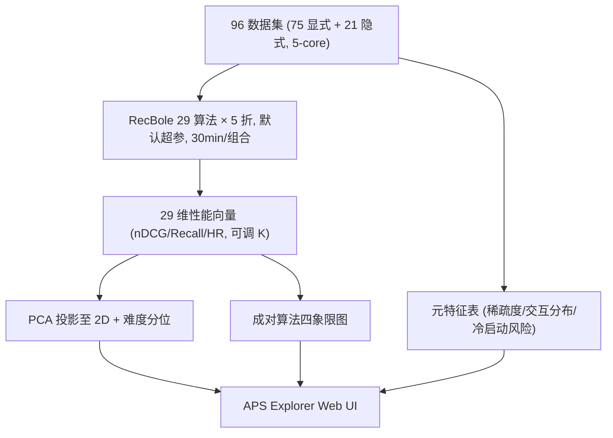
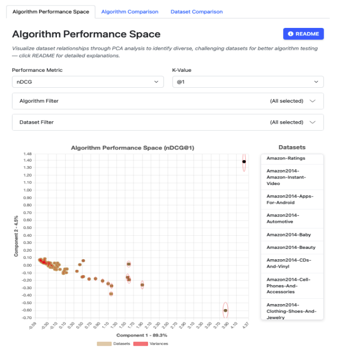

# APS Explorer: Navigating Algorithm Performance Spaces for Informed Dataset Selection (面向知情数据集选择的算法性能空间导航工具)

- **会议/期刊**: RecSys 2025 (Demo/Resource Track, 3 页短文)
- **作者与机构**: Tobias Vente, Bart Goethals (University of Antwerp, Adrem Data Lab); Michael Heep, Abdullah Abbas, Theodor Sperle, Joeran Beel (University of Siegen, Intelligent Systems Group)
- **推荐链路定位**: 离线评测基础设施（不涉及召回/精排模型本身，服务于实验设计与基准选择）
- **研究方向**: 多模态推荐（数据集/基准资源） / 去偏公平与工业架构（评测基准）
- **论文原文**: [https://arxiv.org/abs/2508.19399v1](https://arxiv.org/abs/2508.19399v1)
- **开源代码**: [https://github.com/ISG-Siegen/APS-Explorer-Website](https://github.com/ISG-Siegen/APS-Explorer-Website)

## TL;DR (1分钟核心速览)

本文是一篇资源/工具型短文，痛点不在模型精度而在**实验方法论**：作者统计 ACM RecSys 2024 全部 58 篇长文，发现 **86%（50/58）未对数据集选择给出任何理由**，且实验高度集中于 Amazon(38%)、MovieLens(34%)、Yelp(15%)、Gowalla(12%) 四个数据集。为此作者在 96 个数据集（75 显式 + 21 隐式，统一 5-core 剪枝）上以默认超参跑通 RecBole 的 29 个算法，构建 29 维 Algorithm Performance Space (APS)，并做成 Web 工具 APS Explorer，提供 PCA 相似度投影、成对算法四象限图与元特征对比表三大交互模块，把"数据集选择"从经验直觉变成可辩护的数据驱动决策。

## Background & Motivation (背景与核心矛盾)

- **主流范式**: 离线实验的数据集选择长期依赖"社区惯例"——直接用 MovieLens/Amazon 等少数公开基准，理由是"real-world"或"public availability"。
- **前人局限**: ① Beel et al. 提出的 APS 框架虽能量化数据集多样性（欧氏距离越大表示算法性能模式越分化），但只交付了 GitHub 上的原始 `.csv`，研究者须自行下载、改代码、画 PCA 图，可用性极低；② Chin et al. 用稀疏度/规模等**内在元特征**做 k-means 聚类选数据集，却发现相似分布并不稳定预测算法行为（Amazon 数据集散落不同簇且无簇内趋势）。
- **核心洞察 (Key Insight)**: 数据集的"相似性"应当由**算法在其上的性能响应模式**来定义，而非由稀疏度、规模等静态元特征定义；性能向量才是数据集对实验目的适配度的直接度量。
- **本文切入点**: 把 APS 从"论文里的方法论"工程化为一个开箱即用的交互式 Web 工具，降低采用门槛。

## Method (核心方法设计)

### 1. 整体框架 (Overall Architecture)

流程为：收集 96 个推荐数据集（75 显式反馈 + 21 隐式反馈，显式反馈统一把每条评分视为正交互转为隐式，全部经 5-core 剪枝）→ 在 7,000 GPU-hour 预算的 NVIDIA Tesla V100 集群上，用 RecBole 的 29 个算法以**默认超参**、5 折交叉验证、每「算法-折-数据集」组合严格 30 分钟训练上限跑完全部组合 → 每个数据集得到一个 29 维性能向量（nDCG / Recall / Hit Ratio 三种指标、可调 $K$）→ 前端对性能矩阵做 PCA 降维到 2D 并叠加元特征表与成对比较视图。

<figure class="paper-figure" markdown="span">
  <figcaption>图1：APS Explorer 用户界面</figcaption>
</figure>

### 2. 关键设计拆解 (Key Designs)

1. **算法性能空间与难度分位（Algorithm Performance Space）**：针对"元特征无法预测算法行为"的失效，改用性能向量定义距离。对 29 维性能矩阵做 PCA 取前两主成分作 2D 投影，数据集间距离即性能模式分化程度；同时用归一化位置五分位定义难度分：
$\text{Difficulty Score} = \frac{\text{norm}(C_1) + \text{norm}(C_2)}{2}$其中$C_1, C_2$ 为前两主成分得分，阈值取五分位以保证五档难度均匀分布。直觉是：主成分得分越低说明算法在该数据集上整体排名越靠后，即数据集越"难"。
2. **成对算法四象限比较（Algorithm Comparison）**：针对"单一聚合指标掩盖算法互补性"的问题，按百分位阈值把两算法在 96 数据集上的性能散点切成四区：左下（红，双方均处后 25%）为共同失效区，右上（绿，双方均处前 25%）为共同强区，蓝/黄分别表示 A 优 / B 优的非对称区，中间白区为中等表现（中间 50%）。这直接回答"我的候选算法在哪些数据集上会拉开差距"，是选择**有区分度**数据集的关键依据。
3. **训练与推理开销说明**：本文无训练损失函数；工程开销集中在离线批量跑实验（7,000 GPU-hour、30 分钟硬截断），前端仅做 PCA 与表格渲染，交互延迟可忽略。作者明确承认默认超参 + 时间截断不保证每个算法的最优性能，但主张这足以支撑 APS 的**相对**刻画。

## Experimental Setup & Evaluation Protocol (实验设置与评估协议)

- **数据集与预处理**: 96 个数据集，75 显式 + 21 隐式；显式反馈全部二值化为隐式正交互以统一 top-$n$ 推荐任务；全部经 `5-core` 剪枝。

| 数据集集合 | #Datasets | 反馈类型 | 预处理 | 说明 |
| :--- | :---: | :---: | :---: | :--- |
| 显式反馈子集 | 75 | Explicit→Implicit | 5-core, 评分视为正交互 | 覆盖 MovieLens/Amazon 等主流基准 |
| 隐式反馈子集 | 21 | Implicit | 5-core | 点击/签到类数据 |
| 合计 | 96 | — | — | 29 算法 × 5 折全组合 |

- **数据划分与防穿越 (Splitting Strategy)**: `5-fold cross-validation`（原文未细化每折内部的时间切分或 Leave-One-Out 细节，属该短文的方法论披露不足）。
- **排名评测协议 (Ranking Protocol)**: 采用 nDCG、Recall、Hit Ratio 三项 top-$n$指标，$K$ 值可调；原文未明确声明是 Full-Ranking 还是 Sampled Ranking，亦未披露负采样比例——这是复现时的关键缺口。
- **对比基线与超参设置**: 基线即 RecBole 内置 29 个推荐算法（覆盖协同过滤、图模型、序列模型等），全部使用**默认超参**，无调参、无显著性检验（$p$ 值仅在引用 Chin et al. 时出现）。

## Key Experimental Results (实验关键数据)

### 1. 主实验对比 (Main Results)

本文为工具型短文，**不含传统"本文方法 vs SOTA"主实验表**。其核心"实验"是对 RecSys 2024 长文数据集使用情况的普查，结果如下：

| 统计维度 | 数量 / 占比 | 说明 |
| :--- | :---: | :--- |
| RecSys 2024 长文总数 | 58 | 普查对象 |
| **给出数据集选择理由** | **8 (14%)** | 仅少数论文论证适配性 |
| **未给出任何理由** | **50 (86%)** | 核心动机数据 |
| 理由="real-world" | 29 (50%) | 最常用但最空洞的理由 |
| 理由="public availability" | 12 (20%) | 可得性优先 |
| 理由="established popularity" | 9 (16%) | 如 MovieLens 惯例 |
| Amazon 使用率 | 22 (38%) | 四强之首 |
| MovieLens 使用率 | 20 (34%) | — |
| Yelp 使用率 | 9 (15%) | — |
| Gowalla 使用率 | 7 (12%) | — |

### 2. 消融实验 (Ablation Study)

工具型论文无组件消融；可对照的是**三个交互模块各自承担的决策职能**：

| 模块 | 回答的问题 | 缺失后的后果 |
| :--- | :--- | :--- |
| Algorithm Performance Space (PCA) | 哪些数据集在性能模式上彼此分化？ | 退回按元特征/惯例选数据，易选到高度同质基准 |
| Algorithm Comparison (四象限) | 我的候选算法在哪些数据集上才有区分度？ | 无法判断数据集是否"能测出差异" |
| Dataset Comparison (元特征表) | 稀疏度/交互分布/冷启动风险是否匹配研究问题？ | 稀疏场景研究可能误用高密度数据 |

### 3. 关键实验发现 (Key Findings)

1. **方法论赤字是结构性的**：86% 的 RecSys 2024 长文不解释数据集选择，而给出理由的 8 篇中又有 50% 仅以"real-world"搪塞——说明问题不是个别作者的疏忽，而是社区缺少**低成本、可引用**的论证工具，这正是本文的存在理由。
2. **基准坍缩（benchmark collapse）风险明确**：四个数据集覆盖了绝大多数论文（Amazon 38% + MovieLens 34% + Yelp 15% + Gowalla 12%，存在重叠使用），结论的泛化性因此存疑；APS 的 PCA 投影恰好能把"看似主流但性能模式高度雷同"的数据集识别出来，从而主动挑选互补数据集。
3. **元特征不足以预测算法行为**：结合 Chin et al. 的发现（RP3beta 在中等规模稀疏数据集上可比稠密数据集好最多 45%，且 Amazon 数据集跨簇分布无规律），本文选择以性能向量而非稀疏度/规模定义相似度，这一设计取向得到了既有负面证据的直接支撑。

## Highlights & Limitations (亮点、对比与审稿批判)

- **与代表作对比 (vs. Prior Work)**: 相比 Beel et al. 的 APS 原始工作，本文的增量是**交付形态**（从 `.csv` + 手写脚本变为零代码 Web UI）与**规模扩展**（29 算法 × 96 数据集、含难度分位与四象限视图）；相比 Chin et al. 的元特征聚类路线，本文改用性能响应定义相似度，规避了"分布相似≠行为相似"的陷阱；相比合成数据生成/增强/剪枝等数据集侧工作，本文不造数据，只做**选择决策支持**。
- **可迁移亮点**: ① "性能向量即数据集指纹"的思路可直接迁移到多模态推荐/跨域推荐的基准筛选中，用于构造有区分度的评测组合；② 四象限百分位切分是一种极轻量的算法互补性诊断手段，可用于模型集成前的候选筛选。
- **审稿级局限批判**: ① **协议披露不足**——未说明 Full-Ranking 还是 Sampled Ranking、负采样比例与每折切分细节，而这两项恰恰是推荐评测结论差异的最大来源，工具本身却在教人"严谨选数据集"，存在自指尴尬；② **默认超参 + 30 分钟硬截断**会系统性压低慢收敛算法（如图模型、序列模型）的性能，使 APS 中的距离度量混入"训练预算"这一混杂因子，PCA 结构可能被算法效率而非算法特性主导；③ 无用户研究或采用率评估，"降低门槛"的收益仅为作者主张，缺乏证据。

## Rating (四维评分)

- **方法创新性 (Novelty)**: ⭐⭐ （核心 APS 框架来自前人，本文贡献是工程化与可视化，无新算法或新理论）
- **评估协议与实验扎实度 (Protocol & Experiments)**: ⭐⭐ （96 数据集 × 29 算法的规模可观，但默认超参、时间截断、未披露排序协议与负采样，且无显著性检验）
- **写作与数学规范度 (Clarity & Rigor)**: ⭐⭐⭐ （3 页短文结构清晰、动机数据有力，难度分公式定义简洁，但评测协议细节缺失）
- **工业落地与复现价值 (Industrial & Practical Value)**: ⭐⭐⭐⭐ （代码与网站均开源、零门槛可用，对实验设计与论文写作有直接实用价值，是本文最强项）

