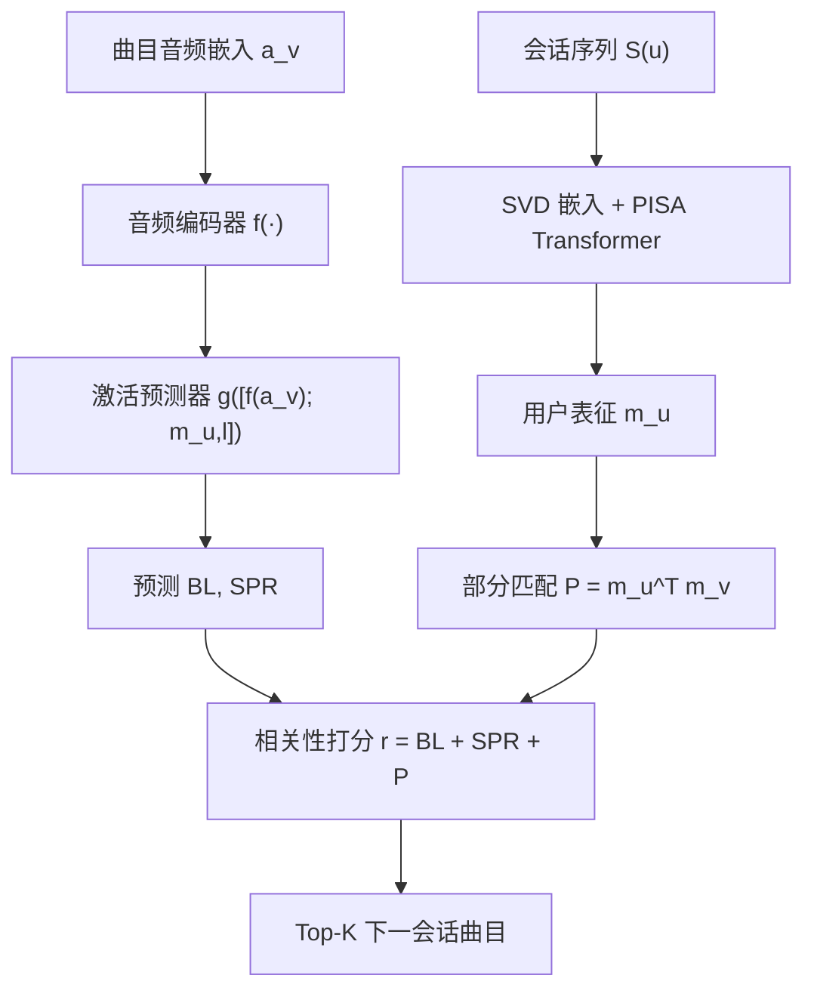
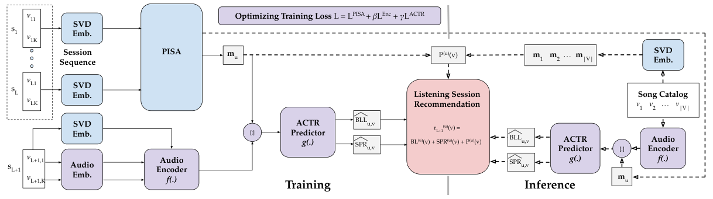

# Beyond the past: Leveraging Audio and Human Memory for Sequential Music Recommendation (超越过去：用音频与人类记忆驱动序列音乐推荐)

- **会议/期刊**: RecSys 2025 (Short Paper)
- **作者与机构**: Viet-Anh Tran, Bruno Sguerra, Gabriel Meseguer-Brocal, Lea Briand, Manuel Moussallam（Deezer Research）
- **推荐链路定位**: 召回（下一会话曲目集合检索）
- **研究方向**: 多模态推荐 / 序列与会话推荐
- **论文原文**: [https://arxiv.org/abs/2507.17356v2](https://arxiv.org/abs/2507.17356v2)
- **开源代码**: [https://github.com/deezer/recsys25-reacta](https://github.com/deezer/recsys25-reacta)

## TL;DR (1分钟核心速览)

ACT-R 认知记忆模型能很好地刻画"重复收听"，但其基级激活 $BL$与扩散激活$SPR$ 只对用户听过的曲目有定义，导致新歌永远拿不到激活分、无法被推荐。本文提出 REACTA：用音频嵌入经两层 MLP 预测新歌的 ACT-R 类激活值，再与 PISA 的会话/用户表征打分相加，形成统一的相关性分数。在 Deezer 近 9 亿条真实收听事件（公开数据集）上，REACTA-P 的 NDCG_Exp 达 3.30%（PISA-P 为 2.36%，相对提升约 40%），RepBias 降至 0.09%，几乎完美对齐真实会话的重复/探索比例。

## Background & Motivation (背景与核心矛盾)

- **主流范式**: 音乐场景的序列推荐近年引入 ACT-R 声明性记忆模块，用基级激活（频率+时间衰减）、扩散激活（会话共现）与部分匹配（嵌入相似度）三组件加权会话内曲目，PISA 进一步把这三项做成注意力权重并纳入训练。
- **前人局限**: 其一，$BL^{(u)}_v$与$SPR^{(u)}_v$ 的求和域被严格限制在用户历史会话内，对未听曲目**数学上无定义**，模型天然偏向重复、探索指标近乎为零；其二，ACT-R-BPR 虽用协同过滤引入新歌，却以牺牲重复准确率为代价，两类指标无法兼得。
- **核心洞察 (Key Insight)**: 用户没听过某首歌，不代表它对用户没有"激活"——对相似艺人的既往曝光应当通过更高层的音乐表征（音频）迁移过来。即激活不应只来自"记忆"，也可来自"听觉相似性"。
- **本文切入点**: 把 ACT-R 激活从"查表式历史统计"改造成"可由音频特征前向预测的连续函数"，从而让全库曲目（含新歌）都拥有激活分。

## Method (核心方法设计)

### 1. 整体框架 (Overall Architecture)

模型在 PISA 之上叠加两个新模块。训练阶段：会话序列经 SVD 嵌入送入 PISA 得到用户表征 $\mathbf{m}_u$；同时每首曲目的音频嵌入$\mathbf{a}_v$经音频编码器$f$投影到 SVD 空间，与上一会话表征拼接后由激活预测器$g$回归出$[BL; SPR]$；三路损失联合优化。推理阶段：对全库每首曲目，若在历史中出现则直接用真实 ACT-R 统计值，否则用$g$预测的激活值，再统一加上部分匹配项$P^{(u)}_v=\mathbf{m}_u^\top\mathbf{m}_v$得到最终相关性分数并取 Top-$K$。

<figure class="paper-figure" markdown="span">
  <figcaption>图1：REACTA模型架构（虚线箭头表示推理阶段）。</figcaption>
</figure>

### 2. 关键设计拆解 (Key Designs)

1. **音频编码器与嵌入对齐约束**：音频嵌入维度 $d'$与 SVD 嵌入维度$d$不一致，且音频空间与协同空间语义不对齐。做法是用两层 MLP$f$ 投影，并施加 BPR 式对齐损失，使编码后的音频向量靠近对应曲目的 SVD 向量、远离负样本：
$\mathcal{L}_{Enc}=\sum\sum\ln\left(1+e^{-(f(\mathbf{a}_v)^\top\mathbf{m}_v-f(\mathbf{a}_v)^\top\mathbf{m}_{v'})}\right)$。
直觉是：只有把音频拉到协同空间，预测出的激活值才能与 $P$ 项在同一尺度上相加。

2. **ACT-R 类激活预测器**：新歌没有历史统计，无法直接算 $BL/SPR$。做法是把"音频表征 + 上一会话用户表征"拼接为$[f(\mathbf{a}_v);\mathbf{m}_{u,l}]$，用两层 MLP$g$ 回归到二维激活空间，以 MSE 监督：
$\mathcal{L}_{ACTR}=\sum\sum\left\|g([f(\mathbf{a}_v);\mathbf{m}_{u,l}])-[BL^{(u)}_v;SPR^{(u)}_v]\right\|_2^2$。
关键取舍是**只预测 $BL$与$SPR$，不预测$P$**——因为$P$本质是嵌入点积，推理时用$\mathbf{m}_u^\top\mathbf{m}_v$ 直接算即可，避免重复建模与信息冗余。

3. **训练目标、负采样与推理效率**：总损失为 $\mathcal{L}=\mathcal{L}_{PISA}+\beta\mathcal{L}_{Enc}+\gamma\mathcal{L}_{ACTR}$，其中$\mathcal{L}_{PISA}$为 BPR 排序项与会话重构项的加权和。负采样提供两个变体：REACTA-U 从$\mathcal{V}\setminus s^{(u)}_{l+1}$ 均匀采样 10 首；REACTA-P 按流行度采样，使热门曲目更易成为负例，从而抑制流行度偏置。推理需对全库逐曲计算激活，作者自承这是主要开销，未来拟用近似激活方法加速。

## Experimental Setup & Evaluation Protocol (实验设置与评估协议)

- **数据集与预处理**: Deezer 自采工业数据，仅保留用户主动选择的有机交互（剔除算法推荐带来的被动播放），收听事件定义为播放 ≥30 秒；曲目取 2023 年平台最热 5 万首，附带预训练音频嵌入与 SVD 嵌入，已随代码公开。

| 数据集 | #Users | #Items | #Interactions | 稀疏度/密度 | 特征/场景说明 |
| :--- | :---: | :---: | :---: | :---: | :--- |
| Deezer (Proprietary, 公开) | > 4M | 50,000 | ≈ 900M | 极稀疏（单用户年均约 225 条） | 一年时间跨度；含音频嵌入 + SVD 嵌入；仅有机交互 |

- **数据划分与防穿越 (Splitting Strategy)**: 每用户取最后 20 条会话序列，随机 10 条验证 / 10 条测试；每条序列内前 $L=30$ 个会话可见，第 31 个会话被掩码作为预测目标，属**按会话序列的留出划分**，时间上严格前向。
- **排名评测协议 (Ranking Protocol)**: 从掩码会话中检索 $K=10$ 首曲目，按预测分数排序；未明确声明全库排序，实际为**候选集内排序**（目标会话 10 首 vs. 训练时采样的 10 个负例），这是本文评估协议的主要薄弱点。
- **对比基线与超参设置**: 基线覆盖音乐域全部 ACT-R 系方法——ACT-R-Repeat、ACT-R-BPR、PISA-U、PISA-P。嵌入维度 $d=128$，时间衰减$\alpha=1/2$，Transformer 2 层 2 头，Adam 优化器、batch 512、最多 100 epoch，$\lambda/\beta/\gamma$ 网格搜索，结果取 5 次运行均值±标准差。

## Key Experimental Results (实验关键数据)

### 1. 主实验对比 (Main Results)

| 模型 | NDCG(%) | Recall(%) | NDCG_Rep(%) | Recall_Rep(%) | NDCG_Exp(%) | Recall_Exp(%) | RepBias | PopBias |
| :--- | :---: | :---: | :---: | :---: | :---: | :---: | :---: | :---: |
| ACT-R-Repeat | 10.74 | 10.34 | **11.70** | **11.90** | 0.00 | 0.00 | 16.21 | 28.05 |
| ACT-R-BPR | 7.41 | 6.92 | 7.26 | 7.07 | 1.78 | 2.59 | -21.28 | **6.46** |
| PISA-U | 8.34 | 7.72 | 8.39 | 8.26 | 2.01 | 2.89 | 1.87 | 27.88 |
| PISA-P | 8.88 | 8.19 | 8.86 | 8.68 | 2.36 | 3.34 | 1.48 | 25.54 |
| REACTA-U (ours) | 8.56 | 7.87 | 8.45 | 8.26 | 2.65 | 3.71 | 0.33 | 27.20 |
| **REACTA-P (ours)** | **9.35** | **8.57** | 9.10 | 8.89 | **3.30** | **4.52** | **0.09** | 23.96 |
| Improv. (vs PISA-P) | +5.3% | +4.6% | +2.7% | +2.4% | +39.8% | +35.3% | — | — |

（RepRatio-GT = 83.79%；RepBias 越接近 0 越好，PopBias 越低越好。）

### 2. 消融实验 (Ablation Study)

原文未设独立消融表，但通过 U/P 两种负采样变体与基线族构成隐式消融，可整理为：

| 配置 | NDCG | NDCG_Exp | RepBias | 说明 |
| :--- | :---: | :---: | :---: | :--- |
| PISA-P（无音频激活预测） | 8.88 | 2.36 | 1.48 | 去掉 $f,g$ 两模块 |
| REACTA-P（完整） | **9.35** | **3.30** | **0.09** | 加入音频编码器 + 激活预测器 |
| REACTA-U（均匀负采样） | 8.56 | 2.65 | 0.33 | 负采样策略退化 |
| ACT-R-Repeat（仅记忆） | 10.74 | 0.00 | 16.21 | 探索能力完全缺失 |

### 3. 关键实验发现 (Key Findings)

1. **音频激活预测是探索指标的唯一起点**：PISA-P 的 NDCG_Exp 仅 2.36%，REACTA-P 提升至 3.30%（+39.8%），而纯记忆的 ACT-R-Repeat 探索指标恒为 0，证明增益确实来自"为新歌预测激活"而非其他模块。
2. **重复与探索首次实现兼得**：REACTA-P 在 NDCG_Rep 上达 9.10（超过 PISA-P 的 8.86），同时探索指标大幅领先，打破了 ACT-R-BPR "提探索必损重复"的权衡；RepBias 从 PISA-P 的 1.48 降至 0.09，几乎精确复现 83.79% 的真实重复比例。
3. **流行度负采样是双刃剑**：REACTA-P 相比 REACTA-U 全面更优（NDCG 9.35 vs 8.56），说明难负例提供更强梯度；但 PopBias 仍为 23.96，远高于 ACT-R-BPR 的 6.46，表明协同过滤基线在抑制热门偏置上仍有不可替代性。

## Highlights & Limitations (亮点、对比与审稿批判)

- **与代表作对比 (vs. Prior Work)**: 与 ACT-R-Repeat 相比，本文把激活定义域从"历史曲目"扩展到"全库曲目"；与 ACT-R-BPR 相比，本文不靠协同过滤硬拉新歌分数，而是让新歌获得与记忆同源的激活语义，因而无需牺牲重复准确率；与 PISA 相比，本文补齐了 PISA 在推理期对新曲目激活缺失的结构性漏洞，且改动是增量式、可插拔的。
- **可迁移亮点**: 其一，"用内容模态预测协同/认知侧统计量"这一范式可迁移到新闻、短视频等冷启动物品——用文本/视觉特征回归出本应由交互历史计算的兴趣强度；其二，把可解释的认知激活分量作为打分项，天然支持向用户暴露"为什么推荐"以及调节探索/重复滑杆。
- **审稿级局限批判**: 其一，评估协议为候选集内排序（10 正 vs 10 负），未做全库 Full-Ranking，探索类指标的绝对数值可能被高估，且未报告显著性检验；其二，推理需对 5 万首曲目逐一前向计算激活，工业级全库（千万级）部署成本高，作者亦承认需近似激活方法；此外音频编码器依赖预训练音频嵌入的质量，跨语种/小众曲风的外推性未验证。

## Rating (四维评分)

- **方法创新性 (Novelty)**: ⭐⭐⭐⭐ （把认知记忆模型的激活从离散查表推广为音频可预测的连续函数，思路简洁且有明确的理论缺口作为出发点）
- **评估协议与实验扎实度 (Protocol & Experiments)**: ⭐⭐⭐ （数据规模真实、指标覆盖重复/探索/偏置三维度，但候选集内排序而非全库排序、缺少显式消融表与显著性检验）
- **写作与数学规范度 (Clarity & Rigor)**: ⭐⭐⭐⭐ （ACT-R 三组件与损失函数定义清晰、符号一致，短论文篇幅下推导完整，复杂度分析略欠）
- **工业落地与复现价值 (Industrial & Practical Value)**: ⭐⭐⭐⭐ （代码与近 9 亿条工业级数据集全部开源，仅有机交互的设计对学界极友好；但全库激活计算开销是落地瓶颈）

