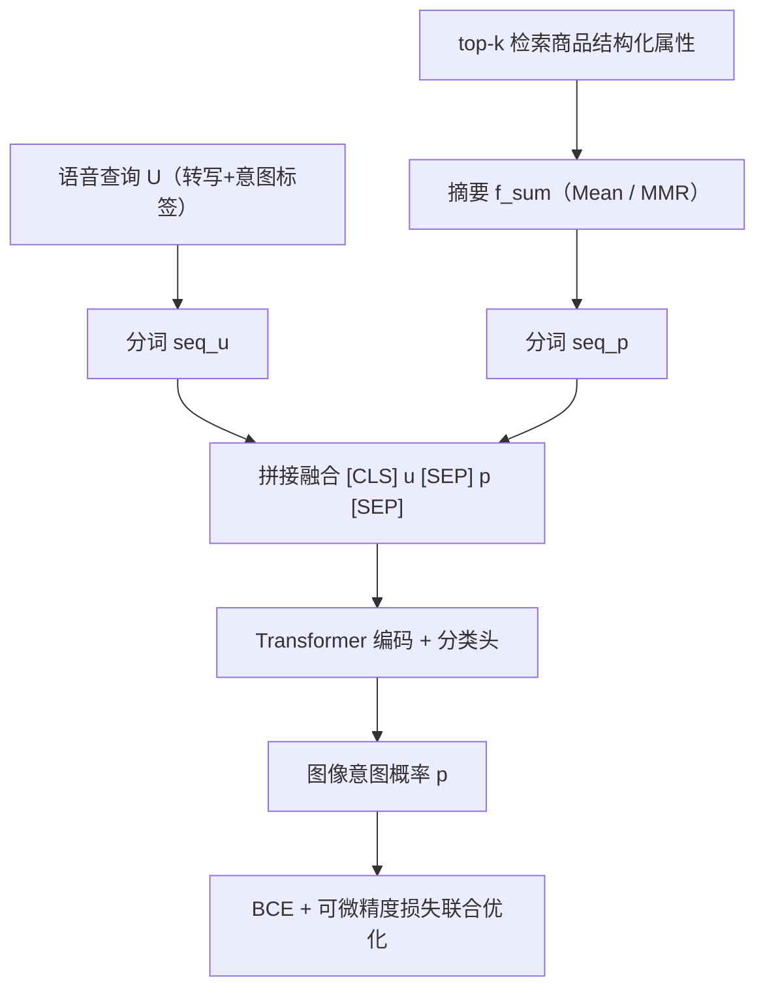
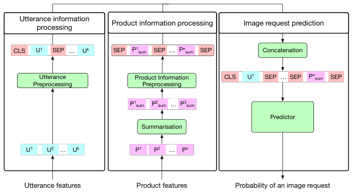

# Image-Seeking Intent Prediction for Cross-Device Product Search (跨设备商品搜索中的图像寻求意图预测)

- **会议/期刊**: RecSys 2025 Workshop on Generative AI for E-commerce (Oral)
- **作者与机构**: Mariya Hendriksen (Oxford)、Svitlana Vakulenko (WU Vienna)、Jordan Massiah / Gabriella Kazai / Emine Yilmaz (Amazon)
- **推荐链路定位**: 召回前置的意图判别（决定是否触发跨设备视觉模态切换）
- **研究方向**: 多模态推荐 / 对话与智能体推荐
- **论文原文**: [https://arxiv.org/abs/2511.14764v1](https://arxiv.org/abs/2511.14764v1)
- **开源代码**: 暂未开源

## TL;DR (1分钟核心速览)

无屏语音助手在商品搜索中常遇到"必须看图才能决策"的查询，但盲目建议切换到带屏设备会带来严重摩擦，因此这是一个**高精度优先、极度不平衡**的二分类问题。本文提出新任务 Image-Seeking Intent Prediction 与模型 IRP：将语音转写与 top-$k$检索商品的摘要化元数据拼接送入 Transformer 编码器，并用**可微精度损失**替代纯 BCE 抑制假阳性。在 90 万条真实生产语音查询上，融合商品摘要后 Precision 由 77.83 提升至 78.47，$F_{0.5}$ 最高达 73.55。

## Background & Motivation (背景与核心矛盾)

- **主流范式**: 跨设备搜索研究长期聚焦"预测用户下一个会使用哪台设备"（device transition prediction），多模态电商检索则聚焦"如何融合图文提升排序精度"。
- **前人局限**: 其一，既有工作假设模态固定，只优化检索准确率或对话生成质量，**从不判断"当前查询是否根本不该在无屏设备上回答"**；其二，设备切换的直接监督信号几乎不存在，人工标注视觉意图在大规模场景下成本不可承受。
- **核心洞察 (Key Insight)**: 用户在带屏设备上"点击打开图片轮播"这一行为，是视觉信息需求的**弱但可规模化**的代理信号——若某语音查询在带屏端被点开图库，说明该查询本质上需要视觉模态。
- **本文切入点**: 把"是否建议切屏"重构为以图库点击为弱标签的二分类任务，并用商品检索结果作为查询语义的补充上下文，配合精度导向损失直接优化"少误报"这一业务目标。

## Method (核心方法设计)

### 1. 整体框架 (Overall Architecture)

IRP 采用双流编码 + 晚期融合结构：语音查询经转写与分词得到 `seq_u`；top-$k$ 检索商品的结构化属性（标题、品牌、尺码、颜色、评论、价格、风格、类目等）先经摘要函数压缩为单一向量再分词得到 `seq_p`；两段序列以 `[CLS] u [SEP] p [SEP]` 形式拼接，送入 Transformer 编码器取 `[CLS]` 表示，经分类头输出图像意图概率。训练阶段在 BCE 之外叠加可微精度损失，推理阶段仅需一次前向即可给出是否触发切屏建议。

<figure class="paper-figure" markdown="span">
  <figcaption>图1：IRP 架构。查询和商品信息分别经过各自的流水线处理，融合为联合表示，再送入预测头以估计图像搜索意图的可能性。</figcaption>
</figure>

### 2. 关键设计拆解 (Key Designs)

1. **商品信息摘要化表征（Mean Pooling vs. MMR）**：直接把 top-$k$商品全部属性拼进输入会超出长度限制且引入噪声。作者用两种压缩算子：均值聚合$p_{sum}=\frac{1}{k}\sum_{j=1}^{k}p^{(j)}$ 保留整体商品分布，或用 MMR 在相关性与多样性间做贪心选择以保留互补属性。直觉是：视觉意图往往由"商品品类 + 外观属性"共同决定，摘要化既控长度又提纯了与视觉相关的信号。

2. **可微精度损失（Differentiable Precision Loss）**：业务上假阳性（无必要切屏）代价远高于假阴性，但 Precision 不可导。作者用 sigmoid 输出的软计数构造代理：$\mathcal{L}_{Precision}=1-\frac{TP}{TP+FP}$，其中$TP=\sum\hat{y}\cdot y$、$FP=\sum\hat{y}\cdot(1-y)$。该式直接对"预测为正的样本中正确比例"施加梯度，使模型在正类稀疏时主动压低高置信误报。

3. **训练目标与推理开销**：总损失为 $\mathcal{L}_{Sum}=\alpha\mathcal{L}_{BCE}+\beta\mathcal{L}_{Precision}$，通过$\alpha,\beta$调节准确率与精度的权衡；训练采用 20 epoch、batch size 128、lr$2e^{-5}$、weight decay$1e^{-2}$、AdamW。任务本身为二分类，**不涉及负采样**（全量真实交互即样本），推理为单次 Transformer 前向，DistilBERT 版本仅 66M 参数，适合在线低延迟触发。

## Experimental Setup & Evaluation Protocol (实验设置与评估协议)

- **数据集与预处理**: 来自生产级多设备电商助手 2022 年 8–12 月的去标识化日志，初始采样 220 万条交互，约 10% 含图库打开动作；进一步过滤为"用户显式语音触发"的高质量子集，得 90 万条语音交互，其中 20% 后续打开图库（正类比例 20%，属不平衡但非极端稀疏）。

| 数据集 | #Users | #Items | #Interactions | 正类比例 | 特征/场景说明 |
| :--- | :---: | :---: | :---: | :---: | :--- |
| 生产多设备助手日志（私有） | 未披露 | top-10 检索/查询 | 900K 语音查询（原始 2.2M） | 20% 图库点击 | 语音转写+意图标签+商品 9 类结构化属性 |

- **数据划分与防穿越 (Splitting Strategy)**: 原文未明确披露训练/验证/测试的具体划分比例与时间切分方式（仅说明为五个月日志采样），这是复现性上的一个缺口。
- **排名评测协议 (Ranking Protocol)**: 非排序任务，采用**阈值化二分类指标**：Precision、Recall 与 $F_{\beta}$（$\beta=0.5$，显式偏向精度），未使用 Full-Ranking 或采样排序协议。
- **对比基线与超参设置**: 基线为特征消融式对照（Utterance / Intent / Title 及其组合）与三种骨干（DistilBERT 66M、RoBERTa 125M、XLNet 340M）；未与外部已发表模型对比，属任务首创型论文的典型设定。

## Key Experimental Results (实验关键数据)

### 1. 主实验对比 (Main Results)

特征贡献分析（Table 1，骨干为 DistilBERT）：

| 特征组合 | Precision | Recall | $F_{0.5}$ |
| :--- | :---: | :---: | :---: |
| Utterance | 77.83 | 64.92 | 73.41 |
| Intent | 76.12 | 40.53 | 56.32 |
| Title (top-1) | 76.59 | 56.76 | 68.90 |
| Utterance + Intent | 77.93 | **65.11** | **73.55** |
| Utterance + Title | 77.91 | 63.75 | 72.94 |
| Utterance + Intent + Title | **78.11** | 64.19 | 73.23 |
| IRP（全属性 + Mean 摘要） | **78.47** | 60.42 | 71.61 |

商品摘要方式对比（Table 2）：Mean 聚合 Precision **78.47**（最高），MMR 取得最高 Recall 61.94 与 $F_{0.5}$ **72.27**，两者均优于仅用商品标题（68.90）。

### 2. 消融实验 (Ablation Study)

损失函数消融（Table 3，节选关键配置）：

| 配置 | 损失 | Precision | Recall | $F_{0.5}$ |
| :--- | :--- | :---: | :---: | :---: |
| Utterance | $\mathcal{L}_{BCE}$ | 77.83 | 64.92 | 73.41 |
| Utterance | $\mathcal{L}_{Precision}$ | 77.59 | **65.54** | **73.55** |
| Utterance | $\mathcal{L}_{Sum}$ | **77.89** | 64.02 | 73.05 |
| IRP 全特征 | $\mathcal{L}_{BCE}$ | **78.47** | 60.42 | 71.61 |
| IRP 全特征 | $\mathcal{L}_{Precision}$ | 77.99 | **62.87** | **72.58** |
| IRP 全特征 | $\mathcal{L}_{Sum}$ | 78.22 | 63.27 | 72.87 |

骨干消融（Table 4）：

| 骨干 | Precision | Recall | $F_{0.5}$ | #Params |
| :--- | :---: | :---: | :---: | :---: |
| DistilBERT | 78.47 | 60.42 | 71.61 | 66M |
| RoBERTa | **78.78** | 59.28 | 71.14 | 125M |
| XLNet | 78.79 | **60.64** | **71.85** | 340M |

### 3. 关键实验发现 (Key Findings)

1. **查询语义是主信号，商品元数据是增益项而非替代项**：单用 Utterance 已达 $F_{0.5}$=73.41，而 Intent 单独仅 56.32（Recall 崩至 40.53），说明意图标签高度稀疏、信息量远低于原始转写；但 Utterance+Intent+Title 把 Precision 推到 78.11，证明商品侧信息主要贡献"精度"而非"覆盖"。
2. **摘要化比原始标题更有效，且摘要策略决定精度-召回取向**：全属性 Mean 摘要将 Precision 从 76.59（Title）抬到 78.47，MMR 则以 61.94 的 Recall 换取更均衡的 $F_{0.5}$=72.27——即"要精度选 Mean，要平衡选 MMR"，为线上按业务容忍度调参提供了直接依据。
3. **精度损失的价值体现在召回侧而非精度侧**：在全特征 IRP 上，$\mathcal{L}_{Precision}$使 Recall 从 60.42 升至 62.87、$F_{0.5}$从 71.61 升至 72.58，而 Precision 略降；$\mathcal{L}_{Sum}$ 则在 Precision 78.22 与 Recall 63.27 间取得折中。这说明可微精度项实际是"在保持高精度平台期的同时释放被过度压制的正例"，而非单纯抬高精度阈值。

## Highlights & Limitations (亮点、对比与审稿批判)

- **与代表作对比 (vs. Prior Work)**: 相较跨设备搜索的 device-transition 预测（预测"下一台设备"），本文预测"是否应当建议切换"，是决策而非预测；相较多模态电商检索（融合图文做排序），本文不融合模态做相关性，而是**用商品元数据反推模态需求**；相较对话推荐中的意图识别，本文监督信号来自图库点击这一模态特异行为，而非任务意图或物品相关性。
- **可迁移亮点**: (1) 用"下游模态交互行为"构造弱监督代理标签，可低成本迁移到"是否触发视频/AR/语音播报"等模态路由场景；(2) 可微精度损失 $\mathcal{L}_{Precision}=1-TP/(TP+FP)$ 可直接插入任何高精度优先的触发式判别模型（如推送打扰控制、主动澄清问句触发）。
- **审稿级局限批判**: (1) 代理标签存在系统性偏差——未点击图库不等于无视觉需求（用户可能已放弃或未注意到图库），标签噪声未被量化，且 20% 正类比例与真实"应切屏"分布未必一致；(2) 评估完全离线且无外部基线、无划分细节披露，缺少线上 A/B 对用户满意度与切屏接受率的验证，同时模型强依赖高质量结构化商品元数据，跨域迁移性存疑。

## Rating (四维评分)

- **方法创新性 (Novelty)**: ⭐⭐⭐ （任务定义本身是主要贡献，模型结构为标准双流 Transformer 拼接，可微精度损失为已有代理指标的迁移应用，机制新颖度中等）
- **评估协议与实验扎实度 (Protocol & Experiments)**: ⭐⭐⭐ （90 万真实生产数据规模可观、消融覆盖特征/摘要/损失/骨干四维，但缺少外部 SOTA 对比、数据划分细节与线上验证）
- **写作与数学规范度 (Clarity & Rigor)**: ⭐⭐⭐⭐ （任务形式化、三模块拆解与损失定义清晰，公式简洁无冗余，唯摘要算子与融合细节的推导略浅）
- **工业落地与复现价值 (Industrial & Practical Value)**: ⭐⭐⭐⭐ （DistilBERT 66M 版本以极小精度损失换取部署友好性，单次前向即可在线触发，工程价值明确；但数据与代码均未开源，复现受限）

