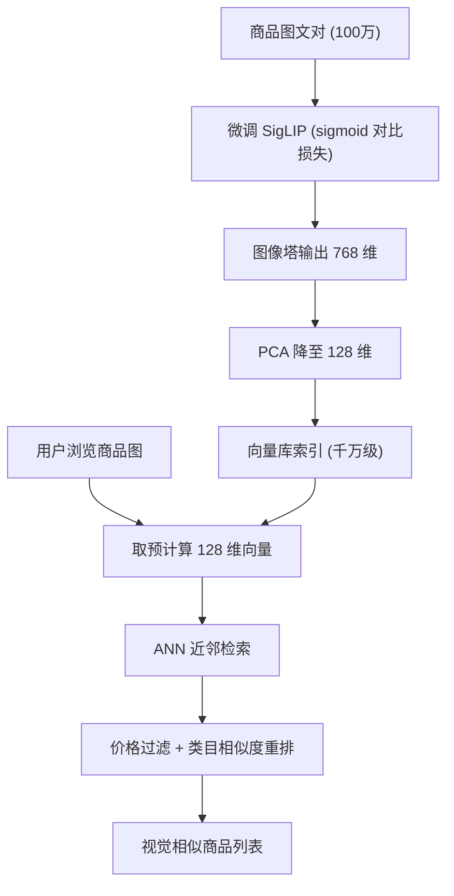
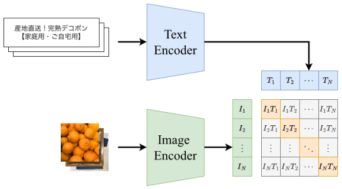

# Improving Visual Recommendation on E-commerce Platforms Using Vision-Language Models (基于视觉语言模型的电商视觉推荐改进)

- **会议/期刊**: ACM RecSys 2025 (Spotlight)
- **作者与机构**: Yuki Yada, Sho Akiyama, Ryo Watanabe, Yuta Ueno, Yusuke Shido, Andre Rusli（Mercari, Inc.）
- **推荐链路定位**: 召回（视觉相似物品 i2i 召回）
- **研究方向**: 多模态推荐 / 协同过滤与双塔召回
- **论文原文**: [https://arxiv.org/abs/2510.13359v1](https://arxiv.org/abs/2510.13359v1)
- **开源代码**: 暂未开源

## TL;DR (1分钟核心速览)

针对 C2C 电商（Mercari，月活 2000 万+）中用户自建商品缺乏标准商品 ID 与规范文本、纯文本特征难以刻画颜色/形状/纹理等视觉偏好的痛点，本文用 100 万条商品图文对微调 SigLIP（sigmoid 对比损失），产出图像编码器并接入 ANN 向量库做视觉相似召回，再用 PCA 将 768 维压到 128 维以控存储。离线基于历史曝光/点击日志评测，nDCG@5 相对 MobileNetV2 基线提升 9.1%；线上 A/B 测试 CTR +50%、CVR +14%。

## Background & Motivation (背景与核心矛盾)

- **主流范式**: 视觉相似推荐的标准流水线是「查询图 → 图像编码器出向量 → 向量库 ANN 近邻检索」，系统上限几乎完全由图像编码器质量决定；工业界普遍沿用 ResNet / MobileNet 这类 ImageNet 分类预训练 CNN。
- **前人局限**: 其一，分类预训练 CNN 的监督信号是类别标签，对细粒度属性（花纹、材质、款式细节）与跨类目相似性（如"同风格不同品类"）不敏感；其二，C2C 场景下标题常被用户当作聊天消息使用（"reserved" 商品尤甚），文本描述与图像严重不对齐，单模态视觉特征无法借语义先验补足。
- **核心洞察 (Key Insight)**: 大规模图文对预训练的 VLM 已把"视觉外观"与"语义概念"对齐到同一空间，其零样本/迁移能力在图文检索上显著优于分类预训练 CNN；而 SigLIP 的 sigmoid 对比损失不依赖 in-batch 负样本的 softmax 归一化，对 batch size 与学习率更鲁棒，更适合工业微调。
- **本文切入点**: 不做新模型结构，而是把"微调 SigLIP + PCA 降维 + ANN 索引"这条极简工程链路完整跑通并给出离线 + 线上双重证据。

## Method (核心方法设计)

### 1. 整体框架 (Overall Architecture)

系统分训练与 serving 两条链路。训练侧：取 Mercari 三个月（2024-04-29 至 07-29）约 8.53 亿条上架记录，剔除标题被当作私信的 "reserved" 商品后采样 100 万条图文对，以对比损失微调多语言 SigLIP（ViT B/16 图像塔 + B 级 Transformer 文本塔）。Serving 侧：新商品上架即由微调图像塔产出 768 维向量，经 PCA 投影至 128 维后连同 item ID 写入向量库；用户浏览某商品时，实时取该商品预计算向量作 query 做 ANN 检索，候选再经价格过滤与类目相似度重排后展示。

<figure class="paper-figure" markdown="span">
  <figcaption>图2：训练流程。𝐼1, . . . , 𝐼𝑛表示商品图像1至𝑁的嵌入向量，𝑇1, . . . ,𝑇𝑛表示商品标题1至𝑁对应的嵌入向量。</figcaption>
</figure>

### 2. 关键设计拆解 (Key Designs)

1. **SigLIP 图文对比微调（把商品域语义注入视觉塔）**：痛点在于 ImageNet 分类预训练的监督目标与"商品相似"语义错位。本文沿用 SigLIP 的成对 sigmoid 损失，对每个图文对独立判定正负而非全 batch softmax 归一化：

$$\mathcal{L}=-\frac{1}{|\mathcal{B}|}\sum_{i=1}^{|\mathcal{B}|}\sum_{j=1}^{|\mathcal{B}|}\log\sigma\left(z_{ij}\left(\boldsymbol{u}_i^{\top}\boldsymbol{v}_j/\tau+b\right)\right)$$

其中 $\boldsymbol{u}_i,\boldsymbol{v}_j$为图像/文本归一化嵌入，$z_{ij}\in\{+1,-1\}$为配对指示，$\tau,b$ 为可学习温度与偏置。直觉：解耦了"负样本必须来自同 batch"的耦合，使小 batch 下梯度依然稳定，且每个非对角对都被显式当作负例压制，等价于更充分的隐式负采样。

2. **PCA 降维（768 → 128）**：千万级商品向量库的存储与 ANN 延迟是硬约束。在 2000 万条商品嵌入上拟合 PCA 投影，存储下降约 83%，而 nDCG@5 仅从 0.662 掉到 0.647（-2.3%），仍领先基线 6.6%。直觉：VLM 嵌入存在显著低秩冗余，主成分已承载绝大部分判别信息。

3. **训练配置与推理开销**：5 epoch、batch size 256、学习率 5e-5、NVIDIA L4；负样本即 batch 内非配对图文（in-batch negatives），无需额外难负采样挖掘。线上为异步预计算 + 实时 ANN 检索，编码开销与请求解耦，单次推荐仅一次 ANN 查询。

## Experimental Setup & Evaluation Protocol (实验设置与评估协议)

- **数据集与预处理**: 训练集为 Mercari 真实上架数据（2024-04-29 ~ 07-29，约 8.53 亿条），剔除 "reserved" 商品后采样 100 万图文对；离线评测使用历史用户曝光与点击日志。

| 数据集 | #Users | #Items | #Interactions | 稀疏度/密度 | 特征/场景说明 |
| :--- | :---: | :---: | :---: | :---: | :--- |
| Mercari 训练集 | — | ~8.53 亿上架 | 100 万图文对 | — | C2C 二手商品，图文对 |
| Mercari 离线日志 | 未披露 | 千万级索引 | 曝光/点击日志 | — | 视觉相似模块真实曝光 |

- **数据划分与防穿越 (Splitting Strategy)**: 原文未明确说明离线日志的训练/测试切分方式（未给出时间戳切分或 Leave-One-Out 细节），仅说明使用历史曝光与点击日志度量相关性，属本文可复现性短板。
- **排名评测协议 (Ranking Protocol)**: 基于真实曝光日志计算 nDCG@k 与 Precision@k，属**日志驱动的离线相关性评测**，而非标准全库 Full-Ranking 或固定负采样排序；线上以 A/B 测试的 CTR/CVR 为最终判据。
- **对比基线与超参设置**: 基线为线上在用的 ImageNet 预训练 MobileNetV2（`mobilenet_v2_1.4_224`）；主模型为 `siglip-base-patch16-256-multilingual`，嵌入 768 维，PCA 后 128 维；线上显著性以 A/B 实验为准（原文未报 p 值）。

## Key Experimental Results (实验关键数据)

### 1. 主实验对比 (Main Results)

| Model | nDCG@5 | Precision@1 | Precision@3 |
| :--- | :---: | :---: | :---: |
| MobileNetV2 (baseline) | 0.607 | 0.356 | 0.601 |
| **SigLIP (768d)** | **0.662** | **0.412** | **0.660** |
| SigLIP + PCA (128d) | 0.647 | 0.406 | 0.658 |
| Improv. (SigLIP vs. base) | **+9.1%** | **+15.7%** | **+9.8%** |

线上 A/B（"Visually Similar Items" 模块，treatment = SigLIP+PCA 128d，control = MobileNetV2）：**CTR +50%**，**CVR +14%**。

### 2. 消融实验 (Ablation Study)

| 配置 | nDCG@5 | 相对完整 SigLIP | 说明 |
| :--- | :---: | :---: | :--- |
| MobileNetV2 | 0.607 | -8.3% | 分类预训练 CNN |
| SigLIP 全维 (768d) | 0.662 | — | 效果上限 |
| SigLIP + PCA (128d) | 0.647 | -2.3% | 存储 -83% 的折中 |

### 3. 关键实验发现 (Key Findings)

1. **编码器预训练目标比容量更关键**：MobileNetV2 与 ViT B/16 参数量同量级，但图文对齐预训练带来 nDCG@5 从 0.607 到 0.662 的跃升，说明"相似"的定义应由语义监督而非类别监督提供。
2. **PCA 降维的性价比极高**：维度压缩 6 倍仅损失 2.3% nDCG@5，却换来 83% 存储节省，且压缩后仍领先基线 6.6%——说明 VLM 嵌入高度低秩，工业部署不必为维度买单。
3. **离线增益被线上放大而非衰减**：离线 +9.1% nDCG 对应线上 +50% CTR，量级差异提示离线日志指标与真实用户兴趣存在系统性 gap，也说明视觉召回的质量提升在真实流量中触发了显著的正反馈（更准的相似项 → 更高点击意愿）。

## Highlights & Limitations (亮点、对比与审稿批判)

- **与代表作对比 (vs. Prior Work)**: 相较 Pinterest [15]、eBay [14] 等从零构建、聚焦"查询图内区域定位 + 类目级相似"的视觉搜索系统，本文直接复用现成 VLM 做整图嵌入 + ANN 检索，工程成本极低；相较 CLIP 系 softmax 对比损失，SigLIP 的 sigmoid 损失在小 batch 微调下更稳，这是本文选择其作为底座的关键理由。
- **可迁移亮点**: ① "VLM 微调 → PCA 降维 → ANN 索引"三段式是任何 i2i 召回场景（短视频封面、房源图、二手奢侈品）的低成本起量模板；② 剔除 "reserved" 噪声样本这一数据清洗细节，对 C2C 图文对训练集构建有直接借鉴价值。
- **审稿级局限批判**: ① 离线评测协议披露不足——未说明日志切分、候选集构造与是否全库排序，nDCG 数值难以与其他论文横向比较，且仅一个基线（MobileNetV2）缺乏与 CLIP、其他 VLM 的对照；② 线上 CTR +50% 幅度异常大，未报告置信区间、实验时长与流量分配，也未分析增益是否部分来自重排/过滤规则变更；③ 系统仍是纯视觉 i2i，未引入用户个性化信号，作者亦在结论中承认这是未来工作。

## Rating (四维评分)

- **方法创新性 (Novelty)**: ⭐⭐ （本质是成熟 VLM 的领域微调 + PCA 工程组合，无新算子或新损失，创新在落地验证而非算法）
- **评估协议与实验扎实度 (Protocol & Experiments)**: ⭐⭐⭐ （具备罕见的线上 A/B 证据，但离线切分与候选协议披露不足、基线单一、缺显著性检验）
- **写作与数学规范度 (Clarity & Rigor)**: ⭐⭐⭐⭐ （4 页短文结构清晰、流水线交代完整，公式极简但够用，未给复杂度分析）
- **工业落地与复现价值 (Industrial & Practical Value)**: ⭐⭐⭐⭐⭐ （千万级向量库真实部署 + 存储降 83% + 双指标线上增益，是可直接照抄的工业范式，唯代码未开源）

