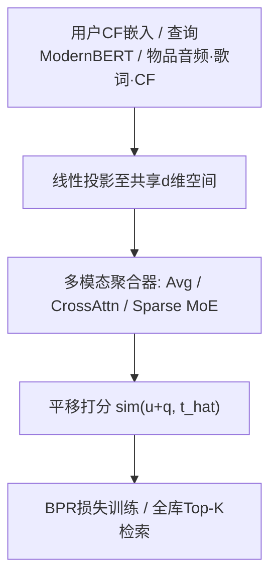
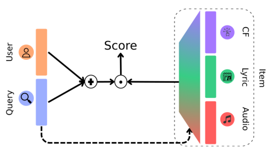
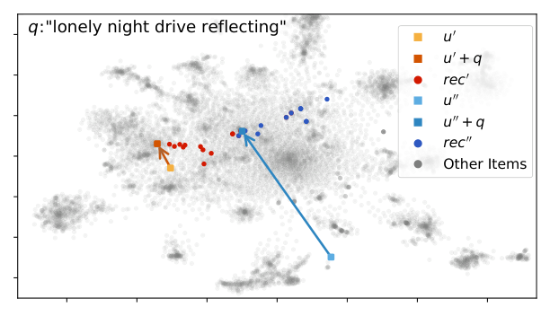

# Just Ask for Music (JAM): Multimodal and Personalized Natural Language Music Recommendation (自然语言音乐推荐：把查询当作平移向量)

- **会议/期刊**: RecSys 2025
- **作者与机构**: Alessandro B. Melchiorre、Elena V. Epure 等（JKU Linz / Criteo AI Lab / Deezer Research）
- **推荐链路定位**: 召回（检索式自然语言接口，可嵌入既有推荐栈）
- **研究方向**: 多模态推荐 / 大语言模型推荐（轻量文本编码器路线）
- **论文原文**: [https://arxiv.org/abs/2507.15826v1](https://arxiv.org/abs/2507.15826v1)
- **开源代码**: [https://github.com/hcai-mms/jam](https://github.com/hcai-mms/jam)

## TL;DR (1分钟核心速览)

现有自然语言音乐推荐要么依赖昂贵 LLM 端到端生成，要么用对比学习检索但只用单模态物品表征、忽略长期用户偏好、且需全栈重训。JAM 借鉴 TransE，把查询 $\boldsymbol{q}$建模为用户$\boldsymbol{u}$到物品$\boldsymbol{t}$的**向量平移**（$\boldsymbol{u}+\boldsymbol{q}\approx\hat{\boldsymbol{t}}$），并用交叉注意力按查询动态加权音频/歌词/CF 三模态。在自建 JAMSessions（11.2 万三元组）上按时间切分、全库排序，CrossMixing 变体 NDCG@10 达 0.311，较 TalkRec（0.152）提升约 105%。

## Background & Motivation (背景与核心矛盾)

- **主流范式**: 两条路线——LLM 直接做对话式推荐（表达力强但微调贵、推理慢、幻觉多、新物品新用户表现差）；小模型对比学习检索（query 与 item 投影到共享空间，可与 CF/内容侧组件拼接）。
- **前人局限**: ① 物品侧只用单一信息源（仅元数据 / 仅标签 / 仅音频），无法把 "love songs" 这类查询对齐到歌词语义；② 只建模会话内短期意图，长期偏好被丢弃，而音乐推荐恰恰高度依赖历史行为个性化；③ 多数管线假设全模型重训，与工业上"分模块迭代"的现实冲突。
- **核心洞察 (Key Insight)**: 知识图谱嵌入中 TransE 的平移几何天然契合"用户 + 意图 → 物品"的语义结构：同一查询从不同用户出发应落到不同物品区域，同一用户不同查询应落到不同区域——这正是个性化 + 意图解耦所需。
- **本文切入点**: 冻结预训练的用户/物品/查询表征，仅学一层线性投影 + 一个多模态聚合器，用 BPR 式平移损失训练，实现"即插即用"的轻量自然语言召回层。

## Method (核心方法设计)

### 1. 整体框架 (Overall Architecture)

输入为三元组 $(u,q,t)$：用户$\tilde{\boldsymbol{u}}$取 CF 长期画像嵌入，查询$\tilde{\boldsymbol{q}}$由 ModernBERT-base 编码，物品$\tilde{\boldsymbol{t}}_i$含音频（对比学习音频编码器）、歌词（multilingual-e5-base）、CF 三路模态嵌入。三者各经一层前馈网络投影到$d$维共享空间得到$\boldsymbol{u},\boldsymbol{q},\boldsymbol{t}_i$；多模态聚合器把$\{\boldsymbol{t}_i\}$融合为$\hat{\boldsymbol{t}}$；以$\boldsymbol{u}+\boldsymbol{q}$与$\hat{\boldsymbol{t}}$的点积做 BPR 排序训练；推理时对全库物品算$\mathrm{sim}(\boldsymbol{u}+\boldsymbol{q},\hat{\boldsymbol{t}})$ 取 Top-K。由于预训练表征全部冻结，模型可独立替换/升级任一上游编码器而不触发全栈重训。

<figure class="paper-figure" markdown="span">
  <figcaption>图1：JAM（Just Ask for Music）框架概览。</figcaption>
</figure>

### 2. 关键设计拆解 (Key Designs)

1. **平移式三元组建模（TransE 迁移）**：痛点是把"个性化"与"查询意图"混在一个塔里，导致同一查询对不同用户给出相同结果。JAM 令 $\boldsymbol{u}+\boldsymbol{q}=\hat{\boldsymbol{t}}$，打分即$\mathrm{sim}(\boldsymbol{u}+\boldsymbol{q},\hat{\boldsymbol{t}})$。几何直觉：查询是空间中的"位移向量"，起点（用户）不同则终点（推荐物品）不同，从而在单一公式内同时编码长期偏好与短期意图，且无需为每个用户单独建塔。

2. **查询条件化的多模态聚合（CrossMixing）**：痛点是等权平均无法体现"upbeat motif"更依赖音频、"love songs"更依赖歌词。JAM 用查询作 query、各模态作 key/value 做缩放点积注意力：
$$\hat{\boldsymbol{t}}=\sum_{i=1}^{N_{\text{mod}}}\alpha(\tilde{\boldsymbol{t}}_i,\tilde{\boldsymbol{q}})\,\boldsymbol{t}_i,\quad \alpha=\mathrm{Softmax}\!\left(\frac{(\boldsymbol{W}_{\text{key}}^{\tilde{t}_i}\tilde{\boldsymbol{t}}_i)^\top(\boldsymbol{W}_{\text{query}}^{\tilde{q}}\tilde{\boldsymbol{q}})}{\sqrt{d}}\right)$$
使模态权重随查询语义动态重分配。对照的 Sparse MoE 变体用 Noisy Top-K 门控（$K=2$）强制稀疏激活，反而因丢弃模态信息而掉点。

3. **训练目标与推理效率**：损失为 BPR 形式
$$\mathcal{L}=-\sum_{(u,q,t)\in\mathcal{D}}\sum_{t_{\text{neg}}}\log\sigma\big(\mathrm{sim}(\boldsymbol{u}+\boldsymbol{q},\hat{\boldsymbol{t}})-\mathrm{sim}(\boldsymbol{u}+\boldsymbol{q},\hat{\boldsymbol{t}}_{\text{neg}})\big)$$
每正样本采 4 个负样本（均匀采样，非难负例）。由于只训练线性层与聚合器，参数量极小；物品侧 $\hat{\boldsymbol{t}}$ 可离线预计算并建 ANN 索引，在线仅需一次查询编码 + 向量加法 + 近邻检索，延迟远低于 LLM 生成式方案。

## Experimental Setup & Evaluation Protocol (实验设置与评估协议)

- **数据集与预处理**: 自建 JAMSessions，采样自 Deezer 2025 年 3 月一周搜索日志；每条记录 = 用户输入查询 → 点击编辑精选歌单并收听超 10 分钟。查询经 DeepSeek-R1-Distill-Qwen-7B 用歌单标题/描述做两 shot 增强（限 20 词）。

| 数据集 | #Users | #Items | #Interactions | 稀疏度/密度 | 特征/场景说明 |
| :--- | :---: | :---: | :---: | :---: | :--- |
| JAMSessions | 103,752 | 99,865 | 112,337 | 约 $1.1\times10^{-5}$ | 查询+歌单+用户三元组，含预计算多模态嵌入 |
| CPCD（对比） | 917 | 106,736 | 917 | — | 仅对话，规模不足以训练 |
| 30Music（对比） | 45,167 | 5,675,143 | 57,561 | — | 歌单挖掘，标题噪声大 |

- **数据划分与防穿越 (Splitting Strategy)**: **全局时间戳切分**——最后一天查询为测试集，前一天为验证集，其余训练，严格避免未来信息泄漏。
- **排名评测协议 (Ranking Protocol)**: **Full-Ranking 全库排序**（对全部 99,865 首曲目打分），指标 Recall@10/100 与 NDCG@10/100，三次随机种子取均值与标准差。
- **对比基线与超参设置**: Random、Pop、TalkRec（多模态对比学习，含 query 无 user）、TwoTower（拼接多模态 + MLP，含 user 无 query）。AdamW、50 epoch、batch 512、每正样本 4 负例、余弦退火、验证集 NDCG@10 早停（patience 10）；$d$ 与学习率对所有基线统一调优。

## Key Experimental Results (实验关键数据)

### 1. 主实验对比 (Main Results)

| 模型 | 使用 $q$| 使用$u$ | Recall@10 | Recall@100 | NDCG@10 | NDCG@100 |
| :--- | :---: | :---: | :---: | :---: | :---: | :---: |
| Random | ✗ | ✗ | 0.000 | 0.001 | 0.001 | 0.001 |
| Pop | ✗ | ✗ | 0.012 | 0.084 | 0.073 | 0.079 |
| TalkRec | ✓ | ✗ | 0.041 | 0.159 | 0.152 | 0.144 |
| TwoTower | ✗ | ✓ | 0.024 | 0.136 | 0.110 | 0.118 |
| JAM AvgMixing | ✓ | ✓ | 0.072 | 0.313 | 0.258 | 0.274 |
| **JAM CrossMixing** | ✓ | ✓ | **0.086** | **0.371** | **0.311** | **0.327** |
| JAM MoE ($K{=}2$) | ✓ | ✓ | 0.048 | 0.252 | 0.180 | 0.211 |
| JAM MoE ($K{=}1$) | ✓ | ✓ | 0.036 | 0.165 | 0.128 | 0.142 |

CrossMixing 相对最强基线 TalkRec：NDCG@10 提升 **+104.6%**，Recall@100 提升 **+133.3%**；相对 TwoTower NDCG@10 提升 **+182.7%**。

### 2. 消融实验 (Ablation Study)

| 配置 | Recall@10 | NDCG@10 | 相对 CrossMixing 变化 |
| :--- | :---: | :---: | :---: |
| CrossMixing（完整） | **0.086** | **0.311** | — |
| w/ AvgMixing（等权平均） | 0.072 | 0.258 | NDCG@10 −17.0% |
| w/ MoE $K{=}2$（稀疏双专家） | 0.048 | 0.180 | NDCG@10 −42.1% |
| w/ MoE $K{=}1$（单专家） | 0.036 | 0.128 | NDCG@10 −58.8% |
| w/o $u$（即 TalkRec 式） | 0.041 | 0.152 | NDCG@10 −51.1% |
| w/o $q$（即 TwoTower 式） | 0.024 | 0.110 | NDCG@10 −64.6% |

### 3. 关键实验发现 (Key Findings)

1. **用户与查询缺一不可，且查询更关键**：去掉 $u$掉 51.1%、去掉$q$ 掉 64.6%（NDCG@10），说明短期意图是检索的主导信号，但长期画像提供不可替代的个性化增益；两者结合才产生超线性收益（0.311 远高于 0.152 与 0.110 之和的直觉预期）。
2. **模态聚合"软加权"优于"硬稀疏"**：CrossMixing 比 AvgMixing 高 17.0%，而 MoE 从 $K{=}2$降到$K{=}1$ 再掉 16.8 个百分点——说明三模态对查询回答均有贡献，Top-K 门控的硬截断造成信息损失；注意力权重分析显示 CF 模态权重最高，作者归因于用户与物品 CF 嵌入是联合预训练的，存在初始化偏置。
3. **平移空间具备可解释的个性化性质**：同一查询 "partying like crazy" 下，用户 $u'$得到德语/奥地利舞曲，$u''$得到巴西 axé 与 marchinha；同一用户下 "cartoon music for kids" 返回《猫儿历险记》原声，"feeling lonely and sad" 返回 Billie Eilish 等另类/民谣——定性验证了$\boldsymbol{u}+\boldsymbol{q}$ 的位移语义。

<figure class="paper-figure" markdown="span">
  <figcaption>图2：物品嵌入的TSNE，两个用户（u’、u"）、他们在同一查询（q）下的翻译以及推荐（rec’、rec"）。R𝑑中的等价翻译在二维中可能看起来不同。</figcaption>
</figure>

## Highlights & Limitations (亮点、对比与审稿批判)

- **与代表作对比 (vs. Prior Work)**: 相比 TalkRec（对比学习、仅 query、单塔式模态对齐），JAM 引入用户平移起点实现个性化；相比 TwoTower（仅 user、无 query），JAM 补上短期意图通道；相比 LLM 对话推荐（如 CPCD 上的生成式方案），JAM 用 ModernBERT + 线性层把训练与推理成本压到可工业部署量级，且冻结上游表征支持模块化迭代。
- **可迁移亮点**: ① "冻结预训练表征 + 仅训投影与聚合器"的轻量适配范式，可直接迁移到图文电商、短视频搜索式推荐；② 用查询作注意力 query 动态重加权多模态，是低成本替代 MoE 路由的实用技巧。
- **审稿级局限批判**: ① 仅 6 页短文，基线只有 2 个学术模型，缺少与 LLM4Rec 检索式方法（如 CPCD 上的对比基线）及工业双塔强基线的对比，且无显著性检验；② 数据来自单一平台一周日志，查询经 LLM 增强引入噪声，且艺术家名查询（如 "Coldplay best songs"）明显失效，暴露模态语义鸿沟与稀疏性问题；③ 全库排序虽无偏，但物品侧嵌入预计算依赖上游模型版本，跨版本可比性存疑。

## Rating (四维评分)

- **方法创新性 (Novelty)**: ⭐⭐⭐⭐ （TransE 平移几何迁移到"用户+查询→物品"三元组是简洁而有效的类比，多模态聚合策略的系统对比有增量价值，但单点技术均非全新）
- **评估协议与实验扎实度 (Protocol & Experiments)**: ⭐⭐⭐ （时间切分 + 全库排序协议规范、三次种子报标准差，但基线仅 2 个、无显著性检验、数据集单一）
- **写作与数学规范度 (Clarity & Rigor)**: ⭐⭐⭐⭐ （公式极简清晰、三种聚合策略定义完整、平移性质有定性图示佐证，但缺少复杂度与超参敏感性分析）
- **工业落地与复现价值 (Industrial & Practical Value)**: ⭐⭐⭐⭐⭐ （冻结表征 + 轻量投影的即插即用设计、开源代码与 11 万三元组数据集、离线预计算 + ANN 检索的低延迟路径，工业迁移价值突出）

