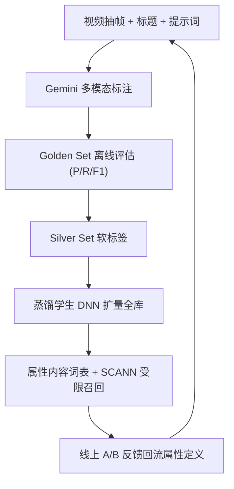
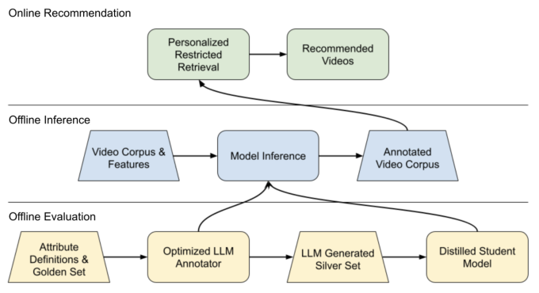

# LLM-Powered Nuanced Video Attribute Annotation for Enhanced Recommendations (基于大模型 nuanced 视频属性标注的推荐增强)

- **会议/期刊**: RecSys 2025 (Industry Track)
- **作者与机构**: Boyuan Long, Yueqi Wang, Hiloni Mehta, Mick Zomnir, Omkar Pathak, Changping Meng 等（Google / YouTube）
- **推荐链路定位**: 召回（候选生成侧的内容理解信号注入）
- **研究方向**: 多模态推荐 / 大语言模型推荐
- **论文原文**: [https://arxiv.org/abs/2510.06657v1](https://arxiv.org/abs/2510.06657v1)
- **开源代码**: 暂未开源

## TL;DR (1分钟核心速览)

传统内容理解分类器开发周期长、只能捕捉高层语义，无法刻画“真实感/治愈/燃”这类主观氛围（vibe）属性。本文提出工业级 “LLM-as-annotators” 端到端流水线：以 Gemini 多模态模型（抽帧+标题+提示词）做属性标注，用专家对齐的 Golden Set 离线评估、再用 LLM 产出的 Silver Set 蒸馏轻量 DNN 扩量到全库，最终通过“个性化受限召回”（属性词表内 SCANN 近邻检索）注入线上 Transformer 序列召回。离线 F1 达 81.33%（人类众包仅 63.21%），线上 A/B 取得用户创作参与度 +0.49%、满意消费 +0.21% 的显著提升。

## Background & Motivation (背景与核心矛盾)

- **主流范式**: 工业推荐的内容理解依赖人工标注训练专用 ML 分类器，输出题材/标签等高层语义，作为召回与排序的辅助特征。
- **前人局限**: 其一，每新增一个属性都要走“标注—训练—上线”长周期，无法跟上短视频内容潮流的周级演化；其二，分类器只能学到粗粒度类别，对“authentic / calming / inspiring”这类主观、边界模糊的氛围属性几乎无能为力。
- **核心洞察 (Key Insight)**: 多模态 LLM 的世界知识与推理能力使其可直接充当“人类级标注员”，且通过灵活提示词免去 per-task 微调；而人类标注者自身的一致性（IRR）才是标注质量的天花板——降低人的歧义即可同步降低 LLM 的歧义。
- **本文切入点**: 不做新模型结构，而是把“属性定义—评估—扩量—上线”重构为一条可高速迭代的工业流水线，用线上 A/B 作为属性定义的最终裁判。

## Method (核心方法设计)

### 1. 整体框架 (Overall Architecture)

流水线分三阶段闭环。**离线评估（黄）**：内部专家经讨论校准形成 Golden Set，用于评估 Gemini 的标注质量；验证通过的 LLM 再批量产出 Silver Set。**离线推理（蓝）**：对每日 $10^5\sim10^6$量级的优先候选视频（新发/热门/高影响）做量化、批调优、模型分片优化后的 LLM 推理，吞吐提升 2–3 倍；随后以 LLM 概率分数为软标签蒸馏学生 DNN，用预计算视频 embedding 等紧凑特征扩量至$O(10^7)$/天全库。**在线推荐（绿）**：标注结果构建各属性的内容词表，供个性化受限召回使用。三阶段由 A/B 结果反向驱动属性定义与提示词迭代，新提示词到线上实验的周期压缩至一周内。

<figure class="paper-figure" markdown="span">
  <figcaption>图1：工作流程图。工作流包含三个阶段。离线评估（黄色）使用由对齐的专家评分者验证的“黄金集”示例来评估LLM质量，随后该LLM被用于创建更大的“白银集”以蒸馏学生模型。离线推理（蓝色）处理视频语料和特征以构建LLM标注语料。在线推荐（绿色）随后利用这些标注，通过个性化检索等系统增强推荐。圆角矩形为模型/系统；梯形为数据集/流程。</figcaption>
</figure>

### 2. 关键设计拆解 (Key Designs)

1. **属性定义与 Golden Set 校准闭环**：痛点是氛围属性定义天然歧义，人类标注者间不一致会直接传导为 LLM 标注噪声。做法是先由专家多轮讨论校准出显式定义与 Golden Set，再以“假阴性复盘”反推定义漏洞——例如初版 “authentic” 提示词误排除了剪辑较多的 vlog，修正后要求模型优先判断创作者表达的真实性而非剪辑程度。直觉是：把人类歧义压到最低，LLM 的输出方差随之收敛，离线指标才具备可比较性。
2. **LLM 教师 → DNN 学生的知识蒸馏扩量**：直接 LLM 推理覆盖全库成本不可接受。做法是以 LLM 的离散标注与对应概率分数作为软标签训练轻量学生网络，输入仅为预计算视频 embedding 等紧凑特征，从零训练于百万级教师样本，复现教师在单一属性上的预测行为。核心目标是拟合教师分布而非硬标签：
$\mathcal{L}_{\text{KD}} = -\sum_{c} p^{\text{teacher}}_{c}\log p^{\text{student}}_{c}$
软标签保留了 LLM 对边界样本的不确定性，使学生在极低延迟下仅损失少量保真度，从而把“昂贵理解”民主化到全语料。
3. **个性化受限召回与训练/推理开销**：标注落地方式不是加特征，而是在生产级 Transformer 序列召回模型内，对每个被触发的属性词表做限制性 SCANN 近邻检索，属性触发由用户意图模型或启发式规则决定，词表内选品仍由序列模型统一打分。该设计把“内容理解”与“用户兴趣建模”解耦：前者离线批量更新，后者在线实时推理，新增属性无需重训召回主模型，这是迭代速度的关键来源。

## Experimental Setup & Evaluation Protocol (实验设置与评估协议)

- **数据集与预处理**: 本文为工业 case study，未公开数据集统计。评估语料为生产短视频库，标注对象为每日优先候选集（$10^5\sim10^6$）与全库扩量集（$O(10^7)$）；Golden Set 由内部专家多轮校准人工标注，Silver Set 由 LLM 生成。

| 数据集 | 规模 | 标注来源 | 用途 |
| :--- | :---: | :---: | :--- |
| Golden Set | 未披露（专家人工） | 内部专家校准 | 离线质量评估基准 |
| Silver Set | 百万级 | Gemini 软标签 | 蒸馏学生 DNN |
| 全库标注语料 | $O(10^7)$/天 | 学生 DNN | 在线召回词表 |

- **数据划分与防穿越 (Splitting Strategy)**: 未采用学术式划分；以 Golden Set 为固定评测集，线上以标准 A/B 分流实验验证，属性定义迭代与评估集更新同步进行以防定义漂移。
- **排名评测协议 (Ranking Protocol)**: 离线为属性级二分类的 Precision / Recall / F1（非排序指标）；线上为大规模 A/B 的用户参与度与满意消费指标，统计显著性由平台标准检验给出。
- **对比基线与超参设置**: 基线为外部众包人类标注者（决定传统分类器性能上界）；教师模型为 Gemini 2.5 Pro，采用灵活提示词、免 per-task 微调；学生 DNN 规模远小于教师，输入为紧凑预计算特征。

## Key Experimental Results (实验关键数据)

### 1. 主实验对比 (Main Results)

离线标注质量（nuanced 属性，Golden Set）：

| 标注者 | Precision | Recall | F1-Score |
| :--- | :---: | :---: | :---: |
| 外部众包人类标注者 | 76.82% | 53.69% | 63.21% |
| **Gemini 2.5 Pro** | **85.03%** | **77.94%** | **81.33%** |
| Improv. (绝对) | +8.21 | +24.25 | **+18.12** |

线上 A/B（个性化受限召回，单属性实验）：

| 指标 | 相对提升 | 显著性 |
| :--- | :---: | :---: |
| 用户创作参与度 (Participation) | **+0.49%** | 统计显著 |
| 满意消费 (Satisfied Consumption) | **+0.21%** | 统计显著 |

### 2. 消融实验 (Ablation Study)

原文未提供严格消融表，以下为文中给出的关键工程对照数据：

| 配置 | 效果 |
| :--- | :--- |
| 基线 LLM 推理吞吐 | 1× |
| + 量化 / 批调优 / 分片优化 | **2–3×** 吞吐 |
| 直接 LLM 全库标注 | 成本/延迟不可行 |
| 蒸馏学生 DNN 全库标注 | 成本与延迟大幅下降，仅轻微质量损失 |

### 3. 关键实验发现 (Key Findings)

1. **人类标注才是瓶颈而非 LLM**：众包 Recall 仅 53.69%，LLM 高出 24.25 个绝对点，说明传统分类器的性能上界被人类标签质量锁死，换标注器比换模型收益更大。
2. **软标签蒸馏是规模化的必要条件**：LLM 直推仅能覆盖 $10^5\sim10^6$/天，蒸馏后扩至$O(10^7)$/天且质量损失轻微，使“先小范围验证影响、再全量铺开”的敏捷路径成立。
3. **氛围属性可直接转化为业务收益**：单一属性经受限召回即带来 +0.49% 创作参与度与 +0.21% 满意消费，在十亿级流量平台上属于高价值增量，验证了 nuanced 理解对反馈环的破局作用。

## Highlights & Limitations (亮点、对比与审稿批判)

- **与代表作对比 (vs. Prior Work)**: 相较传统 ML 分类器路线，本文以提示词替代训练、以周级迭代替代月级周期；相较纯 LLM 排序/生成式推荐工作，本文不把 LLM 放进在线链路，而是仅作离线标注器，规避了在线延迟与成本；相较一般 LLM 标注研究，本文补上了“蒸馏扩量 + 受限召回落地 + A/B 闭环”这一工业缺环。
- **可迁移亮点**: ①“Golden Set 专家校准 → Silver Set 蒸馏 → 学生模型全库铺开”的三级标注范式可迁移到任何需要主观标签的推荐场景（如商品风格、直播氛围）；②把新属性做成独立词表 + 受限 ANN 检索，实现内容理解与用户建模解耦，新增属性零重训上线。
- **审稿级局限批判**: ①全文仅 4 页且无数据集统计、无显著性检验细节、无严格消融，学术可复现性弱，F1 提升仅来自单一属性示例；②蒸馏学生模型的质量上界被教师与紧凑特征双重限制，且论文未量化学生相对教师的保真度衰减，也未讨论属性定义随潮流漂移后的标注陈旧问题。

## Rating (四维评分)

- **方法创新性 (Novelty)**: ⭐⭐⭐ （无新模型结构，创新在工业流水线编排与“人类歧义即 LLM 歧义”的洞察）
- **评估协议与实验扎实度 (Protocol & Experiments)**: ⭐⭐⭐ （有真实线上 A/B 与人类对照，但缺数据集统计、显著性细节与系统消融）
- **写作与数学规范度 (Clarity & Rigor)**: ⭐⭐⭐ （工程叙述清晰、经验教训可操作，但公式与定量分析极简，属短文体例）
- **工业落地与复现价值 (Industrial & Practical Value)**: ⭐⭐⭐⭐⭐ （完整给出量化推理、蒸馏扩量、受限召回与周级迭代闭环，是大厂内容理解落地的直接参考模板）

