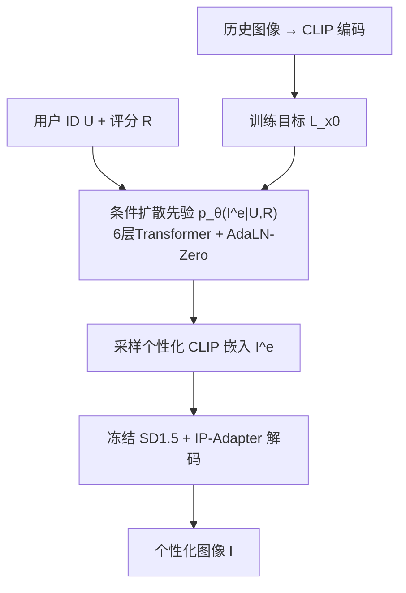
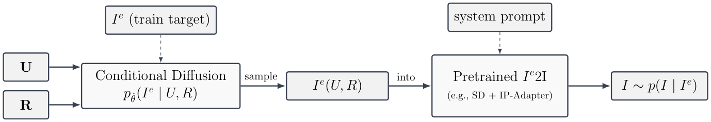

# Personalized Image Generation for Recommendations Beyond Catalogs (超越目录的推荐个性化图像生成)

- **会议/期刊**: RecSys 2025
- **作者与机构**: Gabriel A. Patron, Zhiwei Xu, Ishan Kapnadak, Felipe Maia Polo (University of Michigan)
- **推荐链路定位**: 端到端生成式（推荐信号 → 生成式内容）
- **研究方向**: 多模态推荐 / 生成式推荐
- **论文原文**: [论文原文链接](https://arxiv.org/abs/2502.18477v3)
- **开源代码**: [开源代码仓库链接](https://github.com/huggingface/peft)（仅复用 PeFT 工具，REBECA 本体暂未开源）

## TL;DR (1分钟核心速览)

现有扩散图像生成对用户多样性不敏感，而 PPD 依赖昂贵成对偏好标注、PMG 依赖 LLM 推理带来延迟。REBECA 提出两阶段免微调框架：先训练一个 4.4M 参数的轻量条件扩散先验，从用户 ID 与评分直接采样个性化 CLIP 嵌入，再用冻结的 SD1.5+IP-Adapter 解码成图。在 FLICKR-AES（210 用户、19.3 万评分）上，REBECA 的 Macro-F1@1 达 0.605，较最强基线 VLM Persona+LoRA 的 0.555 相对提升约 9%，且置换检验显示正确用户-图像配对得分高出随机近 5 个标准差（$p<10^{-3}$）。

## Background & Motivation (背景与核心矛盾)

- **主流范式**: 扩散模型个性化主要有两条路线——PPD 用成对偏好做 DPO 式微调，PMG 用 LLM 从行为轨迹推断偏好再转文本提示。
- **前人局限**: 其一，PPD 需每用户成对标注与反复 VLM 评估，且每次前向都要额外采样，难以扩展到大规模用户；其二，PMG 的 LLM 推理引入显著延迟，个性化被文本中介"稀释"，无法直接学习审美对齐。
- **核心洞察 (Key Insight)**: 用户隐式反馈（点赞/评分/点击）本质上在 CLIP 嵌入空间中划出了一块"偏好流形区域"，而 CLIP 空间具有平滑语义方向与良构流形，因此个性化可以完全在嵌入空间完成，无需触碰像素级生成器。
- **本文切入点**: 把个性化从"改生成器"降维成"学一个用户条件的嵌入先验"，生成器保持冻结、即插即用。

## Method (核心方法设计)

### 1. 整体框架 (Overall Architecture)

REBECA 将目标分布做链式分解 $p(I|U,R)=p(I^e|U,R)\,p(I|I^e)$：第一阶段用条件扩散先验$p_\theta(I^e|U,R)$在 CLIP 嵌入空间采样用户-评分特定的嵌入；第二阶段把该嵌入送入冻结的 SD1.5 + IP-Adapter 解码为图像。训练时仅需三元组$(U,R,I^e)$，图像经 CLIP-ViT-H-14 单次前向得到确定性嵌入；推理时给定用户 ID 与目标评分（实验中固定$R=1$ 表示强偏好）采样嵌入并解码。整个先验仅 6 层、8 头、隐维 128、32 个学习 latent token，单张 RTX-4090 上训练不足 10 分钟。

<figure class="paper-figure" markdown="span">
  <figcaption>图 2. REBECA 概览。训练：条件扩散先验被训练用于从用户 ID 和评分生成个性化图像嵌入。推理：生成的嵌入通过预训练图像解码器模型解码为图像。</figcaption>
</figure>

### 2. 关键设计拆解 (Key Designs)

1. **嵌入空间条件扩散先验（把个性化搬到 CLIP 空间）**：痛点在于像素级微调代价高且需成对偏好。本文改为对 CLIP 嵌入 $I^e\in\mathbb{R}^d$做标准前向扩散$q(I^e_t|I^e_0)=\mathcal{N}(\sqrt{\bar\alpha_t}I^e_0,(1-\bar\alpha_t)\mathbf{I})$，去噪网络直接预测干净嵌入：
$$\mathcal{L}_{x_0}(\theta)=\mathbb{E}_{I^e_0,U,R,t,\epsilon}\big[\|f_\theta(I^e_t,t,U,R)-I^e_0\|_2^2\big]$$
直觉是：用户偏好表现为嵌入空间中的连续区域，扩散先验天然适合建模多峰、多样的区域分布，且预测 $x_0$ 比预测噪声更稳定（消融中 sample-prediction 胜出）。

2. **免微调即插即用解码 + 双 CFG 控制**：生成器完全冻结，仅通过 IP-Adapter 的图像条件接口注入嵌入，因此同一先验可换任意同嵌入类的解码器。推理用 classifier-free guidance $f^{(s)}_\theta=f^{(0)}_\theta+\omega(f^{(1)}_\theta-f^{(0)}_\theta)$，其中$f^{(0)}$为$(\varnothing,\varnothing)$无条件分支；$\omega$ 越大个性化越强、多样性越低，形成可调的精度-召回旋钮。

3. **训练目标、负采样与推理效率**：总损失即上述 $x_0$ 重建损失，无负采样、无偏好对、无 RL 策略迭代；评分二值化为 like/dislike 两类条件。推理每用户 25 张图、50 步去噪、SD CFG=5，先验前向开销可忽略，瓶颈仅在冻结解码器。

## Experimental Setup & Evaluation Protocol (实验设置与评估协议)

- **数据集与预处理**:

| 数据集 | #Users | #Items | #Interactions | 稀疏度/密度 | 特征/场景说明 |
| :--- | :---: | :---: | :---: | :---: | :--- |
| dSprites（受控） | 4 | 4 类形状-颜色 | 40,000 | 90/10 划分 | 合成红/蓝心形与方块，评分按 0.95/0.10/0.05 概率规则生成 |
| FLICKR-AES | 210 | 40,988 | 193,208 | 每图 5 人评、人均约 920 条 | 真实美学评分 1–5，二值化为 $\ge 4$ 记 like |

- **数据划分与防穿越 (Splitting Strategy)**: 受控集 90/10 随机划分；FLICKR-AES 按用户-图像评分三元组划分训练/测试，验证器与生成模型使用同一训练集拟合（附录 E 用 bootstrap 证明验证器训练/测试 ROC-AUC 无统计差异，缓解泄漏担忧）。
- **排名评测协议 (Ranking Protocol)**: 采用 `Sampled Ranking`——在"喜欢+不喜欢"混合池中按余弦相似度检索真实 like，报告 Macro 平均 P@k/R@k/F1（$k\in\{1,5\}$）；另设个性化验证器分数$\text{Score}=\mathbb{E}_{\hat p}[\hat v(U,I)]$ 与置换检验。
- **对比基线与超参设置**: 基线含 Shared LoRA（rank 512 全体用户共享）、Per-user LoRA（按图量自适应 rank 8–128）、VLM Persona（LLaVA-1.5-7B 打标生成文本人设）、VLM Persona+LoRA；嵌入维 1024（CLIP-ViT-bigG），验证器为 Neural MF（ROC-AUC≈0.87），置换检验 $B=1000$、$\alpha=0.05$。

## Key Experimental Results (实验关键数据)

### 1. 主实验对比 (Main Results)

FLICKR-AES 上 210 用户 Macro 平均检索结果（加粗为最优）：

| 模型 | P@1 | R@1 | F1@1 | P@5 | R@5 | F1@5 |
| :--- | :---: | :---: | :---: | :---: | :---: | :---: |
| Shared LoRA | 0.455 | 0.718 | 0.540 | 0.471 | 0.991 | 0.623 |
| Per-user LoRA | 0.485 | 0.713 | 0.557 | 0.470 | 0.986 | 0.621 |
| VLM Persona | 0.507 | 0.685 | 0.556 | 0.472 | 0.983 | 0.621 |
| VLM Persona + LoRA | 0.511 | 0.673 | 0.555 | 0.475 | 0.986 | 0.626 |
| REBECA (CFG=3.0) | 0.524 | **0.767** | **0.605** | 0.478 | **0.997** | 0.630 |
| REBECA (CFG=5.0) | 0.556 | 0.714 | **0.605** | 0.478 | 0.989 | 0.629 |
| REBECA (CFG=9.0) | **0.605** | 0.610 | 0.575 | **0.484** | 0.972 | **0.631** |

受控 dSprites 上，REBECA 在 $k=1/5/10/20$的 Precision 稳定在 0.78–0.80，而随机基线仅约 0.29；均值原型基线虽 P=1.0 但完全丧失多样性（Recall 仅$0.214\times10^{-3}$）。

### 2. 消融实验 (Ablation Study)

| 配置 | 验证器分数 | LAION 美学分 | 结论 |
| :--- | :---: | :---: | :--- |
| 先验 CFG 3→9 | 0.70→0.80 上升 | 略降 | 个性化强度与保真度此消彼长 |
| SD CFG 1→10 | 轻微下降 | 5.25→5.75 上升 | 解码器 CFG 主要影响画质 |
| Prompt Level 0/1/2 | 无显著差异 | 无显著差异 | 个性化与文本提示解耦 |
| 预测目标（$\epsilon$/sample/$v$） | sample 最优 | — | 直接预测$x_0$ 最稳定 |

### 3. 关键实验发现 (Key Findings)

1. **个性化不是"更好看"的副产品**：置换检验中正确用户-图像配对得分比随机重配高出近 5 个标准差（$p<10^{-3}$），而验证器分数与 LAION 美学分的相关性仅$R^2=0.32$，说明 REBECA 捕获的是用户特异偏好而非通用审美。
2. **CFG 是精度-召回旋钮而非万能增益**：CFG 从 3 升到 9 时 P@1 由 0.524 升至 0.605，但 R@1 从 0.767 跌至 0.610，Macro-F1 在 CFG=3–5 处达峰 0.605，说明单一 CFG 无法同时最大化覆盖与命中。
3. **文本提示对个性化几乎无效**：三级 prompt（无/温和/强描述+负向）下验证器与 LAION 分数均无统计显著变化，反证个性化信号完全驻留于先验学到的用户条件嵌入分布，而非文本条件通路——这正是与 PMG 类文本中介方法的本质分野。

## Highlights & Limitations (亮点、对比与审稿批判)

- **与代表作对比 (vs. Prior Work)**: 相比 PPD，REBECA 彻底摆脱成对偏好标注与逐用户微调，训练成本从"每用户多次 VLM 评估+采样"降到"单卡 10 分钟一次训练"；相比 PMG，去掉 LLM 推理环节，个性化不再经文本中介；相比 Per-user LoRA，参数量与训练开销低数个量级却取得更高 F1。
- **可迁移亮点**: 其一，"在预训练编码器嵌入空间学条件先验 + 冻结解码器"的解耦范式可平移到音频/视频/跨模态生成；其二，slerp 球面插值可在嵌入空间构造用户对齐的连续编辑轴（图 7 显示偏好分随 $t$ 单调上升），为可控推荐提供新交互原语。
- **审稿级局限批判**: 其一，评估依赖 Neural MF 验证器作为偏好代理，存在 verifier shift 风险，且验证器与生成模型同源训练集，虽有 bootstrap 佐证仍非完全独立；其二，FLICKR-AES 仅 210 用户、评分二值化丢失序数信息，冷启动用户与大规模隐式反馈场景未验证，且生成需 50 步 SD 去噪，线上时延仍受解码器制约。

## Rating (四维评分)

- **方法创新性 (Novelty)**: ⭐⭐⭐⭐ （将个性化从生成器微调重构为嵌入空间条件先验采样，思路简洁且与 CLIP 流形性质自洽，但扩散先验本身非新算子）
- **评估协议与实验扎实度 (Protocol & Experiments)**: ⭐⭐⭐⭐ （提出验证器+置换检验的统计评估范式颇具价值，受控+真实双数据集完整，但真实集规模偏小、验证器独立性存疑）
- **写作与数学规范度 (Clarity & Rigor)**: ⭐⭐⭐⭐ （分解式与扩散损失推导清晰，超参网格与最终配置全公开，个别符号如 $f^{(s)}_\theta$与$f_\theta$ 混用略欠统一）
- **工业落地与复现价值 (Industrial & Practical Value)**: ⭐⭐⭐⭐ （4.4M 先验、单卡 10 分钟训练、冻结解码器即插即用，工程友好；但本体代码未开源、依赖 SD 多步采样限制实时性）

