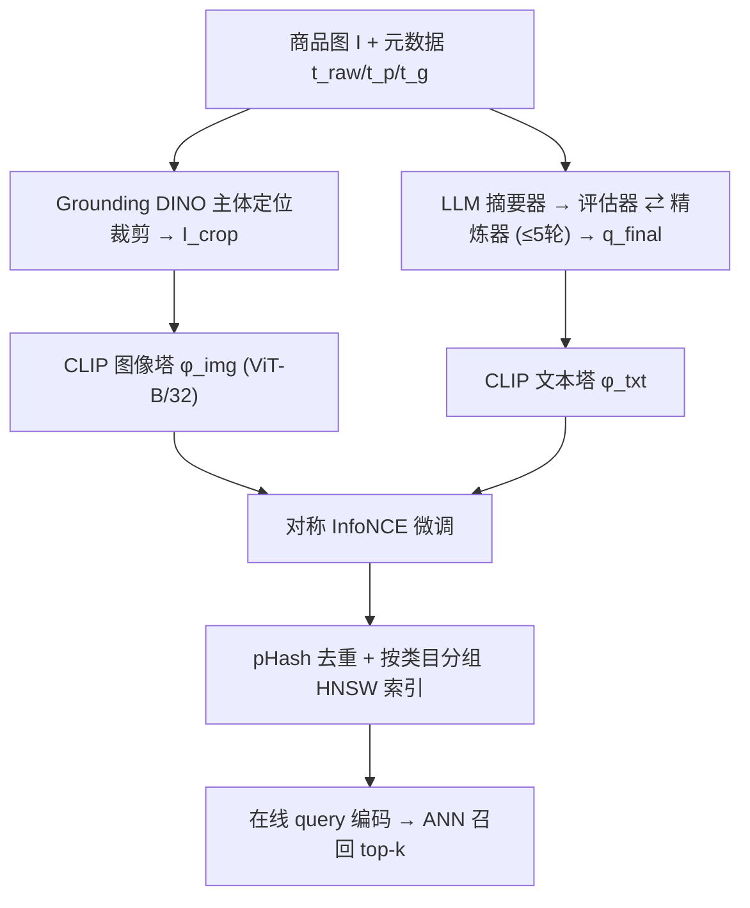

# VL-CLIP: Enhancing Multimodal Recommendations via Visual Grounding and LLM-Augmented CLIP Embeddings (基于视觉定位与 LLM 增强 CLIP 嵌入的多模态推荐)

- **会议/期刊**: RecSys 2025 (Walmart Global Tech 工业实践论文)
- **作者与机构**: Ramin Giahi, Kehui Yao, Sriram Kollipara, Kai Zhao, Vahid Mirjalili 等 (Walmart Global Tech)
- **推荐链路定位**: 召回 (图文双塔向量检索) + 相似商品推荐
- **研究方向**: 多模态推荐 / 大语言模型推荐
- **论文原文**: [https://arxiv.org/abs/2507.17080v1](https://arxiv.org/abs/2507.17080v1)
- **开源代码**: [https://github.com/marqo-ai/GCL](https://github.com/marqo-ai/GCL)（仅提供 Google Shopping 评测数据与 GCL 基线，VL-CLIP 本体未开源）

## TL;DR (1分钟核心速览)

电商场景下 CLIP 存在三大痛点：全局图像嵌入丢失商品细粒度属性、商品标题/描述冗长含噪导致文本语义模糊、通用域预训练与电商域严重失配。VL-CLIP 用 Grounding DINO 以商品类目为 prompt 定位并裁剪商品主体区域，再用「摘要器—评估器—精炼器」三 Agent 自反思循环把商品元数据改写成 20 词以内、仅含视觉可辨属性的结构化 query，最后在 700 万商品对上做对称 InfoNCE 微调。在 Walmart 时尚/家居各 1 万样本的图文检索上 HITS@5 从 FashionCLIP 的 0.4428/0.4227 提升至 0.6758/0.6692，线上四周 A/B 测试 CTR +18.6%、ATC +15.5%、GMV +4.0%。

## Background & Motivation (背景与核心矛盾)

- **主流范式**: 电商召回普遍采用 CLIP 类图文双塔，将商品图与标题/描述分别编码到共享空间后用 ANN 做向量检索；工业界进一步用领域数据微调（FashionCLIP）或引入排序信号（GCL）。
- **前人局限一（弱对象级对齐）**: CLIP 对整图做全局池化，背景道具、模特姿态、生活场景占据大量表征容量，两个仅纹理/搭扣不同的手袋在全局嵌入下几乎重合，细粒度属性被稀释。
- **前人局限二（文本表征歧义）**: 商品描述质量参差——有的堆砌 "free shipping"、"machine wash cold" 等非视觉噪声，有的极度稀疏；CLIP 文本编码器对长文本截断敏感，跨模态匹配被无关词干扰。
- **核心洞察 (Key Insight)**: 图文对齐的瓶颈不在编码器容量，而在**输入本身不干净**——图像里主体不突出、文本里视觉信号被非视觉信号淹没。因此"清洗输入"比"换更大模型"性价比更高。
- **本文切入点**: 在编码器之前插入两个数据侧净化模块（视觉定位裁剪 + LLM 视觉化改写），把 CLIP 微调变成"喂干净数据"的问题。

## Method (核心方法设计)

### 1. 整体框架 (Overall Architecture)

离线阶段对全库商品做三件事：先用 Grounding DINO 以元数据中的商品类目（如 "dress"、"backpack"）为文本 prompt 检测主体框并裁剪，得到 $I_{crop}$；再用 LLM 三 Agent 循环把拼接元数据$t_{concat}=[t_p\|t_g\|t_{raw}\|t_{in\text{-}context}]$改写为视觉化短 query$q_{final}$；随后以$(I_{crop}, q_{final})$为配对，用 ViT-B/32 图像塔与 Transformer 文本塔输出 512 维归一化嵌入做对称对比微调。在线阶段对 query 编码后在按商品类目分组的 HNSW 索引中检索 top-$k$，再进入下游排序。

### 2. 关键设计拆解 (Key Designs)

1. **视觉定位裁剪（Visual Grounding）**：痛点是用整图编码会把背景当信号。Grounding DINO 对图像 $I$生成$N$个候选框，框置信度按图文相似度 softmax 计算$s_i=\frac{\exp(\phi_{image}(v_i)\cdot\phi_{text}(P)/\tau_{DINO})}{\sum_{j=1}^{N}\exp(\phi_{image}(v_j)\cdot\phi_{text}(P)/\tau_{DINO})}$，取$i^*=\arg\max_i s_i$；若$s_{i^*}\ge\tau_{thresh}$则$I_{crop}=\text{Crop}(I,b_{i^*})$，否则保留原图以防误裁丢失上下文。直觉：用"商品是什么"这一先验把注意力强制锚定到主体，等价于给图像塔做了一次语义级 ROI 池化。

2. **LLM 三 Agent 自反思文本改写**：痛点是原始描述混入大量非视觉信息。摘要器先产出 $q_{init}$，评估器按三条准则（属性一致性、10–20 词简洁性、**仅保留视觉可辨属性**）打分并给出增/删/改写/缩短建议$e_i$，精炼器据此产出$q_i=\text{Refiner}(q_{i-1},e_i,t_{concat})$，遇 `<STOP>` 或$i_{max}=5$ 终止。关键在第三条准则：把 "quick-drying" 这类功能词剔除、只留 "striped"，使文本嵌入与图像模态的**信息交集最大化**，从源头降低跨模态噪声。

3. **训练目标与推理效率**：采用对称 InfoNCE，$\mathcal{L}_{CLIP}=-\frac{1}{2N}\sum_{i=1}^{N}\left[\log\frac{e^{v_i\cdot t_i/\tau}}{\sum_{j=1}^{N}e^{v_i\cdot t_j/\tau}}+\log\frac{e^{t_i\cdot v_i/\tau}}{\sum_{j=1}^{N}e^{t_i\cdot v_j/\tau}}\right]$，负样本为 in-batch 随机负采样（无显式难负样本挖掘）。工程侧用 pHash 去重、按商品类目分组建 HNSW 索引、多机 T4 分布式生成嵌入；6 个 epoch 早停（验证损失 0.38→0.28，Recall@10 达 47% 后回落）。

## Experimental Setup & Evaluation Protocol (实验设置与评估协议)

- **数据集与预处理**: 训练集为 Walmart.com 时尚+家居 700 万商品对（分层采样覆盖 500+ 商品类目）；评测集按 17 个商品类目（时尚 10 类、家居 7 类）各均衡采样，共 20,000 样本。预处理含图像归一化、HTML/特殊字符清洗、类目分层平衡。

| 数据集 | #Users | #Items | #Interactions | 稀疏度/密度 | 特征/场景说明 |
| :--- | :---: | :---: | :---: | :---: | :--- |
| Walmart Fashion (train) | — | ~7M 商品对 | 7M 图文对 | — | 时尚类目，含背景噪声图 |
| Walmart Home (train) | — | 同上 | 同上 | — | 家居类目 |
| Fashion eval | — | 10,000 | 10,000 图文对 | — | 10 个时尚子类均衡 |
| Home eval | — | 10,000 | 10,000 图文对 | — | 7 个家居子类均衡 |
| Google Shopping | — | 公开集 | — | — | 跨域零样本泛化 |
| Walmart Art / Toys | — | 零样本 | — | — | 跨类目零样本 |

- **数据划分与防穿越 (Splitting Strategy)**: 未明确报告训练/验证/测试的时间切分细节，评测集为独立采样的均衡子集；跨域实验采用**零样本划分**（Google Shopping、Art、Toys 均不参与微调）。
- **排名评测协议 (Ranking Protocol)**: 图文检索任务采用**全库候选排序**（每个 query 在评测集全部商品中排序），报告 HITS@5 与 MRR；另设 VLM-as-Judge 协议，用 GPT-4o 对 top-$k$ 结果打二值相关性，报告 Precision@1/3/5（query 检索 K=10，相似商品推荐 100 个锚点）。
- **对比基线与超参设置**: 基线为 CLIP (ViT-B/32)、FashionCLIP、GCL；嵌入维度 512，温度 $\tau$ 为可学习参数，训练 6 epoch 早停；未报告显著性检验。

## Key Experimental Results (实验关键数据)

### 1. 主实验对比 (Main Results)

图文检索（全库排序，HITS@5 / MRR）：

| Model | Fashion HITS@5 | Fashion MRR | Home HITS@5 | Home MRR |
| :--- | :---: | :---: | :---: | :---: |
| CLIP | 0.3080 | 0.2387 | 0.2355 | 0.1747 |
| GCL | 0.3992 | 0.2952 | 0.3104 | 0.2312 |
| FashionCLIP | 0.4428 | 0.3555 | 0.4227 | 0.3219 |
| **VL-CLIP** | **0.6758** | **0.5252** | **0.6692** | **0.5100** |
| Improv. vs 最强基线 | +52.6% | +47.7% | +58.3% | +58.4% |

VLM-as-Judge 评测（Precision@1）：

| Model | Query 检索 (Fashion/Home) | 相似商品推荐 (Fashion/Home) | Google Shopping Query | Google Shopping SI |
| :--- | :---: | :---: | :---: | :---: |
| CLIP | 0.3800 | 0.9719 | 0.3935 | 0.6161 |
| FashionCLIP | 0.5900 | 0.9813 | 0.7032 | 0.8298 |
| GCL | 0.4500 | 0.9813 | 0.4193 | 0.7759 |
| **VL-CLIP** | **0.8586** | **0.9925** | **0.8452** | **0.9294** |

零样本属性分类准确率：Neckline 0.937（FashionCLIP 0.881）、Pattern 0.959（FashionCLIP 0.934）。线上 A/B（四周、百万级交互）：CTR +18.6%、ATC +15.5%、GMV +4.0%。

### 2. 消融实验 (Ablation Study)

| Model Variant | Fashion HITS@5 | Fashion MRR | Home HITS@5 | Home MRR |
| :--- | :---: | :---: | :---: | :---: |
| w/o GD, w/o LLM | 0.4484 | 0.3570 | 0.4418 | 0.3471 |
| w/o GD（保留 LLM） | 0.5308 | 0.4176 | 0.5075 | 0.3929 |
| **Full VL-CLIP** | **0.6758** | **0.5252** | **0.6692** | **0.5100** |

### 3. 关键实验发现 (Key Findings)

1. **视觉定位是主增益来源**：去掉 GD 后 HITS@5 平均掉 15.34%、MRR 掉 11.23%，远大于再去掉 LLM 的额外 7.40%/5.32% 损失；说明电商图背景噪声是首要矛盾，裁剪带来的"主体聚焦"比文本改写更关键。
2. **两模块互补而非冗余**：仅 LLM 增强（w/o GD）已把 Fashion HITS@5 从 0.4484 拉到 0.5308，叠加 GD 后进一步跃至 0.6758，增益近似可加，印证"图像去噪 + 文本去噪"分别作用于两个模态输入端。
3. **工程优化贡献可量化**：pHash 去重使 MRR +7.2%，按商品类目分组的 HNSW 相比 IVF 索引使 Precision@1 +9%、延迟降低 81%；而模型侧 6 epoch 后 Recall@10 回落，说明噪声图文对下早停是必要手段。

## Highlights & Limitations (亮点、对比与审稿批判)

- **与代表作对比 (vs. Prior Work)**: 与 FashionCLIP 的本质区别在于后者只做领域微调、输入仍是脏数据；与 GCL 的区别在于后者把排序信号塞进损失函数，而本文完全不改损失结构，只在**数据侧**做净化——这是一条更轻、更易上线的路线。相较通用多模态推荐工作，本文的稀缺价值是千万级商品库的真实线上 A/B 验证。
- **可迁移亮点**: (1) "以类目名为 prompt 调 Grounding DINO 裁主体"这一零样本 ROI 方案可直接复用到短视频封面、二手商品图等场景；(2) "评估器强制只保留视觉可辨属性"的 prompt 准则，是把 LLM 改写对齐到跨模态任务的通用技巧。
- **审稿级局限批判**: (1) 评测集仅 2 万样本且为均衡采样，与真实长尾分布差异大，HITS@5 的绝对数值可能被高估；未报告显著性检验，也未给出 LLM 改写与 GD 裁剪的离线计算成本（700 万商品 × 最多 5 轮 LLM 调用开销可观）。(2) 消融只做了"全去掉"的粗粒度对比，缺少对 $i_{max}$、$\tau_{thresh}$、prompt 设计等超参的敏感性分析；VLM-as-Judge 用 GPT-4o 自评，存在与生成模型同源的偏好偏差风险。

## Rating (四维评分)

- **方法创新性 (Novelty)**: ⭐⭐⭐ （模块本身均为现成组件，创新在于"数据侧净化优先于模型侧改造"的系统性组合与电商场景验证）
- **评估协议与实验扎实度 (Protocol & Experiments)**: ⭐⭐⭐⭐ （全库排序 + VLM-as-Judge + 零样本跨域 + 线上 A/B 四重验证较完整，但缺显著性检验与超参敏感性分析）
- **写作与数学规范度 (Clarity & Rigor)**: ⭐⭐⭐ （流程与 prompt 交代清楚，但公式较浅、符号表冗余，缺少复杂度与成本分析）
- **工业落地与复现价值 (Industrial & Practical Value)**: ⭐⭐⭐⭐ （千万级商品全量部署、HNSW 分组索引与 pHash 去重的工程细节可直接借鉴，可惜 VL-CLIP 本体未开源）

