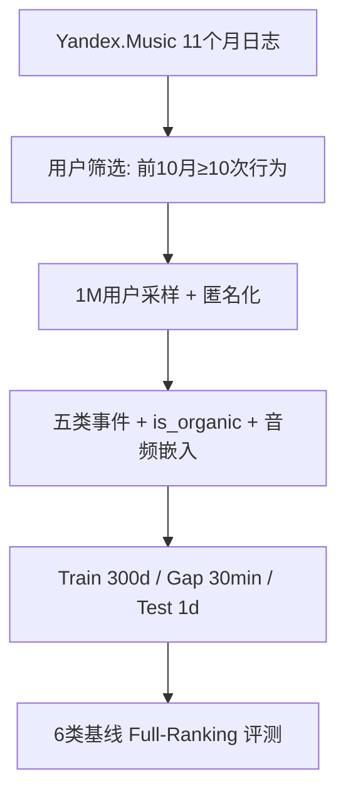

# Yambda-5B — A Large-Scale Multi-modal Dataset for Ranking And Retrieval (Yambda-5B：面向排序与检索的大规模多模态数据集)

- **会议/期刊**: RecSys 2025
- **作者与机构**: Alexander Ploshkin, Vladislav Tytskiy, Alexey Pismenny 等（Yandex 团队）
- **推荐链路定位**: 召回 / 排序（基准评测覆盖候选生成与排序两阶段）
- **研究方向**: 多模态推荐 / 序列推荐
- **论文原文**: [https://arxiv.org/abs/2505.22238v2](https://arxiv.org/abs/2505.22238v2)
- **开源代码**: 暂未开源（数据集发布于 HuggingFace `yandex/yambda`，基线代码见论文 GitHub 仓库）

## TL;DR (1分钟核心速览)

现有公开推荐数据集普遍存在「规模小、反馈单一、缺时间戳、无内容特征」四大短板，导致学术实验与工业实践严重脱节。本文发布 Yambda-5B：来自 Yandex.Music 的 4.79B 条交互、1M 用户、9.39M 曲目，含隐式收听与显式 like/dislike 双反馈、CNN 音频嵌入，以及关键的 `is_organic` 标志（区分自然行为与算法推荐驱动行为）。作者提出带 30 分钟 Gap 的 Global Temporal Split 评测协议，在 50M/500M/5B 三档规模上对 6 类基线做 Full-Ranking 基准，揭示 ItemKNN 与 SASRec 在 Listen+ 场景领先、而简单 DecayPop 在 Like 场景反超的工业级现象。

## Background & Motivation (背景与核心矛盾)

- **主流范式**: 推荐研究依赖 MovieLens、Amazon Reviews、Steam 等公开数据，模型从 MF 演进到 SASRec/BERT4Rec 等 Transformer 序列架构，但训练数据规模普遍停留在百万级。
- **前人局限**: ① MovieLens/Netflix 物品池仅万级、时间戳粗到「天」，无法支撑序列建模与冷启动研究；② Criteo 1TB 虽达 4B 规模却缺失用户/物品标识与时间戳，无法做序列分析；③ LFM-1b/2b、MLHD 虽大却因授权限制不可公开访问。
- **核心洞察 (Key Insight)**: 工业推荐系统的真实数据具备三个学术数据缺失的属性——**工业级规模**、**隐式+显式混合反馈**、**全局时间戳可切分**；更关键的是，平台日志中约 48.74% 的收听事件由推荐算法驱动，若不加区分地训练，模型会学到「推荐器自身的偏好」而非「用户真实偏好」。
- **本文切入点**: 用 `is_organic` 标志把自然行为与算法驱动行为解耦，配合音频嵌入与严格时间切分，构建一个「可复现工业条件」的公开基准。

## Method (核心方法设计)

### 1. 整体框架 (Overall Architecture)

Yambda 并非提出新模型，而是构建「数据—协议—基准」三位一体的评测基础设施。数据侧：从 Yandex.Music 采集约 11 个月日志，筛选前 10 个月至少 10 次目标行为、后续期至少 1 次行为的用户，随机采样 1M 用户，保留 Listen/Like/Dislike/Unlike/Undislike 五类事件，每条事件附 `is_organic`、`played_ratio_pct`、`track_length_seconds` 与 5 秒精度时间戳；曲目侧提供 CNN 对比学习生成的音频嵌入及 artist/album 映射。协议侧：采用 Train 300 天 + Gap 30 分钟 + Test 1 天的改进 GTS，测试期冻结全部模型参数与用户状态。基准侧：在 50M/500M/5B 三档子采样上跑 6 类基线并报告 NDCG/Recall/Coverage。

### 2. 关键设计拆解 (Key Designs)

1. **`is_organic` 交互归因标志（本文最核心增量）**：痛点在于平台日志中推荐驱动事件占比极高（Listen 48.74%、Dislike 48.47%、Like 42.30%），直接训练会让模型拟合推荐器曝光策略而非用户偏好。本文为每条事件打上二值 `is_organic`，使研究者可构造「仅自然行为」训练集或做曝光去偏分析。其价值在于把工业界心照不宣的「曝光偏差」问题第一次以显式字段形式开放给学术界，为因果去偏、反馈回路偏差传播研究提供了可操作的数据接口。

2. **改进型 Global Temporal Split 协议**：LOO 会破坏时间依赖（训练集可能含比测试集更新的事件），朴素 GTS 又会引入测试期「无历史用户」。本文取折中：训练 300 天、留 30 分钟 Gap 模拟工业「训练—部署」延迟、测试 1 天，并剔除测试期起始无历史的用户，同时冻结用户状态以近似「日级离线更新」系统。该协议把「防穿越」从口号变成可复现的工程规范。

3. **多粒度子采样与双格式存储**：按用户随机采样构造 5B/500M/50M 三档，使算力有限的研究者可做规模缩放实验；同时提供 Flat（逐事件元组表）与 Sequential（按时间排序的用户历史列表）两种格式，并以 Parquet 分发以兼容 Spark/Polars。时间戳统一做 $T'_{event}=\lfloor (T_{event}-T_{start})/5 \rfloor \times 5$ 的 5 秒对齐，兼顾隐私与序列精度。

## Experimental Setup & Evaluation Protocol (实验设置与评估协议)

- **数据集与预处理**: 用户筛选条件为前 10 个月 ≥10 次目标行为且后续期 ≥1 次行为；Listen+ 定义为收听时长 ≥ 曲目时长 50% 的正反馈。

| 数据集 | #Users | #Items | #Interactions | 稀疏度/密度 | 特征/场景说明 |
| :--- | :---: | :---: | :---: | :---: | :--- |
| Yambda-50M | 10,000 | 934,057 | 46.47M listens | 极稀疏 | 1/100 子采样，快速实验 |
| Yambda-500M | 100,000 | 3,004,578 | 466.51M listens | 极稀疏 | 1/10 子采样，中等规模 |
| Yambda-5B | 1,000,000 | 9,390,623 | 4.65B listens + 89.3M likes | 极稀疏 | 全量，工业级 |

- **数据划分与防穿越 (Splitting Strategy)**: `全局时间戳切分`（改进 GTS）：Train 300 天 / Gap 30 分钟 / Test 1 天，测试期冻结模型与用户状态，剔除测试期起始无历史用户。
- **排名评测协议 (Ranking Protocol)**: 无偏 `Full-Ranking`（全库未交互曲目排序），指标为 NDCG@{10,100}、Recall@{10,100}、Coverage@{10,100}；Coverage 定义为 $\text{Coverage@}k=\frac{|\bigcup_{u\in U}R(u,k)|}{|I|}$。
- **对比基线与超参设置**: 基线含 MostPop、DecayPop、ItemKNN、iALS、BPR、SANSA、SASRec 共 7 类；超参经 OPTUNA 以 NDCG 为目标在训练集末 1 天验证集上调优（SASRec 因算力限制未调参）；ItemKNN 与 SANSA 在 5B 规模因计算不可行而缺失。

## Key Experimental Results (实验关键数据)

### 1. 主实验对比 (Main Results)

**Listen+ 场景（Yambda-5B 全量）**：

| Model | NDCG@10 | NDCG@100 | Recall@10 | Recall@100 | Coverage@100 |
| :--- | :---: | :---: | :---: | :---: | :---: |
| MostPop | 0.0175 | 0.0239 | 0.0062 | 0.0313 | 0.0000 |
| DecayPop | 0.0271 | 0.0348 | 0.0130 | 0.0509 | 0.0000 |
| iALS | 0.0388 | 0.0628 | 0.0132 | 0.0816 | 0.0027 |
| BPR | 0.0408 | 0.0664 | 0.0141 | 0.0870 | 0.0508 |
| SASRec | 0.0647 | **0.0847** | 0.0289 | **0.1214** | 0.0456 |
| ItemKNN | — | — | — | — | — |

**Like 场景（Yambda-5B 全量）**：

| Model | NDCG@10 | NDCG@100 | Recall@10 | Recall@100 | Coverage@100 |
| :--- | :---: | :---: | :---: | :---: | :---: |
| MostPop | 0.0026 | 0.0084 | 0.0035 | 0.0238 | 0.0000 |
| DecayPop | 0.0165 | 0.0267 | 0.0281 | 0.0733 | 0.0000 |
| iALS | 0.0052 | 0.0207 | 0.0076 | 0.0626 | 0.0039 |
| BPR | 0.0071 | 0.0245 | 0.0106 | 0.0726 | 0.1141 |
| SASRec | **0.0136** | **0.0348** | 0.0217 | **0.1026** | 0.0547 |

### 2. 消融实验 (Ablation Study)

本文为数据集论文，无传统模块消融，但提供了**规模缩放实验**作为等价分析：

| 配置 | SASRec NDCG@10 (Listen+) | SASRec NDCG@10 (Like) | ItemKNN NDCG@10 (Listen+) |
| :--- | :---: | :---: | :---: |
| Yambda-50M | 0.0748 | 0.0100 | 0.0781 |
| Yambda-500M | 0.0754 | 0.0125 | 0.0708 |
| Yambda-5B | 0.0647 | 0.0136 | 不可行 |

### 3. 关键实验发现 (Key Findings)

1. **规模不总是带来增益，但反馈类型决定赢家**：SASRec 在 Listen+ 上从 50M 的 0.0748 降至 5B 的 0.0647（未调参所致），却在 Like 上从 0.0100 升至 0.0136；而 ItemKNN 在 50M 时 NDCG@10=0.0781 反超 SASRec，说明小规模下邻域方法仍具竞争力，序列模型优势需在显式反馈与大规模下才显现。
2. **简单方法在稀疏显式反馈上意外称王**：Like 场景中 DecayPop 的 Recall@100=0.0733 高于 iALS 的 0.0626 与 BPR 的 0.0726，仅略低于 SASRec 的 0.1026，表明显式反馈极度稀疏（Like 中位数仅 45 条/用户）时，时间衰减流行度是极强基线，复杂模型收益有限。
3. **覆盖率与准确率呈明显权衡**：BPR 在 Like 场景 Coverage@100=0.1141 远超 SASRec 的 0.0547，而 NDCG 却低一半以上；MostPop/DecayPop 覆盖率近乎 0，印证全库排序下流行度基线完全丧失多样性，为多样性/公平性研究提供了天然对照。

## Highlights & Limitations (亮点、对比与审稿批判)

- **与代表作对比 (vs. Prior Work)**: 相比 Amazon Reviews 2023（572M 交互但纯电商显式评论）与 Criteo（4B 但无 ID/时间戳），Yambda 同时满足规模、双反馈、时间戳、内容嵌入四要素；相比 LFM-2b（2B 但授权受限不可公开），Yambda 完全开放下载，是当前少数「可公开 + 工业级 + 多模态」的音乐推荐基准。
- **可迁移亮点**: ① `is_organic` 式的「交互归因字段」设计可直接迁移到短视频、电商等强推荐曝光场景，用于构造去偏训练集；② 带 Gap 的 GTS 协议可作为团队内部离线评测的标准化模板，避免 LOO 的时间穿越陷阱。
- **审稿级局限批判**: ① 仅覆盖单一平台（Yandex.Music）单一领域，音频嵌入由平台私有 CNN 生成、不可复现其训练过程，跨域泛化性存疑；② 5B 规模下 ItemKNN/SANSA 直接不可行、SASRec 未调参，基准公平性受损，且测试期冻结用户状态与真实实时系统仍有差距，可能低估在线更新类方法。

## Rating (四维评分)

- **方法创新性 (Novelty)**: ⭐⭐⭐ （数据集论文，核心创新在 `is_organic` 归因字段与改进 GTS 协议，非算法层面突破）
- **评估协议与实验扎实度 (Protocol & Experiments)**: ⭐⭐⭐⭐ （三档规模 × 双反馈 × 7 基线 × 5 指标，协议设计贴近工业，但大规模下部分基线缺失、SASRec 未调参）
- **写作与数学规范度 (Clarity & Rigor)**: ⭐⭐⭐⭐ （数据统计、文件 schema、时间戳变换公式交代清晰，规模对比表详实）
- **工业落地与复现价值 (Industrial & Practical Value)**: ⭐⭐⭐⭐⭐ （4.79B 交互完全公开、Parquet 分发、三档子采样降低门槛，是难得的可复现工业级基准）

