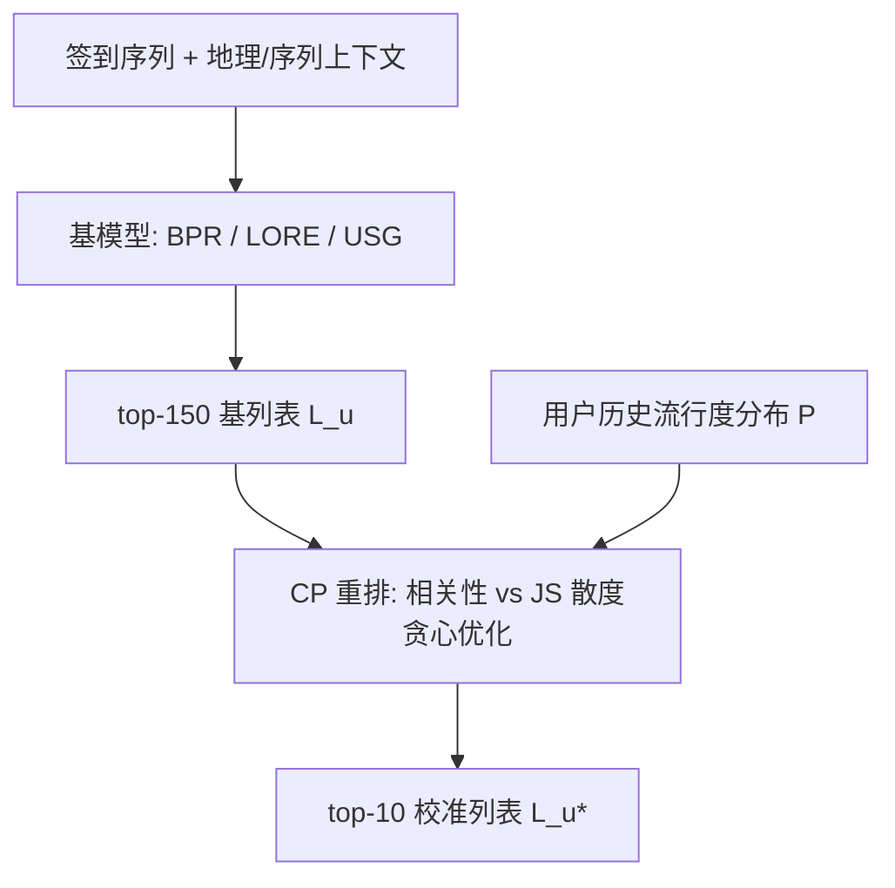

# Exploring the Effect of Context-Awareness and Popularity Calibration on Popularity Bias in POI Recommendations (上下文感知与流行度校准对POI推荐流行度偏差的影响探究)

- **会议/期刊**: RecSys 2025
- **作者与机构**: Andrea Forster, Simone Kopeinik, Denis Helic, Stefan Thalmann, Dominik Kowald (TU Graz / Know Center / University of Graz)
- **推荐链路定位**: 重排 (Re-ranking，作用于 top-150 基列表生成 top-10)
- **研究方向**: 时空轨迹与POI本地生活推荐 / 去偏公平与可信推荐
- **论文原文**: [论文原文链接](https://arxiv.org/abs/2507.03503v2)
- **开源代码**: [开源代码仓库链接](https://github.com/andreafooo/POI_RS_PopBias_Mitigation)

## TL;DR (1分钟核心速览)

本文针对 POI 推荐中热门地点垄断曝光、小众地点被系统性压制的问题，首次将校准流行度 (Calibrated Popularity, CP) 重排引入 POI 场景，并与两个上下文感知模型 LORE、USG 做独立与组合的系统评测。在 Brightkite/Foursquare/Gowalla/Yelp 四个真实签到数据集上，按用户流行度偏好分 LowPop/MedPop/HighPop 三组，采用用户级时间切分与 top-10 全库排序评测。核心结论：上下文感知并非一致解药（LORE 显著降偏但损精度，USG 反而加剧偏差），而 LORE+CP 组合在 Foursquare 上 nDCG 相对 LORE 提升 83.99%、PopLift 向 0 收敛 31.50%，是唯一能同时贴近用户画像尾部分布的方法。

## Background & Motivation (背景与核心矛盾)

- **主流范式**: POI 推荐依赖地理邻近、时间动态与社交连接等上下文特征提升个性化，代表作为 LORE（马尔可夫链+位置转移图）与 USG（用户/好友 CF + 朴素贝叶斯地理影响）；去偏侧则以 CP 重排为代表，通过调整推荐列表的头部/中部/尾部 (H/M/T) 分布匹配用户历史偏好。
- **前人局限**: 其一，CP 此前仅在电影、音乐域验证，从未在 POI 场景落地，也未与上下文感知模型联合考察；其二，上下文感知模型被普遍默认为"能提升多样性、缓解偏差"，但缺乏跨模型、跨数据集的定量反证。
- **核心洞察 (Key Insight)**: 作者按用户历史平均流行度将用户分为 LowPop/MedPop/HighPop 三组后发现，非上下文 BPR 系统性伤害 LowPop 用户（推荐流行度远超其画像），而不同上下文模型对偏差的作用方向可能完全相反——偏差缓解必须"分用户群"讨论，而非全局平均。
- **本文切入点**: 以 CP 的 $\lambda$ 分组网格搜索为杠杆，把"上下文感知"与"校准重排"两条独立路线放进同一评测框架，回答二者是否互补。

## Method (核心方法设计)

### 1. 整体框架 (Overall Architecture)

流程为：先用 RecBole 训练 BPR、用 CAPRI 训练 LORE/USG，为每个用户保留 top-150 基列表 $L_u$；随后 CP 重排模块以用户历史流行度分布$P$为目标，在相关性与分布相似度之间做加权贪心选择，输出 top-10 精排列表$L_u^*$。$\lambda$ 按用户组（LowPop/MedPop/HighPop）分别网格搜索，形成组特异去偏强度。最终在 nDCG、ARP、PopLift 三指标上同时衡量精度与偏差。

### 2. 关键设计拆解 (Key Designs)

1. **校准流行度重排 (CP Re-ranking)**：痛点在于基模型输出的 H/M/T 分布与用户真实偏好脱节。CP 将重排建模为带分布约束的子集选择问题，用 Jensen-Shannon 散度 $\Im(P,Q(L_u))$惩罚推荐分布$Q$与用户画像$P$ 的偏离：
$$L_u^* = \arg\max_{L_u,\,|L_u|=n}\Big((1-\lambda)\cdot \mathrm{Rel}(L_u) - \lambda\cdot \Im\big(P,Q(L_u)\big)\Big)$$
直觉上，$\lambda$ 越大越偏向"像用户本人"，越小越偏向"模型觉得相关"，从而把去偏强度显式外置为可调旋钮。

2. **分组 $\lambda$优化与两种校准目标**：全局单一$\lambda$会让 HighPop 用户被过度去偏、LowPop 用户去偏不足。作者按用户组分别调参，给出两种目标：$CP_H$最大化 nDCG 与$(1-\Im)$ 的调和平均
$$\lambda=\frac{\mathrm{nDCG}_g\cdot(1-\Im_g)}{\mathrm{nDCG}_g+(1-\Im_g)}$$
即"精度-校准折中版"；$CP_\Im$直接令$\lambda=1$，纯校准优先。前者用于验证"去偏不必牺牲精度"，后者用于探测校准上界。

3. **训练目标、负采样与推理效率**：本文不提出新训练损失，基模型沿用 BPR 的成对排序损失与 LORE/USG 原设定（200 epoch，验证集调 lr/embedding/batch）。CP 为免训练的后处理，仅需对 top-150 做贪心重排，单用户开销为 $O(n\cdot m)$级别的 JS 散度计算，在线可接受；但需注意$\lambda$ 网格搜索依赖验证集标签，存在一定调参成本。

## Experimental Setup & Evaluation Protocol (实验设置与评估协议)

- **数据集与预处理**: 四个公开签到数据集，为控制算力做了用户采样（正文仅报 Foursquare 与 Yelp，其余见 GitHub）：

| 数据集 | #Users | #Items | #Interactions | 稀疏度 | 特征/场景说明 |
| :--- | :---: | :---: | :---: | :---: | :--- |
| Brightkite | 600 | 794 | 15,341 | 96.78% | LBSN 签到，无社交边使用 |
| Foursquare | 1,500 | 2,804 | 69,401 | 98.35% | NYC/Tokyo 签到 |
| Gowalla | 1,500 | 7,579 | 53,679 | 99.53% | LBSN 签到 |
| Yelp | 1,500 | 4,515 | 35,288 | 99.48% | 商户点评签到 |

- **数据划分与防穿越 (Splitting Strategy)**: 采用**用户级时间切分**（user-based temporal split），每个用户按时间取 65%/15%/20% 为 train/valid/test，测试集为最近 20% 签到，严格防未来信息泄漏。
- **排名评测协议 (Ranking Protocol)**: 对每个用户生成 top-150 基列表后重排取 top-10，指标在**全库未交互候选**上计算（非采样排序），nDCG 衡量精度，ARP 与 PopLift 衡量推荐流行度及其相对用户画像的偏移（PopLift→0 为理想）。
- **对比基线与超参设置**: 基线为 BPR（非上下文）、LORE、USG（上下文），以及 BPR+$CP_H$、BPR+$CP_\Im$；显著性用 t-test 并做 Bonferroni 校正（$p<0.05$）。用户按平均画像流行度分 LowPop(20%)/MedPop(60%)/HighPop(20%)，物品按签到频次分 T(20%)/M(60%)/H(20%)。

## Key Experimental Results (实验关键数据)

### 1. 主实验对比 (Main Results)

RQ1（相对 BPR 的 Δ%，Foursquare / Yelp，All 组）：

| 方法 | nDCG↑ (FSQ) | ARP↓ (FSQ) | PopLift→0 (FSQ) | nDCG↑ (Yelp) | ARP↓ (Yelp) | PopLift→0 (Yelp) |
| :--- | :---: | :---: | :---: | :---: | :---: | :---: |
| BPR (绝对值) | 0.1060 | 0.0982 | 2.4906 | 0.0350 | 0.0074 | 2.0039 |
| LORE | -88.83%** | -93.44%** | -129.88%** | -31.70%** | -74.20%** | -110.34%** |
| USG | -11.13%** | +39.55%** | +82.08%** | +2.19% | -4.74%** | -9.93%** |
| BPR+$CP_H$ | -0.03% | -0.35%** | -0.52%** | +1.36% | -4.21%** | -11.68%** |
| BPR+$CP_\Im$ | -12.74%** | -17.44%** | -29.79%** | **-20.24%**** | **-31.24%**** | **-51.88%**** |

RQ2（上下文模型 + CP，相对各自 Base 的 Δ%）：

| 模型 | nDCG Δ% (FSQ All) | ARP Δ% (FSQ All) | PopLift Δ% (FSQ All) | nDCG Δ% (Yelp All) | ARP Δ% (Yelp All) | PopLift Δ% (Yelp All) |
| :--- | :---: | :---: | :---: | :---: | :---: | :---: |
| LORE+$CP_H$ | **+83.99%**** | +106.32%** | **+31.50%**** | **+21.79%** | +18.46%** | **+54.91%**** |
| LORE+$CP_\Im$ | +83.99%** | +106.32%** | +31.50%** | +18.77% | +19.29%** | +57.44%** |
| USG+$CP_H$ | -1.54% | -5.62%** | -10.23%** | +2.52% | -3.55% | -10.16%** |
| USG+$CP_\Im$ | -4.27% | -12.72%** | -20.39%** | -12.70% | -31.41%** | -53.49%** |

### 2. 消融实验 (Ablation Study)

本文为分析型工作，无传统模块消融，但通过"基模型 × 是否校准 × 校准目标"的因子化对比实现等效消融：

| 配置 | 偏差方向 | 精度代价 | 画像贴合度 |
| :--- | :--- | :--- | :--- |
| BPR 单独 | 强正偏（推荐远热于画像） | — | 差（T 严重缺失） |
| LORE 单独 | 强负偏（推荐冷于画像） | 高（FSQ nDCG -88.83%） | 中（T 过量） |
| USG 单独 | FSQ 极强正偏（LowPop 超画像 10 倍） | 中 | 差 |
| BPR+$CP_H$ | 轻度缓解 | 几乎无损 | 仅 LowPop 改善 |
| LORE+CP | 由负偏回调至近 0 | 反而提升精度 | **最优（唯一补齐 T）** |
| USG+$CP_\Im$ | 显著缓解 | 中等损失 | 中 |

### 3. 关键实验发现 (Key Findings)

1. **上下文感知不是一致解药，方向由模型决定**：LORE 在 Foursquare 上把 ARP 压低 93.44%、PopLift 压低 129.88%，但 nDCG 暴跌 88.83%；USG 在同一数据集上 ARP 反升 39.55%、LowPop 组推荐流行度达画像 10 倍以上。二者对偏差的作用符号相反，说明"上下文=多样性"的默认假设不成立。
2. **CP 的收益高度依赖 $\lambda$与用户组**：$CP_H$在 Foursquare 上几乎不损精度（-0.03%）却把 ARP 降 0.35%，但对 MedPop/HighPop 的分布贴合改善有限；$CP_\Im$把 Yelp 的 ARP 降 31.24%、PopLift 降 51.88%，代价是 nDCG 掉 20.24%——精度与去偏的帕累托前沿由$\lambda$ 显式刻画。
3. **LORE+CP 是唯一"精度与画像双赢"的组合**：Foursquare 上 nDCG 相对 LORE 提升 83.99%（0.0118→0.0218）、PopLift 向 0 收敛 31.50%，且在全部用户组中唯一能同时纳入足量 T 物品、使推荐分布贴近用户画像；而 USG+$CP_H$ 虽保精度（-1.54%）却仍残留较高偏差，印证"基模型偏差越强，校准越难完全纠偏"。

## Highlights & Limitations (亮点、对比与审稿批判)

- **与代表作对比 (vs. Prior Work)**: 相较 Abdollahpouri 等提出 CP 的电影域工作，本文首次把 CP 迁移到 POI 并揭示其与上下文特征的交互；相较 Rahmani 等宣称上下文感知可提升多样性的结论，本文用四数据集反证其方向不稳健；相较 Lesota 等的分组 $\lambda$思路，本文将其落到 POI 的用户流行度三分组并给出可操作的选型建议（重去偏选 LORE+CP，保精度选 BPR/USG+$CP_H$）。
- **可迁移亮点**: 其一，"基模型偏差方向 × 校准目标"的二维选型矩阵可直接复用到电商长尾、新闻多样性等场景；其二，按用户组分别调 $\lambda$ 的分组校准策略，是低成本提升去偏公平性的通用技巧。
- **审稿级局限批判**: 其一，实验仅用每数据集 600–1,500 用户的采样子集，且正文只报两个数据集，结论外推性受限；其二，CP 依赖 top-150 基列表，若基列表本身 T 物品缺失（如 BPR），校准无法"无中生有"，且 $\lambda$ 网格搜索与 JS 散度计算带来额外调参和在线开销，缺少延迟实测；其三，全文为离线指标分析，缺少用户研究验证"贴近画像"是否真的提升满意度。

## Rating (四维评分)

- **方法创新性 (Novelty)**: ⭐⭐⭐ （CP 与上下文模型的组合本身非新算子，创新在于首次系统刻画二者在 POI 场景的交互与反直觉结论）
- **评估协议与实验扎实度 (Protocol & Experiments)**: ⭐⭐⭐⭐ （四数据集、用户级时间切分、全库排序、分组显著性检验齐全，但正文仅展示两数据集且为采样子集）
- **写作与数学规范度 (Clarity & Rigor)**: ⭐⭐⭐⭐ （CP 公式与分组 $\lambda$ 定义清晰、指标方向标注规范，但缺少复杂度与调参开销的定量分析）
- **工业落地与复现价值 (Industrial & Practical Value)**: ⭐⭐⭐⭐ （代码与数据样本全开源、CP 为免训练后处理易插拔，但需注意基列表质量依赖与在线重排延迟）

