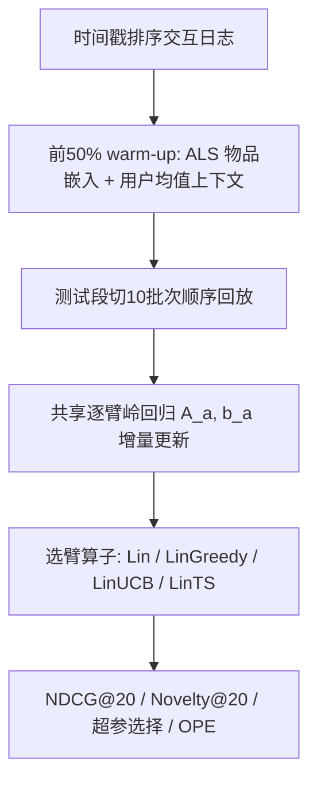
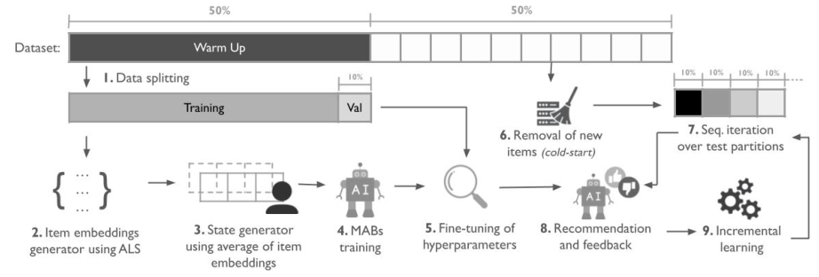

# Exploitation Over Exploration: Unmasking the Bias in Linear Bandit Recommender Offline Evaluation (利用压倒探索：揭穿线性 Bandit 推荐离线评估中的偏置)

- **会议/期刊**: RecSys 2025
- **作者与机构**: Pedro R. Pires, Gregorio F. Azevedo, Pietro L. Campos, Rafael T. Sereicikas, Tiago A. Almeida（巴西圣卡洛斯联邦大学 UFSCar）
- **推荐链路定位**: 召回（在线增量学习场景下的候选选择策略）
- **研究方向**: 强化学习与动态探索推荐 / 去偏公平与工业评测
- **论文原文**: [https://arxiv.org/abs/2507.18756v2](https://arxiv.org/abs/2507.18756v2)
- **开源代码**: [https://github.com/UFSCar-LaSID/exploit-over-explore](https://github.com/UFSCar-LaSID/exploit-over-explore)

## TL;DR (1分钟核心速览)

本文针对线性上下文 Bandit（CMAB）推荐中"离线回放评估能否真实反映探索策略价值"这一根本质疑，在 9 个公开数据集上统一协议对比 Lin（纯贪心）、LinGreedy、LinUCB、LinTS 四种共享线性回归骨干的算法。结果反直觉：无任何显式探索的贪心 Lin 在 56% 数据集上 NDCG@20 最优、89% 场景进入前二，超参搜索也一致收敛到最小探索配置；即便换用 IPW/DR 等 OPE 估计器，贪心仍全面领先。这量化证明了离线回放协议对探索存在系统性负偏置。

## Background & Motivation (背景与核心矛盾)

- **主流范式**: 线性 CMAB 以逐臂岭回归为共享骨干，LinGreedy（$\varepsilon$-greedy）、LinUCB（置信上界奖励）、LinTS（后验采样）仅在"如何把估计与不确定性转成选臂"上不同，是增量式推荐系统的标准组件。
- **前人局限**: ① 在线 A/B 成本高、有风险，离线回放（replay）成为事实标准，但日志奖励固定、算法推荐不改变用户行为，属被动反事实评估；② 探索策略的价值恰恰依赖"观察到日志策略未采取动作的反馈"，静态日志天然无法提供，导致探索收益被结构性抹除。
- **核心洞察 (Key Insight)**: 若探索真有效，随批次推进探索者应凭更丰富信息反超贪心；但实测累积 NDCG 曲线几乎平行，显式探索反而轻微掉点——说明协议在奖励"历史上被验证过的贪心选择"。
- **本文切入点**: 不做新算法，而是以统一可复现协议做大规模实证"审计"，把这一偏置从个案观察升级为可量化的系统性结论（前人 Rao 仅在更小规模、不同分析视角下有过类似观察）。

## Method (核心方法设计)

### 1. 整体框架 (Overall Architecture)

本文是评测方法论研究，核心"方法"是一套统一、可复现的离线基准流水线：数据按时间戳排序模拟连续环境，前 50% 作 warm-up 训练（其中 10% 划为验证集），后 50% 作测试；物品嵌入用 ALS 在 warm-up 上预训练，用户状态取历史消费物品嵌入均值作为上下文；测试段切成 10 个顺序批次，每批智能体推荐、接收反馈并增量更新线性模型。四种算法共享式 (1)–(4) 的逐臂增量岭回归，差异仅在选臂算子。

<figure class="paper-figure" markdown="span">
  <figcaption>图1：用于对模型进行基准测试的实验流程。</figcaption>
</figure>

### 2. 关键设计拆解 (Key Designs)

1. **共享骨干 + 差异化选臂算子（隔离探索变量）**：逐臂维护 $\mathbf{A}_a=\lambda\mathbf{I}_d$、$\mathbf{b}_a=\mathbf{0}_d$，观测后$\mathbf{A}_{a_t}\leftarrow\mathbf{A}_{a_t}+\mathbf{x}_{t,a_t}\mathbf{x}_{t,a_t}^\top$、$\mathbf{b}_{a_t}\leftarrow\mathbf{b}_{a_t}+r_{t,a_t}\mathbf{x}_{t,a_t}$，估计$\hat{\boldsymbol{\theta}}_a=\mathbf{A}_a^{-1}\mathbf{b}_a$（Sherman-Morrison 秩一更新支持实时学习）。四算法唯一区别在于：Lin 取$\arg\max_a \mathbf{x}_{t,a}^\top\hat{\boldsymbol{\theta}}_a$；LinUCB 加$\alpha\sqrt{\mathbf{x}_{t,a}^\top\mathbf{A}_a^{-1}\mathbf{x}_{t,a}}$置信奖励；LinTS 从$\mathcal{N}(\hat{\boldsymbol{\theta}}_a,\nu^2\mathbf{A}_a^{-1})$ 采样后贪心。这样任何性能差异都可干净归因于探索机制本身，而非模型容量。

2. **批次化顺序回放 + 累积曲线诊断**：把测试段切成 10 个 10% 批次而非一次性评估，绘制累积 NDCG@20 与 Novelty@20 曲线。这一设计使"探索是否随时间兑现长期收益"可被直接观察——若探索有效，曲线应出现发散；实测平行甚至下探，构成偏置存在的直接视觉证据。

3. **训练目标、负采样与推理效率**：无独立训练损失，本质是逐臂正则最小二乘（岭回归）的在线闭式更新，无需负采样；推理为每臂一次 $d$维内积（LinUCB/LinTS 额外一次二次型），$d\in\{32,64,128\}$，单步开销$O(|\mathcal{A}|d^2)$ 量级，可实时增量部署。

## Experimental Setup & Evaluation Protocol (实验设置与评估协议)

- **数据集与预处理**: 去除重复交互与同用户-物品冲突评分；Delicious 额外派生仅保留主 URL 的 Delicious-PU。

| 数据集 | #Users | #Items | #Interactions | 特征/场景说明 |
| :--- | :---: | :---: | :---: | :--- |
| Amazon Beauty | 631,986 | 112,565 | 701,528 | 电商美妆 |
| Amazon Books | 1,008,954 | 206,710 | 2,437,999 | 电商图书 |
| Amazon Games | 2,766,656 | 137,249 | 4,624,615 | 电商游戏 |
| BestBuy | 1,268,702 | 69,858 | 1,865,269 | 零售 |
| Delicious | 1,867 | 69,198 | 437,593 | 书签（稠密小用户集） |
| MovieLens-100K | 943 | 1,682 | 100,000 | 电影（稠密小库） |
| MovieLens-25M | 162,541 | 59,047 | 25,000,095 | 电影（大规模） |
| RetailRocket | 1,407,580 | 235,061 | 2,755,641 | 电商行为 |

- **数据划分与防穿越 (Splitting Strategy)**: 全局时间戳排序后 `50%/50%` 切分（warm-up / test），warm-up 内再留 10% 作验证；测试段按时间切 10 个顺序批次。ALS 非增量预训练，测试中涉及未见物品的交互被剔除（防穿越）。
- **排名评测协议 (Ranking Protocol)**: 全库候选打分（每轮对全部臂打分取 top-20），指标 NDCG@20 与 Novelty@20（式 10：$\text{Novelty}=\sum_{i\in I}\log_2 pop(i)/|R|$，值越高越不流行）；显著性用双尾 Bonferroni-Dunn 检验（90% 置信，$CD=1.29$）。
- **对比基线与超参设置**: 四算法同骨干；LinUCB 的 $\alpha$、LinTS 的$\nu^2$搜$\{0.10,0.50,1.00,1.50,2.00\}$，LinGreedy 的$\varepsilon$搜$\{0.01,0.05,0.10,0.25,0.50\}$；ALS 隐维/正则/迭代数分别搜$\{32,64,128\}$/$\{32,64,128\}$/$\{5,15,30\}$，按 top-20 NDCG 选优。实现基于 `implicit` 与 `Mab2Rec`。

## Key Experimental Results (实验关键数据)

### 1. 主实验对比 (Main Results)

NDCG@20（加粗为该数据集最优）：

| 数据集 | Lin | LinUCB | LinGreedy | LinTS |
| :--- | :---: | :---: | :---: | :---: |
| Amazon Beauty | 0.00342 | **0.00346** | 0.00342 | 0.00341 |
| Amazon Books | 0.01525 | 0.01512 | 0.01509 | **0.01527** |
| Amazon Games | **0.00483** | 0.00475 | 0.00477 | 0.00480 |
| BestBuy | **0.02923** | 0.02902 | 0.02885 | 0.02915 |
| Delicious | **0.08634** | 0.08596 | 0.08573 | 0.08385 |
| Delicious-PU | **0.05055** | 0.05033 | 0.05006 | 0.04794 |
| MovieLens-100K | 0.03900 | 0.04013 | 0.03958 | **0.04021** |
| MovieLens-25M | **0.01332** | 0.01302 | 0.01321 | 0.01269 |
| RetailRocket | 0.00614 | 0.00594 | 0.00607 | **0.00617** |

OPE 估计（Open Bandit Pipeline）：

| Estimator | Lin | LinUCB | LinGreedy | LinTS |
| :--- | :---: | :---: | :---: | :---: |
| IPW | **0.01637** | 0.01270 | 0.01509 | 0.01176 |
| DM | **0.00403** | 0.00401 | 0.00383 | 0.00381 |
| DR | **0.01623** | 0.01499 | 0.01458 | 0.01182 |

### 2. 消融实验 (Ablation Study)

本文无传统模块消融，其"消融"等价于**探索强度超参扫描**（表 4，越深色越偏利用）：

| 数据集 | LinUCB $\alpha$| LinGreedy$\varepsilon$| LinTS$\nu^2$ |
| :--- | :---: | :---: | :---: |
| Amazon Beauty | 0.10 | 0.01 | 0.10 |
| Amazon Books | 0.10 | 0.01 | 0.50 |
| Amazon Games | 0.10 | 0.01 | 0.50 |
| BestBuy | 0.10 | 0.01 | 0.10 |
| Delicious | 0.10 | 0.01 | 0.50 |
| Delicious-PU | 0.10 | 0.01 | 1.00 |
| MovieLens-100K | 0.10 | 0.01 | 0.10 |
| MovieLens-25M | 0.10 | 0.01 | 1.00 |
| RetailRocket | 0.10 | 0.01 | 0.10 |

### 3. 关键实验发现 (Key Findings)

1. **贪心近乎全面占优**：Lin 在 56% 数据集 NDCG@20 第一、89% 进入前二，且经 Bonferroni-Dunn 检验以 90% 置信显著优于 LinGreedy；探索者仅在 Amazon Beauty（LinUCB）、Amazon Books 与 RetailRocket（LinTS）上以极小幅度反超（如 Books 上 0.01527 vs 0.01525，差距仅 0.00002）。
2. **超参搜索一致倒向零探索**：LinUCB 在全部 9 个数据集均选最小 $\alpha=0.10$，LinGreedy 全部选最小$\varepsilon=0.01$；LinTS 虽在 5 个数据集选较大$\nu^2$，但此时其 NDCG 往往垫底（如 Delicious-PU 选$\nu^2=1.00$ 却仅 0.04794，为全表最低），说明"探索被选中"与"探索有效"并不等价。
3. **OPE 与多样性均无法翻案**：即便用专为纠偏设计的 IPW/DR，Lin 仍全面领先（DR 下 0.01623 vs LinTS 0.01182，相对高约 37%）；Novelty 与 NDCG 呈明显负相关（如 LinGreedy 在 Amazon Books/Games、LinTS 在 Delicious-PU/ML-25M 上新颖性升而精度降），说明探索换来的多样性未转化为可被协议认可的质量。唯一例外 MovieLens-100K 因用户活跃度阈值导致交互稠密、物品库仅 1682 个，探索"成本"低，四探索模型均超 Lin。

## Highlights & Limitations (亮点、对比与审稿批判)

- **与代表作对比 (vs. Prior Work)**: 相较 LinUCB/LinTS 原始论文关注 regret 界与在线收益，本文指出这些理论优势在 replay 协议下不可见；相较 Rao 的小规模观察，本文以 9 数据集、统一协议、含 OPE 与超参搜索的完整证据链首次大规模量化该偏置；相较 IPW/DR 等 OPE 工作，本文实证表明即便纠偏估计器也未能消除利用偏置。
- **可迁移亮点**: ① "共享骨干 + 只变选臂算子"的受控对比范式，可直接迁移到任何宣称某模块有效的推荐消融设计；② 批次化累积曲线 + 超参选择分布双证据，是审计评测协议偏置的通用模板。
- **审稿级局限批判**: ① 仅覆盖线性骨干，未验证神经 CMAB 或 slates 场景下结论是否成立；② 物品嵌入非增量预训练且剔除未见物品交互，可能人为压低探索上限；③ 未给出替代协议的定量方案（模拟器仅作定性讨论），"揭示问题"强于"解决问题"。

## Rating (四维评分)

- **方法创新性 (Novelty)**: ⭐⭐⭐ （无新算法，但以受控实证把"离线评估偏袒利用"从轶事升级为可量化结论，方法论价值明确）
- **评估协议与实验扎实度 (Protocol & Experiments)**: ⭐⭐⭐⭐ （9 数据集、统一时序切分、Bonferroni-Dunn 显著性、超参扫描与三种 OPE 交叉验证，证据链完整）
- **写作与数学规范度 (Clarity & Rigor)**: ⭐⭐⭐⭐ （四算法公式统一记号清晰、差异点一目了然，实验流程可复现性强）
- **工业落地与复现价值 (Industrial & Practical Value)**: ⭐⭐⭐⭐ （代码全开源、基于 implicit/Mab2Rec 易复现，直接警示工业界勿以 replay 结果选探索策略）

